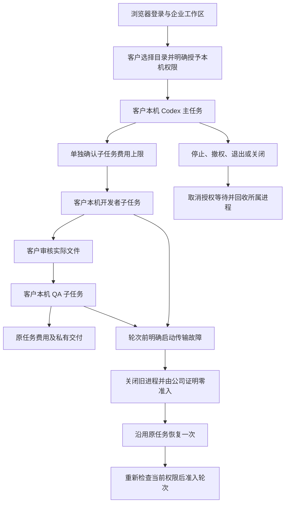

# Desktop 父子流程的恢复与取消 / Desktop workflow recovery and cancellation

客户主动授权后，主任务、开发者子任务与 QA 子任务均由客户电脑上的固定版本 Codex 执行。公司服务继续负责登录、当前权限、模型网关、预算与费用。Web 和 Extension 的云端执行分工保持其既有约定。

The parent, developer child and QA child execute through the pinned customer-local Codex after explicit customer consent. Company services retain identity, current authority, inference gateway, budgets and accounting. The existing Web and Extension execution contracts still apply.

## 本次修复 / Change

原来在停止或完成任务时，控制器会等待后台保活请求结束；如果请求不响应取消，任务可能一直停留在收尾。现在主任务与每个子任务分别管理其后台保活的生命周期，停止保活时同时取消正在等待的授权请求，并等待该观察器退出。即使底层请求忽略取消，控制器也能结束等待；迟到的响应不能继续启动或执行工作。

Previously, task shutdown waited for an outstanding background authority heartbeat. An unresponsive transport could keep cleanup waiting. Each parent and child now owns a separate heartbeat lifetime. Retiring it cancels its outstanding authority wait and drains that watcher. An uncooperative underlying request cannot keep the controller waiting or resume work when its response eventually arrives.

正常完成仅停止该后台观察器；不会因此取消父任务。提交本机轮次前仍必须进行新的身份、本机授权和公司权限检查。客户撤权、退出登录、停止工作或关闭应用，则取消实际执行并回收所属原生进程。费用同步继续使用原任务和原请求键；不能把网络中止解释为零费用、成功退款或可以重做本机副作用。

Normal completion retires the background watcher without cancelling its parent. Fresh identity, local consent and company checks are still mandatory before native turn admission. Withdrawal, logout, stop and close cancel execution and reclaim owned processes. Accounting retains the original task and request identity; a network interruption does not prove zero usage, refund eligibility or permission to replay local side effects.

## 恢复边界 / Recovery boundary

沿用[阶段128协议](128-desktop-startup-recovery.md)：每个任务最多两次启动，只能恢复轮次准入前已分类的传输故障；公司必须持久证明没有模型、输入计数、公司工具或轮次准入。原任务、预算预留、执行截止和 worker attempt 保持不变。已经执行、结果未知或不能证明旧进程已关闭的工作均禁止自动重放。

The [Stage128 protocol](128-desktop-startup-recovery.md) permits at most two launches per task, only for classified transport failures before turn admission. Durable company proof must show zero model, input-count, tool and turn admissions. The original task, reservation, deadline and worker attempt remain. Accepted, unknown or unprovenly reclaimed work cannot replay automatically.

## 当前原生联调 / Current native integration

109项控制层检查及43项真实固定版本Codex检查通过；当前主进程和渲染层编译通过。三个完整原生父子流程也已通过，使用实际 PostgreSQL、公司 API、Codex 进程、本机命令及文件；模型回答、客户选择和注入的网络故障是明确的测试输入。

109 controller checks, 43 actual pinned-Codex checks and current main/renderer compilation passed. Three complete native parent/child journeys also passed against actual PostgreSQL, company APIs, Codex processes, shell commands and files. Model answers, customer choices and injected transport faults are explicit test inputs.

| 编号 / No. | 已验证流程 / Qualified journey | 实际结果 / Actual result |
| --- | --- | --- |
| 1 | 两个子任务分别在 initialize 与 thread/start 故障后恢复 / Both child startup recovery stages | 两个原任务各恢复一次；5个所属进程全部退出；每个子任务费用60 micros；保留原预算与截止 / Each original child recovers once; all five owned processes close; 60 micros per child with original holds/deadlines. |
| 2 | QA启动时公司已接收保活，但响应一直不返回；客户撤权 / Withdrawal during a withheld accepted heartbeat | 324ms内完成撤权收尾；QA没有执行文件操作或新增模型请求；已完成开发者60 micros、QA零费用 / Withdrawal drains in 324ms; QA admits no new model/file work; completed developer costs 60 micros and QA zero. |
| 3 | 相同保活响应卡住，但允许QA继续并正常完成 / Normal completion with the same stalled heartbeat | 两个子任务完成实际文件操作，父任务成功；释放迟到响应不再产生模型请求 / Both actual child file operations and the parent finish successfully; releasing the late response admits no new inference. |

实际未签名Electron包的8项界面检查也已通过：登录、授权、两次子任务恢复、实际文件审批、原费用、三份私有交付下载、双语重载及三个原生窗口宽度。四张真实截图及119秒GIF/MP4已归档，645个观测帧、37个不同帧、零捕获错误；所属浏览器、Electron、API、PostgreSQL及临时夹具全部关闭。2204项当前源码和6项媒体按哈希绑定，6947条原始证据去重保存为2104个原始字节文件。

Eight actual unsigned packaged-Electron checks also passed, including sign-in, explicit consent, two recovered children, actual file review, original receipts, three private downloads, bilingual reload and three native widths. Four screenshots and a 119-second GIF/MP4 retain 645 observed frames, 37 distinct frames and zero capture errors. Owned browser, Electron, API, PostgreSQL and fixtures close. Hash bindings cover 2204 current sources and six media files; 6947 original evidence entries retain 2104 unique byte blobs. See the [checkpoint](../quality/workflow-recovery-checkpoint-130.json), [evidence index](../quality/workflow-recovery-evidence-130/index.json) and [incremental publication manifest](../quality/workmate-publication-130.json). Actual remote publication is established by its final push receipt and SHA readback.

## 持续开放的范围 / Remaining scope

全部崩溃检查点、多节点组合、所有本机工具、全部专业角色与团队、正式模型、签名安装及生产部署继续开放。子任务完成回执丢失后的持久补交与完整父子费用核对仍需继续完善；本次不把“进程已经结束”当作“公司费用状态已经确定”。完整编号见[完整编号待办](../quality/remaining-work-stage130.md)，后续检查点逐项更新已验证范围。

Arbitrary crash checkpoints, multi-node combinations, all local tools, complete professional roles/teams, live providers, signed installation and production deployment remain open. Durable resubmission after a lost child finish receipt and complete parent/child accounting reconciliation still need work. Process exit does not establish a known company accounting outcome. The [numbered current ledger](../quality/remaining-work-stage130.md) retains full acceptance boundaries.
