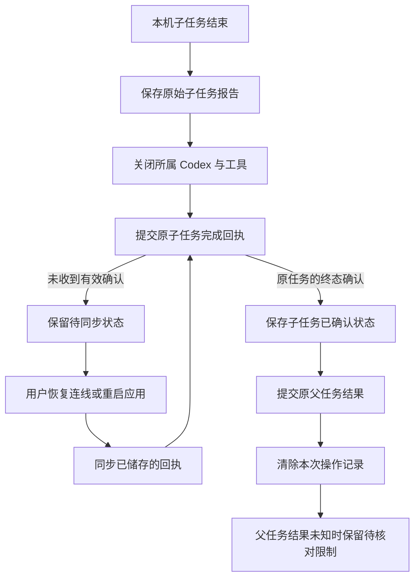

# Desktop 本机结果与费用回执持久同步 · 阶段131

本轮处理一个具体缺陷：本机子任务已经完成、结果已写入日志，但公司完成接口未收到请求或其响应丢失时，父任务的收尾可能清掉整个操作记录，导致子任务回执失去补交入口。

当前实现把子任务完成确认作为父任务完成确认的前置条件。待同步期间保留原任务、原报告和原请求标识；用户重试只补交回执。结果未知的父任务继续等待核对，不因子任务成功而推定整个流程成功。

| 编号 | 实现约束 | 失败或撤权后的行为 |
| --- | --- | --- |
| RCPT-01 | 子任务报告先持久保存，再提交公司接口 | 未确认前不清理父操作，不开始下一步 QA |
| RCPT-02 | 沿用子任务 UUID、完整报告和稳定完成请求标识 | 服务端已接收但响应丢失时，重试取得原结果 |
| RCPT-03 | 完成确认必须属于原任务，且状态组合为有效终态 | 错任务、运行中或格式异常的成功响应均不能清理待同步记录 |
| RCPT-04 | 每次公司写入前后核对原账号和本机登录代次 | 切换账号或使当前控制器失效后，不继续提交父任务 |
| RCPT-05 | 费用回执同步不要求有效的本机工具授权 | 撤销或过期的本机授权仍可保持撤销状态并同步结果 |
| RCPT-06 | 同步不调用运行时工厂、推理、工具或流程推进接口 | 不重跑命令、不建立 QA、不建立新预算预留 |
| RCPT-07 | 恢复出的未报告子任务只能报告 unknown | 先取消原任务权限，再报告未知结果；不生成成功文本 |
| RCPT-08 | 子任务确认后先持久保存 finished 检查点 | 父任务回执再次丢失时，不重复发送已经确认的子任务 |

`LocalAgentController.settleWorkflowReport` 是正常子任务收尾和父任务恢复共用的同步入口。原始报告保存在既有本机日志的 `operation.workflow.report` 中。父任务 `settleReport` 只有在子任务确认成功后才能提交并清理自己的记录；同步入口只提交报告。

重新打开日志时，原先处于 `native_running` 的父任务转为未知结果。已保存的子任务报告完整保留；没有报告的未结束子任务补记为未知。这个恢复入口用于防重放，不等于已经验证任意进程崩溃或所有旧进程回收场景。

费用继续以公司数据库实际观测为准。已知成功的子任务结算一次并释放其剩余预算；未知父任务保留原预留、进入 `reconciling`，等待账务核对。回执同步成功不代表未知父任务已经结算，也不会解除未知副作用限制。

界面增加中英双语待同步说明和“同步已储存的回执 / Sync saved receipts”操作。该操作在本机授权撤销后仍可使用；完整账号退出、登录族变化、企业访问撤销等情况继续遵守服务端权限，不承诺绕过这些限制。

验证范围、原始失败、对应源码、实际安装包页面与交互媒体以[检查点](../quality/receipt-sync-checkpoint-131.json)和[原始证据索引](../quality/receipt-sync-evidence-131/index.json)为准。[编号待办](../quality/remaining-work-stage131.md)继承全部原始完整验收记录。

当前交付仍需推进任意崩溃和旧进程回收、换登录族后的人工处理、完整父任务核对、全部角色与业务组合、正式模型/媒体接入、签名安装更新及全平台验收。本轮使用测试模型响应；真实模型质量和生产计费尚未验收。

English: A saved native child result must receive a valid acknowledgement before its parent operation can be cleared. Retry sends the original report for the original task and starts no native turn or model request. Local access can remain revoked. The known child settles once; an unknown parent retains its original hold for reconciliation. Qualified restoration does not establish arbitrary crash recovery, cross-login-family handoff or whole-platform acceptance.
