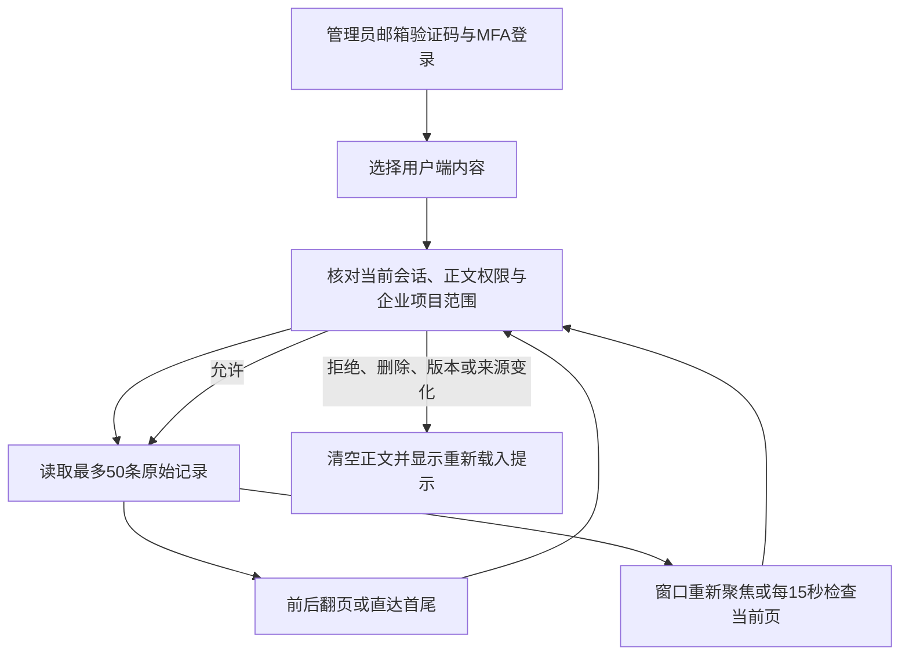

# 后台完整内容历史 · 阶段132

管理员可以从「用户端内容」进入会话、专家和记忆的完整历史，每页最多50条。会话按原始消息顺序显示；专家和记忆从最新版本开始，保留原始版本、时间和客户／管理员修订来源。管理员阅读和修订采用各自权限，阅读不创建任务、不运行模型、不预留费用。

本轮确认的缺口是：专家和记忆的旧正文接口只返回前200版，页面没有继续查看入口。普通会话仍有80条用户输入限制；本轮使用66条实际API消息验证翻页，没有宣称解除该限制，也没有把普通会话描述成已复现的200条截断故障。

| 编号 | 规则 | 实现和边界 |
| --- | --- | --- |
| HIST-01 | 完整、有限读取 | 三类内容共用历史接口，每页50条，以51条查询判断是否还有下一页；不一次加载全部正文。 |
| HIST-02 | 稳定顺序 | 会话按数据库时间与UUID升序；版本按版本号降序。游标保留6位微秒，避免同毫秒或同时间的消息漏读、重复。 |
| HIST-03 | 游标不可移用 | HMAC签名绑定操作者、会话、权限代次、内容种类及ID、版本、审核版本、历史修订号和方向。有效期30分钟，继续翻页不延长原链期限。 |
| HIST-04 | 当前权限优先 | 每页重新核对有效后台会话、MFA和两项正文读取权限。企业／项目范围取内容归属，显式拒绝优先；游标不能绕过撤权。 |
| HIST-05 | 并发变化可见 | SQL134为会话增加单调历史修订号，消息新增、修改、删除后递增，禁止直接倒退。内容或审核版本变化使旧游标返回409，要求重新读取。 |
| HIST-06 | 来源不可用时隐藏 | 经过后台权限校验后，按原企业和项目核对助手结果的任务来源；来源被隔离后，正文返回空值并标记不可用。客户消息原文按既有授权规则读取。 |
| HIST-07 | 不把客户权限上下文用于后台 | 后台使用显式企业／项目参数核对来源；不伪造客户身份，不依赖后台事务中不存在的客户会话变量。 |
| HIST-08 | 删除后的历史不恢复 | 已删除内容返回410；记忆删除沿用既有历史正文及定义快照清除规则。隔离和归档内容仍可在有权限时供后台调查。 |
| HIST-09 | 页面不保留私密正文 | 只在组件内存保留当前页。换对象、换账号、关闭窗口、请求失败或权限失效时清空，取消旧请求并拒绝迟到响应；不写入浏览器存储。 |
| HIST-10 | 可见页面复查 | 页面可见时每15秒复查当前页，聚焦和恢复可见时也复查。检查完成后清空变化的正文；该机制不承诺网络通知尚未到达前瞬时清除。 |
| HIST-11 | 保留原文和来源 | HTML作为普通文本显示；专家完整版本及记忆定义可展开查看。管理员独立修订明确标注，不能冒充客户版本。 |
| HIST-12 | 兼容旧接口 | 旧正文接口保留原字段，三类内容增加`truncated`和`history_url`。仍最多返回200条，完整读取应使用新接口。 |

接口为`GET /v1/admin/content/{kind}/{id}/history`，`kind`仅允许`conversations`、`agents`、`memories`。首次可省略查询参数或使用`edge=first`；直达另一端使用`edge=last`；之后仅传服务器返回的`cursor`。不接受自定义页大小、同时传edge和cursor或未知字段。

响应包含`id`、`kind`、`name`、字符串类型的`history_revision`、`version`、`moderation_version`、固定`page_size:50`、`items`以及可空的`previous_cursor`和`next_cursor`。消息条目保留ID、角色、意图、任务ID、时间及正文，另有`source_unavailable`。版本条目保留版本号、正文、时间及`origin:customer|administrator`；记忆另保留当时的`definition`。响应使用`Cache-Control:no-store`。审计只记内容种类、页内条数和方向，不记录正文或游标。

错误语义：参数或不匹配的游标400；无有效后台会话401；缺少权限或范围被拒绝403；资源不存在404；内容／审核／历史变化或游标过期409；内容已删除410。所有页均执行当前权限检查；这些状态不赋予查询其他企业或项目的权限。

界面继续使用现有CopyPaste后台字体、颜色和组件，支持中英文本、键盘关闭和窄屏按钮换行。后台长历史可以纵向浏览；Desktop的无边框、本机执行和无可见滚动条要求仍由其原生界面验收，不能用后台浏览器验证替代。

验证以[需求细则](../requirements/09-admin-content-history.md)、[检查点](../quality/content-history-checkpoint-132.json)、[原始证据](../quality/content-history-evidence-132/index.json)和[编号待办](../quality/remaining-work-stage132.md)为准。测试使用真实原生PostgreSQL、HTTP、浏览器、邮箱验证码及MFA，客户版本和消息经实际API创建；助手来源撤回示例明确使用合成结果，模型不运行。首次测试的表名错误、来源上下文缺陷，以及首次页面测试的同名行定位失败均保留原记录。

English: Administrators read bounded, complete message and specialist/memory version histories with current scoped permissions and independently attributed revisions. Signed cursors preserve exact ordering and reject stale content. The visible reader rechecks authorization, clears private state on errors and rejects late responses. Legacy responses disclose their 200-record limit. Ordinary conversations retain the existing 80-input limit. Qualification uses synthetic business data with actual native SQL and browser interactions; it does not establish full product, production model or connector acceptance.
