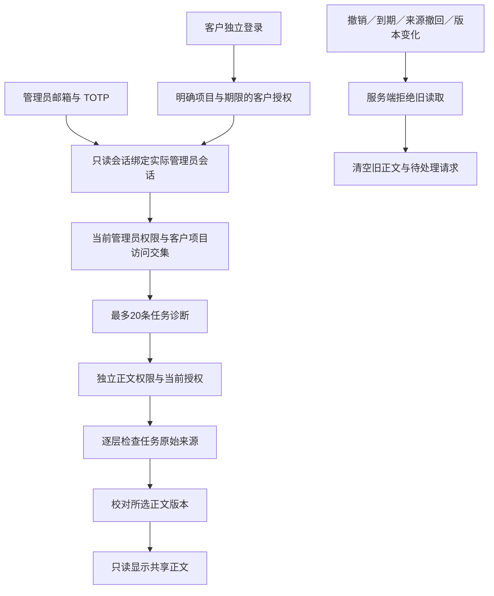

# 受控客服：来源撤回、正文版本与原生客户授权

本项继续落实 REQ-095，并补充 REQ-003、039、048、055、060、090、091、094、098 的相关子流程。原始完整验收条件保留。该文档描述当前实现；实际执行结果、源码与媒体以阶段133检查点为准。

## 用户使用流程

1. 客户使用自己的 Web 登录或 Desktop 浏览器 OTP／PKCE 登录，在「账户设置 → 客服限时协助」明确选择项目、原因与15／30／60分钟期限。空项目选择只授权企业与用户元资料。
2. 客户把授权 ID 交给客服。管理员使用自己的邮箱验证码与 TOTP 登录 Admin，在支援工作台搜索客户，明确选择企业、项目、期限及授权 ID，创建只读会话。
3. 视图持续显示真实管理员、客户、企业、明确项目及服务端截止时间。正文还要求当前独立 `admin.content.body.read`；没有客户授权或正文权限时只显示诊断元资料。私人会话的任务正文不开放。
4. 客户可在 Web 或实际本机 Desktop 撤销自己的授权。服务端下一次读取即拒绝；可见 Admin 视图约每两秒复查并清空。页面隐藏、读取失败、切换对象与到期也会清空。

Desktop 的客服授权表单调用客户接口，管理员支持页面留在 Admin。授权不会向客户端注入管理员身份，也不授予客户本地文件权限。Desktop Agent 继续在本机使用 Codex，完整本机权限仍由客户通过独立流程主动授予与撤销；Extension 继续使用 Chrome 原生右侧 Side Panel 和云端 Agent。

## 服务端来源边界

原接口只检查任务 `content_state`、当前客户授权与管理员权限，未遍历任务实际读取的文件。阶段133的原始复现先通过真实共享任务入口创建任务，确认正文可读，再隔离其真实文件来源；旧实现仍返回200及保留结果。首次准备错误创建了带专家上下文的私人任务，正文在隔离前便被拒绝；两个失败记录分别保留，不能把首次准备失败当作泄露证据。

当前查询先在已授权企业、项目、目标用户与明确任务范围内取得最多21条记录，再调用 `content_source_manifest(tenant, project, ARRAY[task], '{}')`。这是管理事务中的显式范围检查；不借用客户身份，也不调用依赖缺失客户上下文的简化函数。既有来源解析继续检查文件保留期限、版本擦除、数据／云引用／任务继承关系和已实现的业务来源。

来源不可用时诊断返回 `source_unavailable: true`、空标题及错误码、`body_available: false` 和 `body_revision: null`。任务私人标记及基础诊断仍受原范围限制。正文读取返回403 `SUPPORT_SOURCE_UNAVAILABLE`，不返回提示词、结果或来源文件内容。被隔离任务自身也不能读取正文。

正文与诊断都在审计之后再次查询任务及来源，并重新核对当前管理员权限、授权和实际截止时间。审计期间来源被撤回时拒绝返回原来捕获的结果；正文版本变化时返回409。成功审计与正文检查处于同一事务，失败不会留下虚假的成功读取记录。审计只记录目标、项目、任务及动作，不复制正文。

## 正文版本与兼容接口

继续使用既有两个 GET 路径：

- `/v1/admin/support/sessions/:id/view`
- `/v1/admin/support/sessions/:id/view/tasks/:task`

请求必须携带与路径匹配的 `X-CopyPaste-Support-Session`。视图最多显示20条最近任务，另有 `tasks_truncated`；本轮没有把此诊断入口改成完整任务历史。

任务诊断新增以下字段：

| 字段 | 含义 |
| --- | --- |
| `source_unavailable` | 原始来源当前不能继续读取。 |
| `body_available` | 共享任务、当前授权、来源及独立正文权限同时允许读取。 |
| `body_revision` | 仅在正文当前允许读取时返回64位十六进制 SHA-256，否则为null。绑定任务 ID、版本、内容管理修订、提示词、结果与来源清单。 |

Admin 点击正文时使用单个强版本条件，例如 `If-Match: "<body_revision>"`。当前允许的 Admin 来源可通过跨站预检发送此条件；来源白名单保持有效。与所选版本不同返回409 `SUPPORT_CONTENT_CHANGED`；弱条件、多条件及通配符返回400 `SUPPORT_REVISION_INVALID`。省略条件的已有调用继续读取经过当前检查的内容，但不能绕过权限、来源和审计后的版本复核。

成功正文在顶层返回 `body_revision`、任务诊断、提示词及结果；这不构成新的写入或下载权限。视图和正文响应使用 `Cache-Control: no-store`。既有 `SupportGrantCreate`／`SupportGrant` 和 AdminOperation 契约原字节不改写。

## 页面请求与私密状态

Admin 按管理员身份重新建立组件，避免换账号时沿用前一个账号的支持状态。每次视图请求有独立取消控制器与归属检查；旧请求结束不能释放新请求的占用，也不能阻止新会话加载。正文另外绑定所选任务、请求序号、视图世代及正文版本；快速点击不同任务时，旧结果不能覆盖最新选择。

元资料复查发现正文版本或来源资格变化时，取消旧正文请求并清空当前显示。正文响应也按自身的服务端时间检查剩余期限，不能只借用此前元资料的截止判断。隐藏页面、关闭视图、读取失败与实际到期均取消请求并清空正文；前端复查间隔不被描述成瞬时远程擦除。

Web 和 Desktop 客户授权表单按用户、企业及成员角色建立独立状态；列表请求取消并拒绝迟到响应。创建、撤销与复制完成后均重新核对当前组件身份；刷新失败不会显示虚假的成功刷新提示。页面可见时定期复查授权列表，隐藏时不重复轮询，重新可见时再查询。

## 验证范围与限制

后台真实原生 PostgreSQL 检查覆盖原始来源隔离、来源到期、版本擦除、任务隔离、所选正文版本冲突、私人任务、授权与正文权限交集、跨站预检、审计阻塞期间的来源撤回与结果变更，以及读取不新增任务／预留／扣费／模型请求／客户会话。既有受控支持、完整内容历史与任务来源测试一并执行。

实际界面使用独立管理员邮箱／TOTP、客户 OTP／PKCE、Web、Admin 与无签名 Windows 原生包，核对授权、撤销、迟到正文／会话响应、来源撤回、正文变化、真实时钟到期、中英主题及指定布局。构建复用必须逐个匹配完整产品源码集合及包哈希，不能只以版本名称相同替代。

模型按现有授权不执行；业务数据、保留结果与测试记录的文件读取明确为合成夹具。正式模型接入、签名安装、任意进程崩溃、多节点／所有权限竞争和所有页面读屏验收仍按完整清单推进。本轮不关闭完整 TC-095。

English: Controlled support keeps independent administrator identity, explicit customer scope and read-only authority. Original-source checks and conditional body revisions now prevent retained results and delayed responses from bypassing current access. The packaged native Desktop customer grants and revokes support through customer-only endpoints. Exact execution evidence is recorded separately; this is bounded qualification with synthetic business data and no model execution.
