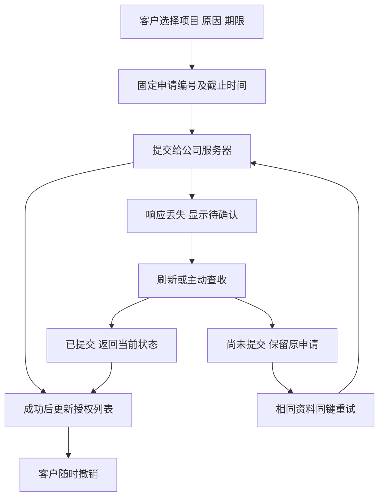

# 客户授权恢复与客服协助验收

本轮补齐 Web 和原生 Desktop 客户支持授权的异常恢复。创建授权的响应丢失后，同一次申请沿用原请求编号、原因、明确项目和截止时间，避免重复建立授权或延长有效期。刷新后先查收结果，不自动再次创建。

## 客户使用流程

客户在账户设置选择项目、原因及15／30／60分钟期限。首次提交固定申请内容；收到成功结果后清理恢复记录并刷新列表。提交结果不明时显示原定截止时间和“查收先前申请”。相同资料可以安全重试；另一份原因、项目或期限不能替换尚未确认的申请。

浏览器会话存储只保留随机请求编号、申请内容的 SHA-256 摘要及原定截止时间，存储名称绑定用户与企业的摘要。原因、项目ID、正文和凭证不写入该记录。禁用浏览器存储时仅能在当前 renderer 的内存内恢复，关闭或刷新后不承诺保留该恢复入口；服务器已提交的授权仍可在列表查看和撤销。

查收返回已提交授权的**目前状态**，包括已经撤销或到期的结果；不把旧成功回执重新解释为有效授权。尚未找到回执只表示当时未确认，不等于取消了第一次请求。原期限前继续保留原申请，重试使用同键、同内容。服务器确认未提交且原期限已过后，客户可以重新申请。

## 接口与边界

新增 `GET /v1/support-grants/attempts/{key}`，要求真实客户会话、当前企业 Owner/Admin 权限及 `X-Tenant-ID`。随机编号不是登录凭证。查询范围固定为当前用户、当前企业、创建授权动作和该编号；即使同企业另一管理员知道编号，也读不到他人的回执。

查询采用与原创建命令相同的事务锁序及幂等锁，避免并发提交尚未结束就判断结果不存在。响应为 `committed`、`not_found` 或 `removed`，带服务器 `as_of`；仅 `committed` 带原规范 `SupportGrant`，全部响应 `Cache-Control: no-store`。查收没有创建、续期、恢复撤销或签发凭证的副作用。原 OpenAPI、原授权 DTO 和既有迁移保持原字节；补充契约位于 [独立接口规范](../contracts/support-grant-recovery-openapi.json)。

撤销操作也使用固定逻辑请求编号和稳定原因。界面文案可以切换语言，同一次撤销不因此改变服务端请求内容。同步请求锁防止同一表单双击并发发起不同申请。切换账户、企业或管理身份时，旧的查收／提交完成结果不能重新填充新表单或显示成功提示。

表单提交错误与授权列表的读取错误分别管理。后台定时刷新只更新自己的读取状态，不清除尚未解决的提交错误；错误出现时滚动至提示位置，不抢走键盘焦点。客户账户设置和后台支持表单按实际可用宽度自动分栏，文字放大后可收为单栏，不依赖固定双栏或仅按浏览器视口判断断点。

Desktop 的真实本机桥只新增这一条客户查收 GET 白名单，不开放 Admin 支持接口。Codex 继续在客户本机执行，本机完整权限继续由客户独立主动授予。Extension 的原生 Side Panel 与云端执行职责沿用原约束。

## 原始验收范围

[REQ-095](../requirements/01-srs.md) 与原 TC-095 要求只读获准范围、持续真实管理员和提示、写入／费用／VIP／凭证拒绝、真实到期及支持审计。本轮将这些原始条件逐条映射到当前源码和真实执行记录，单独作出综合验收结论；不会改写旧运行的 `not_run` 或有界证据声明。

全平台角色／动作／字段并发矩阵属于 REQ-094；全平台读屏、缩放、键盘和 reduced-motion 属于 REQ-055。支持页面另有定向键盘与放大文字要求：Web/Admin 使用实际 CSS 200%放大，Desktop 使用原生 `webContents` 的200%缩放，均记录使用的方法，不能据此关闭全平台无障碍验收。

显式撤销、截止和身份／成员版本失效不能通过重试恢复。临时项目归档期间禁止读取；在截止前恢复项目且原范围、有效授权及所有当前权限仍成立时，允许新的只读查询。页面不会恢复先前缓存的正文。这一界限修正文档51中“不能恢复旧视图”的歧义，不增加或削弱原 TC-095 的权限条件。

实际检查、安装包、页面截图、实时GIF／MP4和原失败均由 [本轮检查点](../quality/support-recovery-checkpoint-134.json) 绑定。业务数据和保留结果使用用户已允许的假数据，模型未运行；Windows包未签名。正式部署、供应商质量和完整产品交付按各自需求继续验收。

当前原生网络失败提示仍可能带有运行时异常文字；待确认条中的查收／重试操作已经验证，统一面向客户的中英文异常表达作为REQ-098后续事项保留，不把它描述为已完成的界面文案。
