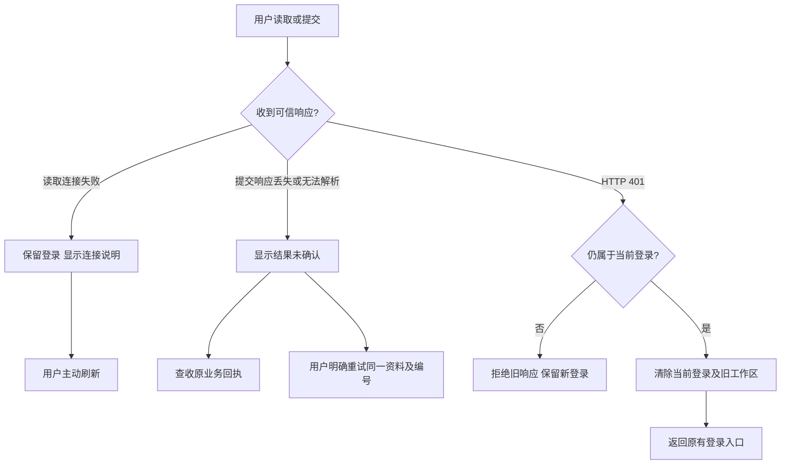

# 阶段135：连接反馈与登录失效恢复

连接层现在明确区分读取失败与提交结果不明。Web、Admin、Desktop渲染层、Desktop本机进程及Extension随独立仓库携带相同的`client-failure.ts`，通过逐字节检查约束规则一致；所有公司API、权限与请求编号继续使用原有路径。

## 使用流程

读取失败时，页面显示当前语言的连接说明。用户检查连接并主动刷新；连接失败本身不注销有效账号。提交之后失去响应时，页面提示“申請可能已收到。請先查收結果，再決定是否重試。”，不再附加容易误导的通用重试说明。客服授权可查收原回执，或者使用同资料及固定编号重试。扩展的原有委派表单沿用原消息编号，服务器仍以原业务幂等逻辑防止重复任务。

管理员支持会话列表的读取提示独立于表单、正文和操作提示。开始主动刷新时仅重置该列表提示；旧的表单错误不会因为后台列表恢复而消失。

## 请求及身份约束

`clientFetch`仅调用一次`fetch`，读取失败返回`CLIENT_CONNECTION_UNAVAILABLE`，写入失败返回`CLIENT_RESULT_UNCONFIRMED`。`clientJson`对无法解析的读取使用`CLIENT_RESPONSE_INVALID`，对无法解析的提交仍使用结果未确认。客户端生成的这类错误使用状态0，防止业务将未知提交结果当成服务器明确拒绝而清掉原恢复编号。服务器正常返回的业务错误、字段说明和状态码继续保留。

繁中／英文文案由稳定错误编号选择；界面不会从原始异常文字猜测失败原因，也不会把原始响应正文或异常的`cause`交给客户。主动取消通过原`AbortSignal.reason`传播；取消显示不触发自动提交或重新登录。

Web及Admin在异步成功或失败后重新检查请求所属的登录版本。旧请求返回401、损坏正文或连接错误时，不能覆盖新身份的防伪标记。当前受保护请求的401先触发登录清除，之后才处理结果；HTML或空响应不再绕过清除。Admin使用独立的`copypaste:admin-session-ended`事件即时卸载管理外壳，与用户登录分开。

Desktop本机进程及Extension后台在读取401正文前，使用该请求实际使用的访问凭证执行`NativeSession.invalidate`。旧凭证不能注销新身份。原生进程将受控连接错误返回为稳定错误数据；Electron内部异常包装不会成为已知连接错误的客户提示。本轮没有扩大本机桥可调用路径，也没有将Desktop的Codex执行迁至云端。

## 源码与验证入口

Delivery的当前入口是`npm test`及`npm run qa:client-errors -- <新的两位尝试编号>`。后者完整编译相关端、创建未签名Windows目录包、使用原生PostgreSQL，再运行实际Web／Admin／原生Desktop／Chrome原生SIDE_PANEL流程。测试仅关闭自己创建的浏览器、侧栏、客户端、服务与数据库，不调度Docker或WSL。

当前Delivery编译会明确排除八份历史执行原件：阶段133的两个、阶段134的四个旧旅程脚本，以及阶段135首版旅程和首版连接单元检查。它们保留原始路径、内容与回执，可供历史审查；当前第九版旅程脚本及第二版连接检查必须参与严格编译。新检查使用运行时模块加载，避免把另一个独立仓库的文件错误纳入Delivery的输出根。当前入口不会因为历史脚本的类型错误而构建失败。

本轮实际原生侧栏由Chrome工具栏动作触发，确认`SIDE_PANEL`类型、右侧布局、浏览页缩窄且没有新增普通标签。随后由用户完成邮箱OTP和PKCE，验证读取失败、语言切换、实际提交后响应丢失及同消息重试，最后验证401清除凭证。侧栏依然承担文件选择／读取／上传及云端执行，完整文件类型和大文件矩阵另按原需求验收。

实际执行结果、每次失败、确切源码、截图及实时录制以[本轮检查点](../quality/client-errors-checkpoint-135.json)和[原始证据目录](../quality/client-errors-evidence-135/index.json)为准。上一轮65项后端验收明确保留为历史引用，本轮核对后台源码一致性；没有将其描述为重新执行。原始REQ-095验收维持独立记录，其他88条必需开放需求不因本轮定向恢复检查而自动结案。

完整构建02的17条命令均成功，包括15项连接／身份、12项交付绑定、1项原生桥及未签名Windows打包；但该次UI旅程失败，不能作为已通过的流程验收。当前09重新编译／构建Delivery和Extension，逐份核对后台、Web、Admin、Desktop源码及Windows包与02字节一致，明确复用其10条相应构建和同来源单元结果。扩展的实际变化是后台通知刷新与语言切换保留提示，并防止后台读取错误覆盖未确认提交提醒。默认不设复用参数时，当前入口重新完整构建，不依赖本机02产物。

Chrome会在连接关闭后进行底层传输重试：尝试07实际收到两次相同委派，只创建一个任务；第二次正常回复使客户端正确显示成功，该次仍未通过预期的未知结果检查。当前第八版持续丢弃同一提交的全部回复，直到worker的真实`Network.loadingFailed`及客户未知结果提示出现，再停止丢弃。记录原始传输次数，核对真实15秒周期刷新和语言切换不增加该次数；用户明确重试后只增加一次正常请求，所有传输的完整请求体相同，最终只有一个任务。后台失败也以worker终态网络事件确认，不以服务端单次断连代替客户端失败。应用层只调用一次fetch，浏览器底层重传由业务幂等保护。

当前证据保留所有原失败、当次源码及实际媒体，不更改已执行脚本。侧栏就绪检查同时等待原生上下文与正确的文档地址；触发故障前等待工作区读取完成。失败录制保留原丢帧计数，只有选定通过录制要求零捕获错误；失败媒体不会被标成通过。具体失败及修正见[本轮更新记录](../changes/135-client-connection-and-session-recovery.md)。

08行为检查已通过，原通过报告和媒体保持原样；随后人工复核发现高级工具的固定定位覆盖了全局提示。当前09将工作区设为定位容器，高级工具在其内部绝对定位，因而全局提示的实际高度自然占据独立空间。检查真实读取英文／繁中及未知提交三个提示的边界、中心命中层与横向溢出，确认实际可见且没有被面板覆盖。此次复用仅放行Extension的`src/panel.ts`及`public/panel.css`，两者均重新编译／构建；其他产品源码和Windows包仍逐字节匹配完整构建02。
