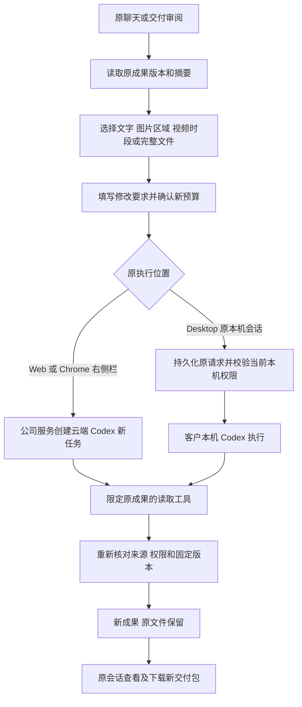

# 原成果修改闭环 · 阶段138

此增量承接阶段137完整交付包，把“收到成果 → 指定修改 → 确认新预算 → 执行 → 新成果交付”接入三端。主要实现位于六个独立仓库，源码路径仍统一在 `dev/`。

## 接口与输入

所有接口位于 `/v1/tenants/:tenant/projects/:project/tasks/:task` 下，沿用现有登录、当前企业、CSRF／原生凭证及项目权限。新接口不接收外部模型地址或密钥。

| 接口 | 行为 | 权限与费用 |
| --- | --- | --- |
| `GET /revision-context` | 原任务版本、交付摘要、答复、当前成果版本及可用的视频时长；原会话当前版本；能否开始修改 | 已授权交付读取；无模型、预算预留或费用 |
| `GET /revision-preview/:version?expected_version=…&expected_delivery_hash=…` | 核对实际文件大小及 SHA-256，返回 MIME、摘要及 base64；读取后再次核对来源和权限 | 原任务及所选文件须匹配；`no-store`；不返回存储键 |
| `POST /revisions` | 使用新预算建立关联原任务的云端修改任务；返回任务及原会话标识 | 项目写权限；必须提供幂等标识；Desktop 来源拒绝云端执行 |

`POST /revisions` 严格接收 `source_task_id`、`expected_version`、`expected_delivery_hash`、`target`、`instructions`、`budget_micros`；原任务属于私有会话时必须同时携带 `expected_conversation_version`。未知字段拒绝。预算精确转换为整数微港币，不采用浮点乘法四舍五入。

`target` 包含 `whole`、`output`、`artifact`、`text`、`image` 或 `video`。文件目标以 `asset_version_id` 固定身份；文字采用 Unicode 字符起止位置及原文；图片采用 `[0,1]` 相对坐标；视频采用整数毫秒。实际边界、MIME、文字字节及视频时长在服务端核对，客户端状态不构成授权。

云端 `delivery_revision_read` 只对具有固定修改来源的任务提供。参数只包含 `offset` 与 `limit`，不能传入任意任务标识。工具分页读取原答复，返回原修改位置及确切文件版本和摘要。Desktop 复用已有 `project_assets` 工具，在其结果的 `delivery_revision` 字段返回受同一来源检查保护的原答复（至多100,000个字符）及所选文件引用，不新增或改写已冻结的本机工具名称、描述或输入格式。原生检查点、Codex线程及权限继续沿用；源文件字节仍须通过角色已有工具实际读取。列出元数据不伪装成实际消费了文件内容。工具仍受原角色、冻结能力和本机只读等限制。

## 云端与本机执行

云端先锁定原会话，再锁定来源任务，检查当前会话版本、封存状态和活动任务，保留原专家版本，创建任务、输入依赖、预算预留、用户消息、审计及队列记录。相同请求标识和正文重试返回原回执；不同正文拒绝。任务创建后仍由现有 Worker 执行。

Desktop 的 `revision` IPC 只接收会话、原请求标识、要求、预算及来源选择，复用既有持久化 dispatch。确切来源随本机操作保存；重启或丢失受理回执后继续核对原操作，不另建预算。本机原生准入要求来源等于该设备／目录／原生授权家族／会话的上一份交付。服务端编译带来源指引的正式 prompt，本机 Codex 读取该 prompt 并执行本机工具。运行位置固定为 `desktop`，不生成云端执行队列记录。

普通后续工作继承已有修改来源绑定；新一轮针对修改成果提出修改时，绑定新的父交付。递归来源核对覆盖旧来源撤回和换版。单独增加审阅可能改变原任务版本，但不改变文件摘要，因此已受理修改不会仅因后续审阅被错误停止。

新增 SQL136 扩展数据库来源绑定检查：普通交付有独立的修订分支；原有计划审批及发布来源规则保留。原任务／项目／企业、角色版本、执行位置、私有归属、会话和父链必须相符。修订来源不可通过更新改写，受控内容删除继续遵循现有删除流程。发布的 SQL001–135 不变；启动兼容版本升至136。升级顺序为先备份并执行迁移，再启动匹配版本 API／Worker 和重建三端。

## 界面及异常

Web 和 Desktop 共享本次修改表单的协议与界面组件，仅以明确文件清单同步；Desktop 的本机工作区、授权及执行实现保留。Chrome 使用原生侧栏内的对话框，绑定当前用户／企业／项目；切换工作区或关闭页面时释放本次对话框和计时器，不新增普通浏览器页签。

提交前保存确切要求、位置、预算及原请求标识。请求结果未知时冻结原正文并提供重试；重新选择前提示客户先核对任务列表。清除本地表单不取消已开始工作。Web／Desktop 主动登出清理本次新增的本地表单数据；Chrome 会话存储按用户和工作区隔离。

原素材换版、源内容撤回、项目权限变化、会话封存、缺失时长、文件损坏、超出预览大小等分别拒绝对应操作。预览及查看不运行 AI；新修改始终显式确认预算。停止／失败交付如有保留成果可提出修改，空交付不可凭空生成来源。团队、方案、特效、GEO、SEO 修改和云电脑继续走原工作流程。

## 运行与验证

从 Delivery 运行 `npm run qa:delivery-revision-backend -- <新的两位编号>` 执行原生数据库、服务端及三端相关回归；`npm run qa:delivery-revision -- <新的两位编号>` 重建客户端、生成未签名 Windows 包并操作实际三端。每次运行保留自己的源码快照、原始日志、报告及失败，不覆写已执行验证器或原结果。

真实业务模型及媒体效果继续按用户授权采用假数据。界面验证中的 Desktop 使用实际打包的 Codex 二进制、本机文件和公司网关协议，模型答复及文件／权限窗口选择明确为受控测试；Web／Extension 云端模型答复也是受控数据。实际登录、数据库、权限、文件字节、原生窗口、右侧栏和下载独立执行。

实际结果以[检查点](../quality/delivery-revision-checkpoint-138.json)、[原始证据](../quality/delivery-revision-evidence-138/index.json)及[完整编号清单](../quality/remaining-work-stage138.md)为准。本增量不重命名原始需求，不把定向回归记作完整平台重跑，也不把图片／视频位置选择记作专业编辑质量通过。

本次界面复核复用同一源码及相同摘要的 Windows 安装目录和构建输出；原始11项编译／构建／打包命令已通过；后续只复用源码完全一致的客户端输出，服务端变更另经当前后端资格检查重新构建。旅程脚本单独重新编译，并核对全部源码及四个关键包文件摘要。原始界面失败保留，不冒称其成功，也不重复计算原构建。仓库提供的完整构建入口可用于新的验收编号；当前通过记录使用的增量复核入口见检查点。

常规后端测试入口只排除本阶段两份保留原失败、使用旧工具预期的历史测试；其确切文件及原验证命令仍可重现，当前 `v3` 测试进入正常回归。修复后的143项回归原始执行全部通过；在仅新增测试发现脚本与调整 `scripts.test` 后，单独验证这两项配置并逐文件证明运行代码、测试、迁移、锁文件和客户端没有其他变更，保留原源码守卫失败。检查点明确区分原测试执行与当前配置验证，不重复计算或重写原结果。
