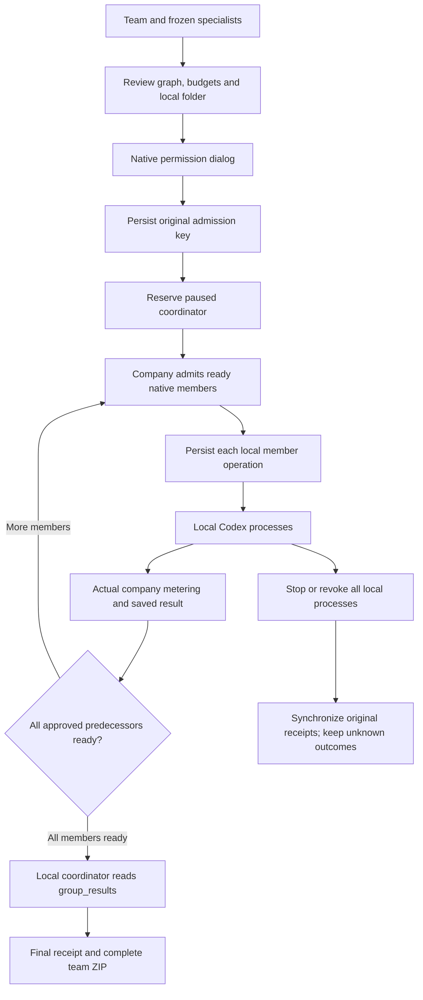

# 阶段139：Desktop 本机团队调度

本说明描述当前实现。验证结果及确切源码由同阶段检查点绑定，原始失败尝试逐项保留；不可把本说明中的设计约束当作全部场景均已实测通过。

## 构成与接口

继续使用项目级 `agent_groups`、版本化专家、冻结 Skill、私有运行和任务费用模型。迁移137为团队审阅／运行新增 `execution_location` 和不可变 `native_binding`，成员节点固定各自 `native_local_session_id`。历史云端定义摘要不变，云端历史与原生历史分别查询；原生历史的游标直接在PostgreSQL比较完整微秒时间及ID，拒绝已撤回／过期及其他私有运行锚点。

| 接口 | 行为与权威约束 |
| --- | --- |
| `/v1/agent-groups`、`/:group`、`/:group/versions` | 原有定义、修订、归档及版本分页；项目动作权限不变 |
| `/:group/native/preflight` | 仅实际 Desktop 登录族；固定设备、目录和运行时；无费用审阅 |
| `/:group/native/runs` POST | 一次审阅只能创建一个运行；精确摘要、版本、总预算和确认；原请求键可取回原受理 |
| `/:group/native/runs` GET、`/:run` GET | 发起人私有历史和分页；当前权限及内容保留期校验 |
| `/:run/advance` POST | 固定设备和登录族，锁运行后校验当前图、依赖、余额、套餐及成员状态；只准备本机任务 |
| `/:run/cancel` POST | 当前发起人停止运行；释放未执行预留，运行中任务请求取消；原请求键重试 |
| `/:run/delivery` GET | 返回当前固定团队交付清单及摘要；等待真实终态及回执 |
| `/:run/download` GET | 精确运行修订与交付摘要；逐文件校验，导出后重新核验权限／来源，最多16 GiB和10,000项 |

原生受理、派工和启动接口只通过可信主进程。Renderer API白名单允许普通团队内容管理、私有原生历史及下载，拒绝直接受理／推进／云端团队执行。IPC固定请求字段、窗口来源、当前账号和本地登录epoch。

## 状态及执行顺序

公司事务先锁团队运行，再锁任务／原生执行记录。成员通过既有 Desktop 启动、临时推理凭据、启动恢复、工具代理、问题答复、心跳及结算路径执行。`lockNativeWorkflowParent` 先检查原生团队锁，保证停止、启动、推理和完成共用顺序。原生团队没有云端 outbox；现有数据库约束同时禁止原生任务插入云端队列。

协调员先以 paused 状态创建和预留。就绪成员受理后，主进程先将独立会话、批准提示词、预算及原任务ID写入加密日志，再调用既有 `execute`。每个成员都有独立 Codex 状态目录和原生线程。最大并行数取已批准图及当前套餐容量的较小值，等待媒体真正完成后才将节点认定成功。协调员只在全部节点成功后解除等待。

`group_results` 只返回同一私有运行里获准的已成功前置任务，协调员可读全部成员。来源闭包继续绑定原任务、角色、会话和当前可用文件；结果内容不能修改预算、权限或图。只读本机模式允许此只读公司工具。

## 持久恢复及撤权

主进程日志记录 review、accepting、running、interrupted、finished 及固定受理键。丢失创建响应后继续原键，不创建第二个团队、资金预留或原生会话。丢失完成响应后先同步原成员结果，再考虑后续就绪步骤。重启时既有 `native_running` 记录转为 unknown回执，不能借团队恢复重跑已接受的原生操作；已知未接受启动继续使用原启动恢复协议。

停止、成员停止、整组撤权首先设置本机取消标记并中断所有所属运行时。公司回执网络失败时保留取消意图和原键，展示待同步，不恢复文件／程序工具。任何一位成员撤权会撤销根及所有成员授权。退出账号、应用关闭或当前登录epoch改变中断团队调度；更新安装安全检查也将未收口团队计为忙碌。

服务端既有轮询只执行原生运行清理：到期、来源撤回、账号／企业停用、项目归档或原登录族失效时，锁后重新检查当前条件再取消，不派工。仍在运行的原生任务通过心跳和原结算路径中断及核对，不能伪造成功、清零实际费用或转交云端执行。

## 长工具调用的心跳

设计渲染等公司工具在事务中持有任务锁时，及时到达的客户端心跳可能等待锁超过45秒。服务器仅对同一真实进行中的工具、固定fencing、当前用户及原生登录族，保留该次到达时间；锁释放后仍校验账号、角色、来源、取消状态和凭据有效期，再以完成时钟续45秒租约。清理程序仅在这一已验证且尚存活的调用与及时心跳都存在时等待。超时／已中止工具、迟到心跳、过期凭据、换登录族或重启后丢失的内存观察不能取得该续期；未知操作不重跑。

## 团队交付

只有运行终止、全部已创建任务的回执已知后才能生成包。成功运行标记 `complete_team=true`；停止或失败运行只导出现有部分成果并明确标记。每项成员文件来自当前可用的任务交付快照；不把本地目录自动上传。

包内有 `coordinator/result.md`、`coordinator/artifacts/`、`members/<step>/result.md`、`members/<step>/artifacts/`、`manifest.json`、`README.md` 和 `SHA256SUMS`，无输出的步骤在清单中保留状态。磁盘流式ZIP64构建，逐文件核对大小／SHA-256，响应前重新检查当前授权、来源及同一固定快照。断开下载或失败时回收本次临时目录。输出为任务交付，不等同于跨机器可恢复的全工程备份。

## 管理与审计

已有管理面板继续按任务位置显示本机任务及真实消耗；角色／Skill禁用、账号停用、套餐变更、项目归档、内容处置沿用已有控制面。团队定义的后台处置及审计保留版本，原生运行复查其冻结角色和来源。管理员不能通过团队API替客户授予本机完整权限；受控协助仍需用户独立授权，不绕过私有运行归属。

审计记录包含团队批准摘要与预算、各成员受理、停止及固定交付下载。完整专业输出、部署、真实外部账户和全部管理员组合以原有编号清单继续跟踪。

## English implementation notes

Migration137 extends versioned teams with immutable native location, device/login-family/folder/runtime binding and per-member local session IDs. Trusted main-process IPC freezes and journals admission before network writes. The company admits only ready tasks and holds a paused coordinator; existing native execution handles startup, local tools, heartbeat, actual gateway usage and terminal receipts. No native task enters the cloud queue.

Independent member processes may overlap. Dependency results remain private, source-bound and untrusted. A durable known receipt can be synchronized after interruption; an accepted unknown native action is never repeated. Stopping or revoking any member stops the whole team locally before attempting company cancellation. Final archives bind exact member and coordinator snapshots, recheck authority after streamed construction and contain only explicitly submitted files. Shared-folder conflict resolution, production professional quality and portable full-project restoration are separate acceptance scopes.

A timely owning-client heartbeat blocked by an actual server-owned company-tool transaction can complete its renewal after the lock releases. The server binds the observation to the same native family, actor and fencing token, rechecks current authority, and uses the actual completion clock for its existing45-second lease. The reaper defers only while that authenticated timely observation and the same un-aborted bounded call both remain. Late, revoked, expired or restart-lost observations never revive a lease.

## 源码交付字节

[补充交付检查点](../quality/native-teams-release-checkpoint-139.json)保留原运行检查点，并严格比较当前源码与Git对象。仅后端及交付仓库的Git属性增加原始字节保留规则；程序、已执行的用例、核查脚本、原始证据及Windows包不变。详见[交付修正说明](../changes/139-exact-source-delivery.md)。Desktop的Git属性保持用户指定的原始SHA。
