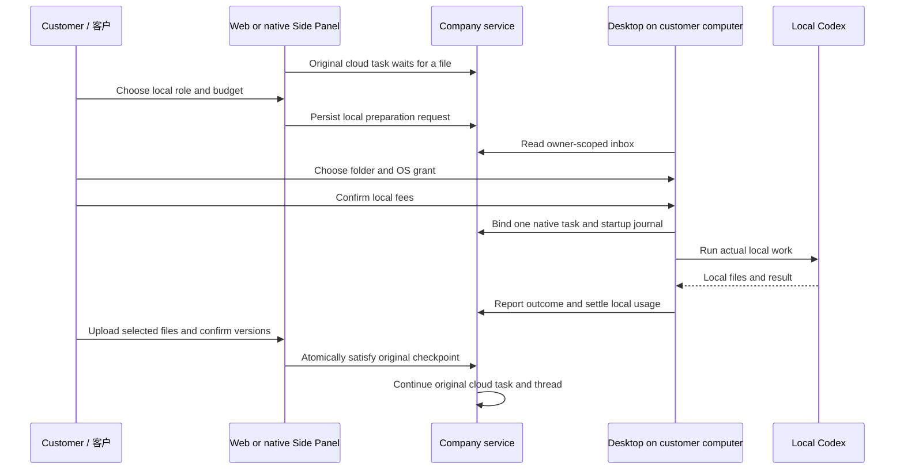

# 流程固定输入与本机回传 / Fixed workflow inputs and local return

## 产品工作流程 / Customer journeys

云端助手缺少获准文件时结束当前轮次并等待。客户在 Web 或 Extension 建立本机准备请求，选择本机角色及费用上限。Desktop 用同一账号打开请求，选择实际目录、确认本机权限并确认费用后，由客户电脑上的 Codex 完成工作。客户检查文件，主动选择上传内容并确认固定版本，原云端工作继续；原有付费轮次的用量、会话、任务及线程继续保留。

The cloud assistant ends its turn at a file checkpoint. A customer requests local preparation, then signs in to Desktop, chooses a real folder, grants local permission and confirms a separate local-step budget. Codex works on the customer computer. The customer reviews and uploads selected files, confirms exact versions, and the original cloud task continues with its conversation, reservation and existing thread.



## WorkflowVersion 契约 / Version contract

`input_schema` 和 `output_schema` 属于原有不可变流程版本，定义摘要覆盖两者。当前采用明确、有界的业务字段格式，不宣称实现完整 JSON Schema。

```json
{
  "input_schema": {"fields": [
    {"key": "campaign", "label": "Campaign / 活动", "type": "text", "required": true},
    {"key": "target", "type": "number", "required": true},
    {"key": "publish", "type": "boolean", "required": true},
    {"key": "brief", "type": "file", "required": true}
  ]},
  "output_schema": {"fields": [
    {"key": "report", "type": "text", "step_index": 0, "required": true},
    {"key": "files", "type": "files", "step_index": 0}
  ]},
  "steps": [{"kind": "codex", "role_key": "assistant",
    "prompt": "Prepare the customer-approved campaign report.", "budget_micros": 100000}]
}
```

模型通过原有 `workflow_run` 提供 `inputs`，例如 `{"campaign":"Hong Kong launch","target":0.75,"publish":false,"brief":"<asset-version-uuid>"}`。未知字段、缺失必填值、错误类型或越权文件会在预留子步骤费用前失败。字段 key 为小写字母开头的字母、数字及下划线，最长48字符；每类最多12字段。文本最长4,000字符，全部值的规范化 JSON 最多24 KB。数字必须有限且在 JavaScript 安全数值范围内，支持小数。文件值必须是明确的版本 UUID。

Each run stores `input_values`, exact `input_files`, `input_hash` and `named_outputs`. The input digest covers both values and file identity/name/version/MIME/size/SHA-256. Values remain immutable; formal erasure may clear them. Reading, approving, advancing and recurring dispatch recheck current ownership, project, source state and retention. A later asset version never replaces the selected version.

`workflow_inputs` 返回命名值及固定文件清单；指定 `input_name` 可缩小读取，指定 `asset_version_id`、`offset`、`max_characters` 分页读完整文本。现有前序步骤 `input_steps`、独立工作和失败人工审阅继续生效。业务值及文件正文始终是参考数据，不能赋予工具、审批、OS 权限或额外费用。

命名输出只映射到定义中实际产生成果的步骤。必需步骤没有成功或成果不可用时，不把流程标为成功。文本输出核对完整文件字节及 SHA-256，单文件上限2 MB、一次完整文本交付总上限4 MB；大文件使用 `files` 输出。页面预览可缩短，命名文本保留完整内容。定时及事件版本的 `input_binding` 和客户批准摘要绑定相同输入，重复运行不能变更或用事件数据替换它们。

Desktop 的受信任主进程核对输入摘要，在有界原生确认卡中完整分页展示较长输入，再单独询问子步骤费用。客户拒绝或确认期间输入／权限撤回时，不启动子步骤。The trusted Desktop validates the digest, reviews long inputs in bounded native cards, then separately asks for fees. Refusal or withdrawal prevents child admission.

## 原任务与本机身份 / Original task and native identity

`task_local_handoffs` 保存租户、项目、所有者、原任务、具体依赖及版本、描述摘要、角色／定义摘要、独立本机预算和状态。等待状态为 `waiting`，接单后为 `working`，客户确认交回后为 `completed`，主动取消或原检查点被其他方式解除后为 `cancelled`。版本号用于防止旧页面覆盖当前状态。列表使用服务端连续分页，不只显示最先几项。

Admission freezes the device, native login family, local session, real workspace digest and pinned runtime identity. One live handoff per checkpoint and a unique native task binding prevent duplicate execution. Authorization is checked before idempotent response replay. The native startup/finish/reconciliation journal keeps its original request keys. A failed or unknown local operation is reviewed through the existing recovery flow, never silently launched again.

本机心跳、工具授权与推理预检按“原云任务 → 本机准备请求 → 本机执行”顺序加锁。仅核对来源身份的前两级使用共享读锁，允许有效心跳与下一次模型请求并行；真正接单、交回、取消及删除仍使用写锁并重新核对当前版本。来源撤回仍拒绝，不能通过取消锁检查或重放已经执行的本机轮次解决竞争。Native heartbeat, tool authorization and inference preflight lock the original task and handoff for shared authorization reads before the native execution. Mutations retain their exclusive locks and current-version checks; a real withdrawal still denies execution.

本机完成以 `desktop_client_report` 标识。服务端核对已知成功及已完成结算后才允许交回，不把 API 的客户端报告当作独立 OS 行为证明。客户选择1至20个当前获准文件版本，全部通过验证后才原子解除原文件依赖；其他必需输入仍未齐备时，原任务继续等待。原任务取消、原依赖版本变化、源撤回、权限撤销或未确认的本机结果均不能绕过检查。

| 接口（位于项目范围） | 用途 |
|---|---|
| `GET /local-handoffs`，可带 `task_id`、`cursor`、`limit` | 所有者收件列表／原任务状态 |
| `POST /tasks/:id/local-handoffs` | 对具体文件依赖建立请求；包含依赖版本、角色、预算及确认 |
| `GET /local-handoffs/:id` | 读取当前状态、固定版本及本机结果 |
| `POST /desktop-executions` 的 `local_handoff` | 原生认证下绑定并接单；不能由普通 Web 凭据启动 |
| `POST /local-handoffs/:id/complete` | 明确确认当前请求和所选文件版本，继续原任务 |
| `POST /local-handoffs/:id/cancel` | 取消本机准备，保留已产生费用及原输入等待状态 |

Project routes use `/v1/tenants/:tenant/projects/:project`. Current project access, owner, authentication family, original task authorization version, active sources and immutable versions are checked on the server; renderer checks are supplementary. OS grants stay in the Desktop trusted process. Extension acquires only customer-approved files, uploads into the original task's private or explicitly shared scope, and keeps cloud execution in the original task.

分块上传可在创建时指定 `source_task_id`，只绑定当前客户已经完成并核对的本机准备来源。服务器从原任务确定会话和私有所有者，客户不能将私人范围降级；每次读取、发送分块、重试和完成都复查当前来源。即使私人原任务没有 `conversation_id`，结果仍属于该用户。`upload_sessions.source_task_id` 不可变；版本元数据使用 `input_task_id`、`input_origin=customer_selected_upload`，不冒充原任务生成的 `task_id` 产物，不引入来源环。原私人任务正式删除时，联动清除其输入上传及私人文件。

Starter 的单任务额度只对经过完整校验、直接关联且仍在等待输入的原云任务暂让一个本机执行槽；其他活动任务仍计入限制，原任务和本机子任务分别预留及结算费用。旧任务的授权版本过期后，重新登录不会重绑授权或允许为该旧任务新开本机费用。项目收件箱在保存点内跳过失效来源，保留其他有效请求；连续分页保留数据库微秒精度。

## 数据库升级及交付 / Migration and delivery

SQL141 新增持久本机请求、行级隔离、唯一接单、状态和来源约束；SQL142 新增运行输入／输出、不可变值、子任务绑定和重复任务继承约束；SQL143 固定任务上传范围、私有结果及删除联动，并阻断已撤销原任务的本机后续来源。SQL144 修复历史收据与输入内容删除的关联：原任务尚未删除时不允许断开活跃输入；正式删除原任务后可清除描述／答案，保留不可变输入身份、费用收据及本机来源撤回。完整文本文件保留原始字节，6000个UTF-16单位以内的步骤预览不截断Unicode代理对。

SQL145 补齐完成上传的删除终态：只在同一所有者的原任务已正式删除且存在删除日志，或该上传的真实固定版本所属资产已正式删除且存在对应删除日志时，允许精确清名、清回执并取消上传。独立删除文件也先退役该文件对应的任务上传回执，不凭无关资产的删除日志放开其他上传。其他身份、配额、有效期及既有私人会话约束继续生效；账务和本机执行身份保留。

这些均为向前迁移，既有迁移保持原始字节；服务端启动要求完整连续迁移到145。执行前按既有备份／恢复手册操作，不能仅改版本号绕过升级。SQL144 retains immutable financial/source identities while allowing input content to retire only after the original task has been deleted. SQL145 retires a completed task upload only with its authoritative deleted source-task journal, or its actual fixed upload version and deleted-asset journal. Independent asset deletion clears only the corresponding task receipts, without weakening identity, quota or expiry rules. Active source dependencies remain protected; completed native derivatives remain revoked. The shared preview boundary also preserves Unicode pairs without changing complete output-file bytes.

Use native tools only; no local Docker/WSL/VM. Follow the existing backend migration and startup instructions in each repository README. Qualification selects actual current source snapshots and an unsigned Windows package; company model responses may be synthetic as authorized. Production credentials, signed installers, complete OS/platform acceptance and all original professional workflows require their own evidence.
