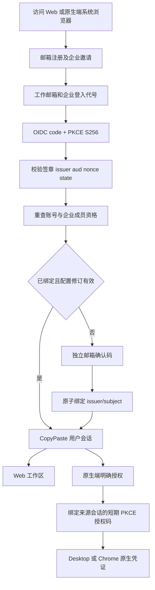

# 企业身份联邦与原生端授权

产品代码：0.5.0。本文记录实际实现，补充 REQ-003 的登录、账号绑定与撤销边界；不把 SAML、SCIM 或强制 SSO 策略视为已交付。实际代码全部位于 `dev/` 的六个独立仓库。

## 用户接入与身份边界

邮箱 OTP 仍负责 CopyPaste 注册、邀请接收和登录。企业可以增加 OIDC 身份连接：用户先通过工作邮箱完成注册并成为该企业的有效成员，再使用管理员提供的企业登入代号。相同邮箱网域不建立成员资格；未注册、已移除、被停用或无有效企业资格的用户不能借 SSO 开户。

首次连接先完成企业身份验证，再输入 CopyPaste 独立发送到该工作邮箱的确认码。即使 IdP 声明邮箱已验证，也不据此合并账号。确认码只用于当前浏览器、当前连接、当前尝试，不能用于普通邮箱登录；10 分钟有效、5 次错误上限，单次原子消费。普通登录与连接确认共用每邮箱每分钟最多两次邮件挑战的额度。

连接保存两种邮箱政策：默认 `verified_email` 要求已签名 ID token 的邮箱完全匹配且 `email_verified=true`；`subject_with_proof` 允许 IdP 不提供已验证邮箱声明，但仍要求独立工作邮箱证明和既有企业成员资格。绑定键是固定 issuer、client_id、sub 的规范化对象摘要，避免替换 IdP 或应用后相同原始 sub 继承旧账号或与之冲突；数据库不保存原始 sub。重新连接、连接修订或替换已绑定 subject 时重新确认邮箱；替换活跃 subject 会先撤销该用户全部旧会话。

Web `/login` 可进入 `/sso`；`/sso/confirm` 负责首次连接确认与过期/失败提示。账号设置显示本人连接、最近登录及状态；解除连接须明确确认登出所有装置。Desktop 与 Chrome 使用相同系统浏览器登录页，再完成现有独立原生授权，不把浏览器 Cookie 作为 bearer。管理员入口继续独立邮箱 + TOTP，不接受企业 SSO 代替 MFA。

## 后台操作与权限

每企业一个 OIDC 连接。企业列表的身份按钮提供查看与配置面板。当前动作目录为 68 项；新增 `admin.tenants.sso.write` 只支持全域范围，内置 `super_admin`、`security_admin` 拥有；`user_operator` 不因既有企业管理权限而获得。写操作还要求当前企业读取权限、10 分钟内 MFA、原因、目标版本和幂等键。

| 操作 | 前置条件与结果 |
| --- | --- |
| 保存 | 新连接须提供 client secret；已有连接留空保留。加密保存 secret，响应和后台页面不回传。禁用连接、增加 version/revision，清除旧验证及中继资料，撤销关联用户会话。 |
| 检查 | 仅在停用时执行；校验 discovery、code、PKCE S256、签章算法和公开 JWKS。冻结审核过的端点，增加 revision/version。外部请求期间不持有数据库锁，提交时重新检查 MFA、权限及版本。 |
| 启用 | 已验证 revision 必须等于当前 revision。只改变运行状态/version，不更换身份信任配置。 |
| 停用 | 使所有关联身份失效，提升关联用户 auth_version，撤销其全部 CopyPaste Web/native/refresh 会话和未交换原生码；旧任务、计划及工具授权在后续重查时失效。 |

检查不兑换授权码，不验证 client secret，也不证明真实企业账号已完成登录。后台明确显示此边界。已启用连接不能通过后台检查静默替换端点；须先停用。重复相同幂等命令返回原结果，不重复撤销或改变修订；不同内容复用键被拒绝。配置 version 用于并发修改，revision 用于身份信任与会话有效性。

停用、配置改变和本人解除连接都会影响该用户在其他企业的 CopyPaste 会话，因为账号 auth_version 是全局撤销版本。界面明确提示全部装置登出；不能把它描述为只退出当前页。重新启用不复活旧身份或旧凭证。

## 协议与网络约束

采用精确锁定的 `openid-client` 6.8.8（MIT），启用 `enableNonRepudiationChecks`，实际验证非对称 ID token 签章。协议流程为 code、PKCE S256、state、nonce、固定 callback；只接受 RS256 或 ES256。公开签章金钥须可导入，RSA 至少 2048 位，ES256 为 P-256，不接受私钥或对称秘密。实现依据与 API 见 [openid-client 官方仓库](https://github.com/panva/openid-client)；身份声明与 nonce 的语义依据 [OpenID Connect Core](https://openid.net/specs/openid-connect-core-1_0.html)。

部署者在 `SSO_ALLOWED_ORIGINS` 填入所有 discovery、authorization、token、JWKS 所需的精确 HTTPS origin；不得带路径、凭证或查询参数。所有服务端外发统一检查白名单、禁跟随重定向、单请求 10 秒及 1 MiB 回应上限。白名单由受信任部署者管理；本实现不声称已进行 DNS 重绑定防护或私人网段解析筛查。IdP 是身份服务，AI 模型请求仍只走公司内部网关。

`SSO_ALLOW_LOCALHOST=true` 仅供开发/测试原生签名 IdP；生产配置直接拒绝此开关。默认 false，不写入可公开的有效企业密钥。测试 fixture 没有注册到产品 API，也不提供生产绕过入口。

默认 callback 为 `WEB_ORIGIN + /v1/auth/sso/callback`，Web 的 `/v1` 反向代理须通到 API；开发 Vite 已配置。若 Web 使用 `VITE_API_BASE` 跨 origin 访问 API，可将 `SSO_CALLBACK_ORIGIN` 设置为相同的 `API_ORIGIN`。该设置只接受当前 Web 或 API 的完整 origin；不能自定义任意回调地址。须在 IdP 登记精确 URI，并确认该部署下浏览器 Cookie 策略允许 API 会话。

返回路径仅接受同一 Web 的 `/app`、`/welcome`、`/invite`、`/authorize`，拒绝外部 URL、反斜线和控制字符。原生授权页面的 query 被完整保留，SSO 结束后仍需点击“授权并返回”。

## 持久化、Cookie 与撤销

迁移 010 新增连接、绑定和瞬态尝试三表，只有 control 数据库身份能读取。app 身份只可调用固定 search_path 的 SECURITY DEFINER 布尔有效性函数，不能读取 client secret、外部 subject 或 PKCE 材料。连接 secret 和未完成 PKCE verifier/nonce 用既有 MASTER_KEY 加密；state/browser capability 只存摘要。IdP access token、refresh token 和 ID token 不保存，也不发给客户端。

浏览器尝试使用 HttpOnly、SameSite=Lax、路径 `/v1/auth/sso` 的 10 分钟能力 Cookie，生产 Secure。回调先原子占用阶段，再兑换 code；第二次回调不再向 IdP 换证。完成或失败立即清空 PKCE/nonce 密文，Worker 每次扫描有界清理过期尝试的秘密。此操作不表示所有历史身份记录或物理存储已被删除。

原生授权码增加 `source_session_id`、`issued_auth_version`：签发和兑换都重查账号版本、来源会话未过期/未撤销及身份联邦有效性。来源退出后，即使原 60 秒授权码尚未使用，也不能换证。迁移会消费没有来源绑定的历史待交换码。换证和 refresh 从来源继承绑定 ID/revision；refresh 允许原 15 分钟 access token 自然过期，但不允许已撤销来源或已失效企业绑定。用户、码、refresh 的锁顺序统一，撤销与换证并发不会留下可用凭证。

## 实际 API

| method/path | 用途 |
| --- | --- |
| GET/POST `/v1/admin/tenants/:tenant/sso` | 读取公开配置 / CAS 保存 |
| POST `/v1/admin/tenants/:tenant/sso/probe` | 检查并冻结 discovery 与公钥能力 |
| POST `/v1/admin/tenants/:tenant/sso/status` | 启用或停用 |
| POST `/v1/auth/sso/start` | 工作邮箱、login_key、next；建立浏览器尝试 |
| GET `/v1/auth/sso/callback` | 固定 OIDC callback |
| GET `/v1/auth/sso/pending` | 当前浏览器待连接身份摘要 |
| POST `/v1/auth/sso/link/challenge` | 向绑定工作邮箱发确认码 |
| POST `/v1/auth/sso/link` | 消费当前尝试验证码并签发用户会话 |
| GET `/v1/me/sso-identities` | 只读取本人连接摘要，不含 subject |
| POST `/v1/me/sso-identities/:id/revoke` | 本人 CAS 解除并登出所有装置 |

新增 11 个实际 method/path；请求以客户端与服务端实现为准，不能把历史规划 OpenAPI 的全部路径当成已部署服务。OIDC 配置字段：login_key、name、issuer、client_id、可选更新 client_secret、domains、token_auth_method、signing_alg、email_mode、expected_version、reason。敏感值不进入响应、截图或执行证据。

## 复核与已知边界

平台 `tests/federation.test.ts` 使用真实 PostgreSQL、原生 HTTP IdP、RSA 签名和真实 code/PKCE/token/JWKS 交互；不是将 SDK 登录函数替换为成功返回。覆盖签章、aud/iss/nonce/expiry/email、Cookie/state、重复回调、一次 OTP、成员资格、subject 替换、权限/MFA/CAS、加密与撤销竞争。跨端 UI 由 delivery `qa:federation` 验证，并在 finally 关闭自己的浏览器、Electron 和 IdP。运行该测试前仅为开发控制器开启 `SSO_ALLOW_LOCALHOST=true`，结束后恢复默认控制器。

当前不包含 SAML、SCIM/组织目录同步、强制某企业只用 SSO、自动域开户、多 IdP 路由或生产公司 IdP 准入。生产需要实际 issuer、client ID/secret、已批准网络 origin、真实 SMTP 和测试成员；协议 fixture 通过不能替代这些验证。验收与真实页面见 [0.5.0 身份验收](../quality/08-enterprise-federation-acceptance.md)。
