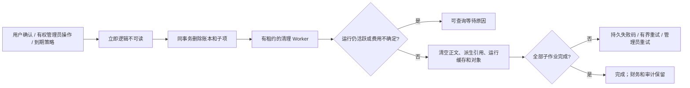

# 删除、文件传输、保留与实时事件的当前实现

2026-10-19 · 修复工作进行中，尚未发布新的完整交付包。本分册记录代码实际约束；SRS、NFR、102 条综合验收及生产准入范围继续有效。

## 演示依赖

用户授权「暂时先用假数据」。delivery 的 `npm run demo` 仅给 API 子进程设置 DEMO_MODE，不改现有 `.env`。网关随机端口和临时密钥仅用于本机进程；生产或非回环监听拒绝该模式。Web/Admin 显示模拟环境横幅，企业、任务、素材元数据及账目保存 data_mode；配置服务模式与模拟企业不能混用。

Agent 仍运行锁定的真实 Codex。模拟 Responses 返回确定性的工具调用；图片是有 DEMO 标记的本机 PNG，开发角色写入实际 UTF-8 源码及 ZIP。模拟额度使用 gift 分录和永久业务唯一键，不登记收款；多次点击不重复充值。这证明产品逻辑可以运行，不能用作真实模型质量、媒体供应商或角色准入证据。

## 永久删除

数据库触发器覆盖资产、任务、Agent、会话、记忆、品牌、分析数据、创意工程、工作流、流程运行及定时配置。永久删除不能通过后台 restore、元数据修改或直接控制层 SQL 复活。模型读取、正文及下载路径检查逻辑状态；下载打开流后再次验证身份和内容。

删除作业保存目标、租约、尝试次数、进度和脱敏失败码，父作业等待私有派生物的子作业。资产删除清理所有不可变版本、上传暂存和分享；明确发布的独立副本仍需单独删除。兼容历史共用对象 key 时，最后一个未删除引用消失后才清除字节。对象墓碑与事务锁阻止清理后的 key 再被引用，超过 24 小时且无数据库引用的孤儿对象按页回收。

任务删除等待运行关闭与费用状态确定，清除提示、输出、上下文、事件、计划、工具结果、关联会话消息、重放响应和私有产物。目录清理仅接受自有 DATA_DIR 下经过逐级核验的 UUID 路径，拒绝符号链接和 junction。I/O 被占用时记录失败并退避，最多八次后等待有权管理员处理；后台重试检查作用域、近期 MFA、原因和幂等键。

实际接口包括规范 `POST /v1/deletions`、`GET /v1/deletions/:id`，项目内进度列表及 Admin 列表/重试。当前规范 target_type 已完成 asset、memory、conversation、agent、workspace_node；project、tenant 仍需实现，不能据此关闭整个 TC-049。

## 分片上传与流式下载

普通文件 100 MiB，音视频 1 GiB；4 MiB 分片，24 小时上传会话。初始化必须提供文件名、大小、MIME 和 SHA-256；分片提交校验实际大小、索引、规范 Base64 和分片摘要；完成重新顺序读取所有分片，校验整文件摘要及支持类型的文件头。文件头核验不等于完整编解码质量检查。

会话按创建者私有，任何后续请求都重新检查企业、项目和当前写权限。企业最多十个未完成会话及 10 GiB 预留，数据库控制触发器计算跨用户总量。完成锁定会话，并发或重传返回同一个资产；版本替换检查 expected_version，不覆盖旧版本。被删除的资产不能借完成重放重新读取。暂停与取消有不同含义：暂停可续传，取消进入暂存清理。

Web 按块计算摘要，持久保存按用户/项目/文件名/内容摘要绑定的会话及稳定幂等键。刷新后重选同一文件读取服务端已验证分片并跳过，不重复分配会话。主上传和版本更新均使用新通道。旧 multipart、扩展原生桥接和部分后台上传仍有原有大小限制，需要继续迁移。

API、公开分享及后台下载使用对象流。Desktop 在用户选择目标后流式写入临时文件，验证大小与摘要，再以拒绝覆盖的方式落盘，失败清理临时文件。Web 下载目前依赖浏览器 Blob；完整 1 GiB 实传及所有端低内存验收尚未完成。

## 自动保留规则

资产、编辑描述、分析快照和终态任务正文默认 90 天。新增不可变文件版本、修改编辑内容或任务转终态会延长对应保留期；在途及待对账任务不按终态策略删除。到期内容通过同一个删除账本进入清理，记忆的明确到期时间也会进入删除流程。Web 素材页显示保留规则和到期时间。

任务事件 30 天后分批删除并保存已裁剪的序号水位。重放响应和终态工具结果七天后清空，保留业务唯一键、摘要及账目；过期请求不会再次执行。终态 Codex 本机缓存不等待 90 天，独立持久作业在运行关闭后清理，失败退避；业务输出和费用保留。对账中缓存、开发邮件箱、完整诊断授权生命周期及后台清理监控仍需进一步处理。

财务和审计不走通用删除，至少 365 天的设计保留继续有效；当前实现保持这些记录。35 天备份轮换、恢复后删除账本重放及 RPO/RTO 演练尚未实现，不把在线清理测试当作备份恢复验收。

## 持久 SSE 与领取恢复

规范 `GET /v1/tasks/:task_id/events` 使用 X-Tenant-ID 与 Last-Event-ID；兼容项目内 JSON 查询。每条新事件由数据库任务锁分配单调序号、事件 UUID 与执行尝试 UUID；历史全局 ID 迁移为保留的初始序号，不能据迁移补造历史执行证据。

SSE 投影使用机器契约的事件结构，覆盖状态、可见消息片段、产物版本、用量及警告；不输出隐藏推理和凭证。每批重新验证会话、当前成员/项目及私有归属；访问失效关闭流。保留期外游标返回 410，客户端获取任务快照及 last_event_seq 后重新连接。心跳不占序号，连接最多 30 秒后重连，每用户六条、进程 128 条，并处理反压、断线与服务关闭。

Web 使用 SSE、序号去重和有界事件列表；Desktop 的 JSON IPC 按游标排空分页，不再重复请求最早 200 条。当前完整暂停/步骤检查点和未知外部写入恢复仍未完成。

事务 outbox 保存实际队列 job ID。恢复器仅重新派发仍为 queued、原队列作业已失败或丢失的未领取任务；已创建、等待重试或执行中的队列作业优先。恢复使用锁、退避和最多八次；耗尽时释放执行前预留。running/reconciling 不通过该通道重放，未知费用继续对账。

## 本轮故障与修正

开发中发现首次 011 迁移执行后文件发生过变化，使用 014/015 前向补齐，后续迁移保存 SHA-256；改写已执行的有摘要 SQL 会阻止启动，旧无摘要记录保留 unknown。019 的通用 record 表达式在任务状态更新时报字段不存在，021 改为先选择表分支再访问字段，并加入三种记录形态与真实队列回归。已执行 SQL 不原地改写。

本轮测试与逐项差异继续登记在 [全体系复查](../quality/09-implementation-alignment-audit.md)；既有 0.5.0 安装包及离线 Git 包仍是历史产物，不包含未发布源码改动。

持久云目录、私人会话上传、源码跨任务继续与目录条目删除见 [云文件实现](18-persistent-cloud-files.md)。
