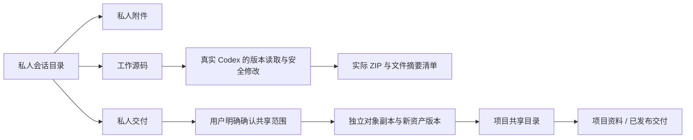

# 持久云文件、版本引用与 Codex 工作源码

2026-10-19 · 当前源码实现，尚未重新发布 Windows 安装包。主需求仍为 REQ-001/002/012/014/049/063/068/090/091；本分册不缩减 102 条完整验收范围。

## 文件范围与用户流程

Web 与 Desktop 增加「云端档案」入口，私人会话可直接打开自己的文件工作区。每个项目创建共享工作区，每个私人会话创建独立工作区。项目默认包含「项目资料、交付产物」；会话包含「会话附件、工作文件、交付产物」。这些记录保存在 PostgreSQL 与不可变对象存储中，不依赖浏览器页面或 Codex 本机缓存。

文件页支持目录浏览、范围内搜索、游标分页、新增目录、引用已有素材的指定版本、重新命名、范围内移动、文本/小型图片预览、下载和删除目录条目。移动不会改变 workspace_id、private_owner 或引用版本。跨私人/共享范围需要显式发布副本，不能靠移动扩大权限。

会话上传将 conversation_id 固定到上传会话。创建、状态查询、分片、完成及取消均核查当前成员、项目写权限与会话归属。完成后创建私人资产并归入附件目录；普通项目上传归入共享项目资料。发布副本需要确认项目成员可以访问，服务端为该文件版本创建独立对象并校验实际字节、大小和 SHA-256。删除私人来源不影响已经发布的独立副本。

## 数据库约束

023/024 为前向迁移，两套原生开发/测试数据库均已实际执行；已执行 SQL 不原地改写。cloud_workspaces 与 workspace_nodes 启用强制 RLS，app 身份受企业、私人所有者、工作区父对象、内容状态及祖先状态约束。项目当前授权仍在每个请求和工具入口核查，控制层正文读取继续单独授权并审计。

节点使用同工作区的复合父外键；数据库触发器验证企业/项目/私人范围一致、文件引用同项目获准资产、父对象是有效目录。名称采用 NFC、限制长度、拒绝路径分隔符、控制字符和点路径；同父级名称大小写无关唯一。目录变更由项目级事务锁串行化，并检查环及最长 20 层，两个并发移动不能形成环。预设根目录不能通过普通 API 改名、移动或删除。

asset_version_id 是不可变文件版本的引用，节点 version 用于编辑冲突控制。源文件出现新版本时，独立引用保留原版本；用户主动更换绑定或编程工具明确写入工作版本时，才更新对应节点。来源隔离或删除后，引用显示 unavailable/deleted，预览与模型读取拒绝返回字节。隔离目录会隐藏其全部后代，搜索或猜测后代 ID 不能绕过。

## Codex 的实际文件能力

具备 asset.read 的角色获得 cloud_files 与 cloud_file_read 工具。列表限定共享项目及当前私人会话；读取必须同时提供 workspace_node_id 和 asset_version_id，不能将旧的选择静默切到新版本。服务端再次检查当前范围、源状态、大小和摘要；咨询/计划模式只开放读取。

私人会话中的 code_read/code_write/code_package 直接使用持久工作文件。已有文件写入需要与读取结果匹配的 SHA-256，并由项目事务锁处理并发；缺失、已删除或被修改的来源返回冲突，不盲目覆盖。编辑导入的共享素材时创建私人版本，保持共享原件。源码路径继续执行本机代码工具的越界、保留目录和敏感文件限制。

单文件 1 MB、工作源码总量 500 文件/20 MB。打包读取当前授权的固定版本，生成实际 ZIP 和摘要清单，清单明确 execution_validation=not_executed，不声称已经运行客户项目测试。连续两次真实 Codex 任务已通过同会话源码读取、校验修改、新增文件版本与实际 ZIP 验证；模型输出仍由获准的模拟网关驱动。

## 删除与后台

删除目录条目永久移除该引用及其子条目，进入现有删除账本，清除条目名与版本引用。素材本体和其他独立引用保留；用户须在「素材与交付」删除源资产，才进入对象物理删除。这两个动作在产品确认文案中明确区分。

删除私人会话会关闭私人目录、删除全部条目、取消会话上传及登记暂存清理，父删除作业等待子作业完成。财务与审计不进入通用清理。规范 deletion 的 workspace_node 类型已接入；项目/企业整体删除、备份删除重放仍未完成。

Admin 的内容目录纳入 workspace_nodes，正文查看返回受控目录元数据，隔离、恢复、删除及改名继续沿用细粒度权限、范围、版本、原因和审计。节点隔离不改变独立源资产的授权。

## 接口与验证范围

规范接口现已提供 GET /v1/workspaces、GET/POST /v1/workspaces/:workspace_id/nodes、PATCH/DELETE /v1/workspace-nodes/:node_id、GET /v1/workspace-nodes/:node_id/reference、POST /v1/artifacts/:artifact_id/promotions。X-Tenant-ID、当前会话、CSRF 与幂等规则生效；现有客户端使用兼容的项目内路径，Desktop 经受限原生桥调用。

OpenAPI 同步根目录类型、引用可用状态、根节点移动的 parent_id=null、会话上传字段及预览响应。实际浏览器 HTTP 响应的六份样本通过严格 schema 验证，见 [样本验证](../quality/runtime-contract-samples.json)；这不等于整个 222 操作契约已经一致。

平台五组集成测试包含重启应用后持久读取、并发编辑/移动、跨企业/项目与私人隔离、来源删除、独立对象共享、目录隔离、会话上传清理及源码安全修改。Web 四组浏览器验收记录在 dev/copypaste-delivery/evidence/cloud-files.json，实际截图随 Web 仓库保存。

当前预览文本上限 100 KB，安全位图上限 2 MB；其他文件通过授权下载预览。尚未实现 Office/PDF 分页预览、素材选择器超过 200 项的检索、全量 1 GiB 各端实传、对象存储生产演练、完整恢复/备份与所有业务需求。这些仍保留在整体差异清单。
