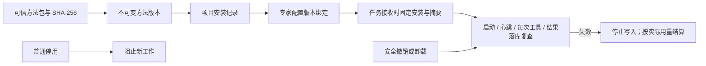

# 项目技能安装、版本绑定与安全撤销

**阶段 87 当前增量：** Desktop 目录监听、稳定快照、持久批量队列、原轮次客户回答、实际应用重启后暂停、原线程/固定版本继续、独立费用和预算/撤销已有限定验证。57 项打包 Desktop、91 项 Desktop 单元、161 项客户端单元通过；原 50/69 项保留。紧凑摘要分行及页面 Home/End 修复已核对；输入框保留光标操作。全部 14 个运行素材/许可证保留，仓库媒体不进入运行 ASAR。本阶段不新增 API/SQL；沿用阶段 86 未变化后端/Web/Admin/Extension 的历史 1023/25/36/14 范围，不宣称完整套件重跑。REQ-040/042 更新部分，原 102 项为 86 部分／16 未证明完整／0 完整验收；至少十二个专业角色和 G01–G10 继续开放。见[当前方案与精确证据](87-desktop-folder-work.md)。

下文保留原规范和各阶段历史记录；历史「当前」及阶段专用命令仅解释其原始回执。新发布流程使用本阶段检查点、文档/媒体核对和提交清单。

**阶段 86 历史基线：** 共享配置草稿/精确预览/不可变发布、新工作固定版本、旧任务保留原版或原先无配置状态，已在实际 Web、原生侧栏及本机 Codex 核对。本机三次执行采用 v3/v3/v4，资料工具与本地原字节、各自费用结算均检查。侧栏聊天附件先建立本人私有会话，分片校验与精确恢复回执不回退共享；同项目另一编辑者不能列出、下载、读取版本或访问私有会话。独立 Admin 正文/费用权限与隔离/恢复/永久擦除继续生效。平台 1023（保留原 1001）、核心 25、兼容 36、客户端 139、实际 Web/Admin/侧栏 14、打包 Desktop 50 分别通过，选定源码精确相符。SQL103 增量保留 SQL001–102 和四份历史契约；487 配置路由加 1 条条件 demo 路由。REQ-065 更新为部分验证，原 102 项为 84 部分／18 未证明完整／0 完整验收，G01–G10 和其余全部差异保留。假模型证据不代表真实专业质量。见[当前方案与限定证据](86-shared-project-guidance-and-private-chat.md)。

以下保留既有规范及历史记录；阶段专属命令仅解释当时回执，当前增量以前述方案、检查点和发布流程为准。 Existing specifications and historical records follow. Stage-specific commands explain their original receipts; the current increment uses the guidance, checkpoint and publication flow above.

**阶段 85 历史基线：** 原任务中的音频提案需原客户以当前登录会话独立确认精确内容和公司报价；默认不勾选，权利依据/用途为空。模型与 Admin 不能代签。拒绝、截止、停止及撤权阻断派发，撤回阻断交付但保留真实或未知费用。新增 SQL102，保留 SQL001–101、四份已发布契约及旧角色/Skill。平台 1001（全部原 988 用例保留）、核心 56、兼容 80、客户端 124、真实 Web/Admin/原生侧栏 13、打包 Desktop 41 分别通过；全部选定源码摘要精确相符。Desktop 保持客户本机 Codex、主动可撤销全权限、无边框/菜单，无可见纵横滚动条，保留滚轮/键盘/末项焦点及真实进度。原生右侧栏保持云端 Codex 和获准文件上传。真实声音/粤语质量、后台音频发行和未知 POST 外部证据结算仍保留；原 102 REQ/102 TC 为 83 部分／19 未证明／0 完整验收，G01–G10 不变。见[当前方案与限定证据](85-audio-rights-and-administration.md)。

当前目录为 18 个专业角色、29 类 Skill、32 个包版本；影片角色 1.4.0 绑定 speech-production 1.2.0，旧角色 1.3.0 和 31 个已发布包完整保留。见[当前可执行目录副本](../contracts/role-preset-catalog-current.json)。原设计目录和历史版本保持各自范围；角色登记及假服务运行不等于最低 12 个专业角色的完整真实业务验收。

<!-- stage60-template-video -->
阶段 60 新增 `template-video-composition`，阶段 60 当时共 29 个随附 Skill；原 28 个包的字节与 18 个角色的完整验收条件保留。R16 v1.1.0 绑定已实现的模板视频能力，已安装旧版本不自动改变；实际合成工具链验证与完整角色资格分别记录。详见[视频工程](60-template-video-production.md)。

2026-10-19 · 当前源码实现。仍采用唯一 Codex 与内部 AI 通道，模拟依赖不形成角色真实服务资格。

## 用户路径

Web 与 Desktop 的「专案技能 / Project methods」展示 29 个平台随附方法，支持搜索、查看内容、来源、精确版本、摘要、工具依赖和项目安装状态。选择预设专家会自动安装从未安装过的必需方法，客户无需逐包配置。管理操作限当前企业 Owner/Admin；普通成员可以查看，不能通过 API 绕过。

普通停用只阻止新任务与新专家版本，已经接收的任务沿用固定版本。安全撤销立即阻止旧会话、排队任务和执行中任务的后续工具调用，且该项目不能重新安装同一被撤销版本。卸载也立即阻止后续调用；明确重装会创建新安装身份，旧任务与旧专家版本不会自动绑定新身份。专家保存新版本后才能采用重装结果。

## 数据与执行约束

025 前向迁移引入 skill_versions、skill_installations、agent_skill_bindings、task_skill_bindings。平台源文件在启动时检查内容摘要，版本 ID 根据包名、版本与摘要确定。方法定义和工具清单来自可信产品目录；用户参数不能提供本机路径或覆盖指令包。方法包完整性验证与角色真实任务资格是两个独立状态。

安装记录具有企业/项目复合外键、状态、启用标记及 CAS 版本。数据库阻止变更安装的企业、项目、方法版本和创建者，永久撤销不可恢复。当前有效安装唯一；卸载记录保留为墓碑，重装创建新 ID。Agent/任务绑定以相同企业和项目的复合外键及触发器核查，任务绑定还受任务私有 RLS 约束。

新任务按项目锁串行获取当前安装，固定具体安装 ID、方法版本和摘要。私人专家任务还必须匹配已选 AgentVersion 的绑定。运行阶段不把普通 enabled=false 解释为安全撤销，但持续检查 installed 状态、平台禁用、包摘要、当前用户/项目权限及实际有效方案。任务启动、心跳、工具事务和最终结果保存均核查；后台重试同样固定新任务绑定，不能绕过停用。

当前方案的能力或角色权限收回后停止后续工具及输出保存。费用仍使用原任务预留，已测得用量结算一次，不把权限变化当作免费已发生调用，也不重复释放预留。未知费用继续按既有对账规则处理。

历史专家版本在启动时补建绑定，不改写原正文。历史任务在首次执行时受当前安装约束进行一次采用，删除或撤销的安装不会被自动重建。方法安装不授予文件、OAuth、设备、模型或网络权限；实际执行仍受独立工具授权约束。

## 接口与验证

规范 GET /v1/skill-versions、GET/POST /v1/skill-installations、PATCH/DELETE /v1/skill-installations/:id、GET /v1/agents/:id/effective-capabilities 已实现。现有客户端使用同项目嵌套兼容路径，详情接口提供确切方法内容。修改继续要求 CSRF、幂等、当前权限及版本；安全撤销和卸载有明确影响提示。

五组集成测试实际验证项目隔离、普通成员拒绝、安装幂等、两个版本竞争仅一个成功、停用后旧任务继续、撤销后下个工具拒绝且输出不落库、卸载重装不复活旧任务、旧专家须显式采用新绑定，以及方案权限变化后的单次结算。三组浏览器验收覆盖真实页面操作、两主题/语言和四种宽度，截图随 Web 仓库保存；四份实际 HTTP 响应加入 [严格样本验证](../quality/runtime-contract-samples.json)。

当前只支持平台随附的可信方法包。自定义包创建、试运行审核、组织发布与版本升级比较尚未实现；输入/输出描述仍为基础结构，精确业务输入由角色和工具 schema 约束。effective-capabilities 排除未实现工具，但连接资源、设备等完整动态缺口仍需补齐。因此本分册不将 TC-064/074/075/079/099/102 整项关闭，≥12 个角色的真实服务资格仍为零。
