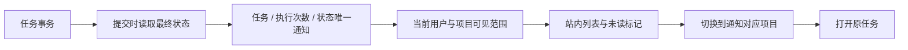

# 站内通知、任务定位与当前权限

2026-10-19 · 当前源码增量，关联 REQ-061/072/090/091。模型依赖采用用户授权的模拟数据，通知、真实 Codex、授权、任务和账务状态仍由实际系统产生。

## 产品行为

Web 与 Desktop 的「工作通知」提供全部/未读、标记已读/未读、手动刷新和游标分页，每页 50 条，每 15 秒同步。通知只属于任务创建者；显示当前获准的任务名称、项目和状态，打开前切换到该任务的项目，再进入原任务。任务名称从当前授权任务关联读取，通知表不复制私人正文、凭证或完整提示词。任务详情维持原会话归属。当前只做站内通知，没有新增邮件、IM 或其他外发。

状态覆盖运行中、待审批、完成、失败、取消和待对账。schema 也保留需要输入与部分完成；这两个枚举不代表对应业务状态机已全量实现。旧任务不伪造补发通知。

## 一致性与访问控制

026 前向迁移增加 notifications、索引、复合外键、RLS 和延迟约束触发器。触发器在任务事务提交时检查最终行，跳过同事务中已被覆盖的中间状态；结算改为 reconciling 时，不发送一次虚假的成功通知。心跳或其他字段更新不会重复生成相同执行次数/状态的通知。

cp_app 仅可查询并修改 read 字段。列表和已读操作均检查企业、当前项目访问和接收者；任务或父级隔离、删除、成员移除后不能通过猜测 ID 获取或修改通知。列表分页保留 PostgreSQL 时间戳微秒，避免转换为 JavaScript 毫秒后漏行。游标已被清理或失去访问权返回 410，用户刷新后重新开始。接口错误期间页面隐藏旧列表和未读标记。

通知保留 30 天，由现有有界清理任务物理删除。任务永久删除同时移除关联通知；财务及审计记录保持独立保留规则。Admin 可管理新页面的导航呈现，但导航隐藏不代替 API 授权。

规范 GET /v1/notifications 与 PATCH /v1/notifications/:notification_id 使用 X-Tenant-ID。客户端兼容路径位于 /v1/tenants/:tenant/notifications。PATCH 要求 CSRF、幂等和严格 read 布尔字段，不接受接收者或项目重写。

## 实际验证及剩余条件

四组 PostgreSQL/HTTP 集成测试覆盖接收者隔离、重复已读、待对账不误报、同毫秒分页、权限撤回、隔离/删除与到期。四组 Web 浏览器验证覆盖真实 Codex 与模拟模型产生通知、跨项目跳转、已读筛选、四种宽度、两主题/语言和注入的权限刷新失败。实际两份 HTTP 响应参与严格契约样本验证。

报告位于独立 delivery 仓库 evidence/notifications.json，截图位于 Web assets/screenshots/27–28。完整 REQ-072 仍要求附图、缺项恢复和首项实际业务成果，不以通知局部验证关闭综合用例。源码快照与历史 0.5.0 安装包仍分别记录。
