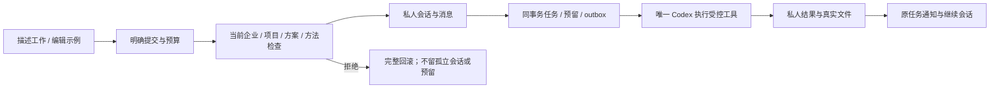

# 默认助手与首次委派

2026-10-19 · 当前源码增量，关联 REQ-061/062/067/072/075。默认助手不计入至少 12 个专业角色的资格数量。

## 默认路径

新用户确定企业和项目后，可在工作台直接描述工作、编辑示例并明确提交；不要求先创建专家、品牌或外部账户。默认选择「预设助手」，可完成获准资料的读取、问答、计划和文字交付。专业角色继续供图片、代码、设计和业务专项工作使用。默认助手只有 asset.read/asset.write，不把它展示成已具有完整图像、视频、程序执行或广告账户能力。

工作台的默认委派在一个事务中创建私人会话、第一条消息、任务、方法绑定、预算预留及 outbox。成功后进入原私人会话。点击示例只填写可编辑草稿，不自动启动 AI。创建空会话或保存笔记也不启动 AI。

## 共享配置与私人内容

027 前向迁移增加 builtin_default 和每项目唯一索引。首次使用按项目锁建立固定配置：Codex、内部文字模型和精确 delivery-core 安装。不同成员共享该方法配置，但会话、上下文、记忆和产物仍受各自私有归属约束。

客户不能通过普通修改或删除接口改变共享默认配置；数据库也禁止 cp_app 改写受保护字段。需要自定义时可复制成普通专家。平台 Admin 仍能按既有正文/治理权限隔离默认实例；隔离后的实例不会被请求「新建助手」绕过，唯一约束和明确错误阻止自动重建。

方法卸载/撤销规则与所有专家一致。卸载后重新安装产生新身份；既有任务和会话保留旧绑定。Owner/Admin 可明确点击「采用目前技能版本」，通过 expected_version 创建默认助手的新配置版本，再由新会话采用。历史会话不会自动切换。安全撤销的同一方法包不能借此恢复。

## 接口与重试

当前客户端接口位于 /v1/tenants/:tenant/projects/:project：POST /delegations 接收 title、prompt、mode、budget_micros、client_message_id；POST /conversations 可省略 agent_id 选用默认助手；POST /default-assistant/versions 接收 expected_version，要求项目管理权。公开元数据由 GET /v1/catalog/default-assistant 提供，专业目录保持独立的 18 个候选。

同一 client_message_id 的相同默认委派复用原消息、会话、任务和预留，载荷变化返回冲突。Web 新工作对话框与 Chrome 侧栏在请求结果未知时保留同一请求身份供重试；内容改变会创建新的身份。此保证覆盖同一打开的表单重试，不宣称跨设备或任意清理浏览器状态后自动恢复草稿。

六组 PostgreSQL/HTTP 集成测试覆盖并发首次创建、私人隔离、原子去重、真实文件保存、预算拒绝回滚、只读模式、不可修改/删除、隔离不可绕过，以及卸载重装后的明确版本采纳。受控 Runtime 测试属于合成业务验证；浏览器真实 Codex 和原生端证据按独立报告记录。

完整自然语言依赖补齐、已付费步骤原任务检查点恢复、专业团队及全部规范模板接口尚需后续完成。本分册不将整项 TC-062/069/072 或角色真实服务资格记为通过。

Web 两组页面旅程各四组通过；源码 Desktop 八组通过，包括原生 PKCE、29 MiB 实传、默认私人文字任务及通知跳转。Chrome MV3 另覆盖真实 PKCE、接受响应丢失后的去重、通知定位及宽度/主题/语言。Desktop 的公开配置/内容读取不要求登录，避免初次启动隐藏模拟标识；私人接口仍要求原生凭证。

显式提交的首次模型调用前文件/连接需求已在三端实现，等待、资源选择与原任务继续见 [运行前资料补齐](22-pre-execution-input-checkpoint.md)。本功能不代替自然语言自动发现或已付费步骤恢复。
