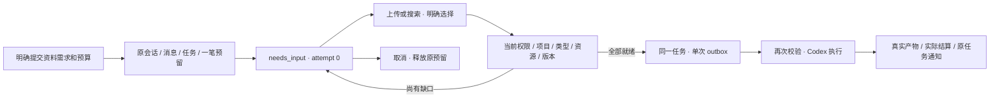

# 运行前资料补齐检查点

2026-10-19 · 当前源码增量，关联 REQ-007/009/035/044/046/061/067/069/072。保持原始 102 条综合验收要求；本分册只定义已实现的运行前子流程。

## 用户流程

Web、源码 Desktop 的新工作对话框和 Chrome 侧栏可明确选择「先等我提供档案」。具备 connector.read 的专业角色在 Web/Desktop 还可要求先选择 Google Ads、GA4、Search Console 或 Meta 连接。用户提交时保存原任务并预留预算；所有要求补齐前不建立执行 outbox、不领取任务、不调用模型。

Web/Desktop 在原私人会话和任务页显示补齐卡片，可搜索、分页选择当前档案版本或既有获准连接。没有候选或请求被拒绝时禁用确认；不自动选中第一项。会话卡片明确传递原会话 ID，补传附件仍为私人文件。Chrome 可选择已有文件或连接，支持搜索和分页；新增等待条件目前只提供文件，侧栏文件选取器明确上传到共享项目、上限 5 MiB。管理连接授权及完整私人会话仍在完整工作台进行。

## 数据及接口

028 是仅前向迁移，增加 task_dependencies 和任务 needs_input 状态。复合外键固定企业、项目和任务，任务/step_key 唯一，行级安全继承当前任务可见性；不接受客户端改变归属、状态或工具范围。任务删除会清除资料说明；取消或失败会将未解决需求关闭。

当前客户端的 POST /tasks、POST /delegations 接受可选 dependencies，最多八项；每项为 file 或 connection、说明、可选 resource_ids。文件绑定不可变 asset_version UUID，最多二十项；连接须声明 provider 并恰好选择一个 ID。现有会话消息委派的请求尚未接入新增条件。

| 接口 | 已实现行为 |
| --- | --- |
| GET /v1/tasks/{task_id}/dependencies | 严格 DependencyRequestList，含 null next_cursor；支持企业/项目嵌套兼容路径 |
| GET /v1/task-dependencies/{dependency_id}/resources | 严格 DependencyResourceList；q、UUID cursor、limit 1–100（默认 50）；不暴露密钥 |
| POST /v1/task-dependencies/{dependency_id}/resolutions | expected_version 与显式 resource_ids；Idempotency-Key 必需；返回 202 和当前实现的任务行 |

规范路径以 X-Tenant-ID 定位企业，仍重新验证当前成员、项目动作和私人归属。嵌套任务列表同时校验路径项目。确认操作依次锁定任务与需求行，CAS 拒绝旧版本；同一已接受版本及相同资源的重复确认返回当前任务，不重复预留或入队。载荷变化返回冲突。

列表与候选已捕获真实 HTTP 样本并按设计 schema 核验。确认返回的既有任务行与设计中的完整 Task DTO 尚不一致，不将路径存在或 202 误报为完整契约通过。规范 TaskCreate 中新增字段为增量设计约束；现有嵌套任务创建结构仍需完整映射。

## 执行及授权约束

文件必须在同一项目、处于 active、为当前版本。共享任务只能选择共享文件；私人任务还可选择任务创建者自己可见的私人文件，不能把私人名称或正文带入共享任务。该检查点尚不接受历史版本，历史引用使用既有云文件机制。连接必须是声明的 provider、仍为 connected；选择连接不授予任何未选广告账户，也不自动导入报表。

最后一项确认时重查先前选择；领取任务、每次工具调用、三秒执行心跳及结果落库再次验证。尚未调用模型的普通任务遇到源文件更新/撤销时回到同任务的 needs_input，原预算不变。已经开始模型执行后撤销资料，会阻止后续工具及结果发布，按已知实际用量结算或进入既有对账，不以零费用或自动重跑掩盖已接受调用。

后续任务和管理员明确重试会继承资料要求。已失效的继承来源要求重新选择；管理重试建立新任务和一笔新的明确预算，保留原私人归属，不因重试跳过补齐。

Admin 只有在 admin.content.body.read 范围允许时，才能通过原任务正文查看需求说明、资源 ID 与状态；支持元数据权限不授予该内容。隔离、取消、永久删除及审计沿用任务治理边界，不新增可绕过任务归属的独立后台需求编辑入口。

计划摘要绑定所选资料；批准时资料变化返回 PLAN_STALE，要求重新规划。已经批准但未开始的执行若资料失效，会取消并以 PLAN_INPUT_CHANGED 说明原因、释放未使用的预留。不能借此在已批准的计划中替换来源并继续执行。

## 验证范围及剩余工作

后端集成覆盖：等待/无模型/无 outbox/单预留、并发相同/不同确认、跨用户/跨项目/私人资源、取消释放、资源撤销/新版本、连接类型与凭证隔离、后续继承、删除清理、管理员重试，以及运行后撤销与计划失效。浏览器验收覆盖真实私人分片上传、明确选择、原任务执行/结算和通知；Codex 为真实锁定程序，模型与业务输入为明确标识的假数据。

证据位于 delivery 的 evidence/task-dependencies.json、alignment-desktop.json、extension.json 和 alignment-platform.*；HTTP 样本校验见 [响应报告](../quality/runtime-contract-samples.json)。截图随各独立客户端仓库交付。

自然语言自动发现缺口、已付费步骤检查点继续、capability/device 需求、设备离线等待及全部媒体/连接器恢复尚未实现。本增量不将完整 TC-069、全量 TC-009 或正式专业角色准入标记为通过。
