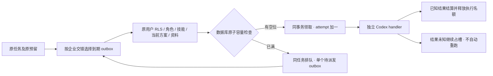

# 执行容量、企业公平调度与排队

本分册记录当前未发布源码的运行修复。原 SRS、全部 102 个 TC 和 NFR 完整负载条件保持不变。模型/媒体依赖暂用获准假数据；SQL、队列、权限、文件、账本与 Codex 仍按实际路径执行。

## 原问题与产品行为

原 Worker 使用一个 pg-boss handler，所有企业任务实际串行。套餐的 max_active_tasks 是每企业内、每用户可持有的未完成工作上限，包含排队、资料等待、执行、人工批准、暂停和对账；它没有替代企业共用执行槽或能力容量。

现在每个原生 Worker 默认启用 10 个独立 handler。领取前在数据库同一事务检查当前企业、用户方案、全平台和能力容量，再把原任务从 queued 转为 running。容量不足只保持 queued 和原预算，不增加 attempt、不调用模型、不重复预留。前台展示等待说明；系统稍后自动续接，用户也可取消。

## 数据库与执行约束

前向迁移 029 增加任务 execution_class、capacity_wait_reason、capacity_retry_at，执行容量索引、待派发索引和 execution_capacity_policy。现有任务按已安装角色及工作模式回填；咨询/计划属于 text，含图片能力的执行属于 image，视频/语音属于 media。这是保守的整任务容量分类，不是对每个供应商请求的独立并发限额。

两种数据模式各有策略行，默认全平台 10 个 Agent 槽、每企业 2 槽、图片 2 槽、媒体 2 槽、每企业媒体 1 槽。图片和媒体仍计入 Agent 总槽。WORKER_CONCURRENCY 只调整单进程 handler 数，不能扩大数据库上限；多个 Worker 仍共用同一数据库策略。修改策略为服务端部署操作，尚未提供 Admin 策略发布 UI。

claim_execution_capacity 由非 owner、无 BYPASSRLS 的 cp_control 拥有，以 SECURITY DEFINER 只进行最小跨企业计数与原子领取；普通用户 API 不暴露它。函数逐项验证 app.tenant_id、app.actor_id、任务创建者、状态、attempt=0、未删除/取消和参数范围，再按数据模式取得事务锁。返回只含粗粒度阻塞原因，不返回其他企业计数、标题或正文。cp_app/cp_queue 不能读取或改写策略表；队列身份不能调用领取函数。业务工具仍使用受限 RLS 身份，不以此获得其他用户资源。

当前有效方案在领取时重新计算。原 Business 队列若降级为 Starter，不会把旧的八项上限当成当前可执行数；已有预算和费用仍依冻结规则结算。企业/用户计数覆盖同企业不同私密会话。已开始的 reconciling 仍占槽，避免租约超时后未知外部执行与新调用超额重叠；尚未领取的 needs_input 不占执行槽。

## 公平派发、重复及故障

实际 outbox 查询按各企业的队列位置交错，再按创建时间和 ID 排序；不会把一家企业较早的 25 条记录全部放在另一家企业之前。FOR UPDATE SKIP LOCKED 支持多派发器。此为有界交错机制，不构成持续过载下的时延保证；不同能力池的完全独立队列仍待建设。

容量阻塞时设置两秒后可再次派发，更新领取恢复时间，并在任务锁下确保最多一个未派发替代 outbox；相同原因不反复追加等待事件。重复队列回调仍以任务行锁、queued/attempt、fencing_token 收敛。既有领取恢复不重复增加预算，也不恢复已付费或未知执行。

已知成功/失败/取消退出计数；对账工作须经既有受控流程处理，不通过重置状态或清账假装释放。Worker 停止会取消自己持有的运行；原生停止命令等待受控进程和 PostgreSQL checkpoint 实际结束，不只等待停止确认。

## 用户端与后台

Web/源码 Desktop 的原会话和任务页显示容量等待说明，用量页区分未完成上限与企业共用容量。Chrome 侧栏显示相同的自动等待语义。语言/主题变化不改变任务和预算。Admin Execution 列表按既有 admin.execution.read 及数据范围展示可读的排队原因；没有新增越权正文或凭证入口。取消和重试继续沿用近期 MFA、原因、当前权限及幂等约束。

## 实际验证及边界

七组隔离数据库测试验证：跨企业、其他用户身份及策略权限拒绝、两 Worker 并发与跨企业可执行、同任务单预留、套餐降级、图片/媒体/全局上限、咨询分类、未知调用保留名额、缺资料不占槽、公平选择、原生 pg-boss 多 handler 与自动恢复。测试创建独立的随机原生数据库，应用全部迁移，完成后关闭连接、删除本次数据库及专用数据目录。

实际 Web 验收使用两个明确标识、私密且从未派发的模拟占槽记录，仅在新建模拟企业中测试等待；释放自己创建的记录后，真实 Codex 经模拟模型产生实际私人 Markdown 文件，核对一笔预留和一次结算。后台另验证独立 MFA 登录后的排队原因。截图随各独立仓库保存；所有自建浏览器实例在 finally 中关闭。

这些证据不等于 NFR 的 10 企业、50 用户、10,000 素材/企业、100,000 标准化报表/企业及 30 分钟完整压测。独立视频/同步队列、供应商逐调用限流、团队等待槽释放与统一预算、正式媒体、全部权益交集和灾难恢复仍是完整需求。
