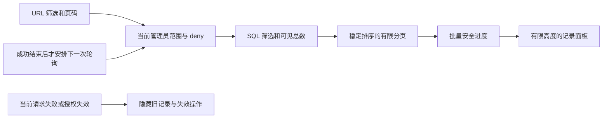

# Admin 记录分页、撤权显示与原生测试隔离

本次落实 REQ-049/090/094/098/100 的清理记录子流程及后台默认分页约束。模型和媒体仍使用已授权的模拟数据；登录、邮箱码、TOTP、权限查询和 PostgreSQL 分页均为真实实现。

## 页面与接口

内容管理的永久清理面板提供状态、内容类别、记录/目标 ID 的组合筛选。筛选条件、页码及页大小写入 `cleanup_*` URL 参数，刷新保留条件，改变筛选从第一页开始。默认 50 条，可显式选 25/50/100；50/100 条记录在可用键盘聚焦的有限高度区域内滚动，页码控件位于区域外。筛选后总数仅计算管理员当前可见的记录。宽表的水平滚动限于表格容器。

`GET /v1/admin/deletions` 支持 `tenant_id`、`project_id`、`state`、`target_type`、`search`、`page` 和 `page_size`。页码 1–10,000，页大小 1–100（默认 50），搜索最长 160 字符。搜索是记录 ID 或目标 ID 的大小写无关字面子串，`%` 不作为通配符。未知查询参数及无效枚举返回 400。状态包括 queued、cleaning、completed、completed_with_exceptions 和 failed；内容类别限于当前已实现的十二类清理目标。

数据库先应用当前 `admin.content.read` 的企业/项目 allow 和 deny，再进行筛选、计数、排序及分页。没有有效授权时列表与总数均为空。使用 `created_at DESC,id DESC` 处理相同时间戳；这是有序的 offset 分页，并非冻结快照，新增记录可能改变下一页位置。响应不包含对象路径、私人所有者、租约 token 或凭据。

每页进度改为批量聚合，失败明细批量读取，每个作业最多展开 100 条安全错误元数据。新增迁移 030 为整体排序、状态、类别及项目查询建立索引；001–029 保持已应用字节不变。用户、企业、通用后台集合、管理员身份及云端定时的分页默认值均统一为 50，显式上限仍为 100。

重试继续使用 `POST /v1/admin/deletions/{id}/retry`，要求 `admin.content.delete`、当前目标范围、最近 MFA、原因及幂等键。HTTP 200 表示已持久排队或返回已完成结果，不表示物理清理立即完成。只读账号没有重试按钮，直接调用也被拒绝；清理失败重试不会恢复原内容。

## 请求失败与旧数据

Admin 通用 `useData` 按 URL、刷新版本和轮询间隔绑定数据。切换查询的当次渲染即不再暴露旧页面；请求错误清空旧结果。轮询在上一请求结束后安排下一次，不允许慢的成功响应越过后来的权限拒绝恢复数据。卸载或更换查询会中止旧 HTTP 请求。删除记录面板遇到错误或失去重试能力会关闭重试对话框。服务端仍是最终权限执行点；页面显示不能替代服务端授权。

## 测试隔离修复

首次全套回归出现 18 项失败，原始 TAP 和摘要保存在 delivery 的 `evidence/admin-records-first-regression-failure.*`。原因是重复使用的 `copypaste_test` 已留存 10 个 configured_services 待对账任务，正确占满全局执行槽；后续 Worker 测试未领取任务。未通过扩大生产容量或清除历史记录规避此问题。

十一组应用集成测试及迁移校验测试现在分别建立 `copypaste_suite_<随机 UUID>` 原生数据库和 `.data/test-runs/<随机 UUID>` 目录。每库应用完整的前向迁移，测试结束关闭应用，再仅删除匹配固定前缀和 UUID 的自有数据库与目录。创建前验证数据库为 loopback，清理前验证绝对目录仍在指定根目录内。既有独立执行容量测试继续使用自己的原生数据库。历史测试库及演示库不被重置；没有调度 Docker、WSL 或虚拟机。

## 证据和剩余条件

新增三组平台测试覆盖 58 条同时间戳记录的完整分页、先过滤后计数、字段脱敏、非法参数、只读重试拒绝、跨企业/项目 deny、授权到期和六类后台列表的默认页大小。delivery `qa:admin-records` 的五组真实浏览器检查覆盖独立邮箱/MFA 登录、58 条可见及 6 条排除记录、组合筛选与 URL 保留、四宽度、两主题/语言、慢轮询拒绝清空以及当前数据库授权到期。自建浏览器在 finally 中关闭，测试主体最终被停用并撤销会话。

真实响应样本按 `AdminCleanupPage` 严格 schema 校验；实际截图随 Admin 仓库提供。全套结果、提交及原始摘要以当前质量报告为准，不以本节局部检查代替完整产品验收。

尚未完成后台百万记录负载压测、全部列表的组合业务筛选与列配置、跨页冻结快照、完整异步批量/导出、200% 缩放与全部无障碍用例，也未完成企业/项目整体擦除、备份删除重放和完整用户支持委托。这些继续保留在全部 102 条需求的差异表中。
