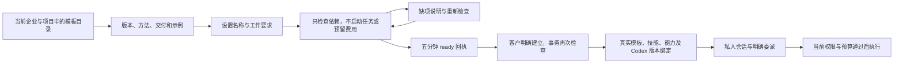

# 持久角色模板、依赖预检与 Codex 版本绑定

**阶段 86 当前增量：** 共享配置草稿/精确预览/不可变发布、新工作固定版本、旧任务保留原版或原先无配置状态，已在实际 Web、原生侧栏及本机 Codex 核对。本机三次执行采用 v3/v3/v4，资料工具与本地原字节、各自费用结算均检查。侧栏聊天附件先建立本人私有会话，分片校验与精确恢复回执不回退共享；同项目另一编辑者不能列出、下载、读取版本或访问私有会话。独立 Admin 正文/费用权限与隔离/恢复/永久擦除继续生效。平台 1023（保留原 1001）、核心 25、兼容 36、客户端 139、实际 Web/Admin/侧栏 14、打包 Desktop 50 分别通过，选定源码精确相符。SQL103 增量保留 SQL001–102 和四份历史契约；487 配置路由加 1 条条件 demo 路由。REQ-065 更新为部分验证，原 102 项为 84 部分／18 未证明完整／0 完整验收，G01–G10 和其余全部差异保留。假模型证据不代表真实专业质量。见[当前方案与限定证据](86-shared-project-guidance-and-private-chat.md)。

以下保留既有规范及历史记录；阶段专属命令仅解释当时回执，当前增量以前述方案、检查点和发布流程为准。 Existing specifications and historical records follow. Stage-specific commands explain their original receipts; the current increment uses the guidance, checkpoint and publication flow above.

**阶段 85 历史基线：** 原任务中的音频提案需原客户以当前登录会话独立确认精确内容和公司报价；默认不勾选，权利依据/用途为空。模型与 Admin 不能代签。拒绝、截止、停止及撤权阻断派发，撤回阻断交付但保留真实或未知费用。新增 SQL102，保留 SQL001–101、四份已发布契约及旧角色/Skill。平台 1001（全部原 988 用例保留）、核心 56、兼容 80、客户端 124、真实 Web/Admin/原生侧栏 13、打包 Desktop 41 分别通过；全部选定源码摘要精确相符。Desktop 保持客户本机 Codex、主动可撤销全权限、无边框/菜单，无可见纵横滚动条，保留滚轮/键盘/末项焦点及真实进度。原生右侧栏保持云端 Codex 和获准文件上传。真实声音/粤语质量、后台音频发行和未知 POST 外部证据结算仍保留；原 102 REQ/102 TC 为 83 部分／19 未证明／0 完整验收，G01–G10 不变。见[当前方案与限定证据](85-audio-rights-and-administration.md)。

当前目录为 18 个专业角色、29 类 Skill、32 个包版本；影片角色 1.4.0 绑定 speech-production 1.2.0，旧角色 1.3.0 和 31 个已发布包完整保留。见[当前可执行目录副本](../contracts/role-preset-catalog-current.json)。原设计目录和历史版本保持各自范围；角色登记及假服务运行不等于最低 12 个专业角色的完整真实业务验收。

<!-- stage60-template-video -->
阶段 60 新增 `template-video-composition`，阶段 60 当时共 29 个随附 Skill；原 28 个包的字节与 18 个角色的完整验收条件保留。R16 v1.1.0 绑定已实现的模板视频能力，已安装旧版本不自动改变；实际合成工具链验证与完整角色资格分别记录。详见[视频工程](60-template-video-production.md)。

本次落实 REQ-062/073–079 的模板目录、实例化及版本约束子流程。按用户要求，AI 与媒体继续使用明确标注的假数据。登录、权限、PostgreSQL、技能安装、版本身份和幂等写入使用真实实现；不据此认定专业角色已经完成真实业务验收。

## 用户流程与页面

Web 的「专业角色」及 Desktop 同步渲染器使用持久目录：18 个专业预设与 1 个默认文字助手。支持设计、开发、营销、流程分类，名称/职责字面搜索，以及有上限的游标分页。详情展示模板版本、示例、交付物、方法版本及品质标准。沿用官网暖灰白、深墨和亮蓝及深色主题；控件和示例提供繁中/英文。

客户可以设置专家名称、工作要求和语言。点击「检查可用性」只创建五分钟有效的预检回执，不安装技能、不建立专家、不启动 AI 任务、不预留预算。修改名称、工作要求或语言会清除当前检查结果。依赖就绪后，客户明确点击「建立此专家」；创建事务会重新检查当前依赖，因此旧的 ready 回执不是授权凭证。

未实现的工具、未就绪的内部能力、禁用角色或方法会显示为缺项，无法通过模板实例化。目录的可试用状态也排除未实现工具，不能将所有已登记角色都显示为可执行。模拟模式明确显示「可模拟试用」与「尚待验收」，而非真实服务资格。

创建响应丢失时，相同表单沿用幂等键重试，返回同一个专家，不再安装一套方法。预检获得响应后，用户主动重新检查使用新键，以免永远重放此前的缺项回执。重复点击在客户端和服务端均有约束。创建完成进入「我的专家」，随后由用户创建会话、明确委派和确认预算。

## 实际接口与权限

| 接口 | 当前行为 |
| --- | --- |
| `GET /v1/agent-templates` | 当前企业成员可读；可选项目还检查项目可读权限；分类、q、cursor、limit，默认 50、最大 100 |
| `GET /v1/agent-templates/{id}?version=N` | 返回数据库真实模板版本；省略 N 返回当前版本 |
| `POST /v1/agent-templates/{id}/preflights` | 要求项目写权限、CSRF 或有效原生 bearer、幂等键；201 持久回执 |
| `POST /v1/agent-templates/{id}/instances` | 相同权限；重新预检，原子安装允许的方法并建立专家/版本/绑定/审计；201 专家 |

四个接口均要求 `X-Tenant-ID`，服务端验证当前成员与项目归属。外部企业或不可见项目返回 404，避免披露其存在；已知项目内操作权限不足返回 403。无效/未知字段为 400，不存在版本为 404，失效游标为 410，幂等键内容冲突及当前依赖不足为 409。客户端不能覆盖 kernel、provider、API 地址、技能身份或模型配置。

预检包含真实回执 ID、模板/项目、状态、必需与可选缺项、已解析技能/能力 UUID、方案版本及到期时间。回执表开启并强制 RLS，限当前企业与本人。实例响应包含实际 `agent_version_id`、`template_version_id`、`runtime_profile_id`、技能安装 ID、职责及兼容的 `instructions` 字段。实例成功不表示任务或产物成功。

Desktop 主进程只向固定产品 API 转发经 UUID 格式检查的企业头；浏览器不能指定任意 origin。实际 PKCE 登录后，主进程继续使用受保护的原生凭证。缺少、外部及格式错误的企业身份分别被 API 或主进程拒绝。Chrome 扩展保留现有默认委派与文件能力，本次未新增扩展内模板编辑器。

## 真实版本与撤销边界

新增前向迁移 `031-agent-template-registry.sql`，001–030 已应用字节不变。`agent_templates` 保存稳定角色身份；`agent_template_versions` 保存不可改写的定义、哈希及运行配置。模板版本引用实际数据库 UUID，而非用目录 key 伪造版本身份。服务启动按审核过的随附目录播种相同哈希；定义变化建立版本，不修改历史正文。

`codex_runtime_profiles` 固定 kernel=codex、精确版本、stdio、公司内部网关策略及禁止自动回退。数据库限制运行配置不可改写；撤销不可恢复。`internal_capability_versions` 保存能力配置版本及模拟/已配置模式，正文和费率不可原地改写，只允许永久撤销。网关地址只保存指纹，密钥不进入版本记录或公共响应。模拟网关使用稳定模式指纹，原生重启端口变化不会使既有专家无故失效。

新 AgentVersion 必须引用启用的真实 Codex 配置，数据库写入触发器再次检查内核和精确版本。其正文保存模板版本、方法与安装身份、能力版本、运行版本及预设定义摘要。历史无运行配置引用的记录保持原始正文，不回填不存在的历史绑定；统一 Codex 适配器仍执行当前版本检查。历史版本的显式升级、差异比较和兼容运行尚未构成完整闭环。

当前配置发生变化时，不会把旧专家静默改绑到新能力。新委派在插入任务/预留预算前拒绝失效绑定。[阶段 52](52-capability-versions-and-frozen-task-pricing.md) 为任务追加独立、不可变的模型/强度/费率绑定：仅默认配置变化时，已排队任务继续其仍有效的原版本；原绑定缺失、被撤销或网关不再匹配时，领取前拒绝调用并释放未使用预留，attempt 保持 0。执行中，在心跳、每次工具调用及最终结果写入前复核；运行配置撤销会阻止后续工具和发布结果。已经发生的可确认模型消耗按原绑定费率结算，不能把撤销解释为全部免费。

## 验证证据与剩余差异

六组新增原生数据库/API 测试覆盖：19 条目录及真实身份、分页和跨企业拒绝；预检无副作用；并发幂等实例化及内核覆盖拒绝；技能停用/撤销后的重查；数据库不可变约束；能力配置变化前置拒绝、领取前零调用取消及运行中撤销阻止工具和发布。

上述六组属于阶段 25 的原始结果。阶段 52 保留所有既有测试与原失败来源，只把“启动默认配置改变即取消已有任务”的子断言调整为“原版本仍有效则继续并按原价结算”；新委派失效拒绝和内核撤销仍在同一测试内验证。当前七组模板测试已纳入阶段 52 的 35/35 专项。

delivery 的 `qa:agent-templates` 通过八组实际 Web/Electron 检查，包括真实邮箱登录、PKCE、目录/筛选、缺失工具、检查后编辑、真实接受响应丢失与重试、技能恢复后重新检查、四宽度、两主题/语言、注入权限失败隐藏目录、原生企业头拒绝。全部自建浏览器、上下文与 Electron 在 finally 关闭。界面截图分别随 Web 和 Desktop 独立仓库提交。

该次模板交付的回归为 145/145；后续 [PDF 设计交付](26-design-pdf-review-delivery.md) 后当前为 147/147。Desktop 单元检查 4/4；严格实际 HTTP 响应样本 21/21，其中模板列表、详情、预检和实例四份。规范仍为 225 个操作、187 路径和 294 个 schema；常规实际路由清单为 229 个 method/path，模拟模式另有仅开发用 demo-credit 路由。方法/路径数不是全接口一致性或全部需求验收结论。原始报告和摘要由质量工具登记，不人工改写 TAP。

仍未完成：模板草稿与受控发布、Admin 完整模板编辑/发布面板、品牌版本覆盖、输入 schema 对所有专业业务的完整校验、所有工具/连接器、企业模板包与版本差异采纳、团队和重复任务中的全部模板路径。旧的自定义专家编辑接口继续保留，尚未全部迁移为规范模板发布流程。模板安全依赖检查已落实；完整专业工作流不因预检通过而自动合格。

**真实服务合格角色仍为 0。至少 12 个通过完整任务、产物修改和异常验收的角色这一要求保留。** 18 个目录条目、28 个 Skill 包及模拟链路均不能替代该门槛。历史 0.5.0 安装包和离线 bundle 不包含当前源码修复。

