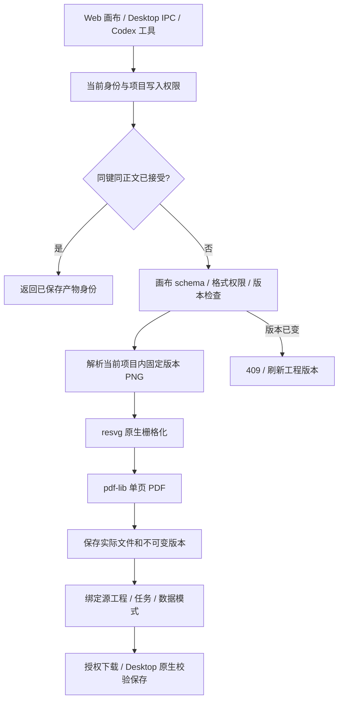
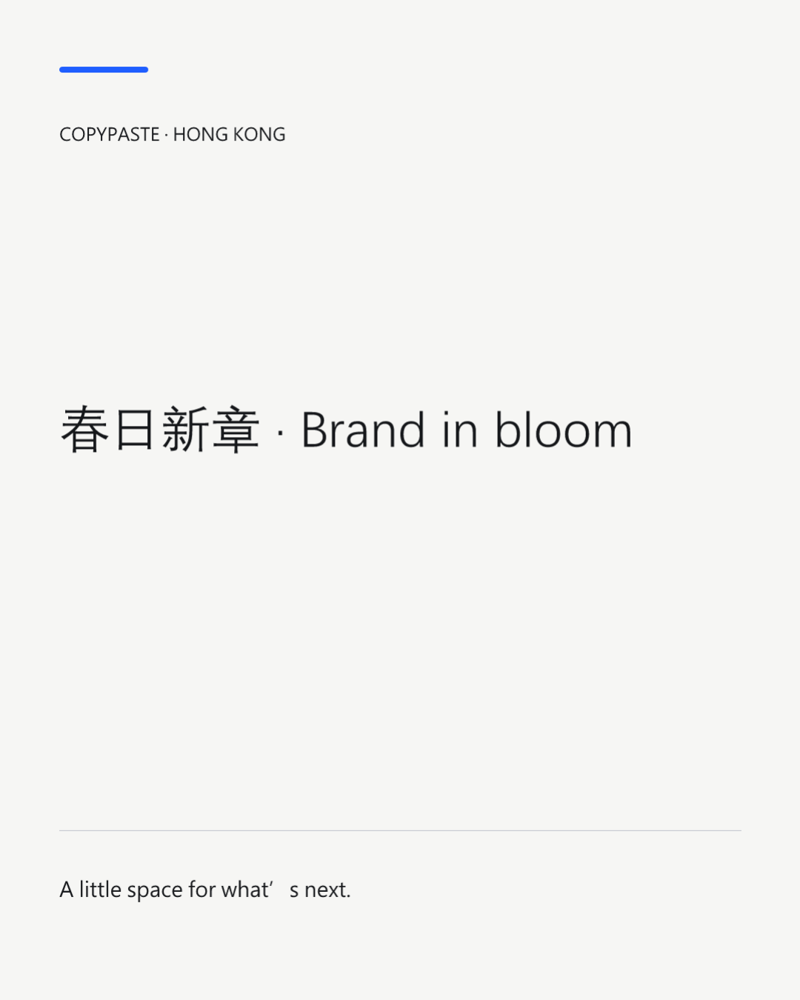
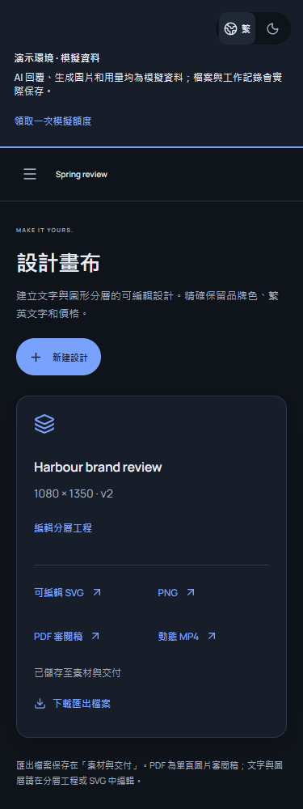
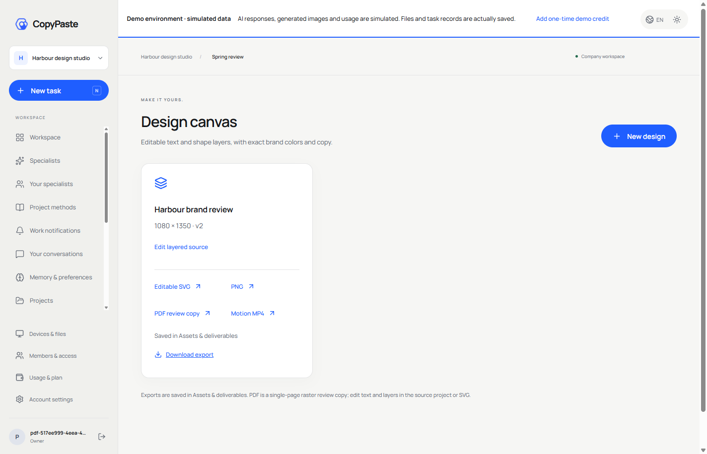

# 设计 PDF 审阅稿与可编辑源文件

2026-10-19。本文记录当前源码新增的原生 PDF 交付，不替代 REQ-012、REQ-022、REQ-073–079 的完整验收。模型与图像依赖继续按用户要求使用明确标识的假数据；文件生成、数据库、权限和下载执行真实逻辑。

## 交付内容与操作

Web「设计画布」保留分层工程，提供可编辑 SVG、PNG、PDF 审阅稿和有限模板 MP4。导出成功后显示保存位置及「下载导出文件」；产物也进入「素材与交付」。Desktop 显式同步相同界面快照，通过现有受保护 IPC 和原生保存对话框下载。

PDF 是**单页图片审阅稿**。原生 resvg 将已校验的文字、形状及授权 PNG 图层栅格化，pdf-lib 将图片嵌入实际 PDF。画布像素按 96 dpi 转为 72 pt/in 页面，1080 × 1350 画布对应 810 × 1012.5 pt。PDF 内不承诺可编辑或可搜索文字，文字、图层和图片版本继续保存在工程及可编辑 SVG 中。界面和 Codex 工具描述均说明这一点。

这项实现不包含可编辑 PDF 字体嵌入、CMYK、出血、PDF/A、印刷认证、分页 Office/PDF 编辑或完整排版引擎。它不能代替字体授权核查、专业设计质量、评论/接受/要求修改和完整交付包。

## API、版本和重复请求

当前已有的原生接口 `POST /v1/tenants/:tenant/projects/:project/creative/:id/render` 接受 `format=svg|png|pdf|mp4`。`expected_version` 为正整数；Web/Desktop 画布始终发送当前可见版本，其他兼容调用可省略。MP4 继续使用既有时长和动效参数。此接口是实际画布实现，尚未替代规范中完整的异步 `/v1/tasks/{task_id}/exports` 任务服务。

提交时检查项目当前写入权限，校验后读取实际工程正文。请求版本与当前版本不符返回 `409 VERSION_CONFLICT`，不新增产物。导出版本保存工程 ID、版本、完整源正文、参数和实际输出元数据。后续修改画布不改写既有导出快照；当前工程表本身仍以最新正文为主，不能把导出快照称为完整工程历史编辑器。

相同幂等键和正文返回同一已接受产物；正文变化返回冲突。客户端为尚未获得成功回执的相同导出保留原键，避免真实接受后响应丢失时生成重复文件。权限检查位于重放之前。若原导出已成功、工程随后变更，原请求的重放仍返回原产物；新键的旧版本请求被拒绝。客户端提供重新载入版本的入口。

PDF 使用 `application/pdf`，保存真实字节、SHA-256、大小及页数、页面点尺寸、像素尺寸、`purpose=raster_review`、`editable_text=false`、`print_certified=false`。下载沿用不可变素材版本、当前项目权限及传输后复查。Desktop 使用现有原生流式下载与服务端摘要校验，不向 renderer 暴露令牌。

## Codex 与角色工具边界

`design_render` 为实际受控工具。对外 JSON schema 与执行时使用同一份动态格式约束：

| 角色权限 | 可调用格式 |
| --- | --- |
| `layout.render` | SVG、PNG |
| `document.render` | 单页 PDF 审阅稿 |
| `video.render` | 原有有限模板 MP4 |

角色只获得其权限交集内的格式；不能凭工具存在扩大权限。问答/计划模式不开放该写入工具。每次执行继续复查当前成员、方案、角色、Skill、运行/能力版本、任务状态与 fencing。参数校验失败在创建源文件前拒绝。

工具调用保存真实 `.editable.json` 素材以及独立导出素材，后者引用源素材 ID。会话任务产生的两个文件均按既有机制归属私人会话；同企业的其他成员也不能直接读取。工具重放不重复生成源文件与 PDF。模型 token 成本继续按实际任务结算，文件栅格化本身不调用外部 AI 服务。

模板预检现在将已实现的 `document.render` 计入工具依赖。设计师、广告、电商、社交内容及字体排版等模板可因此通过相应模拟预检；仍需要其他工具的角色继续保持缺项阻塞。模板的 `qualification_state=unverified` 保留，**真实服务合格角色仍为 0**。

## 输入、安全与运行边界

沿用画布 256–4096 整数像素、最多 100 图层及受限颜色/字体/文字字段。图片按项目和固定版本解析，只接受既有授权 PNG、大小及像素上限；没有远程 URL、脚本或任意 SVG 输入。PDF 生成后再检查嵌入图片与工程尺寸一致。

PDF 路径使用原生 Node、resvg 和精确锁定的 MIT 组件 pdf-lib 1.17.1。[官方文档](https://pdf-lib.js.org/docs/api/classes/pdfdocument)和[项目许可证](https://github.com/Hopding/pdf-lib/blob/master/LICENSE.md)作为组件依据；锁文件记录官方 registry 的 SHA-512。运行不依赖浏览器、Docker、WSL 或虚拟化。独立 PDF 解析/页面渲染仅为交付 QA 工具，不作为产品运行依赖。

导出当前在受限画布的请求/工具事务中执行，尚未建立独立媒体队列、跨企业渲染负载上限或完整压力测试。完整异步导出、ZIP 版本清单、所有业务的源工程格式及真实内部 Image 2 质量验收继续保留为未完成项。

## 实际验证

平台全套原生回归 **147/147**，无失败、取消或跳过。新增测试执行真实 PDF 文件、私有源文件、格式拒绝和工具幂等；既有构图测试新增实际授权下载、原版本重放、并发编辑拒绝及外项目图片拒绝。受控模型适配器测试不冒充真实业务模型质量。

delivery 的 `qa:design-pdf` 通过七组实际 Web/源码 Electron 流程：真实邮箱和工作区、双语工程、真实接受后故意丢失回执、同键重试、下载、旧版本拒绝/刷新、四宽度和两语言/主题、设计师模板及 PKCE 后原生保存。独立 pypdf 读取一页和完整尺寸；Poppler 按 96 dpi 渲染后与同源 PNG 比较。该次每通道像素平均误差约 0.553，均方根误差约 6.538，中文和图层经实际图片复核。Desktop 保存摘要与服务端一致。报告保存本轮结果，全部自建浏览器、上下文和 Electron 已关闭。

这七组子流程和 147 条代码回归不代表全部 102 条综合用例通过，也不改变真实合格角色为 0 的记录。完整验收及旧发布物边界以持续差异台账为准。

