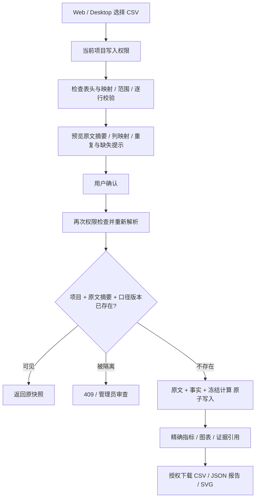
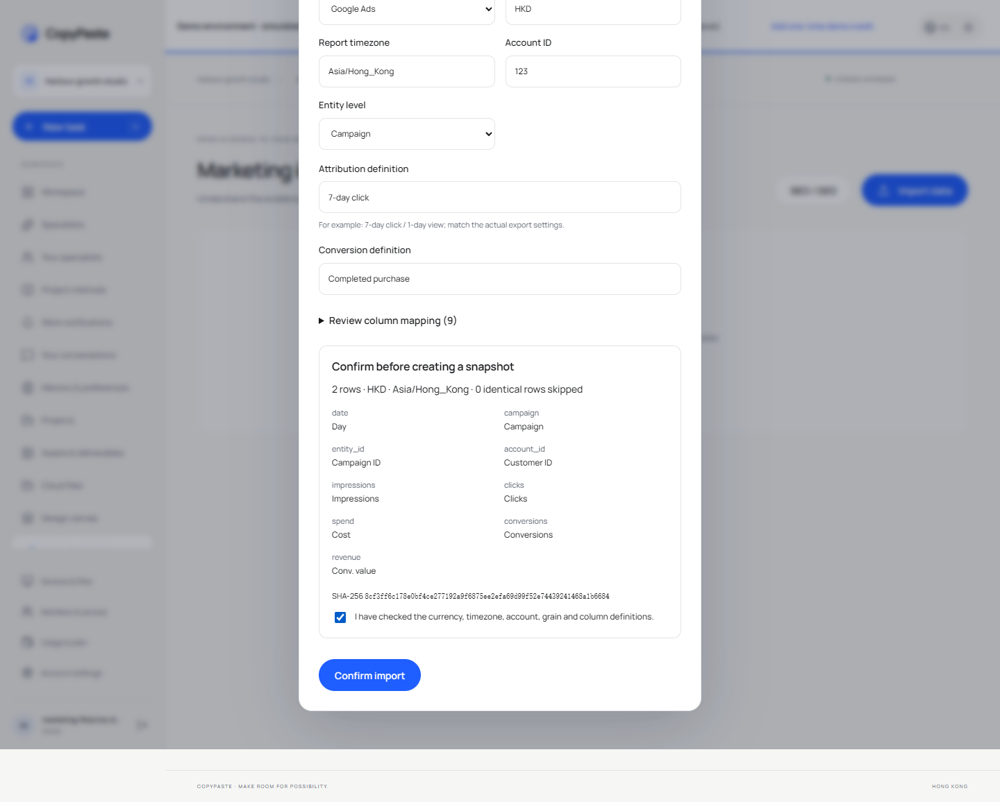
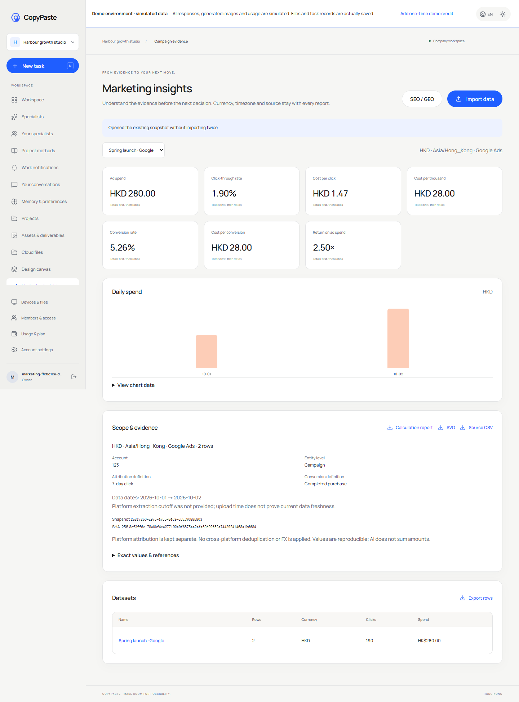
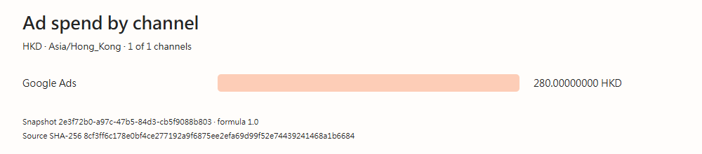
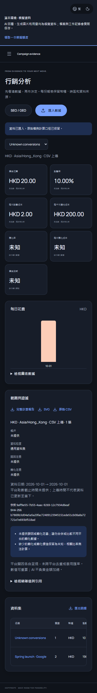
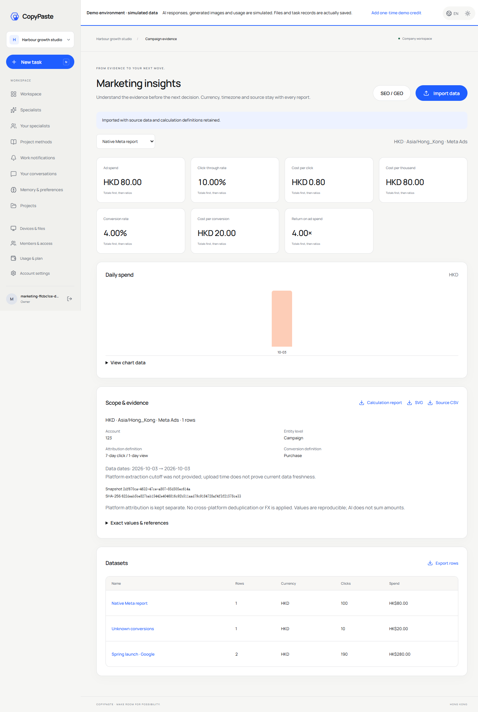

# 营销 CSV、冻结指标与证据交付

本轮修复 REQ-023/024 的一部分：原有接口会重复建立同一导入，空白转化会经 `Number("")` 变成零，计算没有精确值、缺失原因和可追溯来源。当前以获准测试数据验证真实数据库、计算和文件下载；没有使用真实广告账户或内部业务模型，不增加合格角色数。

本文保留本轮导入修复时点的范围和 159 项验证记录。后续 AnalysisSpec、报告任务/固定资产、分页事实工具与规范证据/快照查询的增量及最新验证见 [报告任务与冻结证据](28-analysis-report-tasks-and-evidence.md)；下文当时未实现的内容不代表当前最新状态。XLSX、固定原文件版本、规范导入及显式更正链的后续实现见 [文件导入与更正链](29-file-imports-and-correction-lineage.md)。

## 已实现的使用流程

Web 与当前源码 Desktop 在「行销分析」选择 UTF-8 CSV，先检查表头，再确认来源、币种、时区、账户、实体粒度、归因及转化定义。可以逐列指定映射，预览确认后才建立快照。修改任一配置使原预览失效；保存失败可重试。已接受请求丢失回执时，重试打开同一快照，不重复计数。

支持通用列名及一组 Google/Meta 风格的中英文候选表头。存在 `Clicks` 和 `Link clicks` 等多个候选时拒绝自动选列，要求明确映射。Google/Meta 模式要求账户、实体层级、币种及两个定义；实体 ID 随层级识别。仅接受每日事实，跨日总数不能自动当作某一天。单快照限同一账户、币种和口径；多币种文件需拆分后分别查看。

限制为 UTF-8、5,000,000 字节、1–10,000 数据行、最多 100 列及 10,000 字符记录。字段错误包含记录物理结束行号和列名，含引号内换行时仍可定位。控制字符和畸形 Unicode 在落库前拒绝，合法 emoji 保留，避免数据库编码异常或不可用的图表文本。空白必需指标、非法日期、错误千位分隔、超限值、混合币种、重复表头及歧义映射均在落库前拒绝。数量/金额不执行公式；当前不解析 XLSX、宏或外部链接。标准化 CSV 导出转义公式前缀，原始下载保留收到的文本字节。

通用 CSV 的渠道为必填值，空白不会自动冒充 Meta；只有明确选择 Google/Meta 来源时才补相应渠道。旧 API 请求若未确认币种且行中缺失币种，兼容默认 HKD 并返回明确警告，即使文件已有空白的币种列也会提示。Web/Desktop 要求用户确认币种后再预览。

## 来源、去重与生命周期

前向迁移 032 增加原文、文件名、SHA-256、导入标识、口径及导入元数据；033 增加冻结计算层。旧 001–031 迁移保持字节不变，两套既有原生数据库继续验证各自摘要账本。旧记录不会补造原文、账户或历史口径，页面明确标为未验证来源。

`source_sha256` 对 API 接收的 UTF-8 CSV 计算；Web/Desktop 使用严格 UTF-8 解码并保留 BOM，测试证明浏览器所选文件及原生保存字节一致。其他旧客户端若先转换编码，其摘要仅证明提交文本，不能证明更早的外部文件。原始文本留在数据库，普通列表和详情均不返回原文；下载专用接口先检查当前项目读取权限并重新验证摘要。

导入标识为原文摘要和标准化口径摘要的组合，由企业/项目范围内的部分唯一索引约束。文件名及显示名称不改变其身份。口径摘要含转换版本、实际映射、币种、时区、账户、实体层级、归因、转化定义和日期范围。相同行事实只计算一次；同日/渠道/实体身份出现冲突值则拒绝导入，要求统一粒度。不能将不同维度汇总表当作可叠加事实。

被隔离快照仍占用导入身份，不能通过同文件重新上传绕过隔离。恢复沿用原快照；永久删除解除该身份约束，之后的导入建立新 UUID，不复活旧记录。数据库触发器拒绝改写来源、事实、范围和冻结指标，也拒绝直接物理 DELETE。显示名称和管理状态可按现有权限修改。清理服务在已删除状态下清空原文、文件名、摘要、映射、标准事实和冻结计算；清理账本与现有保留服务继续生效。

后台 `admin.content.body.read` 可检查原文、范围和冻结指标，并记录既有内容读取审计；普通用户会话不能访问该接口。管理员继续通过内容版本控制改名、隔离、恢复和删除，不能静默改写已冻结事实。

## 确定性计算与时间口径

金额以六位微额整数保存；转化允许最多八位小数或 null。计算用 BigInt 实现固定小数与有理数除法，所有中间加总不经过二进制浮点。先加总基础值，再算 CTR、CPC、CPM、CVR、CPA 和 ROAS，结果保留八位小数，采用 ROUND_HALF_UP；界面另按金额/百分比显示。兼容的数值字段仅供旧界面，精确字符串为报告与证据的依据。

空白、`--` 等未提供的转化/价值保持 null。任一必要行缺失时，不将已知子集冒充完整总数；相关比率为 null 并带 `missing_conversions` 或 `missing_conversion_value`。零分母为 `zero_denominator`，无数据为 `no_rows`。覆盖信息保留缺失行数。安全整数总量超限会拒绝导入。

四组文档固定算例由平台测试直接执行：加权聚合、全零分母、未知转化及按币种分组的独立计算。加权算例得到 CTR `0.01900000`、CPC `1.47368421`、CPM `28.00000000`、CPA `28.00000000`、ROAS `2.50000000`。货币分组算例不代表当前导入已支持单文件多币种自动分表或 FX。

每次导入同时保存汇总、每日及渠道计算快照。后续读取和导出优先使用已冻结结果及其公式版本；升级计算器不能改变已有报告。每个基础值和比率有稳定 UUID、快照 ID、公式版本、单位、范围和 null 原因，当前共 11 个引用。引用可在详情与 JSON 报告中定位，不等同完整规范 Evidence 查询服务。

`captured_at` 是本产品接收并保存数据的时间；`date_range` 来自实际行日期。CSV 未提供平台取数截止时间，因此 `data_as_of=null`，不把上传时间冒充平台已更新至当下。页面也说明此限制。当前不做时区转换、跨平台转化去重、汇率折算、异常因果推断或模型数字改写。

## 实际接口与客户端

当前兼容路径前缀为 `/v1/tenants/:tenant/projects/:project/analytics`。所有接口复查当前用户、企业和项目授权；POST 还受既有 CSRF 约束。

| 方法及后缀               | 行为                                                     |
| ------------------------ | -------------------------------------------------------- |
| `POST /inspect`          | 写入权限检查后读取 CSV 表头，不落库                      |
| `POST /preview`          | 解析、计算、样例、映射、来源摘要和已有快照提示，不落库   |
| `POST /import`           | 原文、事实、口径及冻结计算原子保存；同导入身份返回原记录 |
| `GET /`、`GET /:dataset` | 当前可见列表及详情；列表不载入原始 CSV 或全量冻结图表    |
| `GET /:dataset/source`   | 摘要校验后返回收到的原始 UTF-8 CSV                       |
| `GET /:dataset/export`   | 返回币种单位金额、未知空值及公式安全转义的标准化 CSV     |
| `GET /:dataset/report`   | JSON 计算报告，含来源、日期、口径、精确值、引用和限制    |
| `GET /:dataset/chart`    | 实际可下载 SVG 渠道花费图，含快照与来源摘要              |

这些是实际兼容接口，尚未实现完整规范的 `/v1/dataset-imports`、`/v1/snapshots/{snapshot_id}`、AnalysisSpec 报告任务及资产版本绑定。当前常规 method/path 从 229 增至 234，规范仍为 225 个操作；方法/路径数量不是符合性通过数。

Web 提供双语预览确认、七项指标、每日花费图、可展开明细、口径和精确值表。超过 60 个每日点时改显示至多 20 个渠道；完整数据留在 JSON 报告。选中快照读取失败会清空指标、图表及导出动作，不显示其他数据集冒充其结果。公共读取 hook 同时改为前次轮询完成后再发下一次请求，失败清空旧数据。

Desktop 同步独立 renderer 快照，经现有受保护主进程 IPC 使用相同导入流程，真实 PKCE 后可保存原始 CSV。Codex `marketing_metrics` 及既有分析工作流读取冻结精确值、范围和证据。网页 SVG 下载能力尚未注册为角色 `chart.render` 工具；R17 所需的完整工具、来源查询及专业交付验收仍未齐，不自动把营销分析模板标成合格角色。

## 验证与剩余范围

平台完整原生回归 **159/159**，没有失败、跳过或取消；其中新增四组指标/四组 CSV 单元检查及四组隔离 PostgreSQL 集成检查。集成覆盖八次并发只生成一次、预览不写入、原文摘要、冻结结果和不可变守卫、原生 CSV 往返、外企业拒绝、CSRF、隔离后重导入拒绝、删除清理以及项目权限撤销。

`qa:marketing-analytics` 通过六组真实 Web/源码 Electron 流程：邮箱及工作区、Google 风格映射、接受后丢失回执重试、原文/JSON/SVG 实际下载、行错误和未知值、四宽度/两主题/繁英、选中快照拒绝清空，以及原生 Meta 风格导入和本地字节校验。报告在 delivery 的 `evidence/marketing-analytics.json`；全部自建页面、浏览器和 Electron 在 finally 关闭。另有 Desktop 四项原生单元测试与平台/Web/Desktop 构建检查。

REQ-023/024 仍是局部验证，不关闭综合 TC。剩余包括 XLSX、安全公式单元格策略、完整官方导出语言/数值格式矩阵、维度及粒度事实模型、显式替换关系、规范资产/导入/快照 API、跨来源 AnalysisSpec、报告任务/持久资产、证据查询、模型叙述数字校验、GA4/GSC/正式 OAuth 和专业角色资格。旧 0.5.0 安装包与离线 bundle 尚未重打。

Google 官方说明报表可以自定义列，并且账户时区影响统计、数字格式可随设置变化，因此当前采用候选映射和明确确认，未声称自动兼容所有官方导出。[报表说明](https://support.google.com/google-ads/answer/6201327?hl=en)、[数字格式、时区和币种](https://support.google.com/google-ads/answer/9842104?hl=en)。Meta 部分以本轮可复现的 CSV fixture 验证，不作为正式 Insights API 接入证明。

