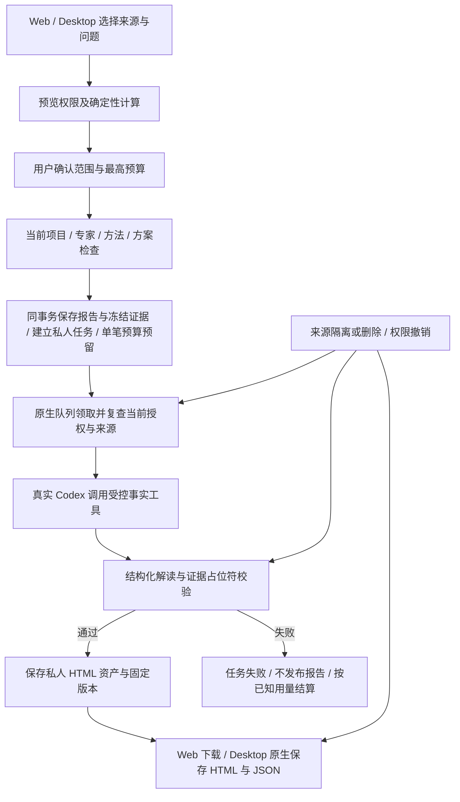
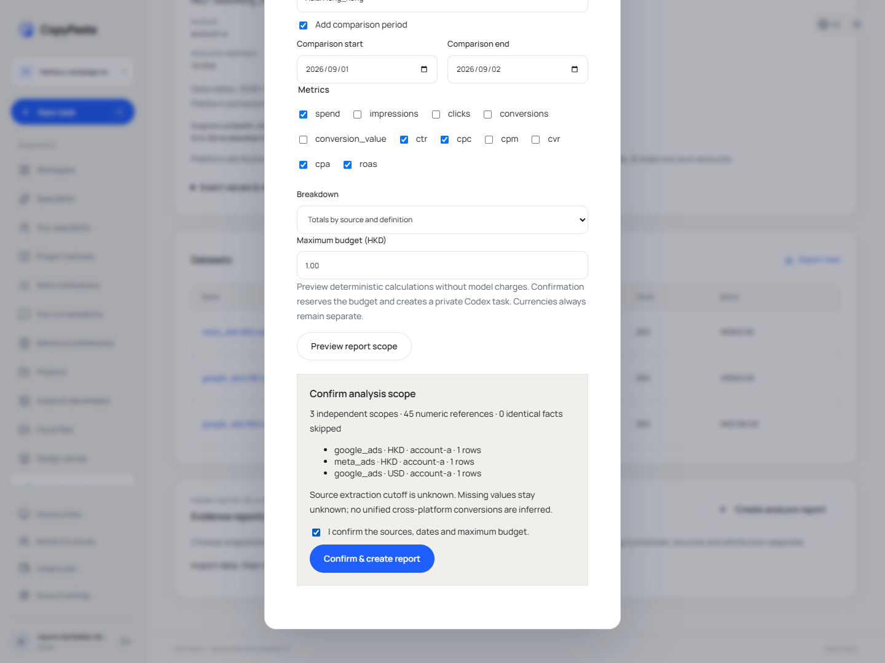
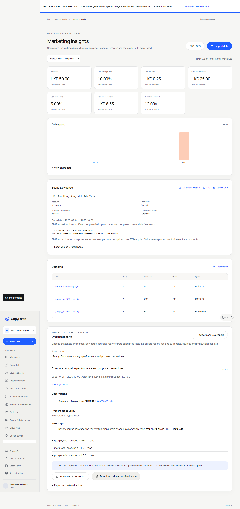
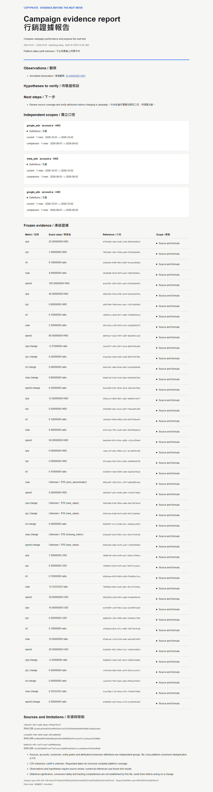
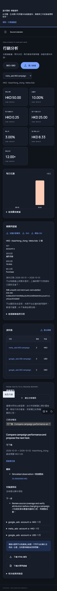

# AnalysisSpec 报告任务与冻结证据

后续原始 CSV/XLSX 文件绑定、规范导入、更正链及来源级隔离/删除见 [文件导入与更正链](29-file-imports-and-correction-lineage.md)。本文保留本轮报告任务的实施与验证时点。

本轮继续修复 REQ-023/024。前一轮已有 CSV、精确指标和下载，但没有持久报告任务、规范证据查询及受校验的模型解读。当前将这些行为接入真实 Codex、任务队列、预算、私人资产和 Web/源码 Desktop。模型响应继续使用用户获准的假数据，不代表公司真实模型或营销分析师已取得业务资格。

## 使用与确认

用户在「行销分析」选择「建立分析报告」，填写业务问题，选择最多十个已有来源快照、当前日期区间、可选比较区间、时区、指标、维度和最高 HKD 预算。来源必须保留已确认口径、原文摘要及冻结指标；历史未验证记录不能直接冒充可信来源。

预览只检查权限和执行确定性计算，不生成任务、不调用模型、不预留费用。预览显示独立分组、来源和证据数量及覆盖限制；修改任一输入使预览及确认失效。用户明确确认后才建立报告。接受后丢失响应时沿用同一幂等键；同请求返回原报告，不重复排队或预留，改变参数复用键返回冲突。

分析师为当前用户和项目下的持久 `marketing-analyst` 专家，明确安装所需方法，工具限制为资产读取/写入和数据读取。它不改变默认助手，也不会在原专家被停用、隔离或撤销后偷偷创建替身绕过限制。实际执行只开放读取工具及报告事实工具，发布由服务端完成。

## 计算与比较的边界

`AnalysisSpec` 规范化来源 ID、指标和维度，验证实际日期和 IANA 时区，固定 `group_by_currency` 策略。当前最多十个快照、十万输入行及一百个独立分组。支持 date、channel、campaign、entity_id、source、account_id、currency；其他维度明确拒绝。指定账户或归因定义必须与所有选中来源一致，不能悄悄丢弃不匹配的来源。当前没有正式连接数据标准化，因此非空 `connection_ids` 返回 `ANALYSIS_SYNC_REQUIRED`。

来源、账户、币种、时区、归因、转化定义和实体层级始终组成独立范围。缺少账户或定义时还按原快照隔离，不能仅因两份资料都填写「未知」就合并。多来源报告不产生跨币种或跨平台总转化，也不执行 FX、跨平台用户归因或因果分析。

在请求的两个日期区间内，以范围、日期、渠道和实体 ID（没有 ID 时使用活动名）识别事实。相同事实只计一次；同身份值冲突返回 409，要求用户选择统一来源版本。两个区间之外的冲突不影响当前查询，但扫描仍受输入行上限约束。选择 date 维度时按区间内日序比较，原始实际日期保留在范围中。

继续使用固定八位小数和 BigInt 的指标计算器，先加总基础值再算比率。变化值是 `(当前－比较) / abs(比较)`，八位 ROUND_HALF_UP；例如 100 与 80 得到 `0.25000000`。比较值为零时以 `new_value` 或 `zero_previous` 返回 null，不产生 Infinity；某期没有行则相关值为 null、原因 `no_rows`，不冒充零业绩。完整口径、未知原因、公式版本、覆盖和证据保存在结果内。

`captured_at` 表示本产品保存结果的时间。CSV 不能证明广告平台的取数截止时间，因此规范 Snapshot 的 `data_as_of` 允许 null，实际返回 null。机器契约和生成器同步表达未知值，没有用上传时间伪造新鲜度。

## 模型解读与实际文件

报告创建时保存规范化 spec、`spec_hash`、来源关系、计算、独立 Snapshot 和 Evidence。任务固定实际专家、方法、内核及能力版本，Codex 通过 `analysis_report_facts` 读取已冻结事实，不负责重新计算营销指标。

完整计算对象会重复嵌套分组、快照和证据，多来源时可能超过内核工具结果上下文并被裁剪。事实工具因此每页返回两项证据、范围、覆盖及 `next_offset`，模型按需继续读取，不能从单页声称已全面审查。完整计算仍保存在数据库和导出中。跨端首次失败记录保留为 delivery 的 `evidence/analysis-reports-first-journey-failure.json`；修复后使用多来源及比较的真实 Codex 回归，而非仅加长等待时间。

模型只返回 observations、hypotheses、next_steps。每条观察或假设必须包含 `{{证据UUID}}`，并在 `evidence_ids` 中列出对应引用。服务端拒绝未知引用、畸形占位符及占位符之外的 Unicode 数字字面量；下一步也不能带数字字面量或占位符。失败时没有可下载的完成报告，已知实际模型用量仍结算，不伪装免费或成功。

该校验证明数值来自固定引用，不能证明自然语言语义完全正确：错误地描述指标、用文字表达数字或将相关性写成因果，仍需要更完整的语义和业务验收。页面明确将解释标为待验证假设，展示口径、未知值和来源限制；本轮不声称完成全部 AI 叙述质量验收。

通过后由服务端替换占位符并转义模型文本，生成实际无脚本、无外部依赖的 HTML，含日期范围、各来源/账户/币种、比较值、证据表、公式/null 原因、原文摘要和限制。HTML 沿用公司白灰、深色文字、蓝色强调色。资产保留固定版本，JSON 导出包含同一报告身份、计算、spec、来源和证据。Web 实际下载，Desktop 通过受保护 IPC 原生保存；所有下载重新检查当前权限及来源状态。

## 隔离、撤销与永久清理

前向迁移 034 增加报告、专家映射、来源依赖、Snapshot 和 Evidence 表及索引，启用企业/项目/私人所有者 RLS。旧冻结快照的 11 项 Evidence 可查询索引直接使用已保存精确结果补齐，不重算历史数据；只读核对报告保存在 delivery 的 `evidence/analysis-index-backfill.json`。

即使同项目其他编辑者可以读取原 CSV，也不能读取别人的私人报告、计算证据或报告资产。报告重放先复查项目授权，再读取当前可用报告，不能返回过去保存的敏感响应。领取、心跳、工具和最终发布都检查当前授权及来源。工具/发布持有来源共享锁，来源正在变更时停止执行，避免授权检查与发布之间的竞态及反向锁等待。

隔离来源会使报告及其派生资产不可读取或下载，恢复后仍是原报告。永久删除来源则使报告不可恢复，清空 spec、计算、叙述、Snapshot 和 Evidence，删除对应任务及私人产物，后续清理服务擦除对象和运行缓存。快照/证据、报告来源绑定及既有叙述/版本不能静默改写；既有 001–034 迁移均保留原始摘要。

Admin 沿用既有任务、来源和资产治理及独立正文读取权限；这轮集成验证的是底层隔离/恢复/永久删除约束，没有新增完整的报告专用运营面板或异步批量导出，也不把底层控制通过等同全部 Admin 验收。

## 实际 API

规范 API 要求当前身份和 `X-Tenant-ID`；创建还要求 CSRF 和幂等键。项目范围来自载荷或受保护记录，不从客户端声称的快照关系直接信任。

| 接口                                             | 实际行为                                                          |
| ------------------------------------------------ | ----------------------------------------------------------------- |
| `POST /v1/reports`                               | 同事务冻结计算、私人 Codex 任务、来源/证据和预留，返回 202 Report |
| `GET /v1/reports/{report_id}`                    | 当前可用 Report，完成后才含固定资产版本                           |
| `GET /v1/snapshots/{snapshot_id}`                | 原导入或报告计算 Snapshot；不补造取数截止时间                     |
| `GET /v1/evidence/{evidence_id}`                 | 当前授权且可用的固定值、单位、公式、范围和 null 原因              |
| 项目下 `POST /analysis/assistant`                | 当前用户的受限营销分析师；原专家失效不自动绕过                    |
| 项目下 `POST /analysis/preview`                  | 无任务/预留/模型调用的来源与计算预览                              |
| 项目下 `GET /analysis/reports`                   | 当前用户最多五十条私人报告                                        |
| 项目下 `GET /analysis/reports/{report}`          | 固定计算、来源、叙述、校验和预算详情                              |
| 项目下 `GET /analysis/reports/{report}/download` | 完成且当前授权时下载 HTML 或 JSON                                 |

项目兼容前缀为 `/v1/tenants/:tenant/projects/:project`。规范 `/v1/dataset-imports`、XLSX、正式平台连接及完整维度事实模型继续保留为未完成项。

## 验证与交付状态

新增四组计算检查和四组隔离原生 PostgreSQL 集成检查，覆盖独立币种/来源/未知账户、重叠去重与冲突、比较零值/无行/精度、非法叙述、六次并发同键、CSRF、方案/额度拒绝无残留、私人归属、项目撤权和重放、排队来源撤销、隔离恢复、永久清理，以及真实固定 Codex 的事实工具和 HTML 发布。

跨端原始报告为 delivery 的 `evidence/analysis-reports.json`；完整平台回归原样保存在 `evidence/alignment-platform.tap` 与对应 JSON。HTTP 规范样本单列，method/path 数量不作为完整符合性通过数。全部 102 条综合验收、NFR 和至少十二个真实合格角色的门槛保持不变；历史 0.5.0 安装包和离线归档未因此自动更新。

当前平台完整原生回归 **167/167**，无失败/跳过/取消；Desktop 四项原生单元检查及平台/Web/Desktop 构建、renderer 与 delivery 类型检查通过。Web 与 Desktop 主块约 511 kB，Vite 体积提示仍存在，没有作为功能失败隐藏。跨端六组检查通过，包含真正的十六种尺寸/语言/主题组合、丢失回执重试、权限拒绝清空和原任务跳转；原生保存 HTML 与 Web 文件 SHA-256 一致。全部自建浏览器、上下文、页面及 Electron 在 finally 关闭。

规范实际 HTTP 样本 **26/26** 通过严格 schema，新增五份覆盖排队/完成 Report、计算/原始 Snapshot 和 Evidence。实际路由清单从 234 增至 **243**，规范仍为 **225** 个操作；参数名规范化后仍有 161 个规范 method/path 未匹配，其含义和全字段验收限制保留在进度文件。迁移 034 上线前已有 11 个冻结快照的 121 项索引只读核对通过，历史精确值未重算。

提交后的独立 Git 克隆核查通过，34 个迁移原始字节、两套现有数据库摘要账本、28 个可信 Skill 包、40 项 Desktop renderer 来源摘要及 167 项原始 TAP 的 SHA-256 保持一致；临时克隆已清理。证据见 delivery 的 `evidence/byte-integrity.json`。这证明本轮源码可按原字节独立取回，不代替正式安装包发布或灾难恢复验收。

