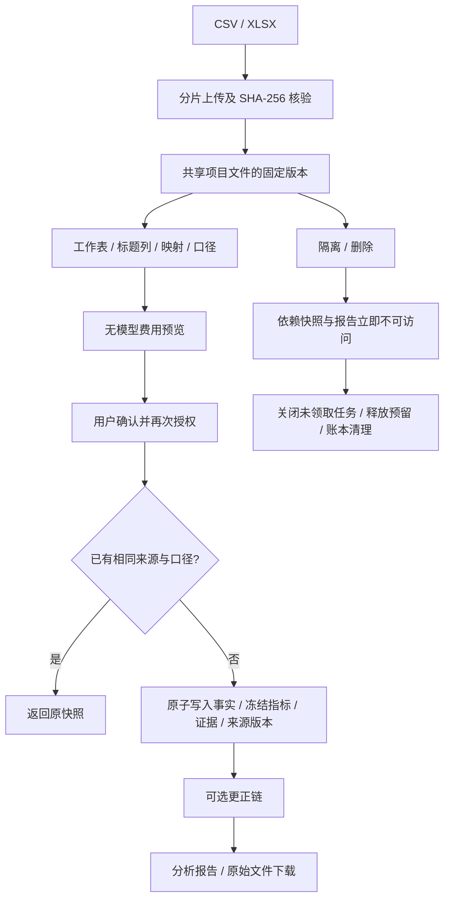
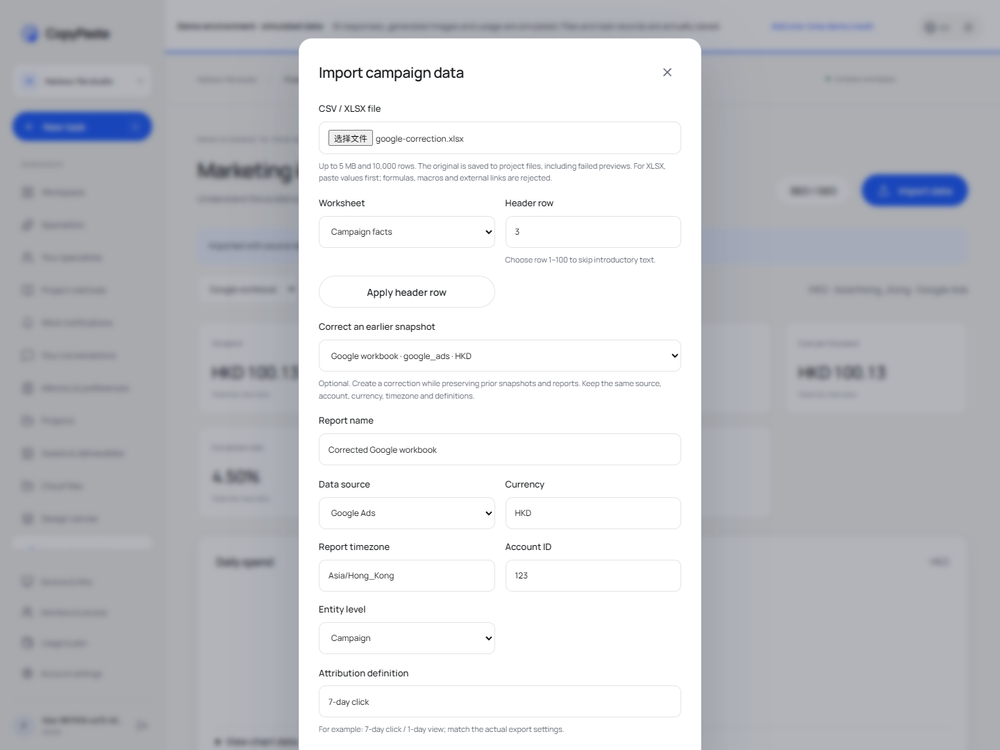
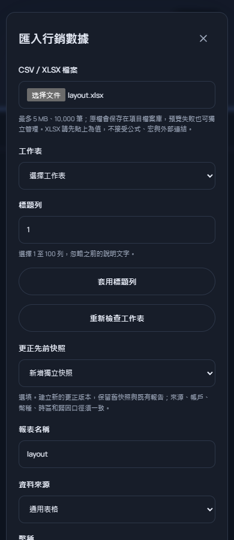

# CSV／XLSX 文件版本导入与更正链

本次继续修复 REQ-023/024 的文件输入及来源生命周期。此前 CSV 文本接口保存了原文和计算，却没有绑定文件库的不可变版本，也没有 XLSX 或显式更正关系。当前 Web、源码 Desktop 和规范 `POST /v1/dataset-imports` 共用同一解析、校验、去重及冻结计算；原始文件、映射与更正历史可追踪。模型/媒体仍按用户授权使用假数据，导入本身不调用模型、不预留 AI 费用。本文不关闭全部 102 条综合验收，也不增加真实服务合格角色数。

## 用户流程与保留规则

1. 在行销分析选择不超过 5,000,000 字节的 UTF-8 CSV 或标准 XLSX。通过现有分片协议保存为当前项目的共享文件版本；上传分配键先持久保存，回执丢失后选同一文件可以继续，避免重复建立原始资产。
2. CSV 使用第一行表头；XLSX 有多个可见工作表时必须手动选择，标题列可设为 1–100，并明确套用。隐藏工作表不能选，隐藏数据行会纳入计算并提示。忽略标题列之前的说明文字，不执行任何工作簿程序。
3. 确认来源、账户、币种、IANA 时区、实体粒度、归因/转化定义和逐列映射。预览仅返回样本、确定性指标、警告及已有快照提示，不建立数据快照、任务或预算。
4. 可选「更正先前快照」。确认后建立新快照，记录直接前版及完整祖先链；既有快照、冻结计算和已建立报告保留原值。修改任一文件/工作表/标题列/口径/映射/更正对象，会使预览和确认失效。
5. 原始文件可以按当前授权下载，返回固定版本的实际 CSV/XLSX 字节并重新验证 SHA-256。后续为原资产上传新版，不改变已导入快照的来源版本。

上传和数据导入是两项明确的保留操作。预览失败时原文件仍存在于项目文件库，界面事先说明；用户可独立管理。删除数据快照不会删除独立上传的原始资产；删除原始资产会使依赖它的所有快照和分析报告失效并进入删除链。没有把失败预览偷偷当作已建立的分析快照。

## XLSX 读取范围

这是有界、只读的 OOXML 表格读取器，不启动 Excel，不执行公式，不请求外部链接，不解压文件到任意路径。使用锁定依赖 `fflate 0.8.2` 和 `fast-xml-parser 5.11.2`，未引入容器或虚拟化。

ZIP 在解析 XML 前检查中央目录、单卷、文件数量、路径/重名、头部一致、重叠范围、压缩方式、声明长度、总展开长度和被读取 part 的 CRC32。仅支持非加密、非 ZIP64、stored/deflate 内容；最多 2,000 个 part、每个展开 12 MB、总展开 40 MB。XML 拒绝 DTD、实体声明、非法控制字符，限制节点数量和嵌套深度。宏、嵌入程序、外部连接及外部关系被拒绝；这种受限支持范围不等同通用 Office 文件安全认证。

支持共享字符串、内联字符串、富文本字符串合并、稀疏单元格、数字存储值及科学记数法。数字转为十进制字符串后进入既有精确计算器，不用 `Number` 转换货币。金额输入最多六位小数，冻结指标保留八位；超过输入精度直接拒绝。单元格样式必须有合法索引；日期按工作簿 1900/1904 设置转换为整日，拒绝时间小数和 1900 系统虚构的第 60 日。显示格式不改变实际存储值，也不根据货币格式猜币种。[Microsoft 单元格值读取](https://learn.microsoft.com/en-us/office/open-xml/spreadsheet/how-to-retrieve-the-values-of-cells-in-a-spreadsheet)、[共享字符串](https://learn.microsoft.com/en-us/office/open-xml/spreadsheet/working-with-the-shared-string-table)、[Excel 日期系统](https://support.microsoft.com/en-us/excel/date-systems-in-excel)。

最多 50 个工作表、100 列、10,000 数据行，仍沿用既有 CSV 单条记录/文本及标准化体积上限。选定表内有公式即拒绝，**包括带有缓存结果的公式**，要求另存仅值的导出；布尔、错误、公式字符串、数据区合并单元格、数据超出表头范围、无效坐标等也拒绝。普通以 `=` 开头的文字不被求值。XLSX 行错误使用实际工作表和单元格，如 `Campaign facts!F7 (Cost)`；多行文字和中间空行不会把位置误报成临时 CSV 的行号。

不支持 `.xls`、`.xlsm`、加密工作簿、自动计算公式、所有自定义 Excel 格式或全部官方导出语言。用户仍需选择实际每日明细粒度；跨日总数、混合币种、口径不明和同一粒度冲突事实沿用既有拒绝策略。

## 规范接口与兼容入口

| 接口                                | 结果与约束                                                                                               |
| ----------------------------------- | -------------------------------------------------------------------------------------------------------- |
| `POST /v1/dataset-imports`          | 当前企业/项目写入授权；绑定已有 `asset_version_id`；Google/Meta 来源；返回 HTTP 202 的严格 Snapshot 字段 |
| `GET /v1/snapshots/{snapshot_id}`   | 读取当前可用冻结快照；来源隔离、删除或授权撤销后不可访问                                                 |
| 嵌套 `POST /analytics/file-inspect` | 返回文件类型、来源摘要、可选工作表、实际表头与行数，不创建数据快照                                       |
| 嵌套 `POST /analytics/file-preview` | 校验并计算样本、精确指标、实际映射与已有身份提示                                                         |
| 嵌套 `POST /analytics/file-import`  | 通用表格兼容入口；同一文件版本、解析和保存逻辑，返回 HTTP 202                                            |
| 嵌套 `GET /analytics/{id}/source`   | 当前授权与摘要核验后下载固定来源版本                                                                     |

嵌套路径前缀为 `/v1/tenants/:tenant/projects/:project`。规范请求保留必需的 `project_id`、`asset_version_id`、`source`、`account_id`、`timezone`、`currency`、`mapping`、`attribution_definition`，增加可选显示名、实体粒度、转化定义、工作表、标题列及 `supersedes_id`。规范缺省粒度为 campaign；缺少转化定义会显式记录 `not_provided` 和警告，不推测平台口径。Web/Desktop 在平台模式要求用户填全定义。

有界解析和冻结写入在当前请求事务内完成，再返回 202/complete；尚未实现后台异步导入队列。错误在提交前返回，不伪造 processing 任务。普通读/写继续走项目权限，Cookie 写入受 CSRF 检查；规范接口要求 `X-Tenant-ID` 和幂等键。

幂等重试先复查当前项目及实际来源文件，再读取保存的快照 ID；不返回失效的历史保存响应。相同文件摘要和相同口径在同一项目只建立一次，不因文件名变化或重复上传而另算一次。CSV 与旧文本 API 保留相同身份，因此旧快照可直接复用；不会为既有快照补造资产绑定。XLSX 身份另含所选工作表、标题列、日期系统和读取器版本，原始摘要始终针对实际 XLSX 字节。

## 更正、不变性与来源生命周期

前向迁移 **035** 增加来源文件版本、来源可用状态、直接前版及祖先 UUID 数组。数据库守卫校验共享文件的项目、企业、活动状态和实际摘要；绑定和祖先不可改写。新更正必须保持来源、账户、币种、时区、实体层级及归因/转化口径；同一前版只有一条更正，不允许并发分叉，后续修订应选择最新版本。同一数据身份不能被事后改成其他快照的更正。

AnalysisSpec 在建立任务/预算前拒绝同时选中更正版本和任一祖先，防止间隔多版的重复汇总。原快照仍可单独用于复现历史报告；不自动改写用户已经选择或已冻结的来源。

私人文件不能直接导入共享项目分析；须先通过既有明确发布操作建立共享副本。外企业、外项目、只读成员、错误 CSRF、撤销成员及回放请求均复查授权。固定版本不可被后续上传或改名静默替换。

上传完成时把原始文件名保存在不可变版本元资料中。历史版本没有此字段时，已明确的 CSV/XLSX MIME 决定读取类型；不根据当前资产的新名字改变旧版本解析器。集成测试在后续上传、改成 XLSX 扩展名后，仍能预览原 CSV 版本并复用原快照。

原始资产隔离时，触发器锁定依赖数据行并同步 `source_state`；普通快照、证据、报告及报告资产按当前状态隐藏，Worker 在读取工具和发布前复查。恢复原文件不会解除独立施加在数据快照上的隔离。永久删除原文件会逻辑删除依赖快照，继而失效报告、任务和产物，建立父子删除依赖；清理服务清空数据、映射、文件绑定和解析结果。文件及数据锁顺序统一为来源资产后数据集，避免下载与来源治理锁顺序相反。

本次还修复了队列恢复中的删除等待：已删除的 queued 任务可能仍有调度器不会派发的 outbox，旧恢复逻辑会先等待它而不取消。现在先在控制身份事务和任务行锁下关闭尚未领取的不可用任务并释放预留，之后才检查派发记录；实际运行/费用不明的任务不经这个零费用分支重放。测试使用真实恢复逻辑验证删除依赖完成。

## 验证与未关闭范围

完整原生平台回归 **180/180**，没有失败、跳过或取消。新增八组解析检查、五组隔离 PostgreSQL 集成检查，覆盖稀疏/多行/富文本、双日期系统、精确数字、公式缓存拒绝、外链/宏/DTD/ZIP/样式错误、并发与幂等重试、旧 CSV 身份兼容、来源固定版本、两级更正及跨代汇总拒绝、权限/私人边界和来源删除清理。原始 TAP 字节及 SHA-256 保存在 delivery 的 `evidence/alignment-platform.tap` / `.json`。

Web/源码 Electron 的实际文件流程四组通过，请求/响应样本由 `qa:file-imports` 保存在 delivery 的 `evidence/file-imports.json` 与 `file-imports-contract-samples.json`。包含成功回执丢失后的唯一资产、实际更正、公式定位、四宽度/两主题/繁英共 16 种组合，以及原生 PKCE/字节一致下载。原有 CSV 旅程 `qa:marketing-analytics` 六组重新通过；严格实际 HTTP 样本共 **31/31**，Desktop 类型检查及四项原生单元通过。所有脚本在 finally 关闭自己创建的页面、上下文、浏览器及 Electron。截图与实际结果一同更新独立仓库中英 README。

首次原生文件验收暴露主进程尚未开放规范导入路径。修复仅增加精确 `POST /v1/dataset-imports`，没有开放任意 API；固定 origin、企业 UUID 和受保护凭证检查仍执行。原始失败分别保存在 `file-imports-first-native-failure.json`、`file-imports-native-bridge-failure.json`，修复后重新通过四组流程。独立 renderer 快照共 **41** 项来源摘要；源码构建不依赖相邻 Web 仓库。

另用独立 openpyxl 3.1.5 生成标准工作簿，四组兼容检查通过，包含双日期系统、真实日期/货币样式、科学记数、稀疏与隐藏行、中文/换行、公式及超精度拒绝。实际输入摘要和生成器版本保存在 `evidence/workbook-interop.json`；命令为 `WORKBOOK_QA_PYTHON` 指向含 openpyxl 的原生 Python 后执行 `npm run qa:workbook-interop`，finally 清理自建工作簿，不启动 Excel 或浏览器。初始 fixture 的七位金额被既有六位约束正确拒绝，记录保留在 `workbook-interop-first-fixture-failure.json`。

独立核查实际发现默认 XML 解码不会解开数字中文引用，导致标签保存为编码字串；失败保存在 `workbook-interop-first-unicode-failure.json`。现使用解析器的 XML 解码入口执行一次明确的五种命名/十进制/十六进制字符引用解码，检查 XML 1.0 码点，拒绝未知或非法引用；转义后的字面引用与 CDATA 保留原值，不递归解码、不加载声明。新增单元覆盖中文、emoji、属性、文字和非法码点，再跑全部平台回归及独立兼容检查。此兼容检查仍不代表全部官方广告平台导出格式。

REQ-023/024 仍为局部验证。完整官方导出/语言数字矩阵、多维事实模型、规范资产上传接口、正式广告/GA4/GSC 连接、语义/统计质量、全部 NFR 和专业业务角色验收继续保留；已实现的 XLSX、更正链和规范导入不再列为完全缺失。历史 0.5.0 安装包及离线 bundle 尚未重发，不能作为本次源码修复的可执行交付证明。

