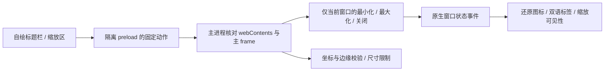
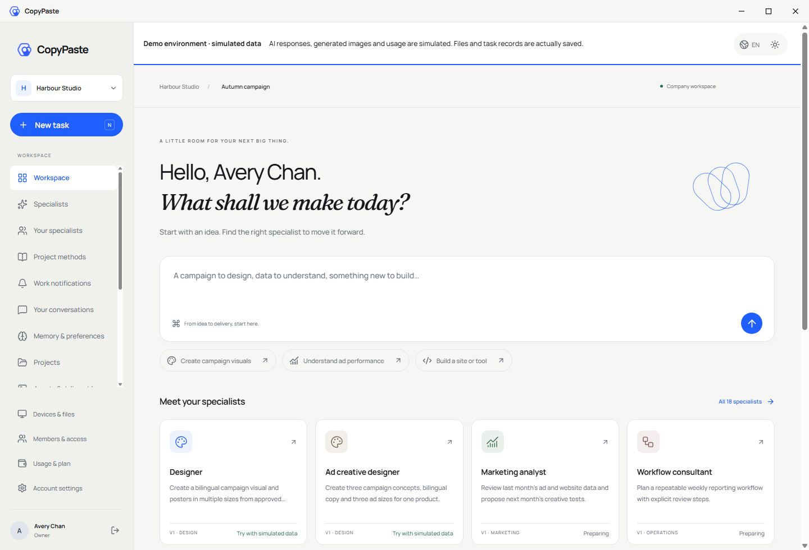
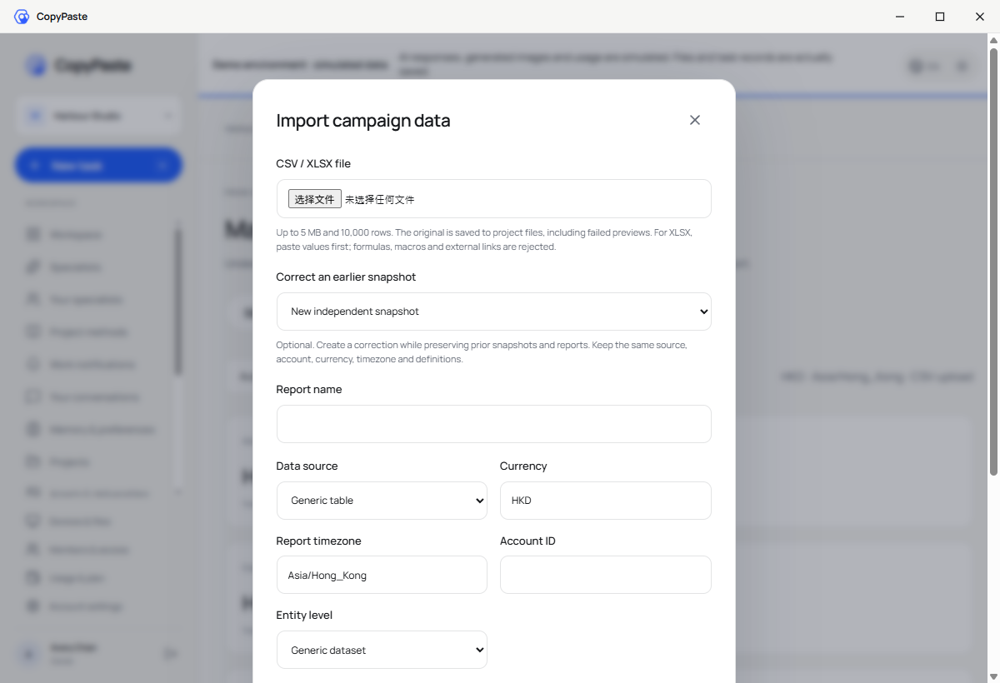
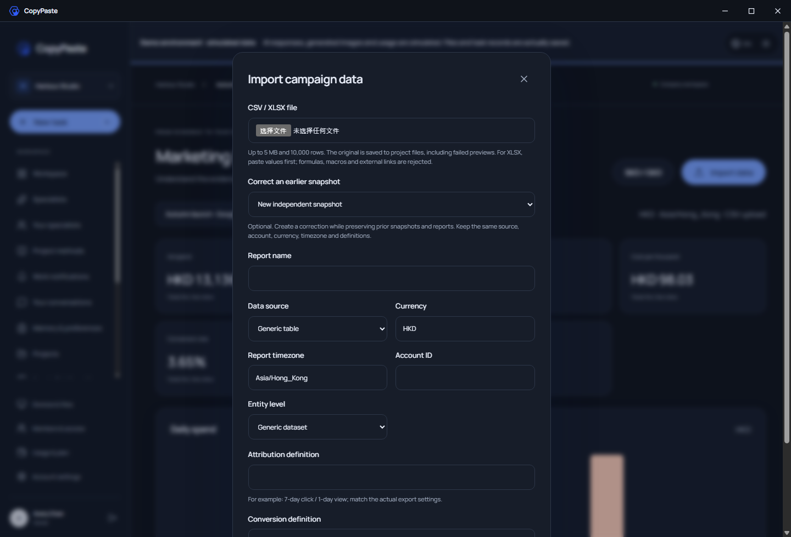

# Desktop 无边框窗口与 Chrome 原生侧栏

<!-- stage62-scoped-seo -->
阶段 62 新增[有范围约束的网站诊断与复查](../technical/62-scoped-seo-audits.md)：实际原生模拟 HTTP、逐 URL 问题/原文、Codex 内部模拟网关报告、不可变复查和来源治理。专项 **45/45**，完整平台 **716/716**，保留原全部 674 项命名测试；实际 Web/Admin **13 项**、新包原生 **20 项**。Desktop 无边框、无 Electron/Alt 菜单；扩展工具栏打开/收起真正 Chrome 原生 Side Panel，增加固定网站工作台入口。两库 077→079 保留 164 张原表全部行摘要及 SQL001–077，三张新表为空并强制 RLS。当前包在各端 `release/scoped-seo-62-02/`；见[当前回执](../quality/scoped-seo-checkpoint.json)和[包清单](../quality/scoped-seo-artifacts.json)。修改任务、GEO、正式站点/模型、安装发布及全部原 TC/NFR/G01–G10 继续保留，未宣称完整产品验收。下方较早阶段只代表当时的源码和包。

<!-- stage61-marketing-connectors -->
阶段 61 继续验证新打包客户端的无边框、自绘最小化/最大化/关闭、无 Electron/Alt 菜单及真实 Chrome 右侧原生 Side Panel。营销授权经固定公司网页和原会话回到 Desktop，JSON 经原生保存窗口；侧栏固定打开公司营销工作台。实际原生 **16 项**见[当前回执](../quality/marketing-connector-checkpoint.json)，包位于各端 `release/connectors-61/`，旧包与旧回执未改写。

<!-- stage60-template-video -->
阶段 60 在新包 `release/video-60/` 实际验证 17 项原生流程：无系统边框、默认菜单和 Alt 菜单；自绘控制；真实 PKCE、受保护视频桥接、成片播放及系统文件保存。扩展真实工具栏仍在右侧打开/收起原生 Side Panel，新增固定公司视频工作台入口。详见[视频回执](../quality/template-video-checkpoint.json)与[新包清单](../quality/template-video-artifacts.json)。下方阶段 59 及更早包保留历史执行范围；Chrome 左右位置遵循用户设置。

<!-- stage59-creative-matrices -->
阶段 59 已重建并实际执行当前无边框 Desktop 与 Chrome 原生侧栏，新增设计矩阵入口和滚动后的弹窗定位修复。本次 13 项原生流程通过，实际来源及包见[阶段 59 回执](../quality/creative-matrix-checkpoint.json)与[当前包清单](../quality/creative-matrix-artifacts.json)。当前包为各端 `release/matrices-59-02/`；下面阶段 54 的包和核对命令保留其原历史范围。右侧仍尊重 Chrome 用户设置，未签名 localhost 预览未代表安装、商店及生产验收。

## 本次追加要求的当前交付复核

已按用户要求复核当前实现：Desktop 移除系统边框、Electron 应用菜单与 Alt 菜单，保留 CopyPaste 自绘拖动区及最小化、最大化/还原、关闭按钮；Extension 点击工具栏图标打开原生 Side Panel，再次点击收起，未设置 action popup。默认右侧，左右位置遵循 Chrome 用户设置，扩展不能强制覆盖该设置。

两端类型检查均通过，Desktop 现有 25/25、Extension 21/21 测试通过。只读核对当前 97 份 Desktop、34 份 Extension 来源、77 份桌面运行文件、20 份扩展构建文件及 Setup/Portable/扩展 ZIP，全部与此前 11/11 实际原生验证的字节一致，见 [本次交付文件复核](../quality/native-clients-recheck-20261021.json)。本轮未重新启动浏览器或应用，不将这次文件核对计为新增 UI 或服务端验收。

可在项目根目录执行 `node docs/tools/verify_current_native_clients.mjs` 复核 `release/adoption-54/` 当前交付。下文旧的 `verify_native_client_surfaces.mjs` 继续只核对其原历史预览，不替代当前版本检查。

后台阶段 58 完成时再次[只读复核当前客户端字节](../quality/native-clients-recheck-20261021-02.json)：两端来源、桌面运行文件、扩展构建文件及三个交付包仍与上述 11/11 实际原生 UI 记录一致。这次没有新建浏览器或应用，不增加 UI 验收次数。

## 当前阶段 54 的实际新版验证

新版打包 Desktop 继续无系统边框、Electron 应用菜单与 Alt 菜单，自绘窗口按钮正常；扩展实际工具栏动作打开右侧原生 `SIDE_PANEL`，页面宽度随之缩小，不创建 popup 或普通标签页，再次点击收起。当前新增模型/费率入口、真实浏览器 PKCE、双语与实际版本比较流程共 11 项通过，十张三端截图中的五张来自此次原生执行，见 [当前流程与截图](54-explicit-agent-version-adoption.md) 及 [新版产物摘要](../quality/agent-adoption-artifacts-02.json)。全部自建浏览器、桌面程序与 API 已关闭。

新包位于各端 `release/adoption-54/`；下面 `release/frameless/`、`release/sidepanel/`、95/34 份来源及旧核查命令保留其原历史范围，不能用于验收新增版本。复查新版须在交付仓库使用未占用编号执行 `node scripts/run-agent-adoption-native.mjs NN`，具体浏览器运行时与状态见双语 README。左右位置仍尊重 Chrome 用户设置。

## 2026-10-21 追加要求的历史只读复核

当时 Desktop 无系统边框、无 Electron 默认菜单，使用品牌自绘标题栏；扩展工具栏动作打开 Chrome 原生 Side Panel，不定义 popup。两端类型检查及现有 Desktop 25/25、Extension 21/21 单元测试通过。本次重新核对 95 份 Desktop、34 份扩展运行源码、实际运行目录、安装器与扩展 ZIP，全部与既有 10/10 原生窗口／侧栏实测字节一致，见 [复核回执](../quality/native-surfaces-request-recheck-20261021.json)。这次比对未重新运行浏览器 UI，也不代表安装／卸载或服务端验收。

后续可从项目根目录执行 `node docs/tools/verify_native_client_surfaces.mjs` 只读复核。右侧默认位置仍遵循 Chrome 用户设置，具体边界与交互规则见下文。

<!-- stage51-support -->
阶段 51 已同步用户支持授权 renderer 和受限桥接，并重建当前无边框 Desktop；旧阶段 50 安装器/便携包和侧栏 ZIP 保留在各仓库 release 的 stage50 路径。当前预览 10 项实际窗口/原生侧栏检查、6 项原生权益及 8 项三端费用流程通过，精确字节见 [当前包清单](../quality/native-surfaces-artifacts.json)。这不代表安装/卸载、签名或全部系统/DPI 验收完成。下面的阶段 48 内容为当时记录。

阶段 48 已重新同步企业容量 renderer，并重建实际 Desktop 安装器/便携包与侧栏 ZIP。当前原生外观十组、打包权益六组及源码认证十二组通过；字节清单见 [当前预览摘要](../quality/native-surfaces-artifacts.json)，新增服务端行为见 [企业容量](48-enterprise-seat-and-storage-enforcement.md)。以下保留窗口和侧栏的强制产品规则及历史验证边界。

2026-10-19 用户追加约束：Desktop 使用无边框窗口，移除 Electron 自带边框及菜单；扩展参照新版 MetaMask 的出现方式，点击扩展按钮后在浏览器右侧展开。本文是后续客户端开发和验收的强制约束，覆盖 REQ-036/039 的对应子流程。

## Desktop 产品行为

- 主窗口使用 `frame: false`、`thickFrame: false`，不显示 Windows 原生标题框及 Electron 默认 File/Edit/View/Help 菜单。应用菜单置空、窗口菜单移除，按 Alt 也不显示菜单栏。
- 顶部保留 40px 的 CopyPaste 自绘标题栏，沿用现有品牌 Logo、背景、墨色、分隔线和蓝色焦点 token。浅色、深色及跟随系统由原有偏好控制；窗口按钮具有繁中/英文名称。
- 标题栏空白区域可拖动；按钮排除拖动区域。提供最小化、最大化/还原和关闭，反映真实原生窗口状态。主窗口内容和弹窗从标题栏下方开始，弹窗打开时锁定背景滚动。
- 保留八个不可见边缘/角落缩放区，最小尺寸 800×600；最大尺寸按当前显示器工作区限制。右下角可用方向键调整，每次 10px，Shift 为 50px。最大化/全屏时隐藏缩放区。
- 系统文件选择、保存及权限确认继续使用原生对话框。它们与主窗口的 Electron 默认菜单是不同的 UI，不替换系统授权体验。

实现为 `dev/copypaste-desktop/src/window-controls.ts`、`src/preload.cts` 和 `src/main.ts`。标题栏由 Desktop preload 构建，在 React 根节点之外；Web 页面不增加原生窗口控件，下一次显式同步 Web renderer 时也不会抹掉标题栏。维持 context isolation、sandbox、关闭 Node integration；不把窗口 IPC、任意方法或 Node 原语暴露给业务渲染器。窗口 IPC 仅允许自己的主 frame；另一个窗口及子 frame 不可控制主窗口。

## 扩展产品行为

用户安装/加载扩展 → 在 Chrome 扩展菜单选择 CopyPaste，或先固定图标再点击 → 当前浏览器窗口的原生侧栏出现 → 登录/项目/任务/素材流程在侧栏内使用。再次执行扩展按钮动作可收起侧栏，关闭侧栏不取消云任务。完整工作台按钮由用户主动点击后另开 Web。

`side_panel.default_path` 固定为 `sidepanel.html`，保留 `sidePanel` 权限，action 不定义 `default_popup`。使用 `chrome.sidePanel.setPanelBehavior({openPanelOnActionClick:true})`，不通过网页浮层、action popup 或新标签页模拟侧栏。使用全局侧栏，同一窗口切换网页或标签页继续保留同一侧栏文档。

`src/background.ts` 在每次 service worker 启动、安装/更新及浏览器启动时幂等恢复动作配置和 `TRUSTED_CONTEXTS` 存储访问级别；初始化不会自动打开侧栏。已有 PKCE、会话存储、项目权限、文件选择及 Native Messaging 规则继续执行。

**左右位置由 Chrome 用户设置管理。** 默认右侧的浏览器中出现于右侧；当前 Side Panel API 的 `getLayout()` 只能读取位置，没有强制改右的 API。用户若设置左侧，应在 Chrome 设置的外观/侧边栏位置中切回右侧。产品不能声称可越过该浏览器偏好。最低 Chrome 120，`getLayout` 仅用于较新 Chrome 的 QA，不成为最低版本的产品依赖。

## 运行验证与产物

交付仓库提供 `npm run qa:native-surfaces`。默认测试当前源码 Electron；设 `COPYPASTE_DESKTOP_EXECUTABLE` 为本次 `release/frameless/win-unpacked/CopyPaste.exe` 时测试真实打包应用。它使用隔离 profile，真实邮箱/浏览器 PKCE，模型/媒体仍按授权使用假数据。测试分别验证无原生 frame/menu、Alt、窗口按钮、指针和键盘缩放及 800×600 下限、跨窗口 IPC 拒绝、登录后的侧栏/弹窗布局、双语主题，以及实际关闭进程。

扩展验证使用原生 Chromium 的 `Extensions.triggerAction` 对**真实浏览器 tab target**执行按钮默认动作，再通过 `chrome.runtime.getContexts` 断言 `SIDE_PANEL`。同时确认右侧布局、主网页可用宽度缩小、普通标签页数量不增加、实际侧栏文档无横向溢出、跨导航/标签保留、第二次动作收起及重启后配置保留。没有直接打开 `sidepanel.html` 标签页来替代本次出现模式验收。原有 `qa:extension` 八组覆盖 PKCE、实际 Codex/模拟模型、任务、通知、资料补齐及权限竞态。

证据位于 `dev/copypaste-delivery/evidence/native-surfaces.json`：真实打包客户端与原生侧栏共 10/10 组，扩展原有业务回归为 8/8 组；所有自建 Electron、授权浏览器和扩展浏览器在 finally 关闭。此验证使用浏览器调试接口执行按钮默认动作，未冒充操作系统鼠标对工具栏的人工点击。侧栏截图通过实际 SIDE_PANEL 的 CDP target 采集，仅包含侧栏内容；右侧位置另外由实际 `getLayout()` 及浏览器可用宽度记录证明。首轮提前读取未稳定侧栏布局的失败证据独立保留，最终等待文档、字体和侧栏宽度就绪后验证实际溢出。

本次另行生成 `dev/copypaste-desktop/release/frameless/` 的 Windows x64 Setup、Portable 和 win-unpacked，以及 `dev/copypaste-extension/release/sidepanel/` 的可加载扩展 ZIP。它们采用本机 localhost 默认配置、未签名，源码 package 版本保持 0.5.0；以本次产物清单和 SHA-256 区分，不能与历史原始 0.5.0 完整离线交付包混为一谈。未安装到用户系统、未上架或部署生产。完整签名更新、卸载、显示器/DPI 系统矩阵和长期需求综合验收仍按原计划执行。

执行交付仓库 `npm run package:surfaces`，在源码已提交且干净后逐文件比对 ASAR 与当前实际构建字节，生成扩展 ZIP 和 `evidence/native-surfaces-artifacts.json`，记录三个预览包的大小、SHA-256、源码提交及对应真实打包验证报告摘要。它不会安装、注册 Host 或发布应用。

## 2026-10-20 当前源码与预览复核

此前无边框预览及侧栏 ZIP 的原字节分别保留于各仓库的 `release/frameless-stage30/`、`release/sidepanel-stage30/`。Delivery 的 `evidence/stage30-native-surfaces/` 保留原报告、清单、截图和四项二进制摘要映射，已逐项校验未改变。阶段 49 的包及对应报告另保留于 `release/frameless-stage49/`、`release/sidepanel-stage49/` 和 `evidence/stage49-before-finance/`。当前 `release/frameless/`、`release/sidepanel/` 随 [费用通知页面](50-durable-financial-notifications.md) 的新源码重建，并重新执行真实打包窗口/侧栏及三端费用流程；仍使用 localhost、未签名，版本号 0.5.0 由摘要区分。

真实重跑发现 Desktop 登录成功后仍停在登录页：renderer 已使用 `/v1/session/context`，主进程的旧 API 白名单却拒绝了该路径。现已将白名单提取到 `src/config.ts` 的 `rendererApiOperation`：会话上下文限 GET，企业创建入口、规范成员操作、分析证据和报告使用各自明确的路径/方法；现有用户业务范围保留。renderer 的认证凭证、Admin、跨域、规范化后越界及带歧义的编码路径继续拒绝。Desktop 类型检查、25 项测试通过；当前源码及重新打包的真实窗口/侧栏各十组通过。源码回执与对应 verifier 原字节独立归档；前三次登录页停留失败及诊断截图同样保留，不计为通过。

当前 QA 在开始与结束时记录客户端完整运行目录、可执行文件、安装器、扩展全部 dist 文件及运行源码的 SHA-256，同时记录 verifier 与校验器本身摘要；源码包括已跟踪及尚未提交的新文件，明确排除 README、文档截图及 docs。打包准入再次比较这些实际文件，并比对 ASAR 与当前 dist/renderer-dist。旧通过回执不能验收换过的 ASAR、Host、EXE、安装器、扩展或源码；增删文件、清理未完成及运行中改包均拒绝。12 项准入测试通过，包含未提交新源码必须入摘要、暂存后相同字节仍保持同一清单的专项。文档进度工具还独立重算这些文件摘要，使用分块读取控制内存。

QA 自建进程使用 `--disable-gpu`，产品默认启动参数不变；所有自建 Electron、授权浏览器和扩展浏览器结束后关闭。最终工作区截图等待真实角色卡片及字体载入，避免用加载中页面作为交付截图。侧栏截图仍来自真正 SIDE_PANEL；右侧位置由实际布局和网页宽度佐证。

打包复核实际执行 win-unpacked，并为同轮 Setup、Portable 记录字节来源；未把它等同于安装/卸载验收。原扩展业务八组是先前阶段的历史记录，本轮侧栏验证不会代替完整认证、SSO、设备、系统/DPI、签名发布或全部 TC/NFR/G01–G10。当前模型/媒体继续按用户要求使用假数据。

## 本轮规范 VIP 后的预览复核

当前重建预览在保留无边框及原生侧栏行为的同时，加入规范有效权益及本人通知；方案／并发额度与权益共同刷新。实际打包外观 10/10、实际 Desktop／SIDE_PANEL 登录及 VIP 六组、源码会话十二组和 Desktop 单元 25 项通过，细则及截图见 [本轮有效权益联调](47-canonical-vip-lifecycle-and-effective-entitlements.md)。当前两份原生成功回执绑定相同运行时／安装器／扩展字节，Setup／Portable 仍只验证字节来源，不视为已执行安装／卸载。

本轮测试明确等待实际 SIDE_PANEL documentUrl 就绪，再附着该文档；原生窗口 bounds 更新后，等待 renderer 具有相同宽高，再对实际右下角执行指针缩放。空 documentUrl 及旧布局坐标引发的原失败保持原字节，当前等待不会跳过真实 action、侧栏位置或精确窗口尺寸检查。所有本轮自建原生及浏览器实例结束后均关闭。

## 技术依据

- [Electron 自定义窗口样式](https://www.electronjs.org/docs/latest/tutorial/custom-window-styles)：frameless 主窗口。
- [Electron 自绘标题栏](https://www.electronjs.org/docs/latest/tutorial/custom-title-bar)：拖动区和控件区域。
- [Chrome Side Panel API](https://developer.chrome.com/docs/extensions/reference/api/sidePanel)：action 默认动作、全局侧栏、位置读取和版本边界。
- [Chrome DevTools Extensions 协议](https://chromedevtools.github.io/devtools-protocol/tot/Extensions/)：实际扩展按钮默认动作测试。

当前阶段 59 包的只读复核：在项目根目录执行 `node docs/tools/verify_creative_matrix_clients.mjs NN`，使用未占用的两位报告编号。它核对实际运行包、源码、内嵌代码及扩展 ZIP 内容，保留旧包，不启动浏览器或应用。
