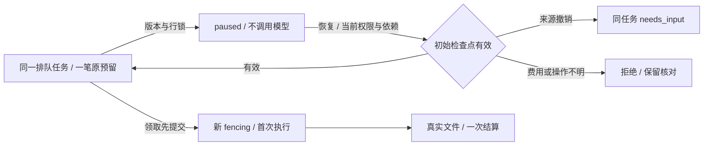
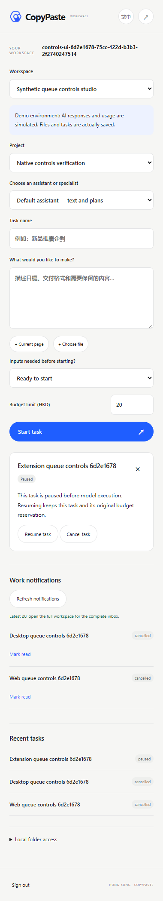

# 排队暂停、同任务恢复与 Codex 原生续聊

<!-- stage65-current-history-source-lineage:start -->
后续[阶段 65](65-conversation-content-source-lineage.md)补充实际文件/云引用/数据集读取、历史结果和计划来源检查，以及显式发布的独立输入快照；状态与费用元数据保留。见[当前后台回执](../quality/history-source-checkpoint.json)。本文原阶段源码和执行回执保持其历史范围；已付费原生步骤的业务续接及完整验收继续跟踪。
<!-- stage65-current-history-source-lineage:end -->

本轮修复 REQ-009/044 的部分缺口，保留全部 102 条需求和原始验收条件。用户端 Web、无边框 Desktop 和 Chrome 扩展已支持**首次模型调用前**暂停排队、恢复原任务及取消；Admin 与用户端复用同一领域函数。模型/媒体依赖依照用户指示使用假数据，PostgreSQL、登录、Codex 程序、文件与费用账本实际执行。

## 已实现的任务控制

兼容接口为 `POST /v1/tenants/:tenant/projects/:project/tasks/:task/controls`，返回 202 及既有任务快照，需用户登录、CSRF、项目写权限和 `Idempotency-Key`。正文严格限制为：

```json
{ "action": "pause", "expected_version": 3, "reason": "调整排期" }
```

`action` 当前只接受 `pause` 或 `resume`，版本为正整数，原因可省略、最长 2000 字符。重放键绑定任务、动作、版本及原因；相同请求复用回执，不同正文复用同键返回冲突。重放之前重新检查项目权限和任务可见性，不能通过旧回执越过权限撤销、私有范围或内容隔离。现有取消接口及 Admin 重试接口保留各自规则。

| 动作 | 必须满足 | 事务结果 |
| --- | --- | --- |
| 暂停 | queued、attempt=0、没有 runtime_thread、没有取消请求、内容有效；原预留为 reserved 且金额与原预算一致、没有工具操作记录 | paused、版本递增、清除过期容量原因、保存暂停事件与真人审计；原资金预留保留 |
| 恢复 | paused，并满足相同初始检查点约束；当前执行环境与任务一致 | 重新检查原受益用户权限、角色/技能/方案及执行上下文；资料有效则 queued，只保留一个未派发 outbox；不新建任务和预留 |
| 恢复时资料被撤销 | 上述恢复授权有效，但先前选择的来源已不可用 | 同一任务变为 needs_input，原依赖重新开放；已批准计划的输入变化沿用既有取消规则 |
| 状态/版本竞争 | Worker 已先领取或任务已变化 | VERSION_CONFLICT、CANNOT_PAUSE 或 CANNOT_RESUME；不回写运行中或终态任务 |
| 预留或执行记录异常 | 费用待核对、预留金额不符、存在先前工具操作 | CHECKPOINT_UNAVAILABLE；不自动重新执行 |

Admin 保留独立身份、范围权限、版本和原因要求，并调用 `controlUnclaimedTask`。管理员的恢复权不能替代原受益用户被撤销的执行权。Worker 领取时还会再次检查原授权。派发查询只选择 queued 且未取消的任务；暂停期间不消耗执行槽，旧队列重复投递也不能领取 paused 任务。



Web/源码 Desktop 只在未领取的 queued/paused 任务上显示“暂停排队 / 继续工作”，版本冲突后刷新；侧栏扩展按当前任务版本调用，并在轮询时同步详情和最近任务状态。暂停说明明确模型尚未执行、原预算仍预留。取消暂停任务仍按原规则释放未用额度。

## Codex 续聊原语与费用修复

锁定版本保持 `0.163.0-alpha.10.2`。原生适配器分别按照实际协议发送 `thread/start` 与 `thread/resume`；`dynamicTools` 和 `allowProviderModelFallback` 仅用于 start，resume 使用保存的工具声明及 `excludeTurns: true`，校验返回的原 thread、内部 provider 和模型。不会自行更换内核或模型。

每个受控运行目录的 `.codex/copypaste-continuation.json` 保存服务端续聊回执，包含线程标识、配置指纹、状态和累计 token 基线，不含密钥、正文或文件路径。指纹涵盖任务、锁定内核、内部端点、模型/推理配置、费率、技能内容和工具声明。配置变化、损坏或缺失回执、不同线程及未明确完成的回合均拒绝续聊。文件属于运行缓存，沿用既有私有目录、保留与删除规则；生产 ACL 和完整工作区隔离仍按部署门槛验收。

接受新的 `turn/start` 前先原子写入 in_flight；只有回合 completed、用量有效且子进程确实关闭后，才通过临时文件和 rename 写入 ready。中断/断连/失败即使收到了本回合早期某次模型响应的用量，也不能把这些部分用量当作全部已知成本，回执保持不可自动续跑。已测部分用量保留给对账。完成后保存回执失败会抛出携带 accepted、已测用量的 RuntimeFailure，避免 Worker 把实际执行误认为零消耗初始化失败。

Codex 的 `tokenUsage.total` 是线程累计值。恢复后的结果扣除上次 ready 回执记录的基线，计入本回合新增用量；只接纳本 thread/turn 的用量事件，旧回合的通知不会重复收费。受控实际测试中，首次工具回合使用 34/10 input/output token，跨进程恢复后的新增用量仍为 34/10，线程基线累积为 68/20。

**适配器续聊原语尚未接到业务 Worker 的已付费步骤恢复。** 当前用户“继续工作”恢复的是首次调用前的队列检查点。运行中安全暂停、逐步骤产物复用、同任务新 attempt 的持久费用累计、未知外部动作人工核对、崩溃/多节点续跑，以及完整规范 `/v1/tasks/{task_id}/controls` 的 Task 响应仍未完成。不能把本轮局部实现称为完整 REQ-009/044/069 验收。

## 实际验证与交付边界

平台新增五组原生隔离数据库集成测试，覆盖同任务/单预留/单次入队和结算、重复请求、领取与暂停的两种先后、跨企业/私有/只读拒绝、撤权后的回执访问、独立 MFA/企业范围的 Admin 守卫、原受益用户撤权、预留待核对，以及暂停期间来源隔离。

原生 Codex 测试启动新适配器/子进程恢复原历史和动态工具，验证增量用量；拒绝线程/模型/技能/工具变化；实际中断一个已有早期用量、但下一响应仍在途的回合；注入完成后的回执保存故障并确认保留已测消耗，累计计数回退时保留未知费用并禁止继续。初始化取消仍验证及时回收进程。完整平台回归为 185/185。

Delivery 提供 `npm run qa:task-controls`，在原生模拟栈上使用独立测试账号及浏览器 PKCE，检查 Web、源码无边框 Electron、真实 MV3 扩展业务文档的暂停/恢复/取消。两个只属于本次测试、从未派发的私有占位记录用于稳定触发容量排队；最后释放占位后，由真实 Codex/模拟模型生成文件，核对原预留和 charge 均只有一笔。五组通过、无页面错误，所有自建浏览器/扩展/Electron 在 finally 关闭。

报告为交付仓库 `evidence/task-controls.json`，完整 TAP 及摘要为 `evidence/alignment-platform.tap`、`alignment-platform.json`；[逐项修复进度](../quality/requirements-alignment-progress.json) 保存摘要和来源。扩展此次业务测试使用独立 MV3 页面，原生右侧 SIDE_PANEL 的真实出现方式继续以 [窗口/侧栏专项证据](30-native-window-and-browser-sidepanel.md) 为准。

重启期间首次脚本早于 API 就绪，零项执行的 `fetch failed` 记录独立保存在 `evidence/task-controls-startup-race.json`；当次没有启动浏览器或 Codex。脚本已加入有界就绪等待，最后一次完整运行五组通过且三个关闭标记均为 true。

当前改动为源码交付；上一轮无边框安装包及侧栏 ZIP 的源码提交和 SHA-256 保存在既有预览清单，它们尚未包含本轮新增排队控制。历史完整 0.5.0 离线包同样保留。全部需求、角色真实服务资格与生产发布门槛不因本轮测试通过而关闭。




技术依据：[OpenAI Docs — Codex App Server](https://learn.chatgpt.com/docs/app-server) 的 thread/resume、工具声明持久化及 turn/interrupt；字段以仓库内锁定版本生成的 `contracts/codex/v2/ThreadResumeParams.json` 和 `ThreadTokenUsageUpdatedNotification.json` 为准。
