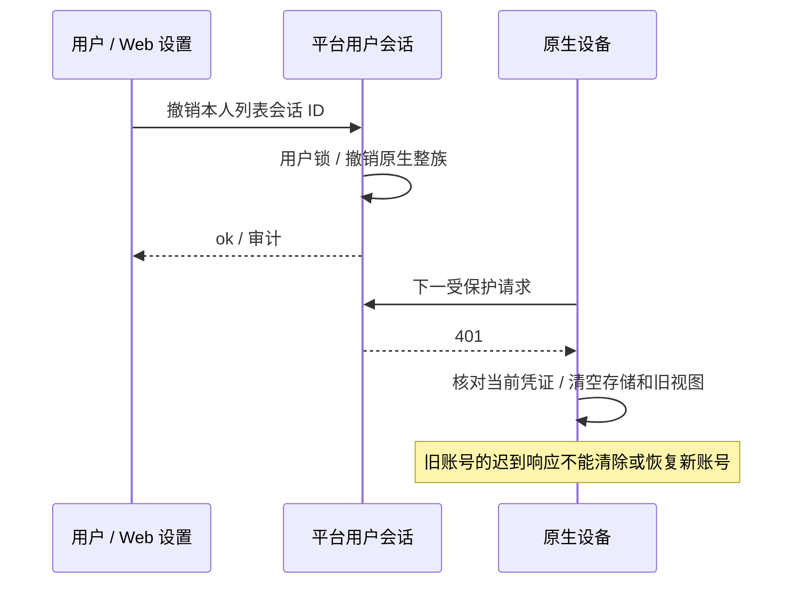
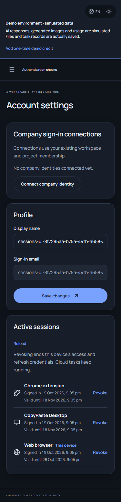
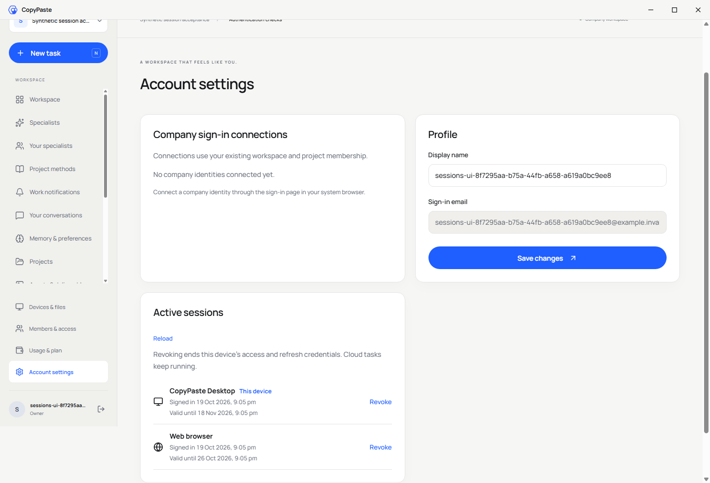

# 跨端会话、设备撤销与退出竞争修复

本轮以 REQ-003 / TC-003 的完整原始条件为核对基准，修复 Web、无边框 Desktop 和 Chrome 扩展的会话流程，并复查企业成员撤销后的旧凭证入口。Codex、内部 AI 路由和全部 102 条需求保留。此流程不需要模型调用；模型/媒体仍按用户指示使用假数据。

## 核心问题与行为

旧设备目录仅显示 access token 尚未过期的会话，无法区分 Desktop 与扩展；原生刷新可能在用户退出后重新保存令牌；扩展使用过期 access token 退出时不能保证服务端撤销；收到撤销后的 401 时仍可能展示上一个账号的工作区。

现在账户设置显示客户端类型、当前装置、建立时间和有效期。原生 access 已过期但 refresh 仍有效的条目继续显示，用户仍可撤销。普通用户只看到自己的条目，不会获得管理员身份、供应商凭证、令牌摘要或设备私有路径。

| 接口 | 规则与结果 |
| --- | --- |
| `GET /v1/me/sessions` | 当前用户登录；按最新未使用、未撤销的 refresh 关联原生会话；区分 web/desktop/extension、current 和 refresh_expires_at；不暴露任何凭证 |
| `DELETE /v1/me/sessions/:id` | 当前用户、Web 写请求 CSRF；只撤销本人会话及其原生整族；旧列表 ID 可定位已经轮换的家族；撤销当前 Web 会话同时清理 Cookie；记录真人审计 |
| `POST /v1/auth/native/revoke` | 严格正文只含 client_id 和 refresh_token；匹配客户端的刷新凭证证明；不需要有效 access、不先刷新、不新发令牌；撤销整族，未知/过期/已撤销凭证返回相同 ok 回执 |

native/revoke 的刷新凭证属于产品会话，服务端仅用摘要查找。该接口不以 Cookie 授权其他操作，不能通过猜测用户或会话 ID 撤销他人。刷新、注销和撤销均先锁用户、再锁凭证；实际并发验证确保任何先后下整族最终失效，不遗留刚轮换的 access。审计只记录真人、会话目标和客户端类型。

## 客户端状态与竞争

两个原生独立仓库各包含相同的 `native-session.ts`，使用各自加密存储 / chrome.storage.session 适配器，不依赖相邻源码构建。刷新采用单飞；所有写入串行，并用进程内 revision 和当前刷新凭证核对登录/刷新回执。退出先清空本地凭证，再发服务端撤销；迟到回执不能回写，而是尝试撤销其刚签发的家族。旧请求的 401 不能清除后来登录的账号，改为提示状态变化。

确定失效才清理当前凭证。网络异常、429 或 5xx 保留现有登录状态并显示可重试错误。令牌结构和有效秒数先验证；保存失败会尝试撤销刚签发的凭证。离线退出明确显示“本机已登出，服务端撤销未确认”，用户可从其他已登录设备完成撤销；没有声称离线即可保证远端成功。未确认撤销的离线凭证不自动重新登录或重发。

Desktop 继续使用无边框与自绘窗口控件。退出和账号替换会撤销本地目录授权、清空文件结果缓存及本地设备/签名公钥关联；文件操作等候清理完成，真实原文件保留。Chrome 后台只把产品凭证保存在受信 session 存储，清除时通知已打开的受信侧栏；账号、任务、文件和通知视图清空，轮询停止。内容脚本不能取得凭证。

Web 对受保护 API 设置会话代次，失效时清空用户、企业、项目与 UI；迟到响应不再恢复旧状态。主动退出用不含身份/凭证的同源跨标签事件通知其他标签，重新进入可见状态时复查用户。设置页撤销有确认、执行中反馈、错误和重新载入；当前装置撤销后返回登录页。

## 邀请和成员边界

过期、已消费或邮箱不匹配的邀请拒绝；验证码和 PKCE 授权码过期/重放拒绝；源浏览器退出使尚未兑换的原生授权码失效。成员移除后，旧 Web、Desktop、扩展以及设备命令入口不能调用原企业；刷新令牌不会恢复被撤销的成员关系。账号可以属于其他企业，因此单个成员关系撤销不等同全账号封禁，其他企业授权仍按当前关系检查。

## 验证与证据

平台 `tests/auth-sessions.test.ts` 有六组真实隔离 PostgreSQL/API 测试：三端目录/当前标识与严格无凭证字段；过期访问和整族撤销；六轮真实刷新/撤销竞争；他人 ID、CSRF、旧列表 ID 及当前 Cookie；验证码/PKCE 的过期重放和源会话退出；邀请过期/错邮箱/重放及成员移除后的全部旧入口。完整平台回归 191/191；原始 TAP 与摘要保存在交付仓库 evidence/alignment-platform.tap 和 alignment-platform.json。

原生控制器各有十组确定性竞争/故障测试，另增加真实目录授权与缓存结果清理测试。Desktop 全部原生测试 15/15，扩展 10/10。它们验证持久化、异步先后及失败含义，不仅检查按钮或复述实现。

源码提交后，独立 Git 重新检出检查四组通过：35 份 SQL 字节及两库迁移校验账本、28 个固定摘要技能包、42 份 Desktop renderer 来源摘要、191 项原始 TAP 字节与摘要均一致。此项保证独立检出的内容完整，不代表历史安装包已包含本轮修复。

交付仓库 `npm run qa:sessions` 的七组流程全部通过，使用新建合成账号、实际邮箱验证、浏览器 PKCE、真实源码 Electron 与真实 MV3，报告写入 evidence/sessions.json。过期时间只调整本次用户；离线 revoke 和后台 GET gate 为明确的故障注入。所有自建页面、上下文及应用在 finally 关闭。

本机 Windows 的默认 GPU 路径在页面计时/帧调度时阻塞：授权按钮可见、未禁用且没有动画，但正常点击不能完成；有窗口与无头模式均复现。对照中仅将 Chromium 改用 `--disable-gpu` 后，四帧、计时器和正常点击均通过，见 evidence/sessions-gpu-diagnostic.json。最终会话验收对自建 Chromium/源码 Electron 使用软件渲染，产品启动配置未改动。这证明本次业务流程，不包含硬件渲染兼容性结论。四次早期失败保存在 sessions-initial-load.json、sessions-desktop-focus.json、sessions-background-focus.json、sessions-authorize-stability.json，不计为功能通过；没有强制点击或脚本触发按钮来绕过可操作检查。

本次扩展业务验收使用隔离 MV3 文档；右侧原生 SIDE_PANEL 的出现方式继续按 [窗口/侧栏专项](30-native-window-and-browser-sidepanel.md) 验收。历史无边框安装包、侧栏 ZIP 与 0.5.0 完整离线包保持原源码提交和哈希，尚未包含本轮会话修复。完整系统矩阵、真实企业身份提供商及生产门槛另行验收，不能仅凭测试数量关闭全部需求。
