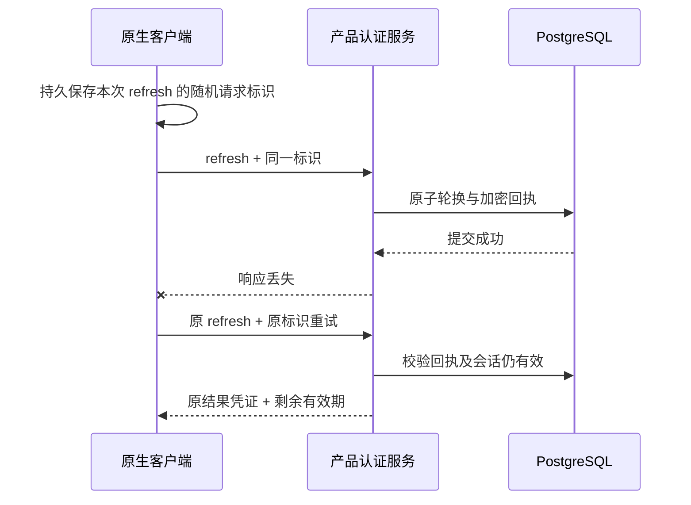

# 规范认证接口与未知响应恢复

适用：D 盘 dev 下的 Platform、Web、源码无边框 Desktop、MV3 侧栏及 Delivery。用户允许当前模型和媒体使用假数据；本项认证、数据库、加密存储、浏览器及原生进程均实际执行。Codex 唯一内核、内部 AI 网关和原生 Windows 约束保持。

## 接口与真实消费者

以原有 [OpenAPI](../contracts/openapi.json) 为依据新增五项，未为迎合实现修改认证契约。平台保留旧路径供已有客户端迁移。

| 接口 | 成功 | 精确载荷与约束 | 当前消费者 |
| --- | --- | --- | --- |
| `POST /v1/auth/challenges` | 202 | 严格 `{email}`；返回 `challenge_id, expires_at`，不含验证码、投递详情或 flow | Web 邮箱登录 |
| `POST /v1/auth/sessions` | 201 | 严格 `challenge_id, code`；返回规范 `user{id,email,display_name}, expires_at, csrf_token`，HttpOnly 产品 Cookie | Web 验证登录 |
| `DELETE /v1/auth/session` | 200 | `{ok:true}`；有效 Cookie 写请求须 CSRF；重复退出可安全确认 | Web 当前账号退出 |
| `GET /v1/auth/authorize` | 302 | 严格 client/redirect/state/challenge 与显式 `S256`；Location 仅为已登记回调的 code/state | Web 用户点击授权，供 Desktop/Extension 使用 |
| `POST /v1/auth/token` | 201 | 严格 authorization_code/refresh_token 联合载荷；返回规范 Bearer Tokens | Desktop 与 Extension 首次交换及刷新 |

四项认证写接口要求 `Idempotency-Key` 长度 8–128。登录页面按相同邮箱/验证码操作保留同一请求标识，用户明确重发或更换输入时产生新标识；原生刷新先将随机请求标识随当前 refresh 凭证持久保存。标识及令牌不进入页面、日志、URL 或截图。

`/v1/me` 仍是现有工作区聚合载荷，尚未迁移成规范 User；邀请、admin-sessions 和完整企业身份契约也未因本次五个接口而视为完成。当前后台邮箱加 TOTP 路径继续使用其独立会话域。实际 method/path 数量和字段符合性分别统计。

## 浏览器与授权边界

规范验证码绑定 `cp_auth_flow` 的哈希。该 Cookie 具有 HttpOnly、SameSite=Lax、限定 `/v1/auth` 和生产 Secure；拿到 challenge ID 的另一个浏览器不能提交，也不能通过旧 verify 路径绕过。相同请求的成功重试只能由原 flow 取回；验证码尝试次数、有效期和一次性使用仍受数据库约束。

授权在系统浏览器的产品会话中完成。Web 使用真正的授权链接发起顶层导航；后台核查 Fetch Metadata 的 navigate/document/用户激活，并核查同源或允许的 Web 来源 Referer。已认证 Web API 也可用该会话的显式 CSRF 证明。子资源、跨站自动调用、缺少证明和原生 Bearer 会话均不能生成授权码；旧 POST 授权同样要求浏览器会话。

跨 API/Web origin 的链接仅携带 origin 级 Referer，不泄露授权查询参数。原生回调地址精确受登记规则约束；code、state、S256 verifier 及原始浏览器会话仍分别校验。登录后返回地址限制为产品内部路由，拒绝外部来源、反斜线、控制字符、非法编码及归一化后的 API 目标；嵌套原生回调参数可正常保留。

导航判断参考 [W3C Fetch Metadata](https://www.w3.org/TR/fetch-metadata/) 的请求上下文语义；PKCE、回调和 refresh 重用边界参考 [OAuth 安全最佳实践 RFC 9700](https://www.rfc-editor.org/rfc/rfc9700.html)。Fetch Metadata 结合产品会话与 CSRF 使用，不单独充当身份凭证。

## 同一请求恢复与撤销

新增前向迁移 `036-auth-request-receipts.sql`。同一操作/请求标识在事务内串行化，将 OTP 使用、会话创建或 refresh 轮换与加密回执原子提交。请求标识和请求载荷使用服务密钥 HMAC；OTP 等低熵输入不以可离线穷举的普通哈希保存。内部回执由现有主密钥加密，数据库不直接保存可读验证码、产品访问凭证或 refresh 凭证。

相同标识更换载荷返回 409。成功重试返回同一凭证；原生 `expires_in` 按数据库中的剩余有效期缩减，不能因重试延长本地缓存。改用新标识重放已经用过的 refresh，仍触发整族撤销。会话已轮换、撤销、冻结、过期、auth_version 或企业身份绑定失效时，历史回执不得重新发放凭证；重试过旧回执也不得撤销已经产生的后续有效轮换。

回执保留 24 小时，独立维护步骤每次最多清理 100 条；回执清理不删除有效会话或更改令牌有效期。邮件在事务外采用有期限投递租约；临时失败可用同一标识重试原验证码而不额外占用一条挑战记录。此处验证了开发邮箱故障恢复，不表示 SMTP 可达性或独立邮件重试服务已完成。

## 原生本地状态与多个侧栏

Desktop 将请求标识和会话状态保存在 DPAPI 包裹密钥保护的加密文件；Extension 使用受信任上下文限定的 `chrome.storage.session`。刷新请求只有一个进行中的实例；网络错误保留可重试状态，明确失效才清理。退出或新账号接管后，旧刷新、旧登录和旧未授权响应不得恢复或清掉后来账号。

首次授权码交换在同一个登录动作内保留请求标识：传输失败、无法读取成功载荷或服务端 5xx 只允许再试一次；明确的 4xx、冲突和限流不自动重试。重试取回原凭证，继续经过登录版本守卫后才写入本地。原生进程在首次交换过程中彻底退出后的持久授权交接不在本次短重试证明范围。

侧栏本地 `session_epoch` 在接受新登录时变化，在正常刷新时保持。已经打开的所有侧栏收到新身份后先清掉旧账号、任务、项目和本地文件缓存，再载入当前账号。普通刷新不会被误判为切换账号。每个请求处理结果前复查视图版本，旧账号迟到的 401 不能清除后来的账号；此检查先于错误状态处理。

Web 当前退出和撤销当前浏览器会话同时清理产品会话与 flow Cookie。原生整族撤销、过期访问撤销、本地目录授权清理、离线退出反馈及跨标签清理继续遵守 [跨端会话生命周期](32-cross-client-sessions-and-revocation.md)。Desktop 无边框和 Chrome 原生右侧 Side Panel 继续遵守 [原生表面设计](30-native-window-and-browser-sidepanel.md)。

## 验证与交付边界

平台 `tests/auth-contract.test.ts` 使用实际隔离 PostgreSQL 和 Ajv 2020 检查原始规范的十个 schema 依赖，覆盖并发同请求、跨 flow、CSRF、明确 S256、重放/整族撤销、历史回执、剩余有效期、加密静态存储、冻结、邮件失败、兼容入口与有界保留。主文档工具另外核对测试 fixture 与原始 OpenAPI 的 schema 及字节摘要，防止缩小 fixture 来取得通过。

Delivery 的 `npm run qa:platform` 将进程原始输出按收到的字节保存，记录完整数量与 SHA-256；`npm run qa:sessions` 运行 Web 登录、系统浏览器 PKCE、真实源码 Electron、两个 MV3 面板、已提交刷新响应丢失及换账号迟到回执等流程。仅修改本次合成账号的到期时间及受控本地状态，故障注入范围在报告中明示。MV3 业务文档不代替原生 Side Panel 出现测试。

本阶段平台全回归 **203/203**，原始 TAP 的 SHA-256 为 `a7bb466cad4baded1746268cedd24c64d69ad87d782ea50a11f4adb921619b23`；Desktop 单元 **24/24**、扩展 **19/19**、Web 返回地址 **3/3**。实际 Web 导航专项 **3/3**：规范邮箱登录、外部返回目标拒绝、真实用户点击跨 origin GET 授权、S256 自有 loopback 回调/201 交换，以及重复退出和 Cookie 清理，原始回执见 Delivery `evidence/stage33-navigation/auth-navigation.json`。十个认证 fixture 的 schema 与原始契约摘要全部一致，当时其他实际业务样本为 31/31；本阶段原始平台 JSON/TAP 保存在 `evidence/stage33-platform/`，最新增量见文档 34。

首次扩大测试因 Playwright Electron 求值的动态导入限制而失败，保留 `auth-recovery-harness-import-failure.json`。修正模块加载后，新增首次交换短重试之前的十组实际流程曾成功，包含 DPAPI/MV3 已提交刷新响应丢失和双面板换账号；之后增加首次交换恢复时，完整十二组重跑在初始浏览器或 Electron 启动阶段受阻，未计为当前完整通过。`sessions.json` 保留原先文档 32 的七组历史回执，当前失败另存 `auth-recovery-latest-integration.json` 和 `auth-recovery-open-issue.json`，不覆盖成通过。

匹配 Playwright 的 Chromium 1248 普通浏览器仍能在完整尺寸/预置语言下复现求值阻塞；同版 Headless Shell 则通过 DOM、计时器、动画帧和上述三组实际 Web 导航。引擎及失败对照保存在 `auth-recovery-browser-readiness-*.json`。源码 Electron 的直接启动、不同渲染参数及 Playwright loader 对照记录均保留。已提交 main 与当前 main 的原生原始启动均在限时内没有可响应页面；该对照共享当前依赖及 renderer，不能排除全部源码问题，也不能据此断言硬件为唯一原因。

相关自建实例已定向关闭；不得在此基础上宣布新增首次交换的两端端到端验收通过。当前首次交换恢复有四组原生单元检查/每端、服务端并发与回执集成证据，完整真实原生进程重跑仍待完成。临时对照的编译产物已逐字节恢复，未改产品默认 GPU/启动配置。历史安装包及完整离线包保持原清单与摘要，本次未重新打包或发布。

Windows 本机软件渲染原因和此前失败记录见文档 32；测试不改变产品默认 GPU 启动参数。全部自建页面、浏览器上下文和 Electron 在 finally 关闭。102 条综合验收、完整 SSO/系统/访问性矩阵、正式网关及角色资格、历史包重新打包与签名更新继续独立待验收。

本阶段源码提交后的独立 Git 重新检出四组通过：36 份 SQL 字节及两库迁移摘要账本、28 个受信任固定摘要技能包、43 份 renderer 来源摘要，以及当时 203 项原始 TAP 与记录 SHA-256。自建临时检出已移除；此项不替代原生启动及业务验收。
