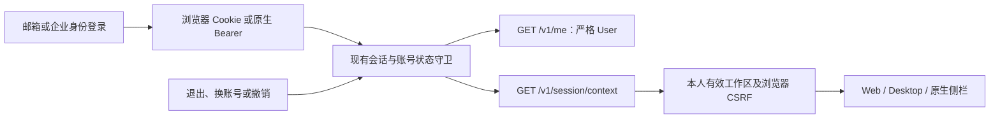

# 用户资料契约、工作区初始化与并发清理

本轮继续核查 REQ-001/002/003/035/036/039/051/055/060/100 的相关子流程，并修复完整回归发现的 REQ-057/090/091 删除并发子流程问题。原始 102 条需求、TC 条件和 OpenAPI 不缩减，综合验收仍未全部完成。

## 用户资料与初始化

原始 `GET /v1/me` 的 200 响应是严格的 `User`。此前实际返回 `{user,memberships,csrf_token}`，虽然客户端能用，仍违反原始字段约束。现拆为两个真实接口：

| 接口 | 结果 | 认证与用途 |
| --- | --- | --- |
| `GET /v1/me` | 仅 `id`、`email`、`display_name` | 规范用户资料；浏览器和原生凭证均执行现有会话、用户状态及企业身份检查 |
| `GET /v1/session/context` | `{user:{id,email,name,locale},memberships:[{id,name,data_mode,role}],csrf_token}` | 私有客户端初始化；仅列出本人有效成员资格及有效企业，供 Web、Desktop 和扩展选取工作区 |
| `PATCH /v1/me` | 保留当前资料编辑流程 | 修改名称和语言，不更改本轮原始 GET 契约 |

上下文接口由同一个 `requireUser` 守卫保护，并维持 `Cache-Control: no-store`。浏览器 CSRF 只在实际选用浏览器会话时返回；原生 Bearer 优先时为 null，即使请求另带其他账号 Cookie。不得把工作区列表或 CSRF 加回规范 `User`。

Web 的上下文刷新、Desktop 设备权限同步、扩展初始化及项目刷新均消费新上下文路由。Desktop 的 Web renderer 通过原有显式 `renderer:sync` 更新并重新记录 43 份摘要。QA 的工作区/CSRF 辅助请求同步迁移，用户 PATCH 和后台 `/v1/admin/me` 保持各自路由。已有退出、换账号、迟到响应与多侧栏身份边界继续执行。

平台新增两组真实隔离 PostgreSQL 检查：原始 `User` schema、最新资料更新、Cookie/Bearer 身份，以及两个不同账号的混合凭证下工作区和 CSRF 的归属。导航专项另通过实际 HTTP 验证规范资料，并等到真实 Web 会话表出现，确认页面已完成上下文初始化。新增 HTTP 样本只保存合成账号的三项资料字段，不保存凭证或 CSRF。

## 并发删除中的消失对象

首次完整回归为 205 项中的 204 项通过；失败发生于已有的并行删除工作者检查。`readdir(objects)` 和逐项 `lstat` 之间，另一工作者删除了同一个对象，`ENOENT` 从孤儿扫描抛出。原始失败 TAP 与其 SHA-256 记录保存在 Delivery `evidence/profile-platform-first-failure/`，不将重跑替换成首次成功。

修复仅在逐项检查时忽略 `ENOENT`，继续处理其他候选。权限错误、繁忙存储及其他 I/O 错误继续抛出，删除任务仍保留原有租约、摘要、安全路径验证、事务墓碑和错误记录。

两组确定性回归使用真实本地文件：在枚举后的 stat 边界实际 unlink 一个对象，验证另一个对象仍被发现；分别注入 EACCES 和 EBUSY，确认错误向上传播且文件保留。测试仅临时替换本进程的文件系统调用，并在 finally 恢复；临时目录位于已核对的项目 `.data/` 下。

## 第 34 阶段验证与限制（历史）

本节保留该阶段的实际结果；当前认证恢复结果见文末更新，旧失败和原始 TAP 不改写。

本轮修复后平台完整回归 **207/207**，原始 TAP SHA-256 为 `be79794025420d55dd8f7f6853afc634d5787554d79625e02a6ec43d94256133`。Web 实际导航 **4/4**，包含从首次邮箱登录、S256 授权、创建企业及项目、加载真实会话表，到规范 Cookie/Bearer 资料和重复退出；自建浏览器已关闭。实际 HTTP schema 样本 **33/33**，原十个认证 fixture 与原始规范一致。平台、Web、Desktop、扩展和 Delivery 均完成适用的类型检查及构建。

Web 首轮增加会话表等待时，合成账号尚未创建企业而停留在初始化页，失败记录保留为 `auth-context-first-navigation-failure.json`；补齐真实首次用户初始化后，页面和资料验证通过。

当前验证记录以 Delivery `evidence/stage34-platform/alignment-platform.json`、配对原始 TAP、`auth-navigation.json` 及 `auth-profile-contract-samples.json` 为准。上一阶段 203 项原始回归完整保存在 `evidence/stage33-platform/`，三组导航历史记录保存在 `evidence/stage33-navigation/`。原始十个认证 schema 仍与未改写的 OpenAPI 完全对应。

本轮没有把原生完整旅程标为通过。未加载产品模块的隔离 Electron 检查中，CJS 在 ready 后创建窗口超时，ESM 则完成了窗口、DOM 和定时器执行。显式路径的 Playwright 启动需要其固定版本的 ready-event bridge；补上后调试连接能建立，但实际首窗口事件仍超时，不能据此断言单一硬件或源码原因。两次本轮失败及已核对 PID 的进程清理记录保留在 `auth-recovery-launch-without-loader.json`、`auth-recovery.json` 和 `auth-recovery-loader-owned-cleanup.json`。

`qa:sessions` 现在将当前十二组旅程写入 `auth-recovery.json`，保留原七组 `sessions.json`。Electron 退出等待有界，超时只清理本次 ChildProcess 树，并仍记验收失败。自建最小诊断目录和进程已清理；其他项目和用户浏览器未关闭。

本轮修改的是规范接口与当前源码，历史 Setup、Portable、侧栏 ZIP 和完整离线包均未重构。旧预览包仍依赖当时的聚合接口，不能作为当前接口修订的兼容性证明。重新打包、签名更新、完整原生/系统矩阵、邀请和后台规范路由、正式网关与所有角色业务资格仍在原范围内待完成。

独立源码提交后的重新检出四组通过，见 Delivery `evidence/byte-integrity.json`：36 份 SQL 字节与两库迁移摘要、28 个受信任 Skill 固定摘要、43 份 renderer 来源摘要，以及 207 项原始 TAP 与记录 SHA-256；自建临时检出已移除。文档结构与契约检查通过 12,608 项、失败 0 项，此数量不代表产品验收数量。

后续邀请和成员契约已按 [邀请与成员权限闭环](35-invitations-and-membership-authority.md) 修复相关子流程；本篇 207 项平台证据成对归档至 Delivery `evidence/stage34-platform/`，完整后台与原生验收仍未完成。

## 当前源码认证恢复复核（2026-10-20）

[当前页面与原生认证恢复](42-current-membership-ui-and-native-auth-recovery.md)记录十二组真实 Web／源码 Electron／MV3 登录和会话验证：首次交换／刷新回执丢失、双面板换账号、撤销、过期访问退出、离线反馈和迟到响应全部通过。前后 758 份源码／运行文件一致，拥有的三端实例关闭且凭证已清理。当前回执为 Delivery `evidence/auth-recovery-current.json`；旧 `auth-recovery.json` 与启动问题回执保持原字节。当前 Setup／Portable 完整认证、系统、SSO 和全部原生成员旅程仍未完成，不能用本次源码验证替代。
