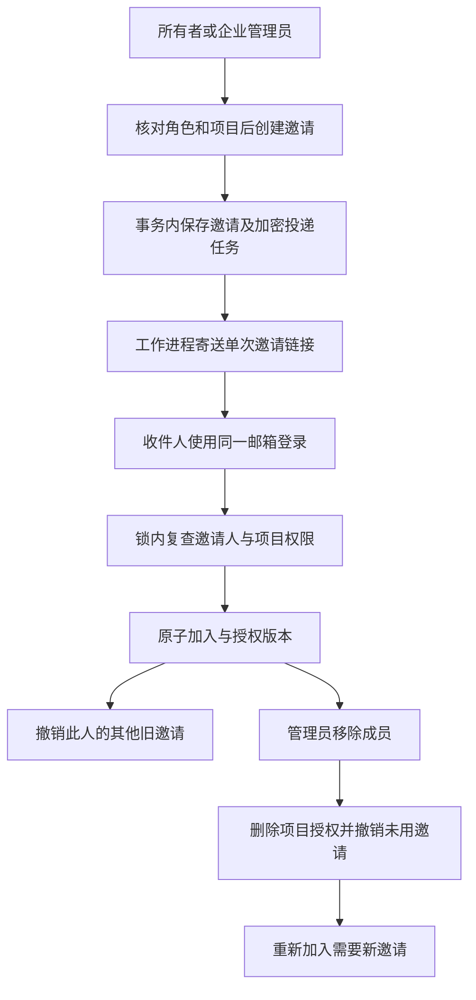

# 邀请与成员权限闭环

本轮继续修复 REQ-001/002/003/035/036/039/051/055/060 的相关子流程。全部 102 条 REQ/TC、NFR 与 G01–G10 仍保留；下列证据不能替代完整产品验收。内核仍唯一使用 Codex，模型和媒体请求仍经内部网关，本轮身份与权限检查不调用模型。

## 规范接口与独立身份

原始 OpenAPI 字节未修改。此前邀请返回额外的明文 `invite_url` 且状态码为 200，接受邀请返回企业对象；成员列表把用户 ID 当成员 ID、没有分页。现在执行原始规范：

| 操作 | 当前结果 | 边界 |
| --- | --- | --- |
| `POST /v1/tenants/{tenant_id}/invites` | 201，严格 `Invite` | `email/role/project_ids`；必需的企业头、CSRF、8–128 字符幂等键 |
| `POST /v1/invites/accept` | 201，严格 `Member` | 本人邮箱、实际会话、原子消费及幂等恢复 |
| `GET /v1/tenants/{tenant_id}/members` | 200，严格 `MemberList` | 企业管理员范围；UUID 游标、1–100 条分页、必需的匹配企业头 |
| `DELETE /v1/members/{member_id}` | 200，严格 `Ack` | 企业头、CSRF、幂等键、当前管理权限及最后所有者保护 |

前向迁移 037 为成员新增独立且唯一的 UUID，同时保留原来的 `(tenant_id,user_id)` 主键和外键。`Member.auth_version` 表示该企业成员授权版本，来自 `memberships.version`；不是账户级 `users.auth_version`。移除后重新邀请会沿用成员 ID，递增授权版本。

名字和邮箱仅由受管理权限保护的补充 `member-directory` 分页接口提供，不加回严格 `Member`。原有成员编辑 PATCH 继续显式检查授权版本、所有者权限和有效项目；移除使用规范 DELETE。

## 授权、并发与失效

所有者可以邀请五种企业角色；企业管理员只能邀请 member、approver、viewer。邀请项目必须属于本企业且有效。所有者和管理员的企业角色提供既定的企业管理范围，不能把其项目选择解释为限制管理员企业权限的沙箱。

邀请记录保存邀请人的成员授权版本。接受时重新验证邀请人仍为有效成员、账户和企业仍有效、角色足以发出该邀请、授权版本未变化，且每个指定项目仍有效。原有邀请人的权限变化使旧邀请失效，需要管理员显式重发。迁移前的邀请在升级时绑定当时的成员版本，随后遵守相同检查；无法关联有效邀请人的旧记录不能授权。

创建、接受、编辑、移除、撤销与重发共用每企业的数据库事务锁。等待锁后再检查操作者权限。最后所有者保护因此覆盖并发移除，不能通过两个所有者互相移除产生无所有者企业。平台后台尚未实现的规范成员授权入口，后续也必须复用这一领域锁和守卫。

同一接受请求并发重试返回同一个已提交 `Member`，不重复授予。其他键不能重复消费同一链接；同一个键配不同令牌冲突。恢复缓存前仍核对当前成员状态和授权版本，移除后的旧成功回执不能恢复授权。

成功加入会撤销同一收件人的其他未消费邀请；成员移除也会撤销当时所有未消费邀请并清除待投递密钥。这同时适用于规范 DELETE 与原有 PATCH 移除。之后由管理员新发的邀请才可重新加入。旧移除请求的同键重试仅恢复回执，不会删除后来重新授予的成员权限。

## 邮件投递与可管理内容

邀请和邮件任务在同一事务中提交。任务以现有 `MASTER_KEY` 加密保存单次令牌，普通 HTTP 响应和通用幂等回执不再保存邀请 URL。迁移 037 清理旧邀请回执的明文 URL 字段，同时保留幂等唯一记录，避免重复创建。

工作进程通过租约领取，数据库事务之外发送邮件；失败保存通用错误并退避，最多八次。过期的最后一次租约会变为可见的失败；管理员可以显式重发。重发递增邀请版本、轮换令牌并重新检查当前授权，旧工作进程不能覆盖新版本状态。撤销、消费、到期和成功发送清除待投递令牌密文。发送端设置连接、问候与 socket 超时。

邮件传输为至少一次：SMTP 成功后进程崩溃可能再次发送同一个单次链接。不能宣称邮件恰好发送一次。已经发出的邮件无法收回；接受端始终检查当前有效性，因此撤销或重发后的旧链接不能授权。

本轮实际使用原生 PostgreSQL、本机开发邮箱和受控发送故障验证队列，并未验证生产 SMTP 服务。开发邮箱的合成邀请是测试交付记录，不得当作生产凭证仓库。

用户端提供成员分页、项目选择、所有者权限编辑、移除确认，以及邀请分页、投递状态、撤销和重发。前端按当前角色显示可执行动作，服务端独立拒绝越权。新邮件链接携带非密钥的企业提示；登录返回保留完整邀请地址，成功接受后选择实际获授企业。创建请求在未知响应时保留幂等键，已确认创建后释放该次身份；接受请求保留恢复身份。浏览器存储只包含摘要、随机键和期限，不保存邀请令牌或邮箱。

Web 的私有响应版本守卫补入 `/v1/session/context` 与 `/v1/members/`。企业嵌套请求自动提供企业头，Desktop IPC 同步传递该头。实际退出后迟到的上下文响应被拒绝，不能恢复 CSRF。Desktop renderer 经显式来源同步后构建，扩展继续通过工作台进入成员管理。

## 验证与交付边界

平台增加 13 组真实隔离数据库检查，覆盖严格原始契约、企业头、幂等、邮箱、分页、角色、跨企业项目、并发所有者、即时移除、重复旧邀请、投递失败/重试/版本围栏、过期/撤销、归档项目及耗尽租约恢复。原始七个成员/邀请 schema 另存为完全一致的测试 fixture；十个认证 schema 保持原样。

早期浏览器工具输出曾显示六组通过，但成功 JSON 在后续重跑中被覆盖，未保存为可复核证据。尝试归档的 `evidence/membership-before-final-source/` 实际捕获了后续失败报告；原始字节保留，不作为成功证据。当前源码新增独立 `qa:membership-wire`，真实 HTTP 五组通过：两账号邮箱登录、投递与创建幂等、单次加入幂等、只读管理目录拒绝，以及移除后的立即拒绝与不可恢复；拥有的两份会话均退出，见 `evidence/membership-wire.json`。当前 HTTP 复核的四份合成账号实际响应加入原始 schema 校验，当前合计 37/37。Web 单元检查 5/5，包含跨账号的操作身份隔离和成功后再次创建。

最初浏览器夹具按 API origin 匹配创建响应，而本机经 Vite 同源代理返回，导致等待超时。已改为匹配实际方法和路径；失败 JSON 和截图保存在 `evidence/membership-first-navigation-failure/`，没有把失败删除或计为成功。修复前 207 项平台回归原始 JSON/TAP 成对保存在 `evidence/stage34-platform/`；新增耗尽租约检查前的 218 项记录另存 `evidence/stage35-initial-platform/`。

最终稳定源码平台全套回归 **220/220**，原始 TAP 不经格式化，完整结果及摘要见 `evidence/alignment-platform.json`，独立 Git 检出结果见 `evidence/byte-integrity.json`。当前源码已构建，但历史 Setup、Portable、侧栏 ZIP、离线包没有随本轮重打包。当前十二组完整原生启动/认证旅程仍未通过，失败和环境诊断继续单列保存。完整后台规范成员授权、生产邮件、正式模型与角色业务资格，以及其他 TC/NFR/G01–G10 仍在待完成范围内。

当前最终源码浏览器复核连续失败：headless shell 的邮箱控件等待与新页面创建、完整 Chromium 的成员按钮等待，以及进程内 GPU 对照的邮箱控件等待均超时。三个 BrowserServer 尝试的正常关闭也超时，随后强制关闭本次拥有的进程，退出已确认。最后对照没有观察到业务 API 请求，不能据此确定根因或宣称产品页面通过。失败报告及具体来源见 `evidence/membership-current-issue.json`；`membership-navigation.json` 保留最后一次实际失败，不用旧成功覆盖。新增页面/上下文有界等待和拥有的 BrowserServer 关闭保护，备用 GPU 参数只用于 QA，产品 Electron 配置未改动。

本轮截图记录早期浏览器运行的实际页面；当前最终 Web 角色限制和操作间距已构建，但页面重验仍待完成。平台 220/220、当前 HTTP 五组和原 schema 37/37 均为不同范围的证据。

独立 Git 检出四组已通过：37 SQL 与两库迁移摘要、28 个受信任 Skill、45 份 Desktop renderer 来源摘要和 220 项原始 TAP 字节；临时检出已移除。此检查不包含页面验收，证据说明纠正和回执提交不改变这些已核对字节。
