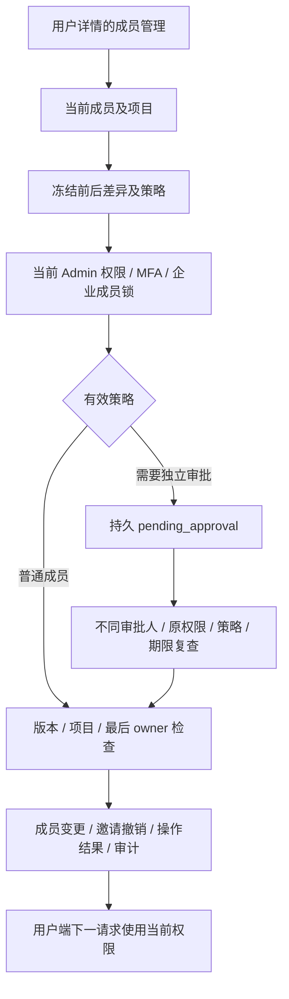

# Admin 成员控制与不可变策略快照

本增量落实 REQ-085/094/100 的成员管理子流程，原始 102 项需求、TC、NFR 和 G01–G10 不变。Codex 内核、内部 OpenAI 兼容网关、Desktop 无边框和 Chrome 原生 Side Panel 继续作为强制约束。模型与媒体仍按用户指示使用假数据；本流程不调用模型。

## 接口与操作身份

`POST /v1/admin/tenants/{tenant_id}/memberships` 严格接受原始 `AdminMembershipChange`，返回持久操作的 `202 AdminOperation`。角色有 owner、admin、member、approver、viewer；状态有 active、suspended、removed；请求必须包含当前版本、用户 ID、完整项目列表和 3–1000 字符原因。企业从路径确定，不能用请求正文覆盖。创建时的 `expected_version=1` 表示首次授权；已存在关系必须使用其当前版本。

原始三个 schema（含 Role）逐字保存在平台测试 fixture，主文档工具另行对比原 OpenAPI 摘要与结构。幂等键为原规范的 8–128 字符；同一管理员、键、企业和参数恢复原操作，换参数冲突。恢复前重新核对当前管理员权限与近期 MFA，已成功的历史操作不会重新授予权限或撤销后来发生的暂停。

未加入对应虚拟版本 1，首次 Admin 授予后持久版本为 2，后续每次变更递增；这样两个首次 Admin 授予不能同时复用版本 1。规范直接请求以执行时实际版本为准；页面预览还冻结“未加入”这个前态，因此期间通过用户邀请新建的版本 1 关系也不能被旧预览覆盖。

`GET /v1/admin/operations/{operation_id}` 按当前 `admin.jobs.read` 企业范围、近期 MFA 和审计返回严格操作结构。操作包含实际策略版本 UUID、发起管理员、目标 IDs、参数摘要、状态、版本和结果成员 ID。完成后同一键恢复的是操作记录，不是当前成员状态承诺。

补充接口提供管理表单所需的当前成员/项目选项、五分钟变更预览，以及审批人的冻结业务明细。选项和预览需要 `admin.tenants.members.write`；审批明细需要 `admin.approvals.read`。明细不返回发起人的 session ID、认证版本或凭证。预览本身不修改成员；管理页面提交预览 ID 头，服务端复查原前态、参数、策略和期限。原始规范客户端也可直接提交规范正文。

## 权限、暂停与并发

所有变更在管理权限锁与企业成员共用事务锁内重新鉴权，核对当前成员版本、账号/企业状态、有效项目及最后一位启用的 owner。用户端修改、移除、邀请接受和 Admin 实际执行共享同一企业锁。审批执行与用户端并发移除也不能留下零位启用 owner。敏感执行持有实际管理员会话和主体的数据库共享锁，退出/撤权与操作提交形成明确顺序。

企业成员身份是不可分割的企业对象：仅有某个 project 的 allow 不能修改整个企业成员；同企业内重叠的 project deny 会阻止该企业级动作。全局、企业 deny 仍优先于 allow。前端按钮可见性只是提示，服务端逐次执行相同检查。

| 管理状态 | 实际存储 | 效果 |
| --- | --- | --- |
| active | status=active，admin_suspended=false | 按当前角色及项目授予访问 |
| suspended | status=removed，admin_suspended=true | 立即阻止旧凭证访问；保留显式项目供恢复时复核 |
| removed | status=removed，admin_suspended=false | 清除项目授权；后续授予必须显式执行 |

原始用户端 `Member.state` 仅允许 active/removed，保持该严格契约；获授权的管理目录额外显示 `management_state=suspended`，后台明细显示三态。暂停不等于冻结全局用户账号，不影响同一用户在其他企业的独立关系。恢复不会恢复已撤销的 OAuth 或本机目录权限。

后台变更会撤销该收件人的旧待用邀请。暂停时，用户端 owner 修改、移除后再加入，以及新邀请接受均不能解除管理暂停；必须由当前获授的 Admin 明确恢复。旧发信人的授权版本改变后，既有邀请仍受当前发行人验证约束。移除和暂停不会伪造已执行任务的完成状态。

## 版本化策略与独立审批

新增前向迁移 038，增加暂停标记、真实策略快照表及操作策略/版本/目标/结果列。快照由实际有效规则及发布目录版本计算摘要，具有真实数据库 UUID；服务身份仅能读取和插入，数据库触发器也拒绝更新或删除。历史迁移 001–037、受信任 Skill 和原始规范不改写。

默认策略对涉及启用 owner/admin 的授予或变更要求另一位管理员审批；普通成员权限变更在近期 MFA 有效时直接执行。发布的 admin-control 策略可以设置 `membership_privileged_requires_approval`，并在 1–10 分钟内设置审批窗口，默认五分钟；近期 MFA 窗口为十分钟。没有发布策略时，快照明确标记 built_in_default，不能声称存在未发布的目录版本。

待审批操作冻结命令、成员前态、策略 UUID、发起会话/认证版本和期限。审批人必须不同，具备当前企业范围的 `admin.approvals.decide` 及近期 MFA。执行前复查发起人的原会话、当前权限、期限、策略、参数摘要、成员及项目；变化后拒绝执行，可取消旧操作并新建请求。原因、操作号、受益用户、前后差异、发起人及审批人保存在审计与持久操作中。

历史操作没有记录有效策略版本，保持该事实：新规范读取返回 `OPERATION_POLICY_UNRECORDED`，其既有后台 job 记录仍可访问。不能给历史记录补一个虚构策略 UUID，也不能据此宣称所有后台规范操作均已覆盖。

## 验证与边界

专项使用隔离原生 PostgreSQL 验证严格契约、项目/企业范围与显式拒绝、MFA、并发版本、用户端暂停绕过、冻结前态、独立审批及原权限/期限/策略变化；另有真实本机 HTTP 证据，使用独立合成账号、实际邮件和 TOTP。HTTP 测试关闭自己的全部会话并停用自己的临时管理员，不启动浏览器或模型。

后台新增成员表单、前后差异和审批明细；Web 显示暂停原因，Desktop 从明确 Web 来源同步 renderer。当前页面交互/截图尚未复核，不把构建、HTTP 或历史页面截图当成本轮页面验收。既有 Web/原生启动问题继续单独保存；本轮无浏览器调用，未关闭用户的浏览器。

本轮平台回归、原始 TAP、HTTP 样本、独立 Git 检出及实际计数以 `docs/quality/requirements-alignment-progress.json` 和 Delivery 的当前回执为准。上一轮 220 项稳定回归及其原字节归档于 `dev/copypaste-delivery/evidence/stage35-platform/`，失败专项原始报告另存。安装器、便携包、扩展 ZIP 和完整离线包仍是历史源码版本，尚未包含本增量。正式身份/邮件、完整 Admin 契约、角色业务资格及全部 TC/NFR/G01–G10 继续待验收。

最终稳定源码平台回归 **233/233**，含 **13/13** 本轮 Admin 成员专项；当前真实后台成员 HTTP **5/5**，捕获规范样本 **43/43**。初次 232 项全套回执及当时 HTTP 响应另存 `evidence/stage36-initial/`；首次授予并发保护修正后才产生当前 233 项最终回执。当前原始 TAP 不经格式化，SHA-256 为 `943b4aa7b743162bf7be4d75df8982d0170e9ebef680449745688365e1e85591`。

独立 Git 检出四组通过：38 份 SQL 与两个本机数据库迁移摘要、28 个受信任 Skill、45 份 renderer 来源，以及 233 项原始 TAP 的摘要与字节。临时检出已移除。此核对是交付字节一致性证据，不等于完整恢复演练或当前页面验收。

后续账户增量见 [账户生命周期](37-admin-account-lifecycle-and-inflight-control.md)。本阶段最终 233 项 JSON/TAP 和独立检出字节回执现已归档 `evidence/stage36-platform/`，上文计数及源码快照为本阶段历史证据；最新累计回执以逐条进度为准。新增账户写操作和批量状态已记录真实策略，但其余尚未迁移的费用/VIP 操作仍未记录策略，不能泛称所有当前操作都有规范策略版本。
