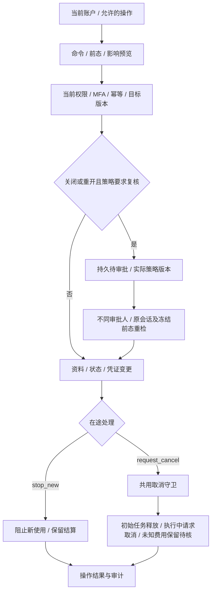
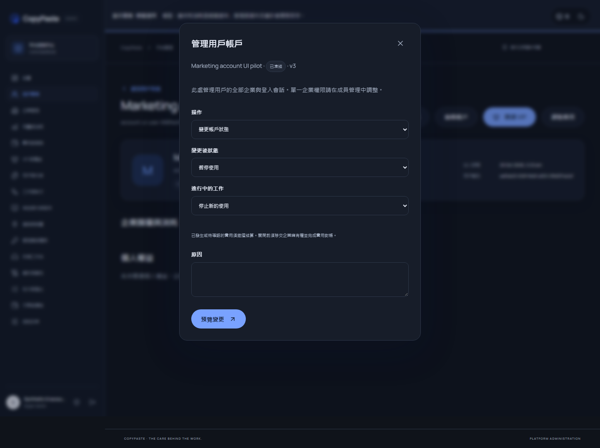

# Admin 账户生命周期与在途任务控制

2026-10-20 增量。保留原始 102 REQ/TC、NFR 和 G01–G10；本文约束后台全局用户资料、账户状态、全部会话撤销及单企业状态变更。它承接 [后台成员控制](36-admin-membership-control-and-policy-snapshots.md)，不替代完整 Admin 规范验收。全部开发仍在 `D:\dev\copypasted\自有agent\dev\`，主文档在 `docs/`，仅使用原生进程。

## 规范接口与实际消费者

| 接口 | 原始正文 schema | 必需权限 | 结果 |
| --- | --- | --- | --- |
| POST /v1/admin/users/{user_id}/profile | AdminUserProfileChange | admin.users.profile.write | 202 AdminOperation |
| POST /v1/admin/users/{user_id}/status | AdminAccountStatusChange | admin.users.status.write | 202 AdminOperation |
| POST /v1/admin/users/{user_id}/session-revocations | AdminReason | admin.users.sessions.revoke | 202 AdminOperation |
| POST /v1/admin/tenants/{tenant_id}/status | AdminTenantStatusChange | admin.tenants.status.write | 202 AdminOperation |

四个接口逐次检查当前管理员、Origin/CSRF、近期 MFA、当前范围/显式拒绝及 8–128 字符幂等键，拒绝额外字段。资料及状态命令要求 `expected_version`，全部要求 3–1000 字符原因。正文及操作响应取自原始 OpenAPI；独立测试 fixture 保存原规范字节摘要并逐项核对，不通过改写设计 schema 消除差异。

补充 `/{profile|status|session-revocations}/preview` 为表单冻结前态、命令、策略版本、影响和五分钟有效期；管理界面提交 `X-Admin-Preview-ID`，执行时重新比对。规范客户端可直接提交原规范正文。`users/{id}/account-control` 和 `tenants/{id}/account-control` 返回获授权的当前版本、管理状态、用户标签、可操作能力与任务数量，使用 no-store，不返回会话、验证码或密钥。`operations/{id}/account-review` 提供审批所需的冻结业务明细。

用户详情的旧单一表单改为资料、状态、会话撤销三个操作；企业状态弹窗使用同一受控预览组件。确认前显示差异与取消含义，成功或待审批结果保持可见至用户关闭。网络结果未知时保留同一逻辑操作的幂等键；服务端在返回旧操作前仍复查当前权限和 MFA。旧 `PATCH /admin/users/{id}`、`PATCH /admin/tenants/{id}` 已移除，管理页面与测试消费者不再调用。

## 状态、范围与凭证

| 对象与管理状态 | 实际效果 |
| --- | --- |
| 全局用户 active | 用户可重新登录，按当前成员及项目权限使用 |
| 全局用户 frozen | 立即停用全局账户，递增授权版本，撤销所有浏览器/原生会话及 refresh，消费未交换 native code |
| 全局用户 closed | 保持停用并记录关闭标记；须先移交非关闭企业的最后所有者责任，处理该用户的未结任务预留 |
| 企业 active / suspended | 恢复或停止该企业访问；同一用户在其他企业的会话及权限保留 |
| 企业 closed | 记录关闭标记并停止企业访问；须先完成企业内未结任务结算或对账 |
| 仅撤销用户会话 | 递增授权版本并撤销凭证；账户状态、成员与显式项目授权保留 |

全局用户操作需要真正的 global allow；某个企业或项目的 allow 不能冻结整个用户。与目标用户所属企业重叠的 tenant/project deny 会限制 global allow。企业状态采用企业范围及其重叠项目 deny，不能通过项目级授权扩大到整家企业。独立审批及规范操作读取执行同样的范围规则。

停用用户撤销其作为收件人或发行人的待用邀请；停用企业撤销该企业待用邀请，并清除待投递 token 密文。恢复不会复活这些邀请、旧会话或被撤销的外部/本地授权。关闭是账户生命周期状态，**不等同隐私擦除**，不会删除审计、账本或擅自承诺备份清除。隐私删除继续遵守独立删除账本和保留设计。

## 版本、并发与复核

前向迁移 039 增加用户/企业版本、用户标签和独立关闭时间。触发器让本人资料修改、身份提供者撤权和后台变更共享实际版本；服务不把关闭混同普通 suspended。既有 001–038 SQL 及受信任 Skill 字节保持原样。

账户级授权事务锁按用户 ID 排序，再取得企业成员锁。用户端成员变更、邀请创建/接受/重发、Admin 成员执行和首次创建企业加入该顺序。全局停用与授权/创建企业因此可形成明确先后关系；入口已鉴权但等待锁的创建请求在事务内再次核对用户状态和授权版本。账户行采用非键更新锁，允许已持有任务的结算事务取得外键引用锁，避免账户控制与费用结算互相等待。

默认 `account_close_requires_approval=true`；关闭及从 closed 恢复均要求不同管理员复核。发布的 admin-control 可以明确设置该规则及 1–10 分钟审批窗口，默认五分钟。策略快照复用 038 的不可变表，记录实际规则、目录身份与版本、摘要和真实 UUID；没有发布目录时明确记录内置默认，不补造目录版本。

待审批操作冻结命令、目标前态、策略、发起人的**原会话**及认证版本和期限。审批执行复查双方当前权限/MFA、不同主体、原会话仍有效、目标版本/前态、期限、摘要、策略以及关闭前提。变化后拒绝执行；可独立驳回过期或失效请求，不代替原发起人重新授权。前后差异、原因、操作号和审批人持久保存。

旧批量 users.status 仍为过渡入口，但已接入相同账户锁、当前范围/MFA、目标快照、真实策略版本、凭证和邀请撤销。它仅做 active/frozen 的 stop_new，不得将 closed 批量改回 active 以绕过独立复核。完整规范批量作业请求和列表仍待迁移。

## 在途费用与取消

`stop_new` 不把在途任务标记为已取消，也不退回其预算；后续执行继续检查当前授权，已经接受的用量仍须结算。`request_cancel` 明确请求取消，用户本人取消、后台任务取消及账户停用共享一个领域实现。

仅从未领取、无运行线程、无工具操作的初始任务可按零消耗释放预留并进入 cancelled。running 仅写取消请求，由 Worker 停止后结算实际用量。已尝试过、存在外部操作或结果待核的非运行任务进入 reconciling，保留原预留，等待既有对账流程确认；不会将“状态不是 running”误判为“没有发生费用”。重复取消保持幂等，不重复释放或扣费。

## 验证、交付与剩余范围

账户专项为 12 组隔离原生 PostgreSQL 测试：严格原规范、预览/重放、MFA/CSRF/版本、范围拒绝、全局凭证与邀请撤销、单企业隔离、关闭/重开、原权限与策略/目标/期限变化、最后所有者、批量守卫、三种取消入口费用保护及入口鉴权后的实际并发冻结。数据库观察实际 advisory 等待后才提交冻结，不用定时猜测替代竞争检查。

`npm run qa:admin-account-wire` 对当前源码原生服务执行六组真实 HTTP 流程，捕获八个严格 AdminOperation 样本，测试用用户、邮件和 TOTP 均为自有合成身份，模型调用为零；结束后撤销全部自建会话并停用自建管理员。全部规范 HTTP 样本及原 schema 比较以 `docs/quality/runtime-contract-samples.json` 为准。当前全套平台、页面及独立检出回执单独保存，不把构建或 HTTP 当作浏览器/原生验收。

上一阶段 233 项稳定回归 JSON、未格式化 TAP 及独立检出回执归档于 `dev/copypaste-delivery/evidence/stage36-platform/`；本阶段初次失败也保留。当前总数、原始 TAP 摘要、源码提交与未完成项以逐条进度文件为准。

**仍需完成：**规范 Admin 用户/企业列表与详情的全部字段、筛选/游标和费用/权益汇总；其余费用、VIP、批量/导出规范迁移与真实业务闭环；其余页面与全部主题/语言/辅助技术及原生系统矩阵；生产身份/邮件、真实模型媒体资格和发布包更新。已有接口路径匹配不等于完整业务验收。Desktop 无边框和 Chrome 原生侧栏继续按 [窗口与侧栏约束](30-native-window-and-browser-sidepanel.md) 实施；历史安装器和 ZIP 不含本轮新增账户源码。

最终稳定平台回归 **245/245**，原始 TAP SHA-256 为 `880650a872f4f18911314c1a410bb3fc96aa4810fc3c31712d819cf783d21c94`；真实账户 HTTP **6/6**、累计严格样本 **51/51**。本次账户页面使用已安装 Chromium 1243 的独立软件渲染实例，通过 **5/5**：真实邮箱/TOTP、资料与标签预览确认、冻结、待审批定位与自批拒绝，以及 375/768/1440 三宽度的英文浅色／繁中深色两组组合及 Escape 关闭。不是全部语言主题组合或全产品可访问性验收。

页面验证实际修复了待审批导航：成功结果直接进入 `/audit?view=approvals&search=<operation-id>`，普通操作进入已筛选 jobs。不存在的 `/approvals` 链接已移除。默认浏览器缓存缺失、初次行定位及导航错误的失败回执和当时截图独立保留于 `evidence/stage37-initial/`；最终调用通过后所有自建上下文、页面和 Chromium 实例已关闭，自有测试管理员和会话已撤销。实际调用使用 CHROME_BIN 指向本机现有 Chromium，不下载、不安装、不触碰用户原有浏览器。旧成员页面和扩展原生完整旅程的未完成记录仍保留，不由本次账户页面替代。

最终独立 Git 检出 **5/5**：39 份 SQL 原字节及两个本机数据库迁移账本、28 个受信任 Skill、45 份 Desktop renderer 来源、Admin 全部 85 个受跟踪源码/配置/双语说明/截图，以及 245 项 TAP 原字节。校验的源码提交为 Platform `3ef36ae`、Admin `cef6e3f`、Desktop `40d5e5f`、Delivery `41958bf`；之后 Delivery 仅提交本次字节回执。全部临时检出已移除，完整复原/生产验收仍不据此关闭。
