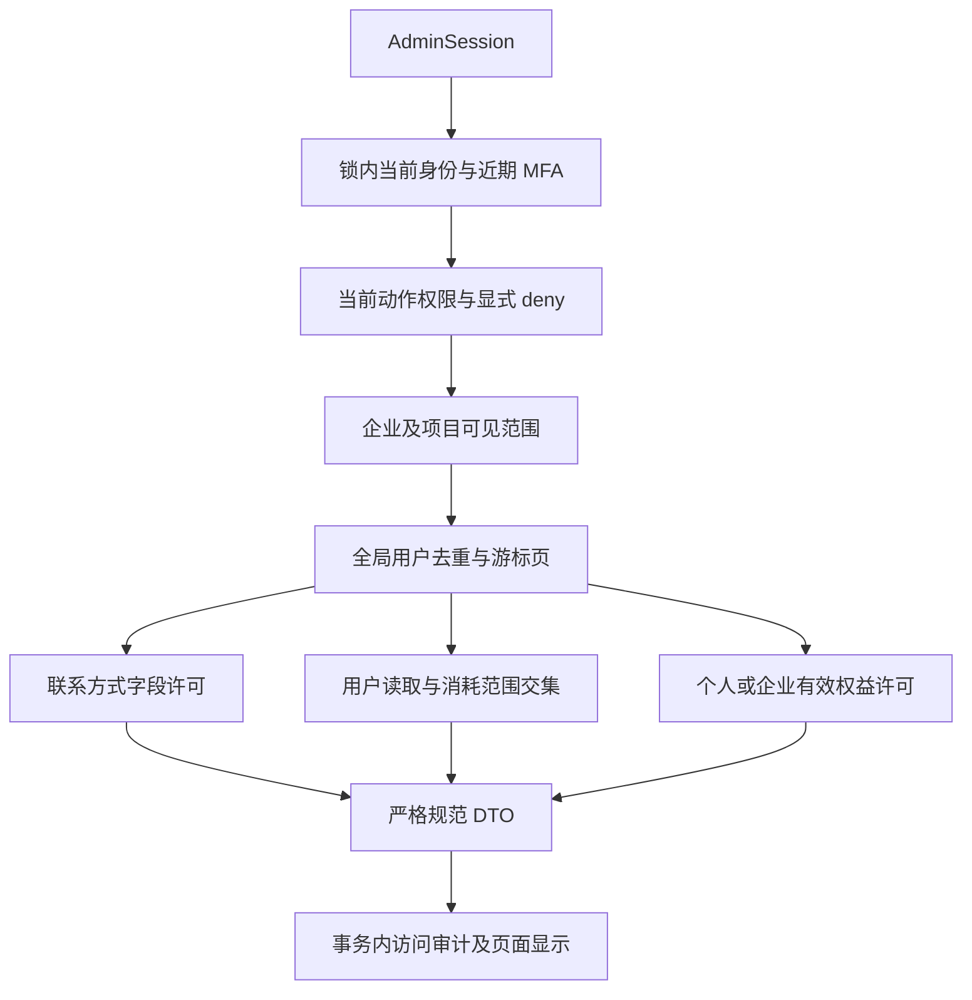
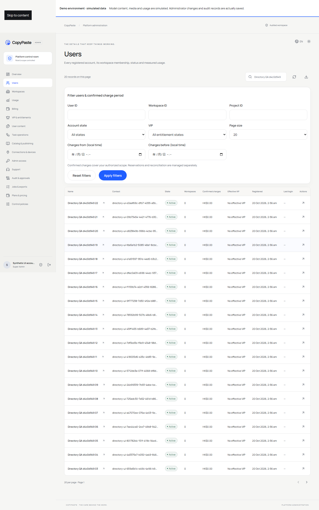

# 后台规范目录、字段范围与确认扣费

本增量落实 REQ-084/085/086/094/098 的列表和详情子流程，保持原始 102 项需求、TC、NFR、G01–G10 及 OpenAPI 原文不变。仅使用 Codex 内核；模型和媒体继续按用户要求使用模拟数据。Desktop 无边框、Chrome 原生 Side Panel 和禁止本地虚拟化仍为项目约束。

## 1. 本次差异与修复

旧后台用户与企业列表接受 page/page_size/search，返回 total/page 等旧字段；用户详情混合原始数据库记录、usage 和 entitlements，偏离严格原规范。旧统计读取 tasks.charged_micros，联系方式的搜索和显示也没有始终采用同一范围交集。当前实现迁移了服务端和实际 Admin 页面调用，没有保留相同路径的旧响应外壳。

| 当前入口 | 原规范响应 | 页面消费 |
| --- | --- | --- |
| GET /v1/admin/users | AdminUserList：items、next_cursor | 用户列表、搜索、筛选、前后翻页 |
| GET /v1/admin/users/{user_id} | AdminUserDetail：user、memberships、billing_account_ids、effective_entitlements | 用户资料、企业关系、账户控制和费用/VIP入口 |
| GET /v1/admin/tenants | AdminTenantList：items、next_cursor | 企业列表、状态管理、费用表单企业选择 |
| GET /v1/admin/users/{user_id}/management-context | 实现增量，不冒充原规范 DTO | 获准企业名称、任务数、确认扣费和个人权益历史 |

新增补充上下文具有与主详情相同的当前身份、MFA、用户读取及对象范围守卫，随后分别检查消耗和个人权益权限。它不返回完整 users/memberships/entitlements 数据库行。个人权益无权限时为 null，获准但没有历史时为 []；无权读取的费用与任务数量省略，页面显示横线。

## 2. 身份和迁移

新增迁移 040，为 wallets 增加独立且唯一的 UUID id，作为 AdminTenant.billing_account_id 和详情的 billing_account_ids。它与 tenant_id 分开持久保存，不以临时散列或前端生成值代替账务身份。企业业务创建继续在同一事务建立企业和钱包。完整个人账务账户及规范费用写流程仍需后续实现，不能据此宣称已完成全部 BillingAccount 规范。

users.last_login_at 在真实邮箱登录和企业联合登录成功的事务中更新；原生令牌刷新不伪装为新登录。迁移仅从仍保留的 user 会话回填历史最近登录，没有足够历史时返回 null，不虚构丢失会话的登录记录。全局资料/状态 version 和 auth_version 继续保留各自含义。

001–039 SQL 未修改。040 应用后同样按迁移账本原字节校验，不回写已执行 SQL。

## 3. 查询与分页

用户列表严格接受 user_id、tenant_id、project_id、period_from、period_to、q、state、vip、cursor、limit；企业列表接受 q、cursor、limit。limit 为 1–100，默认 50；空 q、非法 UUID、非 true/false 的 vip、错误时间、反向区间、旧页码参数和未知参数被拒绝。q 按字面处理通配符，姓名可搜索，完整联系方式匹配必须取得同一用户的联系方式字段权限。

state 区分用户 active/frozen/closed；企业区分 active/suspended/closed。管理暂停的成员状态映射为 suspended，而非将其存储层 removed 误呈现为普通移除。user_id 一人一行，多企业关系和多项目不会重复计算用户。

游标使用持久服务密钥签名，绑定目录类型、管理员、原会话、auth_version、筛选及当前权限绑定摘要，15 分钟到期。改变筛选、会话或权限后必须从首页重新读取。服务端每页复核近期 MFA 和当前权威权限；显式拒绝优先，过期绑定不参与决策。

顺序为 created_at DESC、id DESC，保留数据库微秒精度，避免同时间戳漏行；首请求时间上界排除正常后续新注册记录。它是每页复核的实时目录，不是冻结的跨页数据库快照：资料、状态和权限仍可能变化，授权撤销必须立即生效。响应不虚构 total；页面明确显示本页笔数，前页保存已访问游标，筛选与刷新重置游标。

费用表单的全局企业选择逐页读取完整的获准企业列表，再提供选择，避免静默截断为前 100 家。读取取消时中止自己的请求，读取失败显示错误。

完整回归还发现旧用户导出调用 page_size，现改为消费规范用户游标。旧导出业务保留 500 条同步上限，但超限明确返回 EXPORT_TOO_LARGE，不会默默输出前 500 条。准备下载和发送前均重新检查当前会话/MFA及导出许可，发送前比较完整当前授权摘要，期间角色、字段或范围变化则拒绝；每页来源读取仍复核其权限。其他旧来源也拒绝已知超过上限的集合。原规范异步导出、完整过滤条件传递和批量业务仍未完成，这一修复仅保住实际调用及撤权边界。

## 4. 权限和统计含义

项目范围读取只显示该范围内获准用户和项目 ID；不能展开其他企业的成员、账务账户或个人权益。全局 allow 仍受企业和项目 deny 限制。完整联系方式及不可分割的个人权益遇到该用户重叠的字段 deny 时保守隐藏；联系方式搜索和 VIP 正反筛选同样执行许可，不能以筛选结果推断无权读取的内容。VIP 筛选无字段权限时拒绝；有其他范围许可但目标字段不可见时，该用户不参与正反筛选。

confirmed_customer_charges 汇总 ledger.kind=charge 的真实确认事件，关联原任务以取得企业/项目范围，按发起者归属一次。period_from 含开始、period_to 不含结束，使用扣费入账时间，而非任务创建时间。金额保持十进制微额字符串，不经 JavaScript 浮点累加。充值、赠额、钱包预留和对账中待定费用均不混入确认扣费。

有权读取且确认扣费集合为空时，金额可为 0；没有目标项目消耗范围时省略字段。专项曾发现被拒绝项目仍显示 0 的缺陷，现已修复并保留失败回执。任务数与确认扣费分开读取；页面的横线不解释为免费或零成本。完整预留/对账/内部成本钻取仍以独立消耗业务验收为准。

有效 VIP 取当前 active、已生效、未到期的 pro/business，冻结用户和失效企业成员关系不继承企业方案。个人授予读取需要全局字段许可，企业授予仅来自当前有效且获准的企业关系；starter 不被显示为付费 VIP。VIP 不增加余额或突破资源权限。

## 5. 当前证据与限制

十一组目录和导出专项已纳入最终完整平台回归并全部通过。隔离原生 PostgreSQL 检查使用原始七个 schema 依赖逐一比对、真实登录、完整响应校验、去重、微秒并列游标、过滤/会话/权限绑定、范围和字段拒绝、账本扣费及时间边界、有效 VIP 和 MFA/撤权。失败夹具与真实的拒绝项目 0 投影问题保留在 Delivery evidence/stage38-initial，不以重跑掩盖。

实际本机 API、Vite Admin 页面和自有 Chromium 验证七组通过：真实邮箱/TOTP；23 个合成用户的 20/3 翻页；规范详情与账户/VIP目标入口；VIP/企业/关闭状态筛选；企业账务 ID 与状态入口；375/768/1440 英文浅色及 375 繁中深色布局；MFA过期和未登录拒绝。原始响应保存在 admin-directory-contract-samples.json，仅收集本次合成记录。浏览器、上下文与页面均已关闭，自己的测试管理员、会话和用户已停用；未碰用户原有浏览器。

截图审查修复了引用旧 total 的计数文案，并改为等待列表实际渲染后截取移动端。首次过早加载截图和对应回执独立归档。Admin 和 Delivery 均完成类型/构建检查。最终完整平台 **256/256**，无失败/跳过/取消；额外旧调用定向 **7/7**，当前严格响应样本 **63/63**。完整原始 TAP SHA-256 为 `e0741c2315252c644229cfd51198c911c8272c66b365924f4a3e92fa396f5079`。首次完整回归 252/255 的三处差异（两个旧断言和实际导出调用）原样归档，断言迁移保留默认 50、最大 100、去重、范围和下载撤权要求；只在有真实 charge 事件时计确认扣费，不把旧夹具的任务数值冒充账本。独立检出结果另列。

本增量不完成全部 REQ-084/086 或 G10：完整消费钻取、规范资金/VIP写、批量导出、旧成员页面、原生综合旅程和当前安装包仍有独立缺口；18 个角色的真实生产业务验收仍未完成。历史 0.5.0 安装包、扩展 ZIP 及离线包不能作为本增量发布产物。原始 102 项及所有门槛继续保留，完整验收不得从这些局部通过数推导。

最终独立检出 **5/5**：40 份 SQL 及两个实际数据库迁移账本、28 个受信任 Skill、45 份 Desktop renderer 来源、Admin 全部 89 个跟踪源码/配置/双语说明/截图、256 项原始 TAP 及摘要。校验提交为 Platform `1212445`、Admin `01b11f6`、Desktop `40d5e5f`、Delivery `a4fad77`；Delivery 随后仅提交本次字节回执。全部临时检出已移除。它证明指定检出内容与回执一致，不替代完整灾备、原生或生产验收。
