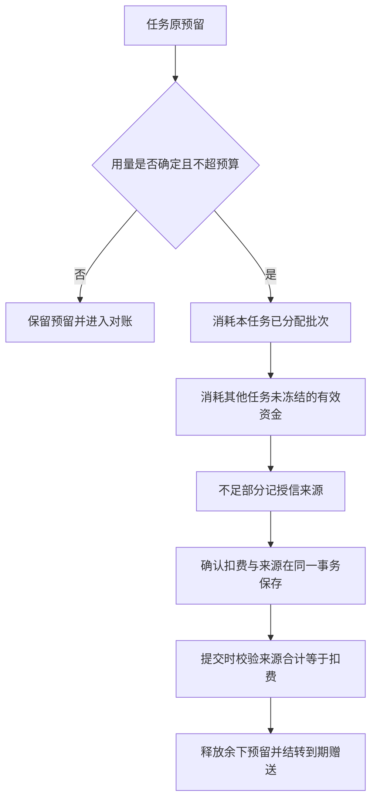

# 授信、资金批次与实际结算来源

本文记录 REQ-011/046/086/087/101 的账务内核增量。它补充 [Admin 控制面](11-admin-control-plane.md) 与 [费用和管理后台](../modules/08-usage-billing-admin.md)，不替代原始费用/VIP 契约、真实收款核验或 G10 综合验收。

## 金额与资金规则

HKD 金额仍以整数 micros 保存。单次内部调用接受可精确表示的整数；累计余额、预留、批次余额、实际债务及过期结转使用服务端 BigInt，数据库使用 bigint/numeric 聚合，传入数据库时转为十进制字符串。累计余额超过 JavaScript 安全整数范围时，不先转 Number 再比较。非整数、负数和超出单次安全整数范围的入参拒绝；充值、赠送和预留不接受零，零费用释放和零信用上限允许。

设所有资金批次剩余总额为 `gross`，钱包净余额为 `balance`，则当前实际授信债务是 `debt = gross - balance`。已冻结的实付/赠送额度包含在 gross 内；预留是独立指标，不能从余额和批次各减一次。可再次承诺的预算为 `balance + credit_limit - reserved`。净余额可能为正且仍有债务，因此不能用 `max(0, -balance)` 代替实际债务。

例如：授信 100；任务 A 先冻结 80；充值 50，任务 B 冻结这 50；A 结算 80。此时批次剩余 50 且全部由 B 冻结，净余额 -30，实际授信债务 80。再充值 40 应全部偿还债务，不能仅偿还 30 并多生成 10 的可退实付批次。偿还后净余额 10、批次剩余 50、B 预留 50、债务 40。

当前钱包读取在企业钱包行锁内计算上述差值；若来源合计小于净余额，拒绝并返回 `BILLING_RECONCILIATION_REQUIRED`。该守卫不会猜测来源或通过补造账项修平数据。

## 预留、扣费和还款

1. 预留先冻结未到期批次，优先最早到期者，之后才使用明确授予的信用额度。同一企业的余额变更持有钱包行锁。
2. 结算先消耗本任务原有批次分配，释放未使用部分。原授信冻结之后收到的充值/赠送，可以用于此次实际扣费；仅消耗当前未到期且未被其他任务冻结的剩余资金。仍不足的部分记录为真实授信来源。
3. 同一资金批次既来自原预留、又在其他任务释放后提供剩余额度时，合并为一条实际来源记录。不能依靠唯一约束异常替代正常结算。
4. 新增充值/赠送先偿还实际债务，仅余额部分形成可用资金批次。还款部分单独关联本次原始入账，不形成可退的剩余实付资金。
5. 调低信用上限同时检查未解除的预算承诺和实际债务。即使净余额足以抵销一部分债务，也不能将信用上限降到实际债务之下。通过同一领域函数执行后台信用调整。
6. 不确定用量或实际用量大于原预留时继续保留预留并进入对账，不创建已确认扣费及其来源；重试已结算任务不重复扣费。
7. 赠送额度到期只回收未冻结部分。已冻结部分可按原任务结算；释放后剩余部分再过期，不能被第二次扣除或转换为实付余额。

## 不可变来源事实

前向迁移 041 新增 `billing_settlement_sources` 和 `billing_credit_repayments`。前者关联真实任务、扣费账项、paid/gift/credit 来源及金额；授信来源没有虚构资金批次。后者关联实际发生的充值/赠送入账及此次偿还的债务金额。两表按企业执行 RLS，普通业务账号只可读和新增；数据库触发器同时拒绝更新与删除，包括直接使用迁移身份修改历史。

数据库验证扣费种类、任务、资金批次所属企业和类型。可延迟约束在事务提交时检查每条新确认扣费的来源合计与原扣费金额严格相等，来源漏写、部分写入或金额不符会回滚整个事务。业务结算及手工事务回滚测试同时检查余额、预留、账项和来源都没有留下半笔结果。

041 不改写既有账本，也不为迁移前的扣费、入账或还款补造历史来源。当前债务可由现存资金批次与净余额计算；这不代表已知道每条历史授信消费或偿还的来源。后续规范资金读模型必须区分真实新来源和历史缺口。

迁移前已存在的来源不足、推导债务超过信用上限或过期后无法满足旧钱包约束的状态，需要独立对账及受控修复；本增量不自动修改历史批次来消除这类差异。迁移前可重复读的只读聚合检查记录在 `dev/copypaste-delivery/evidence/billing-existing-state-before-migration.json`：主库 148 个钱包无来源不足、超信用上限或非零推导债务；历史测试库 2166 个钱包有 361 个非零债务，最大 30 micros，均未超过信用上限且无来源不足。历史债务没有被清零。该结果不代表任意生产历史库均满足新规则。

## 验证与未完成范围

专项命令为 `node --env-file=.env --import tsx --test --test-concurrency=1 tests/billing-sources.test.ts`，使用独立原生 PostgreSQL 数据库、合成企业和真实事务，模型调用为零。覆盖后充值结算、其他任务冻结、同批次合并、赠送过期、混合资金、对账、并发退款、超过安全整数的累计金额、债务偿还与信用下限、回滚、数据库强制校验和跨企业隔离。完整结果以 Delivery 的当前原始 TAP 和摘要回执为准。

最终完整平台回归 268/268，其中十二组账务专项 12/12；无失败、取消、跳过或待办。原始 TAP SHA-256 为 `b84f9f9d594615f3ffc92d8926ed6f3d221ca221e3daeb5dda3667034be6d340`，Platform 类型检查和生产构建通过。原有严格规范响应样本继续为 63/63，它们不包含本次尚未实现的完整规范费用写接口。

本机预览服务已在新源码上重启，两套现有原生数据库均应用并校验 041；迁移前后的钱包数量、来源缺口与债务聚合保持一致，未清空历史测试债务。实际 SHA-256 及聚合回执见 `dev/copypaste-delivery/evidence/billing-live-migration.json`。

后续首次独立检出检查遇到连接重置，失败回执原样保存在 `dev/copypaste-delivery/evidence/billing-initial-checkout-failure.json`。运行中的 PostgreSQL 及其父进程仍在，但可执行文件所用临时 junction 已消失；D 盘真实程序仍存在，日志为 CreateProcess error code 2。只恢复原 junction 后，两库连接恢复；没有证据确定是谁删除别名，也没有将内存/端口耗尽当作原因。诊断与恢复回执为 `billing-runtime-alias-recovery.json`。

启动器随后改用 `%LOCALAPPDATA%/CopyPaste/native-runtime-aliases/` 下的独立稳定目录，替代系统 Temp；可用 `COPYPASTE_NATIVE_ALIAS_ROOT` 指定稳定 ASCII 根路径。缓存处只有 junction，真实源码、依赖、可执行文件和数据仍在 D 盘本项目。正常停止仍核对链接目标并仅移除本次别名。修改后已真实重启原生服务，旧 Temp 别名正确移除，两库新连接均读取 041，API 返回 200；源码摘要与实测记录见 `dev/copypaste-delivery/evidence/billing-runtime-stable-alias.json`。完整 268 项账务回归发生于该启动辅助脚本调整之前；脚本调整单独由语法检查、真实服务重启/连接与后续独立检出验证覆盖。

首次专项为 11/12：跨企业新增已被拒绝，但测试误以为 INSERT 的 RLS 错误先于 BEFORE INSERT 来源校验。实际校验在调用者 RLS 下看不到跨企业账项，以与不存在账项相同的 23514 拒绝。修正测试错误码，未放宽产品权限。首次观察单独保存在 `dev/copypaste-delivery/evidence/billing-sources-initial.json`；该初次运行没有独立原始 TAP 文件，不将观察摘要当作原始 TAP。

此前 256 项完整回归及独立检出回执原字节保存在 `dev/copypaste-delivery/evidence/pre-billing-sources/`。本次新增来源事实不表示完整规范资金账户、付款记录/核验、支付渠道退款、消费退回余额、个人账务主体、规范费用预览与审批、不可变方案/VIP 写接口及当前 Admin 费用页面均已完成。上述业务继续按原始契约、102 条 REQ/TC 和 G01–G10 验收。
