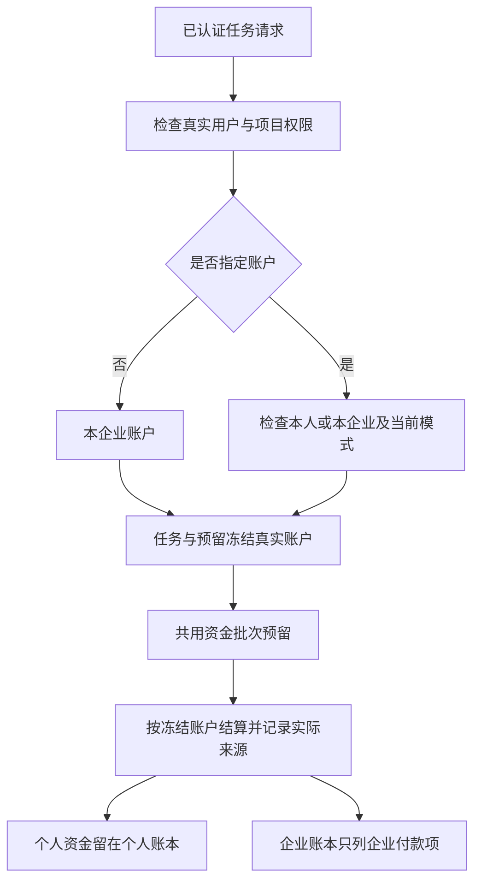

# 个人、企业付款账户与真实账务事件

本文补充 REQ-011/046/086/087/101 的账户和账本实现，继续受原始费用/VIP 契约及 G01–G10 约束。[授信与结算来源](39-billing-credit-and-settlement-provenance.md) 的资金计算规则同时适用于个人和企业。本文不将读取接口或数据库专项认定为完整费用/VIP 交付。

## 账户主体和执行模式

前向迁移 042 将真实钱包 ID 作为账户主键。账户只属于一个真实用户或一家真实企业，两者互斥；不为个人伪造企业。企业保留现有账户 ID、余额、预留和信用上限。每个既有及新增用户拥有两个初始未充值、未授信的独立个人账户，分别属于 `configured_services` 和 `simulated`。模拟资金不能支付正式模式任务。

同一资金内核按账户 ID 执行充值、赠送、资金批次分配、预留、到期、消费、债务偿还和信用上限调整。原 `wallet(tx, tenant)` 只是企业调用入口，不能形成第二套计算规则。企业和个人均使用 BigInt 计算；内部金额接受安全整数或规范的十进制字符串，单次金额不得超过 PostgreSQL bigint 正上限。金额转为 Number 后再比较不符合本实现。

新增钱包主体、执行模式、任务原始付款人及其模式、预留身份、资金批次账户和来源身份由前向迁移 044 的数据库触发器冻结。余额及合法业务状态仍可更新。账户资金不得通过修改所属用户、企业或模式迁移给其他主体。

## 当前任务选择入口

`GET /v1/me/billing-accounts` 返回当前已登录用户在当前服务模式下的个人账户，逐项采用原始 `AdminBillingAccount` 的严格资金结构；不返回其他人的个人账户，也不凭企业成员身份暴露企业资金汇总。

直接创建任务的现有 `POST /v1/tenants/{tenant}/projects/{project}/tasks` 可选 `X-Billing-Account-ID`：

- 缺省时继续使用当前企业账户，保持原幂等载荷不变。
- 指定时必须是任务创建人的当前模式个人账户，或当前企业账户；陌生、其他企业和模式不符统一拒绝，不能先建立任务或冻结预算。
- 幂等摘要包含显式付款账户；相同键切换付款人冲突。成功后将账户 ID 冻结于任务及预留，后续结算使用该快照，不读取当前界面选择。
- 结算保留原任务创建人；不能用另一个用户 ID 代写消费操作者。

当前这项选择仅接入直接创建任务。对话、业务模板、报告、定时任务等其他入口尚未接入显式付款选择；全局请求守卫对这些入口携带的选择头返回 `BILLING_SELECTION_UNSUPPORTED`，避免忽略选择后扣企业款。后续须分别冻结这些入口的付款上下文并完成用户端选择 UI，才能认定所有工作流支持个人付款。CORS 已列入选择头；普通任务的角色、计划、项目权限和额度检查继续执行。

## 账务事件与历史事实

043 新增 `billing_actors`、`billing_operations`、`billing_journal` 和历史来源缺口记录。操作者是已有用户、已有后台身份或明确登记的系统服务；不会在响应时生成 UUID 假充操作者。新账务事件有持久操作 ID，管理员事件关联真实管理员操作及其实际保存的策略版本；历史未记录策略的事件保持空值，不补造旧策略。

预留、确认消费、未用预算释放及信用上限变更均建立独立不可变账务事件。任务消费和释放引用其实际预留账项，重复结算不重复生成事件。后台或内部充值、赠送、撤销和到期事件由原账项触发器登记，不建立独立的余额计算器。Journal 数额为无符号 micros，并以 direction 与 bucket 表达变化。

数据库检查新 Journal 的账户、操作及操作者一致，任务付款账户一致，原账项金额一致，引用来源同属一账户。以上事实表拒绝更新和删除；控制面身份也不能改写它们。应用身份受账户 RLS 约束，不能用企业成员身份读取另一个用户的个人账本。

旧账本保持原字节对应的字段事实，不 UPDATE 旧 ledger。迁移仅根据真实原任务用户、已记录管理员操作或已知到期服务登记可证明的历史事件。原账项 ID 可作为已真实存在的历史事件标识，原管理员操作 ID 可作为其已记录操作标识。没有记录的操作者、资金桶或预留来源显式记入缺口；规范账本遇到该类缺口返回 `BILLING_PROVENANCE_UNRECORDED`，不能在 DTO 中填假身份或猜测资金来源。

新增 `registered_at` 表示索引注册时间，不冒充旧账户或历史事件原创建时间。既有消费的每笔实付/赠送/授信来源依旧受 041 的实际记录边界限制；043 不补造历史资金批次明细，也不补造不存在的旧预留/释放事件。

## 后台读取与权限

当前已接入原始规范的三处读取：

| 入口 | 数据与限制 |
| --- | --- |
| `GET /v1/admin/billing/accounts` | `subject_id`、`limit`、签名 `cursor`；严格 `AdminBillingAccountList` |
| `GET /v1/admin/billing/accounts/{id}` | 真实主体、版本、实付、赠送、预留、信用上限、实际债务和观察时间 |
| `GET /v1/admin/billing/accounts/{id}/ledger` | 严格 `AdminLedgerEntryList`；真实操作者/操作 ID、资金桶和原账项引用 |

账户读取复用执行内核的行锁、到期与债务校验，实付和赠送余额来自真实剩余批次。预留包含在资金批次剩余值内，不能重复扣除。账户读取允许执行既有到期业务；未来无业务效果的费用预览必须使用独立只读校验，不得调用会结转到期的读取函数。

读取要求当前后台身份、有效会话、近期 MFA、`admin.billing.read` 和当前完整绑定集合。个人账户要求全局许可；该用户任何成员企业/项目的明确财务拒绝均阻断个人整体读取。企业整体账户要求全局或该企业许可，单项目许可不能读取企业汇总；企业内任一重叠项目财务拒绝阻断整个账户。无权对象与不存在对象统一 404。用户目录的 `billing_account_ids` 同样使用这些规则。

签名游标绑定操作者、当前会话/授权版本、完整权限绑定、筛选、执行模式和账本目标，15 分钟有效。注册时间截止防止分页途中新增账户或补登记事件插入旧快照；微秒时间和 UUID 构成稳定并列排序。余额值仍是每页读取时的观察值，不声称跨页可变余额具有数据库长事务快照。

旧用户端企业费用页和旧 Admin 企业费用列表均排除个人付款项。旧 Admin 财务列表同步遵守企业整体许可与重叠项目拒绝，不能绕过新账户读取规则。按独立 `admin.usage.read` 授权的任务用量视图仍保留实际任务消耗语义，不能将它当作企业付款账本。

## 验证和仍待完成的交付

`tests/admin-billing.test.ts` 在独立原生 PostgreSQL 中验证真实个人账户、模式分离、个人混合资金结算、实际事件身份与来源、超过 Number 安全范围的金额、债务偿还、企业/项目/个人权限交集、游标签名和注册截止、任务选择幂等、数据库身份不可变及来源缺口。配合目录与结算专项共 31 组通过。原始五个依赖 Schema 从未变更的 OpenAPI 提取并随仓库保存，未放宽 `additionalProperties: false`。

首次联合专项 17/19。一个断言暴露了付款校验晚于并发额度检查，已把付款归属检查提前到计划额度判断之前；另一处读取了错误层级的错误码，修正为标准 `error.code`。首次原始 TAP 保留，未覆盖。最终专项和完整平台回归的原始字节与摘要以 Delivery 回执为准。最终完整平台回归 277/277，无失败、取消、跳过或待办；原始 TAP SHA-256 为 `4fe6d46f99a2c8483700feec0aaad1537f0a1d4b7140fec7521501ff7314cd8c`。Platform 生产构建和 Delivery 类型检查通过。当前实际路由 279 个方法/路径对，不能用路由数替代 225 个原始规范操作的业务验收。

现有数据升级首次触发 PostgreSQL 55006：042 在更新已存在的任务后修改同表，旧延迟约束尚有待处理事件，事务回滚。该问题在空库 276 项回归中没有暴露；失败原日志与初次回归分别保存在 `billing-accounts-migration-initial.log` / `.json` 和 `billing-accounts-before-runner-repair/`，不能把初次回归当作升级成功证明。042–044 SQL 字节未改写，迁移执行器改为在每笔 schema 事务开始设置 `SET CONSTRAINTS ALL IMMEDIATE`，使继承约束在语句边界完成检查。业务事务仍使用原延迟默认值；以后确需延迟的迁移必须在自身 SQL 明确指定。

新增带 041 旧用户、企业钱包、资金批次、账项、任务和预留的独立原生升级测试，验证升级、原字段不变、实际旧操作者、未知旧策略保持空值、未补造旧预留、042–044 摘要和重复启动。升级与账户专项共 10/10 通过；随后重新执行全部平台回归。迁移辅助脚本的 `before` 仅允许 041 状态，先记录原字段行数与 SHA-256；`after` 核对实际相同字段、登记来源和新迁移校验和，不是清空数据库重建测试。

两套现有数据库均已升级 044。原 ledger、funding_lots 和企业 wallets 全部原字段及行数与升级前摘要一致。主库原有 229 用户得到 458 个初始空个人账户，历史测试库 3302 用户得到 6604 个；旧业务数据没有重置。两库历史事件索引分别登记 123 和 646 项，实际来源缺口为零，不代表迁移前已记录每次资金批次拆分。旧迁移 001–015 的执行摘要本来未登记，仍明确保持未知；仅验证已有摘要及本次新增迁移，不能补写摘要后声称证明旧执行字节。回执见 Delivery 的 `billing-accounts-before-migration.json` 和 `billing-accounts-live-migration.json`。

重启后通过真实 HTTP 执行五组账户/账本核查，使用合成用户和真实邮箱/TOTP 会话，模型调用与外部收付款均为零。资金和任务仅作为内部领域测试 fixture，不冒充已实现的管理员费用命令。八份真实规范响应使当前严格响应样本合计达到 71/71；测试后退出自建会话并停用自建管理员，没有创建浏览器页面。对应命令为 Delivery 的 `npm run qa:admin-billing-wire`，回执为 `admin-billing-wire.json` 和 `admin-billing-contract-samples.json`。

本次不是完整收费产品验收。原始规范的费用写入/预览/审批、付款记录及凭证核验、支付退款对账、消费退回原资金桶、不可变方案/VIP 授予，以及当前 Admin 和各用户端完整消费者仍须继续实现和验收。历史账本缺口只能受控对账，不能由迁移猜测修平。12 个原生认证旅程、未验收成员页面、部署/签名和全部 NFR/G01–G10 也仍按原始范围保留。
