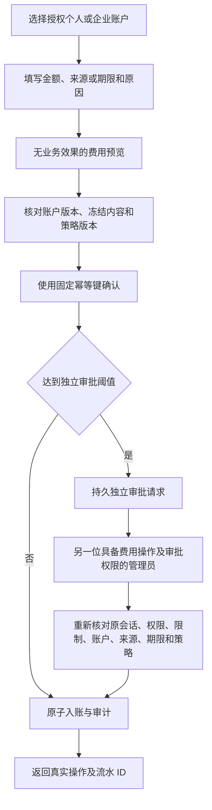

# 规范费用命令与独立审批

本分册继续落实原有 Admin 费用要求，不改变 102 项 REQ/TC、NFR 或 G01–G10 的验收范围。当前实现赠送额度、扣回原始额度和变更信用上限，并接入实际后台页面；付款核实、支付退款、消费退回原资金桶、方案/VIP 及完整审批目录仍按原要求继续完成。模型、媒体使用假数据的授权不等于可以伪造付款或账务状态。

## 账户和操作流程

后台「费用与账务」读取真实个人／企业账户，显示付费余额、赠送余额、预留、信用上限、债务、版本和观察时间；可按主体 UUID 筛选、使用服务端游标分页、查看追加式原始流水。用户详情的赠额入口使用同一规范表单。企业成员身份不是个人账户，模拟模式与已配置服务的资金互相隔离。

金额从十进制港币转换为十进制整数字符串，最多六位小数；服务端使用 BigInt，范围不超过 PostgreSQL bigint。后台金融预览和流水保留完整微额精度。信用上限允许 0；赠额和扣回要求正数。非法小数、科学计数法、溢出或 Number 舍入不能成为有效命令。

## 已实现的契约

| 接口 | 当前行为 |
| --- | --- |
| `POST /v1/admin/billing/accounts/{id}/previews` | 原始 Gift/Debit/CreditLimit 请求；严格 `AdminPreview` |
| `POST .../{id}/gift` | 正金额、未来到期时间、原版本；202 严格 `AdminOperation` |
| `POST .../{id}/debit` | 同账户原始 top_up/gift 流水，保留原资金桶；202 `AdminOperation` |
| `POST .../{id}/credit-limit` | 新信用上限及原账户版本；202 `AdminOperation` |
| `GET /v1/admin/billing/operations/{id}/review` | 补充读取冻结命令、原快照、实际操作和真实 `AdminApproval`（存在时） |
| `POST /v1/admin/approvals/{approval_id}/decisions` | 真实审批请求 UUID、审批版本、摘要、决定及原因；严格 `AdminApprovalDecision` / `AdminOperation`，当前处理上述三种费用操作 |

原始 OpenAPI 不改写。`AdminFeePreview` 定义的 top_up/refund 保留，尚未纳入三命令实现，不能声称整个费用契约完成。旧操作 ID 决定路径只是相同处理器的兼容入口；完整规范审批列表及其他领域审批请求的迁移仍待完成。

初次费用写入必须携带 `X-Admin-Preview-ID` 和 `Idempotency-Key`。预览属于当前管理员、未使用、未过期，并与摘要、目标版本、来源、策略和审批要求完全相符。返回修改后更新账户并重新预览。同键同参数重试返回原操作的最新回执；已确认请求的回执恢复允许不再发送预览头，不能再次入账。同键改参数拒绝。回执也通过当前身份、范围及近期 MFA 检查。

## 财务不变量

- 预览可以保存预览、策略、幂等回执和审计，不得变更账户、批次、到期结转、预留或账本。独立只读校验不调用会结转到期的账户执行读取函数。
- 赠额只产生赠额及真实债务偿还结果，不代表收到付款，不自动获得 VIP；继续遵守 041 的共同财务内核。
- 扣回核对同账户原入账的剩余、预留及到期，不能扣回已花费、已预留、过期或其他账户的来源；累计不能超过可用来源，不发生现金退款。
- 信用上限不得低于债务或预留承诺；新赠额的最终余额不得溢出。金融写锁使用 `FOR NO KEY UPDATE`，串行余额运算并与新任务外键读锁兼容。
- 单笔及每日上限取自同一有效授权。日限按香港日界、执行模式、实际提交者和动作累计；信用上限只累计增加值，调低不会重置日额度。重试不重复累计，待审批执行前再次检查。
- 个人账户要求全局许可，关联企业／项目的对应明确拒绝仍阻断整体操作。企业账户需要整体许可，重叠项目拒绝仍生效。金融操作列表同时检查真实付款主体验证及财务读取权，不能由 Jobs/审批列表绕过拒绝。
- 资金、操作者／策略／操作／流水关联、预览消费和审计原子提交；审计失败全部回滚。金融事件 outbox、通知和外部投影尚未完成，页面刷新不替代该项验收。

## 实际审批与历史保护

`admin_fee_approval_requests` 的 UUID、操作、提交者、摘要、策略和截止时间来自本次真实待审批操作，具有独立身份；不为历史记录编造请求或策略。`admin_fee_approval_decisions` 追加记录真实第二位管理员、原版本、摘要、决定和原因，同请求只决定一次。数据库拒绝修改冻结意图、延长期限、修改或删除决定。

默认阈值 HK$10,000，预览五分钟、审批窗口默认五分钟；实际发布的 admin-control 策略可设一至十分钟窗口并产生不可变策略版本。敏感提交要求原确切会话有效且最近十分钟 MFA，不能换用提交者后来新开的会话。审批前重新验证当前授权、金额限制、账户及资金来源；撤权、会话撤销、策略／来源改变或超时均不能执行旧命令。拒绝可关闭已失效请求并保留原因。

旧 gift/debit/credit_limit 预览及提交明确阻断，旧费用审批不能批准绕过；不带规范标记的历史待审批可安全拒绝后重新提交。历史事实保留，不回填未发生的请求或决定。

045 首次隔离执行发现预览表没有 `created_at`，消费预览因此回滚。原 SQL 不改写，046 按实际表分别比较字段；047 增加真实审批请求及不可变决定。001–047 摘要与实际迁移记录核对，历史 001–015 未记录的执行摘要保持未知。

## 验证和完整范围

费用与迁移测试在隔离原生 PostgreSQL 执行，当前聚焦 16/16 组通过，覆盖纯预览、主体／模式、精确金额、来源／预留、幂等、授权／日限、独立审批、撤权／策略／账户变化、过期／不可变决定、溢出、并发和审计回滚。2/11、10/11、13/14 的最初原始输出及请求拆分前 14/14 独立保留，不替代最终结果。

Delivery 的 `npm run qa:admin-fees` 使用真实邮箱/TOTP 会话、HTTP 和自建软件渲染 Chromium 检查后台表单、审批、账本、语言／主题和窄屏。回执、真实规范响应及源码摘要在 `evidence/admin-fees.json`、`admin-fee-contract-samples.json`；结束关闭自建页面、上下文和浏览器，不触碰用户页面。两次脚本定位／语言初始化失败保留于 `admin-fees-ui-initial/`、`admin-fees-ui-second/`，不计作通过。

最终全量 **291/291** 通过，664 份参与源码及 verifier 前后摘要一致；原始输出和摘要见 `alignment-platform.json/.tap`。当前规范 HTTP 样本 **81/81**，文档自身检查不代替产品验收。中间 289 项运行期间继续修改了后续费用实现，独立保留作历史输出，不能当最终源码证明；路由清单更新前的 291 项输出单独归档，此前 277 项及字节校验保留于 `pre-admin-fees/`。

首次独立 Git 检出发现本轮 README 编辑混入 CRLF，工作文件与按仓库 LF 规则检出的文件摘要不同；失败回执及规范化前后摘要保留于 `admin-fees-checkout-initial/`。仅统一本轮六份 README 的换行，不修改原始 TAP、已执行 SQL 或其他历史证据；当前检出回执必须重新通过后才能更新交付进度。

仍需完成原始付款记录／凭证核实／重复付款、现金退款对账、消费退款分桶及偿还分配、不可变方案/VIP、组合操作、金融 outbox／通知、完整原始审批目录、各付款主体选择消费者，以及原生认证、系统／发布矩阵、NFR 和全部验收门。局部通过不表示这些要求已验收。
