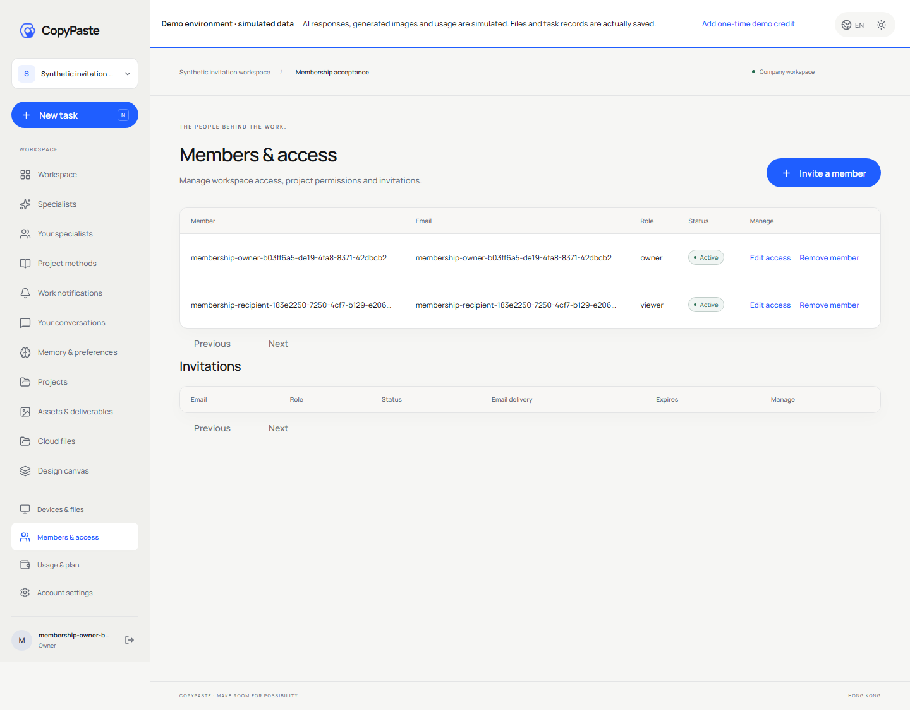
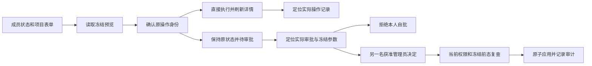
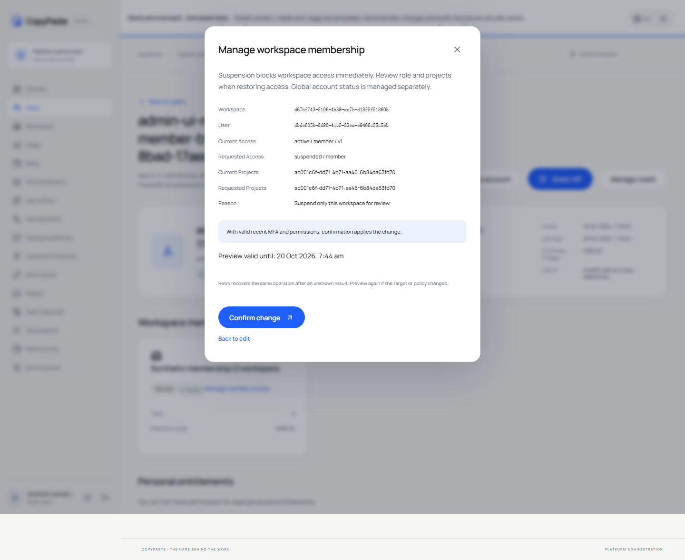
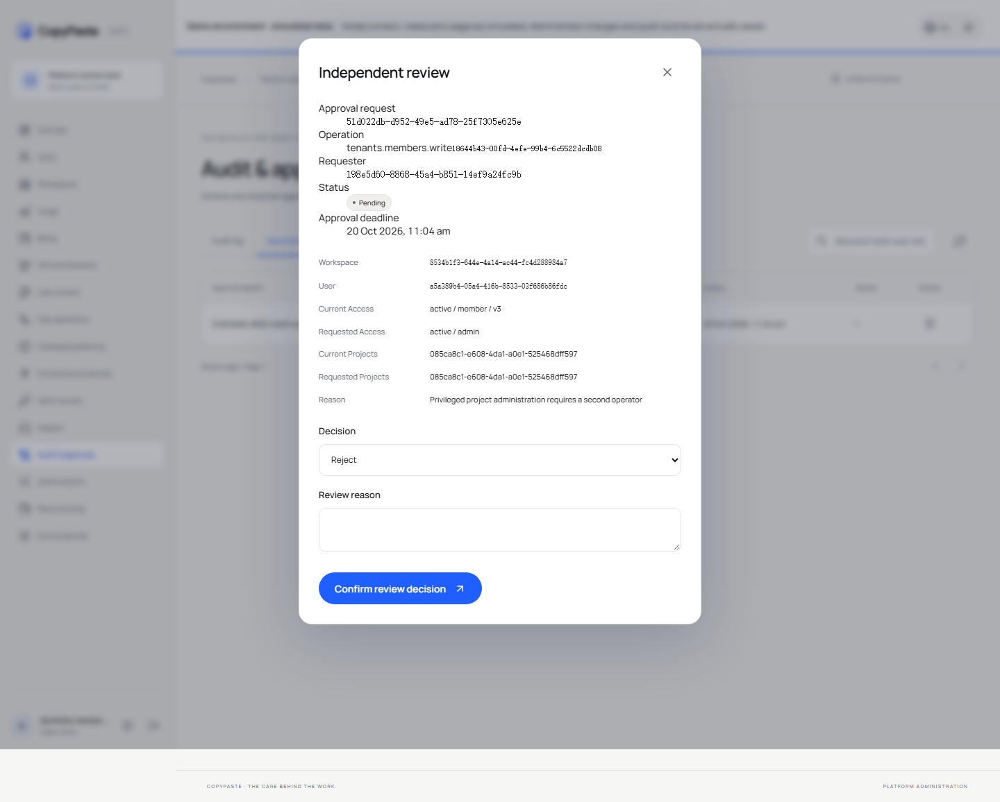
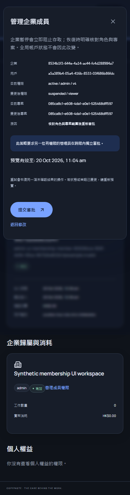
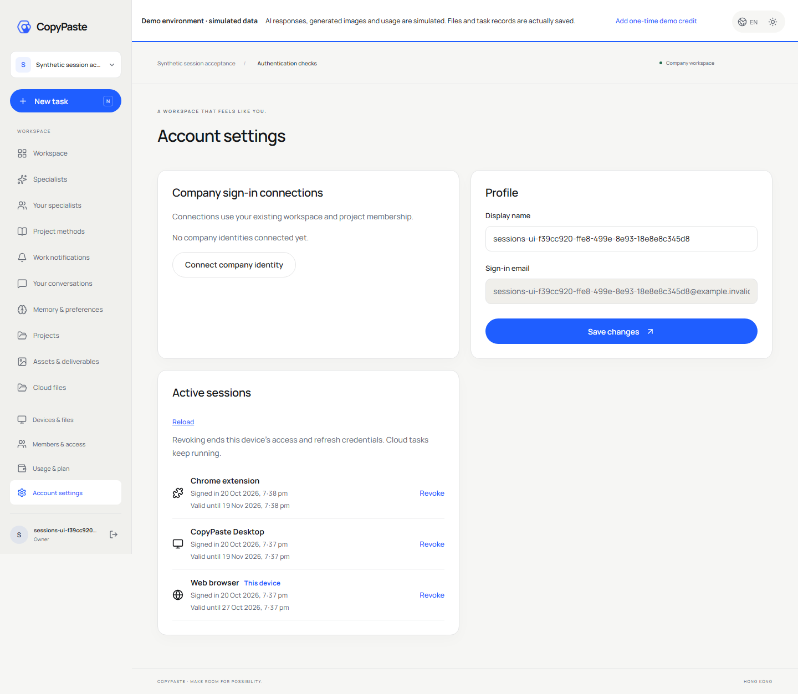
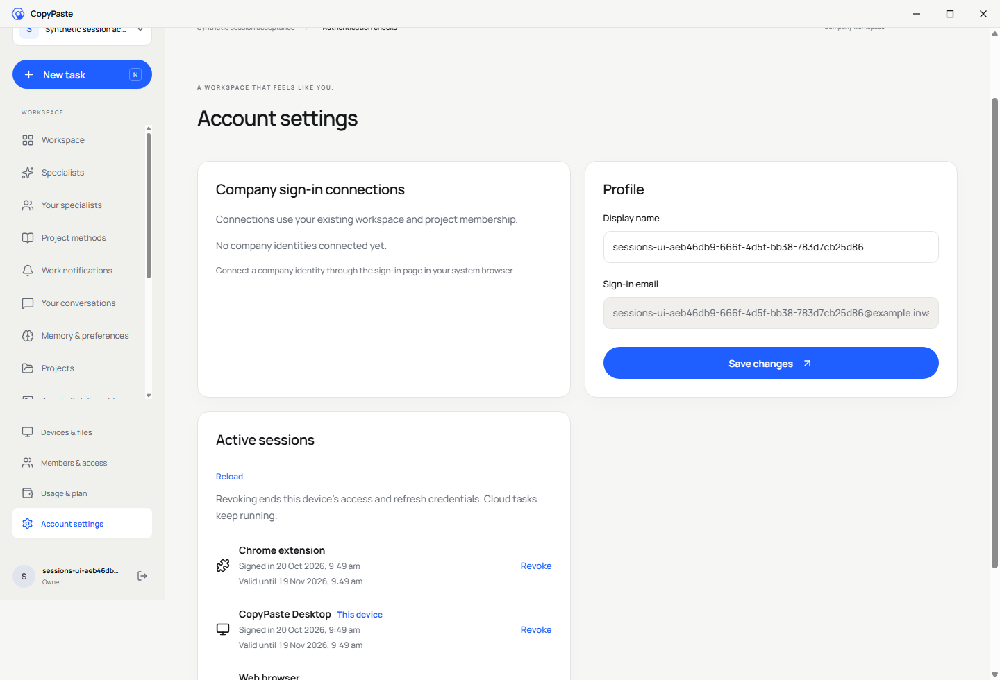
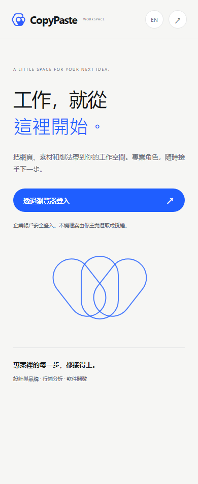

# 当前成员页面与原生认证恢复复核

2026-10-20。本文记录当前源码上的局部验证，关联此前三份未完成回执。全部 102 个 REQ/TC、NFR、G01–G10 保留；没有把任一完整需求改为验收通过。主进度以[可核对快照](../quality/requirements-alignment-progress.json)为准。

后续统一审批修复已替换本文记录的旧成员/账户决定入口，见 [当前共享审批](43-shared-admin-approval-requests.md)。本文保留该轮源码与回执快照；对应原字节已归档。

## 当前结果与执行边界

| 验证 | 当前回执（Delivery 仓库 evidence/） | 通过组数 | 参与源码／运行文件 | 实际规范响应 |
| --- | --- | --- | --- | --- |
| Web 邀请与成员 | `membership-ui-recovery.json` | 6/6 | 155，前后一致 | Invite、Member、MemberList、Ack 各一份 |
| Admin 成员控制 | `admin-membership-ui.json` | 6/6 | 179，前后一致 | 四份严格 AdminOperation |
| Web／源码 Electron／MV3 认证和会话恢复 | `auth-recovery-current.json` | 12/12 | 758，含 Desktop dist、renderer-dist 和扩展 dist，前后一致 | 服务端契约由独立平台／样本检查覆盖 |

模型调用均为 0。账号、邮箱和资金属于合成测试数据；登录、TOTP、数据库授权、Cookie、Electron DPAPI 与 MV3 session storage 使用实际实现。当前平台源码没有在本轮改动，既有稳定全量回归 291/291 和原始 TAP 原字节继续保留；不把新增 24 组浏览器流程加到平台测试数中。八份新规范响应纳入独立 schema 检查，当前总数 89/89。

## Web 邀请与成员

实际浏览器完成 owner 邮箱登录及初始化、指定 viewer 和项目的邀请、加密邮件投递、重发轮换与旧链接拒绝、收件人邮箱登录及接受后选择工作区。viewer 不显示管理控件；原 owner 在确认移除后，收件人已有会话立即失去该企业权限。另验证实际撤销邀请，以及真实服务端退出后迟到的上下文响应不能恢复 CSRF。

当前成功回执与截图不覆盖旧的 `membership-navigation.json` 或 `membership-current-issue.json`。首次恢复运行已完成六组业务，但退出清理缺少幂等请求头，整体仍记失败；原 JSON、样本与截图存于 `membership-ui-first-recovery/`。后续以实际退出所需的 Origin、CSRF 和 Idempotency-Key 完成清理，再从头复跑取得当前成功回执。最初拥有的遗留测试会话已单独撤销，清理记录随失败归档保存。

## Admin 成员控制与操作定位

本轮产品修复位于 Admin `src/memberships.tsx`：待审批结果跳转 `/audit?view=approvals&search=<真实操作 ID>`，已完成结果跳转 `/jobs?search=<真实操作 ID>`。结果链接显示“查看操作記錄 / View operation records”。关闭表单后，既有用户详情刷新读取最新状态。

两名不同、受企业范围约束的测试管理员分别使用真实邮箱验证码与 TOTP 登录浏览器。六组实际流程验证：纯预览前后数据库没有业务变化；确认管理暂停后已有客户会话被拒绝，owner 页面显示暂停原因；明确恢复原项目授权后提示消失，用户全局状态继续 active；提升角色进入待审批而不提前生效；本人自批返回 403；另一名有权限管理员审阅真实冻结参数并批准，当前操作查询严格符合 AdminOperation。繁中深色 390px 页面另验证只读预览与无页面横向溢出。

本成员流程仍使用补充冻结审阅和旧 operation decision 入口。它没有完成全业务原始审批列表契约，也不替代[费用命令的独立审批请求](41-canonical-fee-commands-and-independent-approvals.md)。首次 UI 验证的 schema 容器注册与清理枚举错误，连同原始失败回执保留于 `admin-membership-ui-initial/`；最初两名拥有的管理员已实际暂停、会话撤销，另附数据库确认。当前回执仅在查到零个仍有效的自建管理员后记清理成功。

## 当前源码三端认证和会话恢复

十二组使用规范邮箱登录、浏览器 S256 PKCE、实际源码 Electron 和 MV3。Desktop 与扩展首次交换已提交但回执丢失时，使用原键进行有界恢复，只有一个凭证族；刷新丢失回执也恢复同一轮换。两份已打开的扩展业务页面在登录和换账号后自动更新；旧账号迟到的 401 不清除或污染新账号。

Web 设备目录不含凭证，标注当前装置；1440px 浅色与 375px 深色页面及撤销确认模态已测。远程撤销 Desktop 后，下次受保护读取清空 DPAPI 凭证与私有界面，同时保留扩展自己的会话。远程撤销扩展后实际 session storage 和两页私人缓存均清空。过期访问仍能通过刷新凭据证明退出；离线 Desktop 先清理本地、明确提示远程撤销未确认，再由另一装置完成。浏览器退出传播到另一自建标签，迟到授权 GET 不能恢复旧页面。

当前运行时为 Chromium 153.0.8010.12，以及 Electron 44.5.1／Chromium 152.0.7977.130。QA 使用拥有的独立浏览器和 `--disable-gpu` 软件渲染；产品启动参数没有因此改写。源码 Electron 使用已通过窗口验证的直接启动方式；这一结果不能单独证明旧启动失败的唯一根因。旧失败、隔离诊断与 `auth-recovery-open-issue.json` 保持原字节。

## 复现、资源释放与交付范围

在 `dev/copypaste-delivery/` 使用当前原生 demo 服务依次执行 `npm run qa:membership`、`npm run qa:admin-membership-ui` 和 `npm run qa:sessions`。脚本记录参与源码／构建摘要、实际响应和退出结果，限定拥有的页面、BrowserServer、Electron 子进程和独立 MV3 实例。每次收尾清理测试凭证、会话及临时管理员；当前三个回执均无错误且拥有的实例已关闭，没有触碰用户原有标签。整个过程没有使用 Docker、WSL 或虚拟化。

本轮新增 14 张实际截图，同步中央文档与各端中英 README。原始三份问题回执保持原 SHA-256，在进度快照中关联到当前 6/6、6/6、12/12 结果；这只关闭相应局部证据缺口。

Desktop 无原生边框／默认菜单和 Chrome 右侧原生 Side Panel 的外观证据，继续使用[单独的 10/10 原生窗口及侧栏测试](30-native-window-and-browser-sidepanel.md)和已绑定的预览产物。本次十二组是源码 Electron 与 MV3 业务页面认证，不能充当安装包十二组认证、Side Panel 外观或系统验收。Setup／Portable 安装卸载、系统／DPI、签名更新、完整企业身份与成员旅程、生产邮件、完整后台规范、正式媒体和所有专业角色业务资格仍在原范围内。
