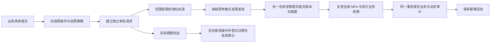

# 后台统一审批请求与原始契约

2026-10-20。本次修复统一现有费用、企业成员、账户及旧后台操作的审批身份与决定入口。全部 102 项 REQ/TC、NFR 和 G01–G10 保留；本项不等于完整后台或全部财务业务验收。Codex 仍为唯一 Agent 内核，AI 与媒体按获准假数据运行。

## 原问题与当前流程

此前通用审批目录返回操作记录，成员和账户审批使用只提交决定及原因的旧入口。操作 ID 与审批请求 ID 混用，用户无法针对自己审阅的准确请求版本提交决定。费用已有真实请求，但与其他业务分开。

现在每个新待审批操作持久化独立审批请求。后台目录读取原始 `AdminApprovalList`，显示真实请求 ID、操作 ID、申请人、状态、期限和版本；使用签名游标分页。操作结果中的定位链接仍以操作 ID 定位，通过补充查询获取对应的真实请求。目录展示当前权限可见的各状态请求，概览单独读取尚未超时的待审批计数。

## 原始接口与补充读取

| 接口 | 行为 |
| --- | --- |
| `GET /v1/admin/approvals` | 只接受 `cursor`、`limit`；严格返回 `items`、`next_cursor`，默认每页 50，最多 100。 |
| `POST /v1/admin/approvals/{approval_id}/decisions` | 必须提交 `expected_version`、`payload_hash`、`decision`、`reason`，携带 Admin CSRF 和幂等键；返回 202 的严格 `AdminOperation`。 |
| `GET /v1/admin/operations/{operation_id}/approval` | 补充定位读取，返回真实 `AdminApproval`；不能用操作 UUID 冒充请求 UUID。 |
| `GET /v1/admin/approvals/{approval_id}/review` | 补充原参数和变更前态读取，额外要求对应业务读取权限。 |
| `GET /v1/admin/approvals/summary` | 补充当前范围内未超时的待审批计数，不扩展原始列表 DTO。 |

原 `/v1/admin/operations/{operation_id}/decision` 返回 `CANONICAL_APPROVAL_REQUIRED`，引导使用准确请求；不会在服务器偷偷补上调用者未审阅的版本和摘要。原费用专用决定地址仅保留为需要相同四字段、同一请求和同一权限检查的兼容别名。

原始 OpenAPI 不改写。独立四项 schema fixture 原字节对比 `AdminApproval`、`AdminApprovalList`、`AdminApprovalDecision` 和 `AdminOperation`；实际浏览器响应另外经过原规范校验。

## 权限、事务及失败行为

读取按整体企业或个人范围授权，企业中的重叠项目拒绝会阻止整个不可拆分的操作。个人账户遵守全局权限及关联企业/项目的显式拒绝。费用列表同时要求财务读取权限，并按模拟或配置服务模式隔离。游标绑定当前管理员会话、有效权限、分页大小及读取边界，不能跨会话或撤权后继续使用。

决定同时要求审批权限、对应业务权限和当前近期 MFA。本人不能自批，页面显示需另一名管理员审阅，服务器也拒绝实际自批请求。批准再次检查原操作者的准确原会话及认证版本；同一管理员重新登录不能替代已撤销的原会话。原参数、请求版本、摘要、有效策略、变更前态和当前业务限制必须继续匹配。

业务变更、操作状态、不可变决定、请求状态、审计和幂等回执在同一 PostgreSQL 事务内提交。不同幂等键并发只能完成一次；同键重试仍先复查当前权限及 MFA。失败不产生半次变更或成功回执。

过期由后台维护任务实际落库：取消仍待审批的操作，推进请求版本并写入系统审计，不伪造审核人或人工决定。读取返回真实持久状态。维护任务处理前，超过期限的待审批请求无法批准，有权限的其他管理员仍可明确拒绝；维护任务处理后，旧请求不能再决定，须重新预览。

## 向前升级与记录保留

SQL 048 将既有费用请求和决定表改为通用资源，保留实际 ID、版本、原因、期限和时间。SQL 001–047 原字节不改写。已有成员/账户待审批操作仅在原会话、认证版本、策略与期限已记录时登记请求，期限不延长。缺失原始事实的旧操作取消，保存独立迁移记录及 `APPROVAL_SNAPSHOT_UNRECORDED`，要求重新预览；不会补造旧审批身份或策略。

## 交付与剩余范围

实际代码位于独立 Platform 和 Admin 仓库，验证脚本与原始回执位于独立 Delivery 仓库。此前通过的回执与截图原字节保存在 `evidence/stage42-before-unified-approvals/`；本次失败运行的原始 TAP 继续保留。

当前审批、成员、账户、费用及迁移专项共 53/53 组通过，其中新增共享审批 11 组和旧 047 带真实记录升级 1 组。原始运行在 `evidence/unified-approvals-focused-third.tap`，前两次失败和首次升级 fixture 失败不覆盖。Admin 构建、类型检查和精确金额单元检查 3/3 通过。

真实浏览器复核：Admin 成员 6/6（183 份源码前后一致）、费用 4/4（30 份源码前后一致）、账户 5/5；Web 成员另复跑 6/6（158 份源码前后一致）。两项新增的规范列表/决定响应使全部样本达到 91/91。邮箱、TOTP、会话、数据库与事务实际执行，模型调用为 0。自建浏览器及测试凭证/管理员已清理。费用首轮脚本尚预期旧 200 的失败原件保存在 `unified-approvals-fees-initial/`，按原规范 202 修正后完整复跑。

全量平台回归 **303/303**，669 份源码前后一致；原始 TAP SHA-256 为 `1615f06e75496988f37cb30872ee35ba7f981c23c7e8d98b3f8e409f16df612f`。Web／源码 Electron／MV3 认证另复跑 **12/12**，762 份源码和运行文件一致，自建三端实例与凭据均已清理。上述专项与浏览器组数不重复加入平台总数。

新 Admin 组件工作区与 Git LF 字节统一后，再次完整运行成员及费用页面验证；统一前的成功原件保存在 `unified-approvals-before-lf-normalization/`，不修改摘要冒充重新执行。五份历史清单共核验 57 份原始副本。

独立 Git 克隆核对 **5/5**：全部 48 个 SQL 文件及两个现有原生数据库的校验账本、28 个可信 Skill、45 份 Desktop 渲染源摘要、Admin 全部 102 份已跟踪文件，以及原始 303 项 TAP 均一致。临时克隆目录已清理；该结果证明交付字节还原，不代替安装、系统或灾备验收。

完整付款确认、付款凭证、退款、VIP 规范命令、财务通知/outbox、批量操作与导出全矩阵，以及全部内容控制仍按原要求继续。Desktop 无边框及默认菜单移除、Chrome 原生右侧 Side Panel 的已绑定客户端预览不因本次后台修复重打包；完整安装卸载、系统/DPI、签名更新及生产验收仍独立保留。
