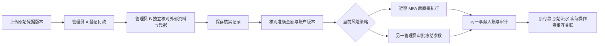
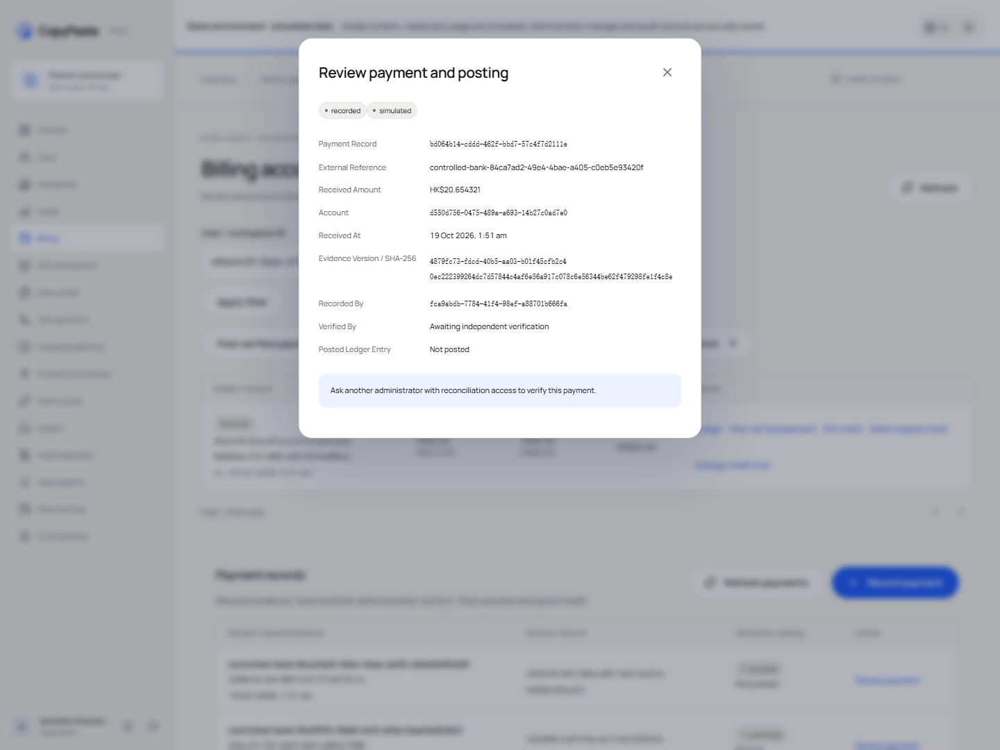
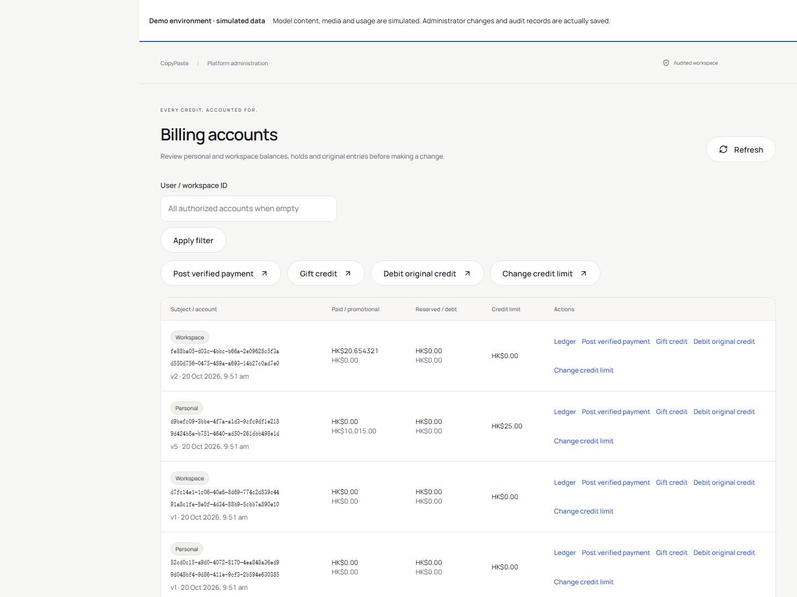

# 付款凭据、独立核实与准确入账

2026-10-20。落实 REQ-087/094/096/098/101 的人工付款及充值子流程。原 102 项需求、TC、NFR 与 G01–G10 全部保留；完整退款、VIP、自动支付与系统矩阵仍须继续验收。Desktop 无边框及扩展原生侧栏继续遵守 [客户端外观约束](30-native-window-and-browser-sidepanel.md)。

## 问题与业务流程

旧后台人工充值只提交一个参考编号，缺少独立付款记录，无法严格证明原付款的金额、主体、凭据和是否已入账。新版将收到付款、核实付款与增加产品额度拆成不同事实。管理员不能通过手写参考编号直接增加付费余额，也不能把赠送额度当成用户付款。

登记和核实均不增加余额、授信、赠额或 VIP。核实表示获准管理员完成线下凭据核对，明确保存 `manual_evidence_review`，不表示支付机构回调或真实支付网关验收。模拟数据仍明确隔离为 `simulated`；测试中的凭据说明没有实际资金到账。

## 规范接口与页面

原始 OpenAPI 不修改。新增独立七项 schema fixture，对照原规范的原始摘要与对象内容。

| 接口 | 结果与校验 |
| --- | --- |
| `GET /v1/admin/billing/payments` | 严格 `AdminPaymentRecordList`，只接受签名 `cursor` 和 1–100 的 `limit`。 |
| `POST /v1/admin/billing/payments` | 原始 `AdminPaymentRecordCreate`，202 `AdminOperation`。必须有实际账户、正金额、外部编号、收到时间、凭据素材版本与原因。 |
| `POST /v1/admin/billing/payments/{payment_id}/confirmations` | 原始 `AdminPaymentConfirm`，提交准确版本与独立核对编号，202 `AdminOperation`。登记人不可核实自己的付款。 |
| `POST /v1/admin/billing/accounts/{account_id}/previews` | 原始 `AdminFeeTopUp` 加入现有预览联合类型；不产生账户及资金效果。 |
| `POST /v1/admin/billing/accounts/{account_id}/top-up` | 原始 `AdminFeeTopUp`，携带预览 ID 与幂等键，返回 202 `AdminOperation`。 |
| `GET /v1/admin/billing/payments/{payment_id}` | 补充详情，展示凭据版本与摘要、登记人、核实人、真实时间及已入账流水；不扩展规范列表 DTO。 |

后台费用页增加付款目录、游标翻页、按付款 ID 打开详情、登记复核、独立核实及充值入口。登记先展示账户、实收、外部编号、时间、凭据版本和原因，确认后才提交。独立核实要求重新输入外部编号并明确确认已核对资料；本人页面显示需另一位管理员处理，服务器另行拒绝自核。

核实后可打开同一账户的充值预览，绑定原付款记录。金额始终以 HKD 微单位十进制字符串处理。付费余额和入账状态分别展示；不以“核实成功”提示代替“余额已到账”。每个表单保存稳定幂等标识，未知响应可恢复原回执。页面沿用现有 CopyPaste 配色、边界、字体、弹窗、错误提示和双语偏好。

## 来源、权限与一致性

付款必须与账户的个人/企业主体及执行模式匹配。企业凭据属于该企业的共享素材；个人凭据属于该个人的私人素材。凭据须处于有效保留期、未隔离、未删除、未擦除，版本非空并有 SHA-256；记录保存版本和摘要。核实、预览、提交及审批执行再次检查凭据，而不是信任旧页面的状态。

读取需要当前 `admin.billing.read`、近期 MFA 与完整范围授权。登记及核实需要 `admin.billing.reconcile`；充值需要 `admin.billing.top_up`。个人操作遵守全局授权及关联企业/项目显式拒绝；企业操作遵守整个企业和重叠项目拒绝。列表、详情、后台任务目录和操作回执使用对应财务主体及模式检查，不能借通用 jobs 读取越权付款。

所有新增写请求验证独立 Admin 会话、CSRF、当前权限及实际 MFA。回执恢复也先检查当前权限，撤权后不能依靠旧幂等键获得成功结果。敏感读取及登记、核实、入账均进入真实审计。

金额须为正整数字符串且不超过 PostgreSQL bigint；登记时间不能在未来。核实编号须与原外部编号精确一致。同一模式内的外部编号跨账户唯一；与历史充值流水中已存在的原外部编号冲突时进入原交易对账处理，不新造付款事实。

一笔付款只允许一个核实事实和一个完整入账事实，不支持将同一凭据拆分金额反复充值。充值必须与实收金额完全相等。账户锁、原付款唯一约束、预览版本、独立审批的当前权限及来源复查共同防止不同幂等键的并发重复入账。同键重试返回已提交操作，不再次增加余额。

原充值入口已拒绝绕过新规范。数据库也约束新增 Admin 充值必须引用尚未入账的已核实付款；保留 `payment:` 参考前缀，避免内部记账入口先占用或伪造付款来源。真实入账继续调用共用资金内核，先偿还实际授信债务，剩余部分进入付费资金批次，不制造超过实收的可用余额。

## 数据与迁移

`payment_records`、`payment_confirmations`、`payment_postings` 依次保存原始实收事实、另一位管理员的核实事实和原流水关联。它们只追加，不覆盖或删除。金额、主体、模式、实际操作者、原凭据和对应操作通过外键及触发器交叉校验。规范 `version` 为这些已提交事实的实际版本；`confirmed` 与“已入账”不是同一个状态，后者另有原流水证据。

SQL 049 建表、约束付款来源及关联新流水；050 扩展操作意图不可变保护。050 错误复用了旧 045 的通用字段比较，导致预览读取不存在的 `created_at`；首轮浏览器及聚焦回归真实失败。051 沿用 046 的按表字段修复并保留付款保护。049 的历史查询别名还与触发器 OLD 变量冲突，052 使用独立别名修复，原有费用 14 组与新增付款 7 组最终全部通过。已应用的 001–052 保持原字节，不覆盖错误历史，两库均以追加迁移修复。

登记/核实操作、付款事实、审计和幂等回执在同一事务中提交。充值还同时包含账本、资金批次、实际债务还款、付款入账唯一关联、操作结果及审计。任何审计或来源检查失败都回滚完整变更，预览仍可安全重试。

## 证据与剩余范围

本轮实现及测试证据见交付仓库的 `evidence/payment-records-*` 与最新 `evidence/admin-fees.json`。原共享审批阶段的 303 项回归及对应页面/来源摘要已按原字节归档至 `evidence/stage43-before-payment-records/`，附复制清单。新增失败浏览器报告、截图、原始 TAP 与四次实际迁移日志均保留；不得以最终成功结果覆盖失败历史。

这一增量不代表完整退款、原消费资金桶补偿、支付退款确认/未知结果对账、自动支付、不可变方案/VIP、财务通知或完整后台验收。现有退款旧模型仍须迁移到原消费/原已核实付款及累计约束，不能根据本项充值测试标记退款通过。真实支付机构与真实 AI/媒体网关验收也不在模拟凭据流程中声明完成。

## 实际页面与当前复核

以上为真实浏览器页面的 1440×1080 视口裁剪，原始完整截图保留在 Admin 仓库，摘要与裁剪范围记录在 `docs/quality/payment-screenshot-provenance.json`。没有绘制模拟界面替代运行截图。

费用页面 5/5（15 份原规范实际响应、39 份源码一致）通过，包含真实 390px 繁中深色付款详情、无横向溢出与入账状态刷新；Admin 成员页面 6/6（190 份）、Web 成员页面 6/6（164 份）、Web/源码 Electron/MV3 认证 12/12（769 份）另行通过，所有拥有的浏览器、Electron、MV3 和会话均已清理。金额解析 3/3、Delivery 类型检查及 Admin 构建通过。

全量回归首次为 306/310：两个旧迁移断言仍固定 048、两个旧充值旅程仍调用已拒绝的通用入口。原始报告与 TAP 保留在 `payment-records-full-regression-failure/`。测试随后真实登记凭据、另一位管理员核实，再走规范预览/充值；保留原资金预留、结算、幂等及跨账户防重断言。四组更新旅程专项通过，原失败未重写。

最终完整平台回归 **310/310**，676 份参与源码与 verifier 前后摘要一致；TAP SHA-256：`5b499c16a50ec57427ed7ff7cf4681ba2e0cef0330e97159dde7e9d25e291119`。21 项费用与四组更新旧旅程专项不与全量重复计数；原始规范实际响应样本 **96/96**。7 份本阶段归档清单校验 180 份原字节副本，保留最初 306/310 全量失败。当前三端/后台截图的原字节复制映射另见 `docs/quality/current-ui-screenshot-provenance.json`。完整 REQ/TC、NFR、G01–G10 均保留原验收条件。
