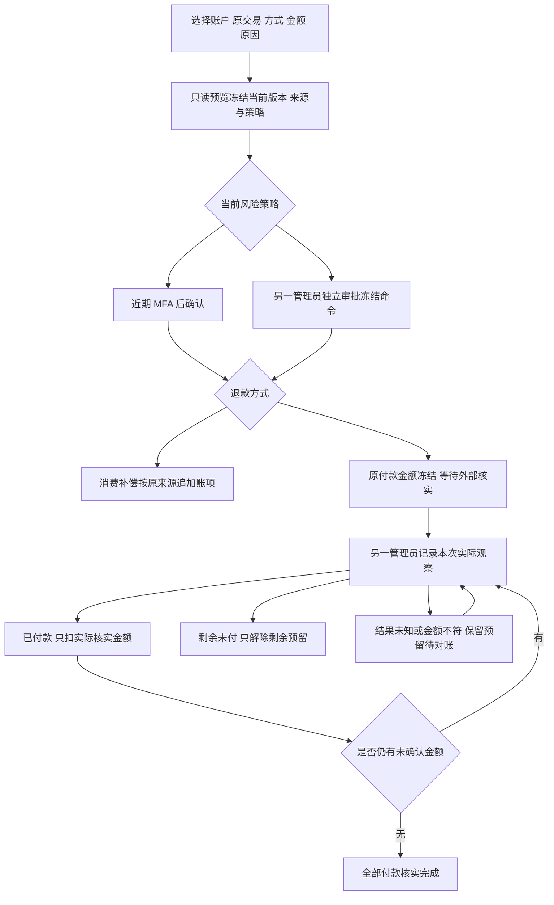
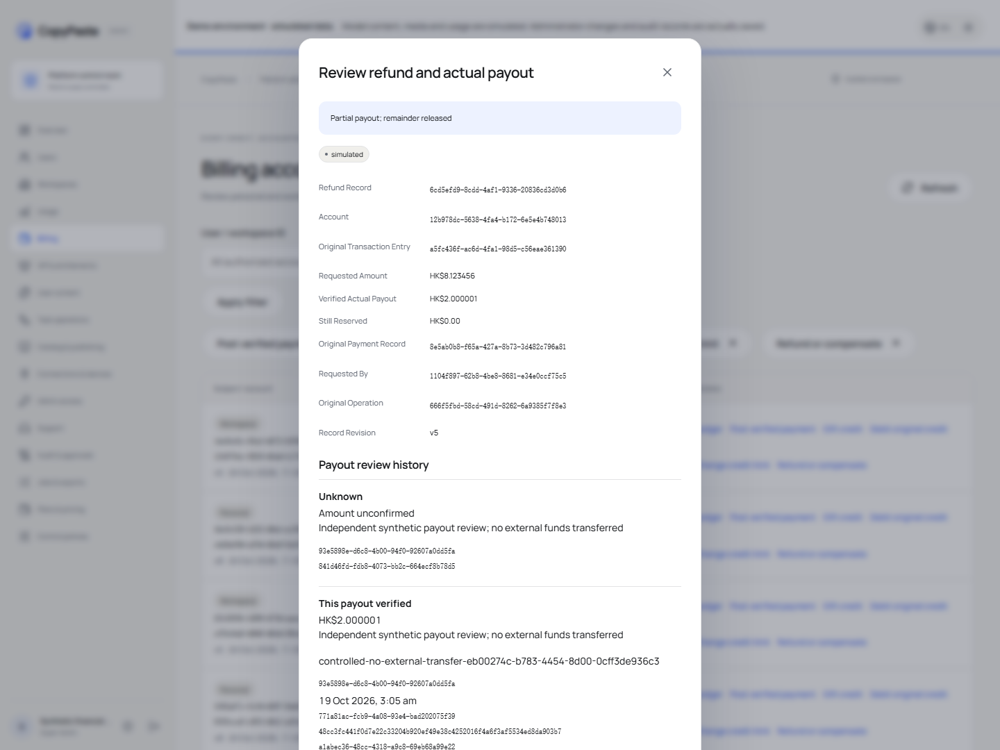

# 原交易退款、资金来源补偿与独立付款核实

2026-10-20。落实 REQ-046/087/094/096/098/101 中的退款子流程，承接 [付款凭据与入账](44-manual-payment-evidence-and-exact-posting.md)。完整 102 项需求、原 TC、NFR 和 G01–G10 保留；本项不关闭整个费用、支付或后台模块。

## 两种操作与实际效果

| 用户意图 | 原交易 | 提交后的实际效果 | 最终核实 |
| --- | --- | --- | --- |
| 退回一次消费的产品额度 | 此账户原始 `consume` 流水及其实际结算来源 | 按原赠额、付费批次或未偿授信返还，保留原到期时间；追加补偿流水 | 成功提交即完成产品额度补偿 |
| 退回原付款途径 | 此账户已独立核实且已入账的原付款流水 | 只冻结原付款中未消费、未预留且未退的付费金额 | 另一名管理员核对实际外部结果后逐笔记账 |

规范命令的 `paid_balance` 表示产品消费补偿；页面明确显示“按原资金来源退回”，不能将混合来源全变成付费余额。`payment_method` 表示原付款途径退款。赠额、未偿授信及已消费资金不能直接作为现金退款来源。

所有金额使用 HKD 微单位整数字符串和 BigInt 运算，不经过浮点数计算。正金额、bigint 上界、完整参数、账户模式及原交易主体在服务端校验。累计补偿不超过原消费；累计实际现金退款加未结清承诺不超过原付款，也必须有足够的实际未用、未预留资金。

本实现记录获准管理员完成的人工凭据核对，保留 `manual_evidence_review` 和 `bank_api_verified=false`。系统不会调用银行或支付机构代付，也不将“提交退款”当作“已经到账”。模拟环境中的凭据和测试资金明确说明没有实际资金转移。

## 消费补偿与授信还款来源

每笔原消费必须有完整的不可变 `billing_settlement_sources`，合计等于原消费。历史缺失来源的消费进入 `REFUND_RECONCILIATION_REQUIRED`，不根据当前余额猜测过去。

部分补偿按原消费的赠额、付费、授信顺序分配，并扣除此前已补偿部分。同类来源按原到期时间、创建时间及 ID 确定顺序；每个分项固定原结算来源、原资金批次和实际金额。未偿授信只注销对应消费的未偿部分，不改变信用上限，不注销其他任务的债务。

当原消费的授信已经由后来的赠额或付费偿还，补偿必须返回真实偿还来源。SQL 053 为新增还款保存每个资金来源实际偿还的具体信用消费；补偿查询该关联，不把后来的赠额偿还变成现金。先注销尚未偿还部分，再返还真实已偿还来源。

赠额返还保留原批次和原到期时间。原赠额已过期时，追加补偿和同额到期账项，不恢复可用余额；数据库拒绝延长原资金批次的到期时间。已记录原消费、用户用量和原 `spent_micros` 均不改写，财务补偿通过独立流水表达。

升级之前未记录逐消费授信还款关联的历史，单独冻结为真实期初债务和历史来源集合。升级不补造还款关联。之后的还款先偿还期初债务，再按顺序偿还新消费；历史授信消费退款继续要求来源对账。该历史来源修复仍是剩余范围，不以自动猜测通过验收。

## 现金承诺、分次付款与关闭

申请引用原已核实付款的原充值流水及付费资金批次。原凭据必须仍有效，摘要、个人/企业主体和 `simulated` / `configured_services` 模式一致。预览和实际执行均检查来源，审批时还检查原请求者当前权限、会话、策略和账户前态。

申请在同一事务中追加预留流水、退款事实并增加账户与原付费批次的预留。申请操作状态为 `reconciling`。冻结资金不能被其他任务或第二笔退款使用，其他任务原有的预留也不能被退款结算消耗。

另一位具备退款及对账权限的管理员提交准确记录版本、本次实际结果、实际金额、外部退款编号、有效凭据版本、实际发生时间和原因。请求者不能核实自己的退款。核实表示观察已保存；核实操作本身的 `succeeded` 不替代原退款操作的最终状态。

| 本次观察 | 资金与原申请状态 |
| --- | --- |
| 实际已付正金额，且不超过剩余承诺 | 只释放并扣除该金额，追加绑定原付款的现金退款流水；余款继续预留 |
| 已确认剩余未付，观察金额为 0 | 只释放剩余预留；此前实际付款保留。全部未付为 `cancelled`，部分已付为 `partially_succeeded` |
| 结果未知 | 追加不可变观察，原申请继续 `reconciling`，保留全部剩余预留 |
| 已付金额为 0、超过剩余金额或“未付”观察非零 | 保存 `mismatch`，保留剩余预留等待后续核实，不按错误金额扣款 |
| 累计实际付款等于申请金额 | 原申请 `succeeded`，退款记录 `paid` |

每次实际付款外部编号在同一模式内唯一。退款记录版本随每个观察事实增加，竞争提交只有一个版本可以成功；稳定幂等键恢复已提交观察，不重复扣款。对账通过追加新观察解决，不覆盖旧错误或未知结果。未来发生时间拒绝。

原付款列表仍返回严格的原始 `AdminPaymentRecord`，状态按实际申请、观察和现金账本派生为 `confirmed`、`refunding`、`reconciling` 或 `refunded`。实际已退金额和等待金额在补充详情显示，不扩展规范列表对象。

## 接口、权限与页面

原始 OpenAPI 和 `AdminFeeRefund` 不改写。原规范退款命令：`expected_version`、`reason`、`action=refund`、正金额 `amount`、`original_entry_id`、`destination`。提交带 `X-Admin-Preview-ID` 和幂等键，202 返回严格 `AdminOperation`。

| 接口 | 合同与行为 |
| --- | --- |
| `POST /v1/admin/billing/accounts/{account_id}/previews` | 原始联合 `AdminFeePreview`，只读冻结原交易、分配来源、账户版本、风险策略 |
| `POST /v1/admin/billing/accounts/{account_id}/refund` | 原始 `AdminFeeRefund` / 202 `AdminOperation`，共用单笔、香港日界每日限额及独立审批 |
| `GET /v1/admin/billing/refunds` | 补充签名游标目录，可按实际账务账户筛选，只列当前模式和授权主体 |
| `GET /v1/admin/billing/refunds/{refund_id}` | 补充详情，包含实际补偿来源、原凭据关联及不可变观察历史 |
| `POST /v1/admin/billing/refunds/{refund_id}/outcomes` | 补充严格观察命令，202 原始 `AdminOperation`，当前权限和独立核实 |

补充 schema 独立保存于 Platform `contracts/admin-refund-schemas.json`，明确为补充扩展，并保留原规范 SHA-256。实际列表、详情、观察请求和操作回执分别校验。补充合同不替代原规范验收。

读取需要 `admin.billing.read`，消费补偿/现金申请需要 `admin.billing.refund`，外部结果核实同时需要 `admin.billing.refund` 和 `admin.billing.reconcile`。敏感读取、写入和回执恢复都要求当前独立 Admin 会话、近期 MFA 和完整财务主体授权。企业及重叠项目显式拒绝、个人及关联企业范围继续生效。撤销权限后不能通过旧幂等键读取成功回执。

后台费用页将退款纳入统一表单：账户、方式、原流水、精确金额、原因、只读预览、确认或独立审批。完成页区分消费补偿完成、等待独立审批和仅预留待核实。退款目录可筛选、翻页或按记录 ID 打开；详情显示申请、实际已付、剩余预留、原交易、原操作、来源分项与每次观察。独立核实先复核本次输入和凭据，再确认提交；页面显示自核限制，服务端另行拒绝。

用户无需重新登录另一套账务身份；该控制面沿用现有管理员独立认证、语言及主题。界面复用 CopyPaste 现有浅深色、文字、边界和表单组件，支持英文、繁中及窄屏。

## 数据与原子性

SQL 053 固定实际期初债务和历史信用来源，记录新增还款的逐消费分配及退款注销；054 建立退款申请、来源分项、观察和财务闭合事实；055 校验独立观察、原资金释放、准确现金流水及任务/退款预留一致性，并固定原资金到期时间。原已应用 001–052 字节保留，053–055 在两库首次应用后同样不可修改。

事实表受 RLS、受限数据库角色、外键及不可变触发器保护。请求、资金分项、补偿/到期流水、预留变化、原操作状态、审计和幂等结果同一事务提交。实际现金观察还要求对应释放和真实现金扣款同时存在；不能仅插入观察假装付款，也不能直接插入旧退款流水绕过独立事实。

每日金额按实际资金命令计一次。一次消费补偿产生多个来源分项和到期流水时，不会被重复累加为多笔费用。每个操作仍检查自身单笔和实际日累计限制；独立结果核实检查当前两项权限和原申请金额权限上限。

## 当前证据与剩余范围

原始失败与成功 TAP、浏览器报告、迁移日志及复制摘要保留于 Delivery `evidence/refunds-*`；进入本阶段前的原字节证据位于 `evidence/stage44-before-refunds/`。50 项费用、来源、带数据升级专项通过，覆盖混合资金、偿还来源、过期赠额、独立/部分现金核实、并发、撤权/MFA、审核、审计回滚和历史来源缺失；另有全量平台回归和当前来源绑定的浏览器验收，准确数量以最新质量报告为准，不将重叠测试重复计数。

浏览器完成 8 组真实邮箱/TOTP、实际上传凭据、费用及双管理员流程，保留严格原规范响应和单独的补充退款响应。无真实外部支付，无 AI 调用；本次创建的浏览器上下文和独立进程均关闭。截图以真实运行页面为源，原图、文档副本及裁剪摘要独立保存。

最终完整平台回归 **324/324**，683 份参与源码及 verifier 前后摘要一致；原始 TAP SHA-256 为 `c4c41077349484a5c39042643335c71724ec44bdaae335b1c250cde9f869634f`。费用及退款页面 **8/8**，47 份来源一致；原规范实际响应 **100/100**，独立补充退款请求/响应 **14/14**。专项 50 项与全量重叠，不重复加入总数。失败的旧内部退款测试、宽泛页面定位器和本轮 Electron 启动超时保留原始回执，后续复核不覆盖失败历史。

当前 Web 成员 6/6（169 份来源）、Admin 成员 6/6（196 份）及 Web/源码 Electron/MV3 认证 12/12（775 份）另行通过；源码及 verifier 前后一致，拥有的凭证和浏览器、Electron、扩展进程均清理。首轮认证在 Electron 调试连接时超时，之后同一源码重跑通过；不据此改写旧失败或声称安装包完整认证通过。

四个仓库的独立 Git 检出校验 5/5：全部 55 份 SQL 与两库已应用摘要一致，28 个受信任 Skill 包、45 份 Desktop renderer 来源摘要、126 份 Admin 跟踪文件以及 324 项原始 TAP 均保持原字节。临时检出目录已清理；六个代码仓库完成各自提交。该校验只证明仓库检出完整性，不替代产品或生产恢复验收。

仍需继续完成历史授信退款来源人工对账工作流、支付机构适配/外部回调与真实支付验收、财务通知及 outbox、完整方案/VIP/席位执行、全部用户费用消费者、全业务权限/系统和原生安装验收。当前退款子流程通过不表示上述范围完成。Desktop 无边框及扩展原生侧栏产物本轮未重建，仍遵守 [原生窗口与侧栏](30-native-window-and-browser-sidepanel.md) 的独立字节验收。
