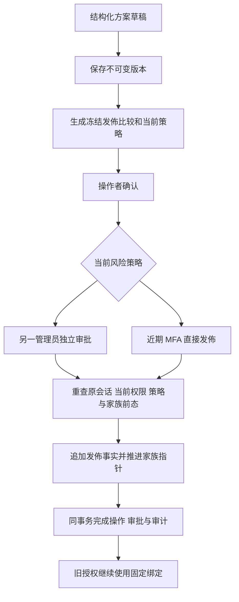
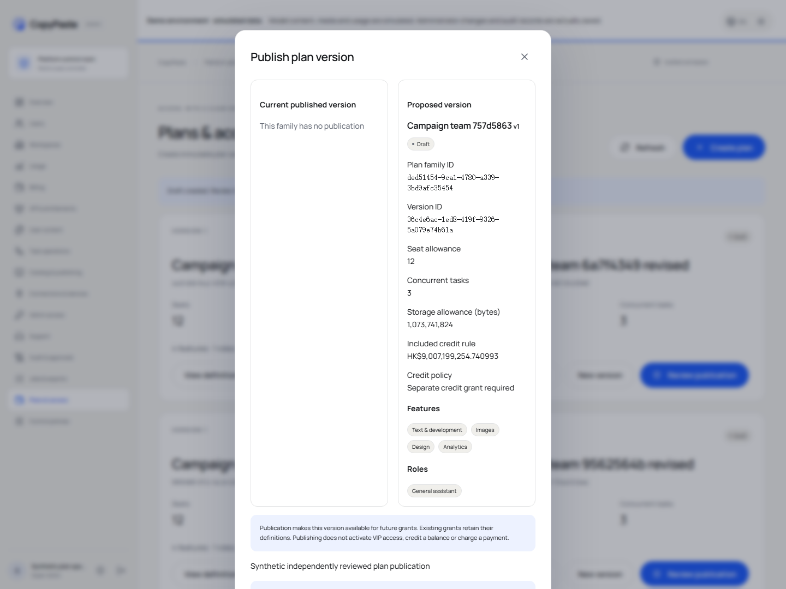

# 不可变方案版本、发佈审批与历史授权绑定

2026-10-20。承接 [后台控制面](11-admin-control-plane.md) 与 [统一审批](43-shared-admin-approval-requests.md)，修复 REQ-047/088/089/094/096/098/100/102 的方案定义子流程。102 条原需求、原 TC、NFR 和 G01–G10 全部保留。本次没有把方案目录视为完整 VIP 授权或商业配额验收。

## 当前行为

后台“方案与权限”使用独立结构化页面。管理员可以建立方案家族、建立新版本、查看完整定义、生成只读发佈预览、提交和独立审批。草稿一旦保存也不原地编辑；修改时建立同家族的新版本。每个版本保留固定 UUID、正整数版本号、名称、功能、角色、席位、任务并发、储存 bytes、HKD 附送额度与额度处理规则。

HKD 额度从输入、传输到显示均使用精确整数字符串与 BigInt。页面实际验证超过 JavaScript 安全整数的 `9007199254740993` 微港元，未经过浮点换算。附送额度属于方案定义，发佈本身不入账、不收费、不自动开通 VIP；另行赠额仍须经过既有财务权限、预览、限额、幂等和审批。

## 原规范与补充读取

原始 OpenAPI 文件及其 SHA-256 保持原字节。`contracts/admin-plan-schemas.json` 精确保存九个原始 schema 及依赖；不使用放宽后的替代 schema。原规范入口如下：

| 方法及路径 | 实际行为 |
| --- | --- |
| `GET /v1/admin/plans` | 原 `AdminPlanVersionList`，严格 `cursor/limit`，签名游标绑定当前操作者、会话和权限；不再接受旧 `page/page_size/search` |
| `POST /v1/admin/plans/drafts` | 原 `AdminPlanDraft`，202 原 `AdminOperation`；锁内分配同家族版本 |
| `POST /v1/admin/plans/{plan_version_id}/publications` | 原 `AdminVersionReason`，202 原 `AdminOperation`，必须携带有效 `X-Admin-Preview-ID` |

补充 `GET /v1/admin/plans/options` 返回已登记的功能和角色；`GET /v1/admin/plans/{plan_version_id}` 返回原严格版本 DTO。补充 `POST /v1/admin/plans/{plan_version_id}/publication-previews` 返回原 `AdminPreview`；`GET /v1/admin/plans/publication-previews/{preview_id}` 读取该操作者、原会话的精确冻结比较。后者不以新查询替换待确认内容。所有这些路径使用独立 Admin 身份和 `Cache-Control: no-store`。

旧 catalog 的 plan 建立、发佈、回退不再作为旁路。普通 catalog 列表继续排除 plan/policy。用户端规范 `GET /v1/plans` 和 `GET /v1/effective-entitlements` 及完整规范授权写入仍未在本项闭环；不能据后台目录推断这些原始接口已完成。

## 版本与授权的数据边界

前向迁移 056 新增五张带强制 RLS 的表；001–055 不改写：

| 记录 | 作用与约束 |
| --- | --- |
| `commercial_plans` | 固定家族身份与旧别名；仅通过实际发佈事实推进当前指针及 revision |
| `commercial_plan_versions` | 只追加定义；原管理员、原操作和精确命令相符；禁止改名、改额度、改角色或删除 |
| `commercial_plan_publications` | 只追加发佈事实；同家族、旧指针和递增版本必须相符 |
| `legacy_entitlement_plan_bindings` | 固定旧授权的执行定义、来源、绑定时间；禁止重绑 |
| `commercial_plan_migration_issues` | 保留无效旧定义的问题，不补造可用方案 |

新草稿和发佈都必须与成功操作同事务提交；发佈还必须和实际家族指针一致。审计写入失败会回滚版本/发佈、前态、操作、审批决定和幂等记录，不能留下半次开通。对非管理员应用账号只开放已经发佈的版本；旧绑定只对当前企业或本人可读。

旧 `entitlements` 的主体、plan、plan_body、原整数版本、原创建人/时间及自动续订标记保持不可变。旧体系的期限与状态控制仍保留，完整规范替换/延长/撤销事件流需要后续继续修复。

## 历史记录的诚实绑定

旧记录有非空原始 `plan_body` 时，绑定完整保留该定义，来源标为 `recorded_grant_snapshot`。它只有与实际目录定义完全相同时才带精确 `plan_version_id`；个别旧授权有自定义快照而目录不匹配时，该 UUID 留空，不能凭旧整数版本补造匹配。

旧记录缺少快照时，在升级/新建绑定的事务中计算一次实际发佈方案，标为 `evaluated_fallback_at_binding` 并保留实际绑定时间；不会宣称这是历史授予时的原定义。发佈新版不会再改变该绑定。旧 catalog 的有效定义保留真实来源、版本及来源状态；初始化发佈事实使用 `evaluated_at_upgrade`，原管理员和原操作未知时留空。无效旧发佈方案记录问题并拒绝执行，不静默恢复为默认付费方案。

旧软件没有商业席位/储存配额；升级的兼容投影使用 `2147483647` 席位与 `9007199254740991` bytes 上限，明确属于旧行为兼容边界，不能当作新增销售承诺。实际席位分配、并发加入、所有上传/复制/衍生文件的储存累计及降级超额处理尚未完整实现；已有独立执行容量和资源授权守卫继续生效。

## 当前授权、审批与竞争

全域方案影响所有企业，必须有全域对应权限；单企业/项目 allow 不足，任何重叠显式 deny 都不被全域 allow 绕过。菜单只影响显示，服务端在列表、详情、预览、写入、重放和审批均重查当前权限与最近十分钟 MFA。

默认 `plan_publication_requires_approval=true`；可在受控 admin-control 策略中明确关闭。预览/审批窗口为 1–10 分钟，默认五分钟。预览绑定精确版本、原因、操作者、原会话、认证版本、策略版本、家族 revision 和原发佈版本。提交只消费一次；审批前再次验证原操作者与审阅者的当前权限、原会话、MFA、策略及前态。本人不能批准自己申请。策略或家族前态改变后需要重新预览，不能借旧审批覆盖较新版本。

持久幂等按操作者、动作、目标和键保存。同键同参数恢复原操作，不重复建立版本/发佈；同键改参数拒绝。家族版本分配与发佈使用事务锁，同一前态的并发发佈仅一项提交，其余重新预览。发佈保留原申请人为事实 actor，审阅者通过实际审批决定和 approved_by 单独记录。

运行时 `effectivePlan` 不再从可变 catalog 为旧空快照授权反复取值；它使用固定绑定。现有任务在请求、领取、工具和输出阶段的当前权限检查继续使用该函数，预留结算仍按原始资金快照。现有方案优先级及旧期限/状态语义尚未替换为完整规范权益合并算法。

## 验证与交付边界

最终全量平台回归 **340/340**，688 份参与来源在执行前后保持一致；原始 TAP SHA-256：`2bc2dfa2f4bfcb6110c51b6474d415f4e1a0075f096584f55549756f9f4541d9`。实际路由清单已同步到 304 条；225 个原规范操作中仍有 133 个方法/路径未匹配，这只是路径清单，不代表匹配入口已完成全部契约验收。原 OpenAPI 和 102 REQ/TC、NFR、G01–G10 均未缩减。

聚焦的方案、迁移和 Skill 执行检查为 **24/24**；涵盖带数据的 055 升级、非法旧定义、快照缺失/自定义来源、并发版本/发佈、原规范、当前 MFA/范围、独立审批、审计故障回滚和原任务结算。首次候选 SQL 语法失败、别名冲突、测试错误响应定位及缺失 fixture 原因的记录原字节保留，不能作为成功记录覆盖。

两个实际原生数据库已应用 056，原 55 条迁移摘要与旧方案、旧授权、余额完整行摘要保持一致。只读回执及启动/迁移/测试库绑定日志在 delivery 的 `evidence/plan-migrations.json` 和 `plan-versions-*.log`；真实升级时点的数据检查不冒充持续不变的数据库快照。

当前 Admin 方案浏览器 **6/6**，8 份原始规范响应及 8 张实际截图，634 份参与来源前后一致；费用/退款 **8/8**（53 份来源）、Web 成员 **6/6**（172 份）、Admin 成员 **6/6**（200 份）及 Web/源码 Electron/MV3 认证 **12/12**（779 份）另按各自范围记录。原规范实际响应共 **108/108**，退款补充样本 **14/14** 单独校验；各专项与全量重叠，不重复加入 340 项总数。

当前 Admin 浏览器检查覆盖结构化草稿、精确金额/错误保留与焦点、冻结比较、202/幂等回执、自批拒绝、独立审批、同家族新版本及英文浅色桌面/繁中深色移动端。自建浏览器、页面和会话在 finally 释放，测试管理员停用。首次缺失浏览器路径和旧 pricing 样式影响桌面布局的原报告/原截图单独保留；修复采用隔离 Admin 样式类并增加布局断言，不改变功能标准。

实际页面：

全部原始截图、URL、宽度、主题、语言和 SHA-256 见 delivery 的 `evidence/admin-plan-screenshots.json`。本轮不重建未改变的无边框 Desktop 或 Side Panel 安装预览；这些二进制及历史完整包的接受范围继续分开。

Git 检出规则同时保留带摘要的 SQL、Skill 与原规范 schema 夹具字节。本轮发现旧 billing 与新增 plan 夹具的工作区换行会在普通检出中转换，已通过 `contracts/*-schemas.json -text` 和重新登记原字节修正；执行文件与已通过回归的摘要保持不变。独立检出工具新增全部 schema 夹具的逐文件字节比较，不能只验证解析后的 JSON。

后续仍需完整规范 VIP 授予/替换/延长/暂停/撤销/到期、个人与企业权益合并、席位/储存实际执行、跨端通知/outbox、真实内网模型与支付机构、原生安装/卸载、完整后台权限与全部 102 项验收。当前逐项状态见 [修复进度](../quality/requirements-alignment-progress.json)。

最终独立 Git 检出 **5/5** 通过：56 份 SQL、11 份原规范 schema 夹具、28 个 Skill 包、45 份 Desktop renderer 来源、135 份 Admin 跟踪文件和原始 340 项 TAP 的字节一致；两个实际数据库的迁移摘要保持。四份临时检出均已清理，Delivery 检出后仅追加本次回执提交。
