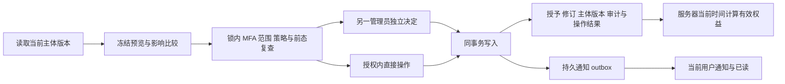
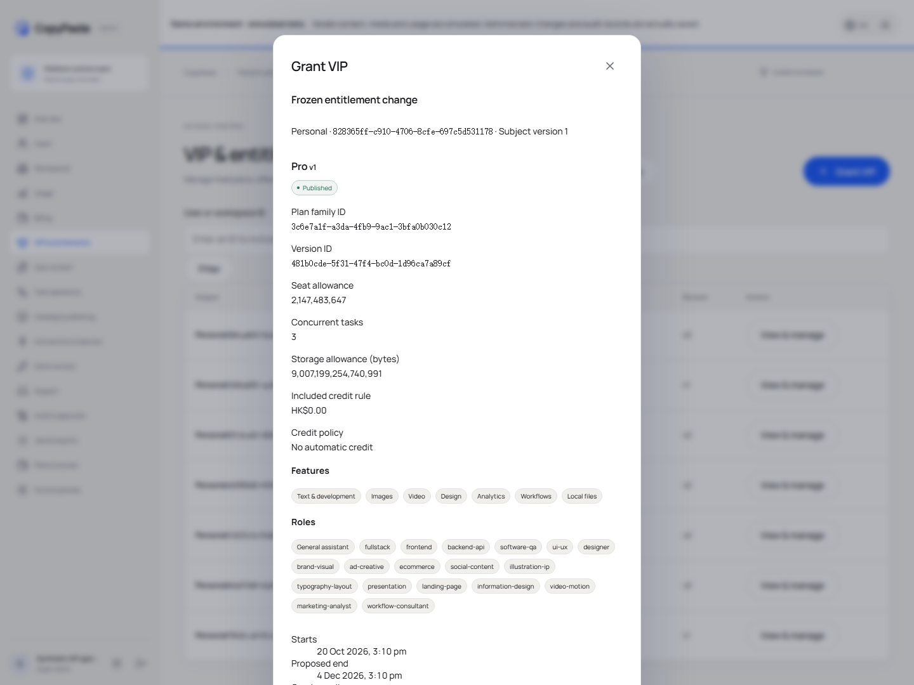
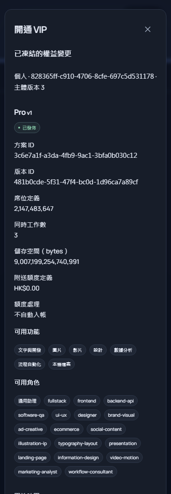
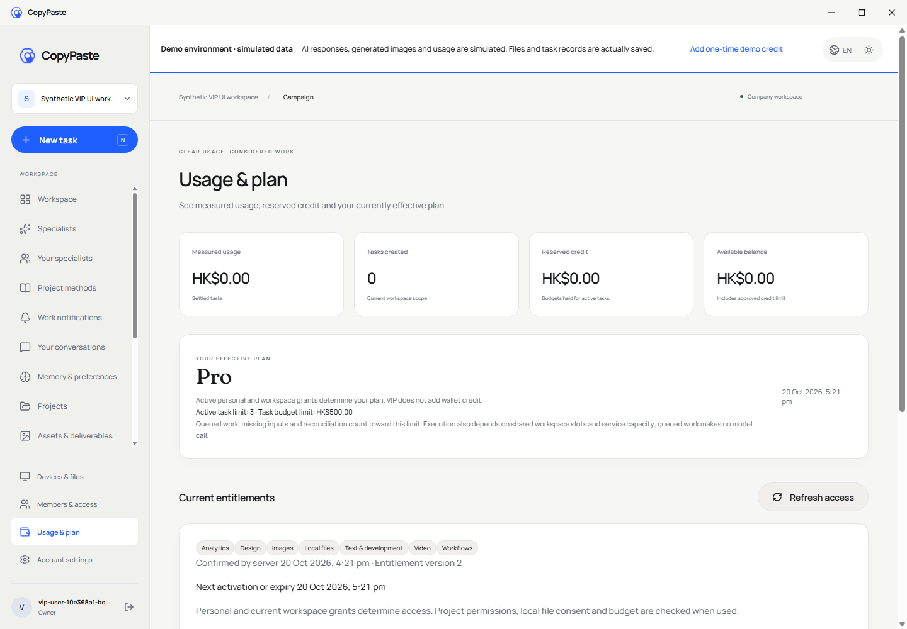
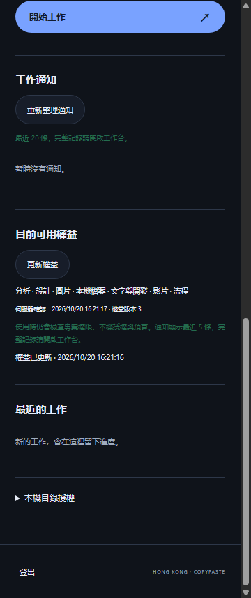

# 规范 VIP 授权与实时有效权益

2026-10-20，代码已实现，正在完成各端交付复核。承接[不可变方案与历史绑定](46-immutable-plans-and-legacy-grant-bindings.md)，对应 REQ-047/048/083/084/088/089/094/096/098/100/102。当前平台回归 354/354、694 份参与源码与 verifier 前后摘要一致，是本轮有界证据；102 个原始 REQ/TC、NFR 和 G01–G10 保持完整范围。

本轮复核发现的旧 VIP 通用表单与单条授权选择已由规范命令和实时计算替换。当前实现包含人工授予、同方案续期、换方案、延长、暂停、恢复、撤销及实时到期。角色、资源、预算、内部 AI 路由与 Codex 约束继续独立执行。席位、存储的完整真实执行及 VIP 与赠额的原子组合操作仍是独立未完成项，不能据本轮合并判定关闭。

原始 OpenAPI 保持原字节。目标入口为 `/v1/admin/entitlement-grants`、`/v1/admin/entitlement-previews`、各授予的 extensions/revocations/suspensions/resumptions，以及用户 `/v1/plans` 和 `/v1/effective-entitlements`。请求和响应按原 schema，补充的冻结比较、主体读取及通知接口单独标示。

授权保留原授予者、原操作、固定方案 UUID、来源、付款引用和原始区间。延长、暂停、恢复、撤销及替换追加修订，原记录不可删除。默认不续费、不扣款；VIP 与赠额继续分开。发佈方案不触发授予，改变定义不重绑现有授权。

重叠策略按实际区间预览：reject 拒绝冲突，replace 明确取代所列授权，extend_same_plan 只延长同一精确版本而保留原来源。预约替换在新开始时生效，不能立即取消原来仍有效的时段，也不能在替换结束后自动复活旧授权。暂停不延长到期时间，恢复仍检查当前状态、版本、授权与实际期限。

个人和企业有效授予按明确规则合并：功能、角色取已生效授予的集合；同种配额取最大值，避免重复相加。存在显式有效授予时不额外并入免费层以扩大能力；没有有效授予时回到当前免费方案。最终能力仍与资源权限、已验证能力、预算、本机授权取交集。权威计算直接使用服务器时间，不依赖到期调度成功。

旧授权的原行、固定绑定及未知来源保持。不得补造历史操作者、原操作、付款或方案 UUID。规范新授予与旧记录分开；替换旧授权必须保留实际新操作和生效时点。未能满足原严格 DTO 的旧记录以明确的历史读取表示，后续管理需明确迁移/替换，不能用假 UUID 填充。

前向迁移 057 已应用实际两个原生数据库，其字节现在不可改写；001–056 与阶段 46 Git 提交逐文件一致。新增主体版本、规范授予/修订、旧授权替换事实及持久通知 outbox；写入、审计、修订、操作结果和 outbox 同事务。模拟/正式模式分开保存新授予；旧未分类记录不补造模式。六张新表启用并强制 RLS，读取视图采用调用者权限。

## 命令、前态与权限

| 类型 | 当前入口 | 约束 |
| --- | --- | --- |
| 规范授予 | `POST /v1/admin/entitlement-grants` | 原始 AdminVipGrantCreate；固定方案 UUID、明确来源、auto_renew=false、主体版本及预览 ID |
| 规范预览 | `POST /v1/admin/entitlement-previews` | 原始 AdminPreview；冻结原参数、前态、操作者会话、权限和策略，无授权及资金效果 |
| 规范修订 | `POST /v1/admin/entitlement-grants/{id}/extensions` 及 revocations/suspensions/resumptions | 原始 AdminVipExtend / AdminVersionReason；检查授予版本、状态、区间和当前权限 |
| 规范读取 | `GET /v1/admin/entitlement-grants` | 原始 AdminVipGrantList；签名游标，完整个人/企业范围及显式拒绝 |
| 用户规范读取 | `GET /v1/plans`、`GET /v1/effective-entitlements` | 原始 PlanList / EffectiveEntitlements；租户头、实时会话、成员及项目授权 |
| 补充读取与预览 | 主体版本、冻结比较、授予详情/历史、当前方案选项及各修订 previews | 单独标示补充接口，不能伪称原始规范新增了这些路由 |
| 历史读取 | `GET /v1/admin/entitlement-grants/legacy` | 未知操作者、原操作、付款及原 UUID 保持未知；只读，并标明未分类模式 |
| 补充用户通知 | `GET /v1/entitlement-notifications`、`PATCH /v1/entitlement-notifications/{id}` | 仅当前真实用户、当前模式和个人/目前企业；有界分页、明确已读 |

个人授权要求覆盖用户整体的权限。只获一个企业范围，或者与该用户相关项目存在显式拒绝，都不能经个人授予、旧目录或作业入口扩大读取。付费预览及审阅另外要求对应账务账户的财务读取权限；付款必须已由另一管理员核实，模式和主体匹配，未退款/待对账，且未绑定另一规范授予。开通付费 VIP 本身不生成资金分录。

默认最长 366 日；超过 31 日、换方案及付费来源需要独立审批。阈值可由版本化策略配置，不代表已经确认最终商业政策。申请、批准及幂等重放都在锁内复查近期 MFA、当前权限、整体范围和额度限制；批准还复查原申请会话、当前策略和冻结前态。原授予者与实际审批者分别保留，本人不能自批。旧通用 VIP 写入口在幂等读取之前即拒绝，避免绕过新控制器。

## 数据库与并发边界

主体按个人/企业和模拟/正式模式分隔。规范授予的主体、固定版本、来源、付款引用、最初起止时点及操作者/原操作不可改写；后续命令必须有下一连续版本。暂停不续时，撤销不可恢复；预约换方案在真实开始时切断列明的旧授予，后续撤销新授予不会复活旧授予。同一固定版本续期可沿用真正已发佈但后来退役的原版本；新授予则必须选当前已发佈版本。

数据库触发器核对真实操作、主体、动作、版本和修订前后态。延迟约束要求投影、主体版本、不可变修订、成功操作及通知意图共同提交；审计失败全部回滚，原未消耗预览可重试。同键提交只产生一次结果；不同键的旧主体版本发生冲突，不能覆盖另一管理员的新状态。outbox 的原始事实和已终结投递状态不可改写。

旧授权的替换仅追加真实新操作、目标及生效时点，原行和旧方案绑定不更新。旧授权缺少严格原始 DTO 所需事实时，补充历史列表明确返回未知字段，不能填造 UUID。历史未分类模式保持可见标记；新模式下的替换不切断另一个模式的权益。

## 实时计算与客户端

有效计算以事务中的服务器时间为准，取当前企业及个人的有效授予。明确选择企业主体的读取只计算企业授权，并要求企业管理权限；个人读取计算本人及目前企业的合并。角色和功能取集合，并发和其他同类配额取最大值；额度、余额、预算和实际资源许可分别执行。没有显式有效授予才使用当前免费层。

下一次开始、到期或替换边界用于提醒客户端刷新；即使 worker 或通知暂时失败，新的请求、任务启动与工具调用也按真实时刻重新判定。在途任务继续按原预留来源结算，不能因到期补造费用或反复释放。完整席位/存储边界及所有收费步骤恢复仍须另行验收。

Web 用量页显示当前方案和配额、功能、确认时间、权益版本、下一边界、资源/预算条件及个人通知。方案与权益同一刷新批次读取，并比较主体版本与固定方案 UUID 集合；若请求之间发生变更，暂时清空旧结果并重新读取，避免旧方案卡片配上新权益。手动刷新、每 15 秒轮询及下一边界都会同时刷新两者，边界延迟按服务端确认时间计算。会话或企业改变使旧响应失效。Desktop 使用同步的独立 renderer 快照及限方法/路径 IPC 白名单。扩展通过已认证 background 附带租户头读取，在原生 Side Panel 中显示当前权益版本及最近五条通知；账号/工作区版本隔离迟到结果，退出清空缓存。三端实际流程以各自回执为准，不能把同步源码等同安装包验收。

Admin 的专用表单包含方案与精确 UUID、主体、来源、区间、重叠策略和原因；失败保留输入并聚焦可达错误摘要。结果显示实际操作及审批入口，授予详情保留原始来源和不可变修订。页面验收修复了详情刷新重建弹窗导致回执消失、目录使用未定义表格样式导致 375px 页面扩宽，以及原生截图中发现的旧方案标题没有随权益刷新的问题。现在使用打开时的固定授权快照、共享的可横向滚动表格区域，以及方案／权益的共同刷新与一致性检查。

暂停 VIP 后不预设某功能一定消失；实际回退到目前已发佈免费方案的功能和配额。当前模拟 Starter 与 Pro 的功能集合相同，但并发及预算不同，原生验收因此核对真实固定方案 UUID、版本、方案名及配额回退，不以「图片标签消失」替代真正的权益判断。首次错误测试假设及显示问题截图保留。

## 迁移证据的限制

首次原生启动器自动执行主库 057，之后升级前快照检查按设计拒绝。该失败、原启动日志及 verifier 候选原字节保留，没有倒改 057。已补充 `COPYPASTE_NATIVE_DATABASE_START_ONLY=true`，升级工具可仅启动原生数据库、先读取快照、再显式迁移，并只停止自己启动的进程。

测试库有真实 056→057 的旧授权、绑定、方案、发佈、问题记录及余额完整行摘要比较；主库只具备首次迁移之后的只读基线比较，不能据此证明它在迁移前后的全部旧行不变。两库均确认新六表在升级时为空，没有补造历史规范授权；视图与强制 RLS 正确。15 条旧迁移原本未存摘要，继续保留 null；已存摘要逐项核对，001–056 全部源文件另与阶段 46 提交比较，不以补填元数据假装历史已有摘要。

## 证据与剩余工作

Delivery 的 `evidence/alignment-platform.json/.tap` 记录当前完整回归；354/354，694 份参与源码前后一致，原始 TAP SHA-256 为 `e065ef8455ede0dd143e01bba80d8e8d239c28a7e91568721c16dcc74cfac112`。VIP 专项、迁移及原平台聚焦结果与全量重叠，不重复加入总数。原始 OpenAPI 字节及 11 个 VIP 依赖 schema 没有放宽。

当前 Admin 页面六组、9 份原规范响应及 11 张实际截图已通过，787 份参与源码一致。Admin 方案六组／640 份来源，费用及退款八组／53 份，Web 成员六组／177 份，Admin 成员六组／206 份，源码三端认证十二组／786 份均复跑通过，拥有的浏览器、原生进程及凭据完成清理。全部实际原规范响应 122/122，退款补充请求／响应 14/14 分开计数。

实际重新打包的无边框 Desktop 和真正右侧 SIDE_PANEL 联调六组通过，790 份参与源码前后一致；浏览器 S256 PKCE、固定方案／配额与权益共同刷新、同一用户通知已读、暂停回退及真实退出均有证据。实际原生外观十组通过，包含无系统边框及菜单（Alt 也不出现）、自绘控制及最小尺寸、跨窗口 IPC 拒绝、工具栏真实 action 打开／收起右侧栏、导航及标签切换保留同一文档、浏览器重启恢复入口。两次成功回执绑定同一运行时、安装器及扩展字节，执行前后没有变化；Setup／Portable 有字节来源，但这组检查没有执行安装／卸载。

阶段 46 的 316 份原字节副本保留于 `evidence/stage46-before-canonical-vip/`；本轮首次失败的 SQL/TAP、启动顺序检查、页面路由、结果弹窗、窄屏诊断、旧成功截图及原生失败分别保留。侧栏原生上下文出现时 documentUrl 可能尚为空；原生 bounds 更新也可能早于 renderer 排版。测试等待实际文档及相同尺寸后继续，仍严格检查真实侧栏与精确缩放，不绕过实际浏览器 action 或模拟缩放。

15 张本轮原始截图按相同字节同步中央文档与各仓库 README，摘要及原回执绑定见 [截图来源](../quality/vip-screenshot-provenance.json)。

最终产物准入曾拒绝一份只枚举 Git 已跟踪文件的旧清单：新 renderer 文件在提交后才出现在该清单。原拒绝日志、旧成功回执和校验器保留。现已纳入未提交新源码，并以 12 项准入单元检查验证「新源码不可漏列；暂存相同文件不改变摘要清单」，随后重跑实际原生十组和六组，不直接修改旧回执来匹配新清单。

最终独立 Git 克隆五组通过：57 份 SQL、12 份原规范 schema 夹具、28 个精确摘要 Skill 包、46 项 renderer 来源、145 份 Admin 跟踪文件及 354 项原始 TAP 保持字节一致。四份自建临时克隆已清理；Delivery 随后只增加该次检出回执。六仓库源码均已独立提交。安装器 107587543 字节、便携版 107356303 字节、扩展 ZIP 297758 字节，准确摘要与源码提交见 [产物清单](../quality/native-surfaces-artifacts.json)；没有执行生产发布或替换历史完整离线包。

本轮不关闭完整 VIP 与赠额原子组合、席位和存储真实执行、旧授予直接规范化迁移、完整收费步骤恢复、全部后台权限/导出、完整安装/SSO/系统矩阵、专业角色真实模型资格、生产投放或所有 NFR。完整范围继续以原始 102 条需求和验收条件为准。
