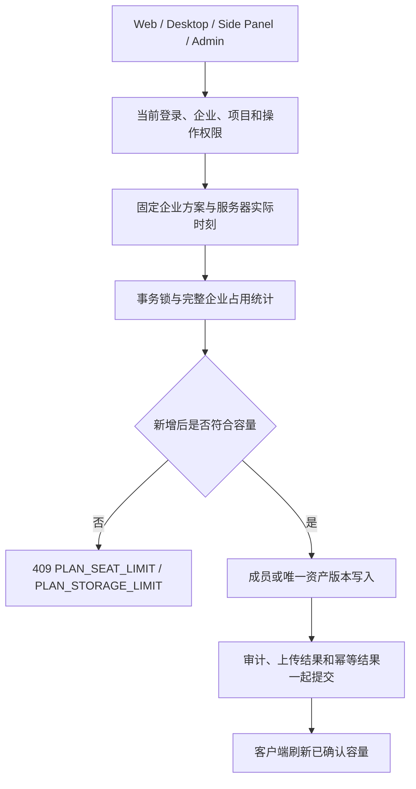
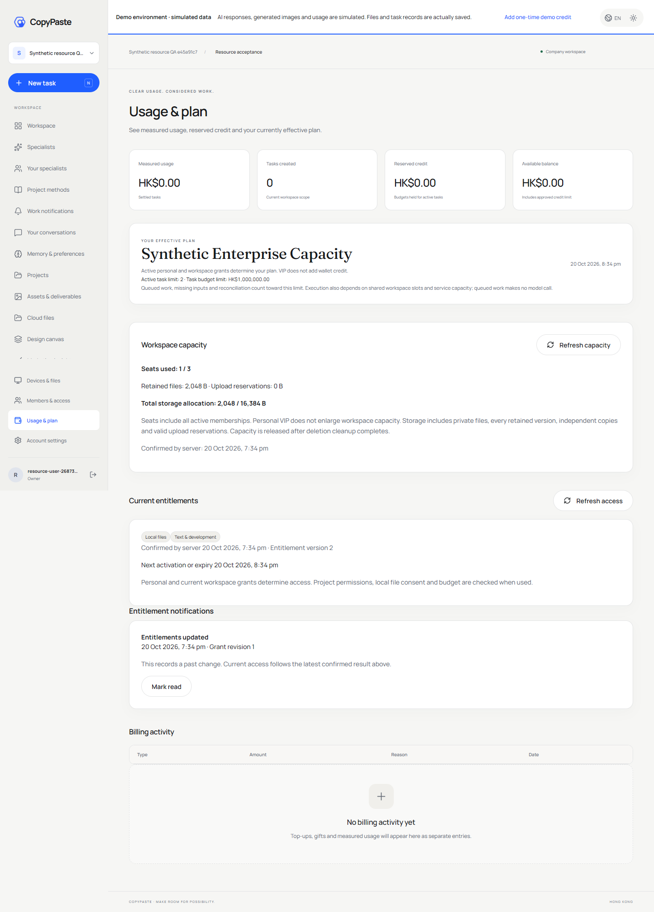
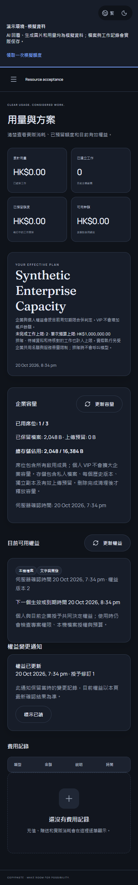

# 企业席位与存储的实际约束

后续阶段 49 已补齐 [VIP 加显式赠额的同事务组合开通](49-atomic-vip-and-explicit-credit.md)。本页数字和边界保留为对应阶段的历史记录；最终当前来源及回执以 [逐项进度](../quality/requirements-alignment-progress.json) 为准。

2026-10-20。承接 [固定方案版本](46-immutable-plans-and-legacy-grant-bindings.md) 与 [VIP 生命周期](47-canonical-vip-lifecycle-and-effective-entitlements.md)，补齐 REQ-047/089/102 中企业席位和云文件容量的运行约束；后台查看沿用 REQ-083/084/088/094/096/098/100 的权限及审计。原始 102 条 REQ/TC、NFR、G01–G10 和 OpenAPI 保持原范围。

## 业务规则

| 对象或动作 | 当前行为 |
|---|---|
| 企业方案 | 只读取当前模式、当前时刻有效的企业授予；固定原方案 UUID，同种容量取最大值，不重复相加 |
| 个人 VIP | 决定个人功能及任务权益，不增加其所在企业的共用席位和存储 |
| 无企业授予 | 读取当前已发佈的 Starter 定义；旧方案的相容上限明确标示，不补造新的付费档位 |
| 席位占用 | 所有启用的企业成员均占用一个席位，包括 owner、viewer；全局账号冻结不释放原企业席位 |
| 邀请 | 创建邀请不占席位，接受时重新检查；超额拒绝不会消耗邀请或留下半条成员/项目授权 |
| 恢复成员 | 用户恢复、Admin 新增/恢复/审批执行与邀请接受使用同一个数据库席位守卫 |
| 已有成员 | 容量已满时仍可修改已启用成员角色；最后 owner 及原有权限保护继续执行 |
| 降级、暂停、到期 | 保留已有成员和文件，不自动移除、删除或产生超额费用；阻止新增占用 |

企业共享资源与个人功能是不同的授权对象；不能由某个成员购买个人 VIP 扩大整个企业容量。多企业之间分别计算。运行时按服务器实际时刻判定授权区间，即使事务早于到期开始或到期 worker 未运行，也不沿用旧容量。

## 存储计量

商业存储数值为企业云资产的逻辑字节。实际对象、历史版本和上传承诺分别计算，不以当前列表可见条目数量代替。

| 内容 | 是否计入 |
|---|---|
| 每个未完成擦除的资产版本 | 计入，包含私人附件、任务成果、历史版本、隔离和已逻辑删除但仍等待清理的内容 |
| 文件复制、私人内容显式发佈及派生成果 | 每个独立版本各自计入；旧物理键碰巧复用也不免费扩大逻辑容量 |
| 有效 pending 上传 | 按已声明并经服务端检查的完整大小预留；不能用分片逐次写入绕过 |
| 上传完成 | 同一事务把既有预留转换为唯一资产版本，不重复计入；必须匹配企业、项目、大小、摘要、类型、原版本和上传者 |
| 已取消或实际到期的上传 | 释放预留；终态不能重开、改变主体或扩大大小/期限 |
| 正在清理的已删除资产 | 继续计入保留字节；物理清理成功并记录 erased_at 后才释放 |
| 私人会话删除 | 取消其待完成和已完成附件的可用状态并清除结果；保留原上传关联和审计，继续按实际擦除进度释放容量 |

已预留上传在降级后完成时没有增加承诺总量，可以原子完成；任何额外容量仍须符合现行上限。失败的对象写入、失败事务和未知清理错误不会被显示为成功释放。

分片缓存、临时组装、运行目录、数据库、日志及备份的物理磁盘容量属于运维资源控制，本项没有把它们伪装成已按套餐逐项收费的资产字节。现有每文件大小、并行 pending 数量及暂存总量限制继续生效。

## 代码和事务边界

`members:*` 锁继续协调 owner、邀请和 Admin 身份操作。数据库的 `tenant-resources:*` 锁把实际资源准入与企业授予变更串行化。上传和资产写入沿用统一上传锁顺序。`saveAssetContent` 在对象 I/O 前检查容量；资产版本 INSERT 和上传 INSERT 再由数据库守卫复查，覆盖工具、复制、派生及直接写路径。对资源许可、资金预留和模型消耗的检查仍各自执行。

完整企业统计必须看到被应用 RLS 隐藏的其他成员私人版本。内部统计函数仅允许 control 身份执行；用户和后台 HTTP 在具名权限检查后的 control 事务中调用，只返回合计数、上限、固定方案 ID 与确认时刻，不返回私人文件行、名称、所有者或内容。应用身份只可调用返回成功/有界错误的容量守卫。

上传预留与资产版本有独立唯一关联；延迟约束确保上传完成状态、实际资产版本及返回结果在同一事务提交。不能借用另一份预留、伪造摘要、重复转换或提前标记完成来释放容量。原金额流水、VIP 事件及钱包均不因容量检查而改变。

## 页面与权限

补充读取入口为 `GET /v1/tenants/{tenant}/resource-usage` 和 `GET /v1/admin/tenants/{tenant}/resource-usage`。它们没有向严格的原始 `EffectiveEntitlements` 偷加字段或改写原 OpenAPI。字节总量和上限以十进制整数字符串传输；Web、Desktop 和 Side Panel 使用 BigInt 显示，避免累计容量丢失精度。

用户读取要求目前有效的企业成员身份，路径与企业头必须一致。后台要求 `admin.tenants.read` 和 `admin.entitlements.read` 同时覆盖整个企业；单个项目 allow 不足以读取合计，任一重叠项目 deny 均阻止该企业整体读取。每次后台读取记录审计。

Web 用量页和成员页显示席位、保留字节、上传预留、容量上限和超额状态。Desktop 使用独立仓库中的同源 renderer 快照，经现有限定 IPC 读取。扩展在浏览器原生 Side Panel 内显示企业容量。Admin 企业列表新增容量入口，显示双语、两主题、窄屏可用的只读面板；权限被撤销或读取失败时清空旧统计。

## 升级与验证记录

058 实际升级前先停止自有开发控制器，再以仅启动数据库模式运行原生 PostgreSQL。主库与测试库均保留已处于 057 状态、执行 058 前的真实快照；升级后在 API 重启前核对 23 类原有记录，原行、001–057 文件及原有已记录校验值保持一致。历史 NULL 校验值保持 NULL，不补造证明；旧上传关联保持空值。

首次完整回归真实结果为 374 项中 373 通过，失败点是新的终态保护与原私人会话删除的附件取消流程冲突。原始 TAP、失败报告和当时页面回执归档于 `resource-before-private-erasure-repair`，没有改写为成功。058 已应用，保持原字节；新增 059 只允许真实已删除私人会话内、同一原主体、`[deleted]` 文件名和空结果的不可逆取消，不能重开上传或扩大容量。已有私人附件原测试保持原断言；新增容量测试验证 pending 预留先释放、保留版本仍计入、实际清理后才释放以及两类终态均不能恢复。

058 的升级前后记录见 [058 原始迁移核对](../quality/resource-migrations.json)。059 采用独立升级前后快照，包含现有实际上传关联，不覆盖第一次升级记录。专项测试及完整回归、实机、源码和产物证明以 [逐项进度](../quality/requirements-alignment-progress.json) 的当前验证为准。

原方案 056、VIP 057、058 及本次各阶段回执分别保留。057 主库当时缺少升级前快照的历史限制继续存在，不能由本次 058/059 的完整前后核对倒推消除。全部综合验收、VIP 与赠额的原子组合、旧授予规范迁移、完整安装/签名更新与系统矩阵、真实外部服务和专业角色资格继续逐项验收。

当前最终回归 375/375，699 份 Platform 来源前后摘要一致；容量专项文件 21 项包含在全量内，不重复累计。实际 Web/Admin 容量八组、新包原生外观十组、打包 Desktop/真实侧栏权益六组、源码认证恢复十二组均通过；后台 VIP/方案各六组、费用八组、成员页两套各六组也已复核。122 份原规范运行态响应保持严格校验。所有自建页面、浏览器及 Electron 均已关闭，测试会话和测试管理员已清理。

独立 Git 检出还发现本机新增 README 的 CRLF 与已提交 LF 不一致；未更改业务值的 Delivery package.json 也会影响三个来源绑定回执。原失败、原说明及原配置字节和受影响的成功阶段回执分别保留，按已提交 LF 原字节还原后重跑相关实机/页面检查；不放宽检出摘要或已应用迁移校验。
