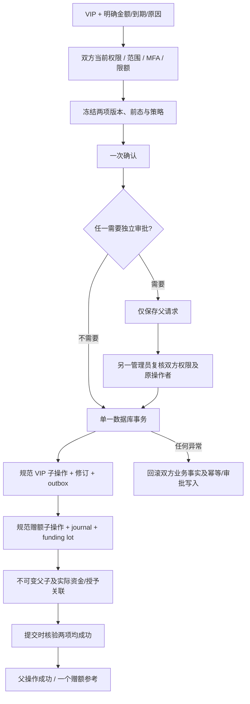

# VIP 与显式赠额的原子组合开通

本增量落实 [后台控制面](11-admin-control-plane.md) 的父操作与子操作约束，以及 [后台产品规格](../product/08-admin-dashboard.md) 的独立权益、费用和完整确认要求。对应 REQ-047/087/088/089/094/096/098/100/101/102 的有界子流程；不改变全部 102 条需求和 G01–G10 的完整验收条件。

## 用户与管理员行为

管理员在现有 VIP 开通表单勾选「与 VIP 一并赠送明确额度」，填写 HKD 金额、独立到期日与赠额原因。只有同时具备 VIP 授予、VIP 读取、赠额和账务读取权限的管理员能使用；后端始终独立核验实际权限，界面隐藏不承担授权。

预览自动匹配同一 user/tenant、同一数据模式的费用账户，冻结固定方案 UUID、有效区间、来源、重叠处理、权益主体版本和账务账户版本。VIP 与赠额共用一次确认。任何一项需要独立审批，则整个组合等待另一名具备双方权限和限额的管理员审批，等待期间不创建业务子操作、权益或额度。

成功后显示父操作、两个实际成功子操作和独立 credit_reference。赠额不会成为 VIP 的隐式效果；方案内 included_credit 不会据此自动入账。赠额的到期日和资金来源独立保留，日后暂停/撤销 VIP 不自动回收已明确赠送的资金。此入口不新增付款、扣费、自动续订或跨主体调拨。

## 补充接口与原始契约

| 方法与路径 | 作用 | 响应 |
| --- | --- | --- |
| POST `/v1/admin/vip-credit-previews` | 预览组合命令 | 原始严格 `AdminPreview` |
| GET `/v1/admin/vip-credit-previews/:id` | 本人冻结命令及前态 | 补充只读 DTO |
| POST `/v1/admin/vip-credit-combinations` | 携带 `X-Admin-Preview-ID` 与 `Idempotency-Key` 一次确认 | 原始严格 `AdminOperation`，HTTP 202 |
| GET `/v1/admin/vip-credit-combinations/:id` | 父操作、独立子操作状态、实际结果和前态 | 补充只读 DTO |
| GET `/v1/admin/operations/:id` | 共用操作读取 | 原始严格 `AdminOperation`，同时检查双方读取权限 |
| GET/POST 既有审批路径 | 共用列表、冻结详情、原始四字段审批决定 | 原有严格审批与操作 DTO |

组合请求严格只有 `billing_account_id`、`vip`、`gift` 三个属性；后两者分别完整嵌入原始 `AdminVipGrantCreate` 和 `AdminFeeGift`。金额始终为十进制 HKD 微元字符串，拒绝超过 int64、零/负数或已到期赠额。原始 OpenAPI 文件及嵌入 DTO 不增加字段。补充定义见 [组合组件夹具](../contracts/admin-vip-credit-schemas.json)；运行代码保存逐字节一致的副本。该夹具是定义数据容器，消费者须将 `schemas` 绑定至 `components.schemas` 命名空间解析引用；不将容器本身作为独立 JSON Schema 直接执行。文档与运行验证均先核对原规范文件摘要、逐项原定义及完整引用。

不能用两个前端请求拼接为「组合成功」。现有单独 VIP、赠额接口仍只负责各自明确操作；通用旧入口与批量接口不能创建未注册组合动作。

## 事务与权限

控制器调用既有 VIP 校验/投影与赠额检查/入账函数，不开启子事务，不重复实现账务计算。`lockAdminAccess` 保持与既有后台相同的授权及日限额串行顺序；权益主体锁在费用账户锁之前取得。审批、提交及幂等重放前都核验近期 MFA、真实会话/认证版本、整个个人或企业范围和重叠 deny。

父策略固定 VIP 与财务两个实际策略版本；审批期限取两者更短值。确认和审批重新读取原策略、前态、固定方案/付款、双方版本、金额/时长及操作者当日累计。原操作者会话撤销、权限收回、目标变化或策略更新时拒绝生效。审批人还必须有共用审批决定权限、双方业务权限及金额/时长限额，不能审批自己的请求。

两个子操作保留最初操作者、原会话/认证版本、各自原始命令和策略，以及真实 approved_by。规范 `billing.gift` 子操作纳入既有香港日界累计，不因父动作名称不同而漏算，也不按父子重复计入。重复或并发相同幂等键只产生一个父操作、两个子操作及一个赠额来源；同键不同请求返回冲突。

父操作及审批目录、摘要、详情、结果和预览都要求双方读取权限；只读其中一个领域或被相关项目 deny 的管理员不能借父操作看到另一领域的冻结资料。读取历史单个规范子操作继续遵守该领域原有权限。

## 数据库防线与升级

只追加 `060-atomic-vip-credit-combinations.sql`，不编辑已经应用的 001–059。新增 `admin_vip_credit_combinations` 不可变表关联父操作、VIP 子操作、赠额子操作、实际 grant 与实际 credit journal。

操作和预览触发器保护固定来源、命令、策略、期限与父引用；完成的组合父子结果不可更改。延迟至提交的约束要求同一主体/模式、两个规范子动作、原操作者/审批人、冻结前态、实际 VIP 修订、真实赠额 journal/lot、原到期日和唯一参考全部一致。只保存父成功、脱离父操作的子成功、多余子操作或只写一半均不能提交。待审批/取消父操作不能关联业务子操作。普通用户角色无该关联表和断言函数权限。

升级工具先停止本项目控制器，仅启动原生 PostgreSQL，分别为主库和测试库的每张原公共表保存行数和完整行序列摘要，记录已应用文件摘要和实际可空历史校验值；追加 060 后在 API 重启前逐项比较。其他本地服务与用户数据库不参与。工具、原始日志、失败测试和前后快照保留在 delivery `evidence/`，主文档报告放在 `docs/quality/`。

## 验证与边界

专项数据库测试覆盖个人/企业、模式错配、双领域权限与重叠 deny、精确金额、独立审批、原会话/策略/目标变化、金额/时长/日限额、并发幂等、同方案续期、数据库旁路和审计/末尾关联失败回滚。实际浏览器验证应覆盖保留错误输入、聚焦摘要、冻结比较、版本变化拒绝、成功的两个子状态、用户权益/余额、独立审批、繁中深色 375px 和晚到的权限撤回。

本增量继续使用获准模拟外部依赖；身份、数据库、账务和权限走真实实现。真实公司模型/媒体和支付机构、完整角色交付质量、SSO/安装与系统矩阵、全量商业通知和全部综合验收仍独立跟踪。专项与回归通过不等于任何整条原始需求自动验收通过。

独立克隆复核还检查全部 Admin 已跟踪文件与工作区逐字节一致。首次检查发现九张最新付款/退款派生截图尚未进入 Git 提交；保留失败回执、原验证脚本及首张图片的提交版/工作版原字节，补齐提交后重新复核。不以工作区中存在图片代替独立交付验证。

第二次复核发现新增嵌套证据目录超过 Windows 文件名长度限制；另存原失败回执后，将这组新归档改为短路径平铺保存，原始日志、图片与验证脚本字节不变。来源路径继续由归档清单逐项记录。

本轮原生交互重测后，客户端产物清单须绑定当前十项回执。专用维护脚本先逐项核对实际源码、完整运行目录、安装包、扩展包与 ASAR 内嵌文件，再保留旧清单及旧回执引用，仅更新验证绑定；不重新打包，也不改变原始构建时间和来源提交。
