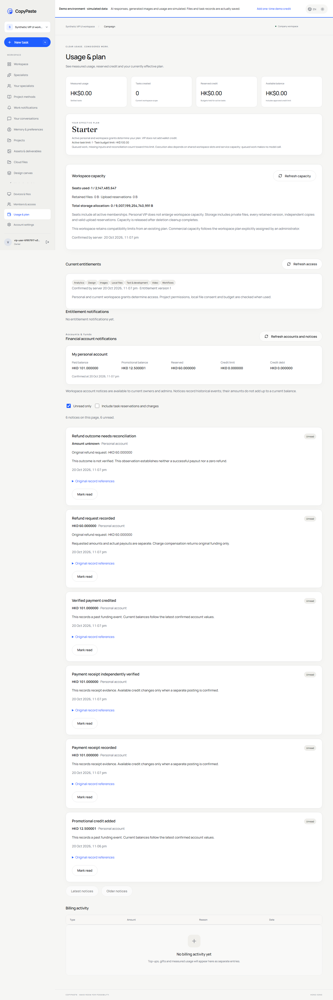
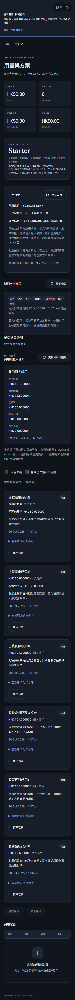
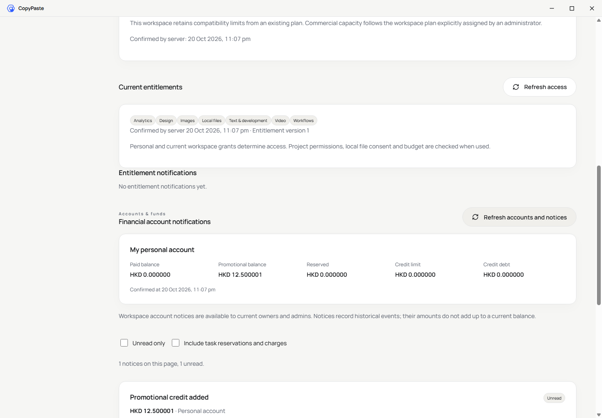

# 费用变更的事务通知与三端账户视图

<!-- stage51-support -->
阶段 51 支持控制面合入后，当前平台全量为 424/424（711 份来源），费用专项仍为原 16 组；三端费用重查 8/8，绑定 817 份来源和相同实际运行包。以下 410/707、808 份来源是阶段 50 当时结果，旧回执保留在独立归档，不改写成当前证明。新增支持流程见 [限时只读支持](51-controlled-read-only-support.md)。

本项对应原 REQ-100 的费用通知子流程和 Admin 费用控制约束。原文要求资金、审计与 outbox 同事务提交；此前 VIP 通知已持久化，费用通知尚未接入。全部 102 条需求、原 TC/NFR 和 G01–G10 范围保留。

## 来源与投递

新增前向迁移 `061-durable-financial-notifications.sql`。规范来源的真实 INSERT 通过数据库触发器写入 `financial_outbox`，失败则来源事务整体回滚。预览、待审、拒绝及幂等命中不会生成第二条资金事实或通知意图。

| 来源 | 通知含义 | 资金边界 |
| --- | --- | --- |
| `billing_journal` | 预留、消费、释放、入账、赠额、到期、扣回、现金退款扣账、原来源补偿、授信更新 | 原账目变动；预留不是再次收费，授信值是当时的新上限 |
| `payment_records` | 收款资料登记 | 证据登记尚未增加余额 |
| `payment_confirmations` | 收款资料独立核实 | 仍须独立入账才改变资金 |
| `billing_refunds` | 退款要求 | 原要求与本次实际支付分开 |
| `billing_refund_events` | 实付、剩余未付、未知、资料差额 | 未知金额为 `null`，不可转换为零或成功 |

每批最多 100 条，`FOR UPDATE SKIP LOCKED`；通知 INSERT 和完成时间同事务提交。投递失败全部回滚，下次重试，不重做资金。`(outbox_id,recipient_id)` 唯一约束阻止并发重复。当前没有合法接收人的意图保留为已处理历史，不向未来新增成员补发。迁移不回填历史通知。

数据库核对原来源与账户、唯一来源、不可变身份/时间及不可撤回的完成时间。两表强制 RLS，普通应用角色不能直接读写；控制角色经受限服务访问。HTTP 不接收收件人、金额或来源参数，用户只可修改本人通知已读状态。

## 接口与当前权限

`GET /v1/financial-notifications` 和 `PATCH /v1/financial-notifications/:notification_id` 使用真实用户会话与 `X-Tenant-ID`。修改需 CSRF、幂等键及严格 `{read:boolean}`。检查当前身份、成员及账户权限后才允许回放旧成功回执；暂停、关闭、移除或切换执行模式均不能借旧收件记录恢复权限。

个人账户只对本人；当前选定企业仍须可访问。企业账户只向投递时合法、读取时仍有效的 Owner/Admin 显示。普通成员只读取自己的个人事实。DTO 只含主体、原来源/操作 UUID、时间、金额和方向，不包含内部原因、银行参考、证据链接、私密任务标题或管理员身份。

金额复用原 `Money` 的字符串微单位；未知退款为 `amount:null`，独立保留 `requested_amount`。响应均 `Cache-Control:no-store`。补充合同为 `financial-notification-schemas.json`；原 OpenAPI 不覆盖、不改写，补充样本独立计数。

查询支持 `limit`（1–100）、游标、可见 `account_id`、`unread` 和 `category`。默认 `account_updates` 隐去频繁的工作预留/消费/释放；`all` 可读取全部事件，两种分类都保留原始投递事实。

HMAC 游标绑定用户、会话、身份/成员版本、角色、企业、模式及筛选，15 分钟失效。使用数据库微秒时间与 UUID 键集分页；篡改、换身份或撤权后要求重载。首次时间上界排除正常新投递；它不是多个 HTTP 请求之间长期持有的 MVCC 快照，已读和权限始终按当前状态检查。

## 三端页面

Web 用量页新增个人实付/赠送/预留/授信上限/已用授信及确认时间，提供通知、未读和工作事件筛选、分页及已读/未读操作。`BigInt` 显示完整六位 HKD 小数，不能把通知金额相加计算余额。企业通知保留独立主体。

Desktop 独立复制 renderer，主进程仅增加两条用户费用路径/方法，继续无原生边框、自绘标题栏和禁用 Electron 默认菜单。Chrome 继续工具栏开启原生 Side Panel，显示个人余额、最近五条账户通知、未读筛选及已读状态；完整历史/工作事件在 Web 查阅，左右位置遵循浏览器偏好。

三端在会话/企业变更、失败读取、撤权及退出时清除旧费用内容；扩展以工作区/加载序号拒绝迟到响应。15 秒更新与主动刷新并行，保留繁中/英文、浅深主题和窄屏；通知数量使用一个有上下文的原子状态区域，不移动焦点。

## 当前验证边界

第四次候选 38/38，使用真实原生 PostgreSQL 覆盖规范来源、并发投递、撤权、失败回滚和原 VIP/赠额组合。原失败夹具和第三次格式整理前通过记录保留；001–060 已应用 SQL 未改。

两套本地库在停止 API 后完成 060→061。每套 120 张原公共表逐行聚合摘要完全一致，旧校验值（包括历史空值）不改，新增两表当时均为零；回执为 Delivery 的 `evidence/financial-migrations-before.json` 和 `financial-migrations.json`。之后才重启模拟栈。

平台全量 410/410，707 份来源前后一致；三端费用专项 8/8，808 份来源及实际运行字节一致，四份补充严格列表响应和八张未编辑截图独立保存。真实 Desktop/原生侧栏登录、精确资金、跨端已读/未读、未知退款、375px 繁中深色、放大文字/横屏、失败清空、撤权及退出均覆盖。侧栏提示文字经截图发现对比度不足后修复，并加入真实计算校验。

首次五组后，脚本误要求待核对现金退款立即成功；原失败和截图保留，真实业务仍是 `reconciling`。之后遗漏浏览器环境变量导致一次启动失败，同样保留；最终明确调用已安装的原生浏览器。银行证据为仅属于测试用户的合成文件，不能代表真实银行支付。模型/媒体按授权模拟，登录、数据库、权限、文件、账本和通知实际执行。已有后台组合开通、容量、VIP、方案、费用、用户端成员、后台成员、原生窗口、原生权益和会话恢复共十项上下文执行均通过；各项实际检查、源码摘要和清理回执独立保存，执行索引为 `evidence/financial-context.json`。

四个独立仓库新检出五组核验通过：61 份 SQL、14 份契约夹具、28 个固定摘要 Skill、49 份 Desktop renderer 来源、162 项 Admin 跟踪文件，以及原始 410 项 TAP 字节；临时检出已清理。当前预览清单记录 Setup、Portable 和扩展 ZIP 的实际摘要，并核对 31 份嵌入构建文件；运行的是打包 `win-unpacked`，没有将安装器字节一致当成安装/卸载验收。阶段 49 的旧三个包和 603 份原证据继续单独保留。

全部通知渠道、完整安装/卸载、生产金融接入和全部 102 项综合条件继续独立验收。
