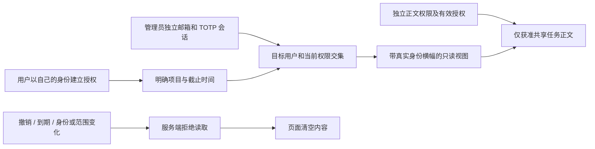
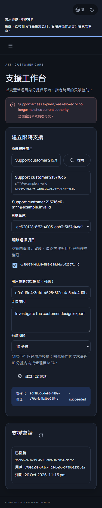

# 限时只读支持与用户授权

本项落实 REQ-095 / TC-095 的限时只读支持子流程，保留全部原始需求、完整 TC、NFR 和 G01–G10。当前已有真实 PostgreSQL、HTTP 与页面的局部证据；不据此关闭完整 TC-095 或生产验收。

## 身份与范围

支持视图是 Admin 内的独立只读页面。管理员继续使用自己的邮箱/TOTP 会话；不切换到用户身份，不生成或读取用户 Cookie、访问/刷新令牌。每次请求显示并核对真实管理员、目标用户、企业、明确项目范围和服务端截止时间。

支持会话绑定发起管理员的实际会话、目标用户身份和成员版本、执行模式，以及创建时明确列出的项目 ID。空项目列表仅表示企业/用户元数据，不自动覆盖现有或将来项目。范围同时满足当前管理员权限、当前目标用户项目访问和冻结项目集合；暂停、关闭、移除、归属改变、管理员撤权或换会话均不能恢复旧视图。

企业 Owner/Admin 可从账户设置创建有原因、明确项目和截止时间的支持授权，并随时撤销。原 `SupportGrantCreate` / `SupportGrant` 和 Admin 支持会话契约保留原字节。授权只约束支持访问，不授予管理员正文、费用、VIP、下载、写入或凭证权限。正文还要求独立当前 `admin.content.body.read`，且仅在明确获准的共享任务中读取；私人会话正文不因企业支持授权开放。

会话最长一小时，可短于此值；如关联支持授权，截止不能超过授权。权限、授权及真实时钟在每次读取重查。正常客服仍只见元数据；明确指定支持上下文的请求只能到支持只读 GET 路径，不能借该上下文调用其他读取或修改接口。

## 事务与迁移

前向迁移 062 新增支持授权和支持上下文两表，保留既有 `support_sessions` 行及历史结构。规范创建在同一事务写入旧会话记录、范围上下文、AdminOperation、审计和幂等回执；任一失败整体回滚。撤销单向生效，记录保持不可变，过期不能靠修改截止或已保存成功回执续期。

新增表强制 RLS，仅受限控制角色可用；普通应用角色不能直接取得支持授权或上下文。旧的仅企业会话不能进入新的用户视图；旧不带目标/范围的创建入口明确要求改用规范入口。

## 用户与后台页面

用户端账户设置列出当前支持授权，选择实际项目、期限和原因后创建，可复制授权 ID 或撤销。后台 A13 使用实际用户目录和成员项目选择，建立规范会话，显示列表、到期/撤销及操作回执。支持视图的常驻横幅保留只读和真实身份，展示当前获准项目及任务诊断；正文资格单独反馈。

页面需要繁中/英文、浅深主题、375/768/1024/1440px、键盘和放大文字。切换企业/目标、读取失败、超时、撤权和退出清空旧内容，迟到响应不能重新显示；本地倒计时根据服务端时间作提前清空，服务端保持最终权限判断。所有自建浏览器与客户端在验证后关闭。

服务器每次读取重查权限，并在审计后再次检查实际时间。页面约两秒刷新一次授权；隐藏页面时清空支持内容，到期定时器根据服务器时间提前清空。这是界面的刷新间隔，不承诺权限变化瞬间抹除已显示内容。管理员 MFA 须在十分钟内；超过后重新认证，不能靠支持会话的一小时上限绕过 MFA 要求。

Desktop 同步独立 Web renderer 的用户授权表单，并仅放行列表、创建、撤销三类用户接口。管理员支持视图不进入本地用户桥。窗口继续使用无边框、自绘标题栏且无 Electron 默认菜单；Extension 继续由工具栏打开 Chrome 原生 Side Panel。左右位置尊重 Chrome 用户偏好，原生验证在右侧设置下执行，见 [客户端强制规则](30-native-window-and-browser-sidepanel.md)。

## 验证要求

使用真实本机 PostgreSQL、邮箱/TOTP 身份、HTTP 和实际页面；AI、媒体和银行继续按既有授权模拟。覆盖规范请求/响应、同键回执、并发、跨企业/项目/用户、正文双重条件、私有正文拒绝、费用/VIP/写入/令牌拒绝、当前会话与成员版本、真实到期、撤销、审计失败回滚及旧数据库逐行前后核对。实际结果、失败尝试和截图另行绑定源码记录。

## 当前有界证据

- 候选隔离库第二次运行 33/33，含 14 组支持专项、16 组既有费用通知和 3 组迁移检查。第一次 29/31 的原始 TAP、迁移候选与日志仍保留；修复的是测试夹具的 TOTP 重放及历史管理员密钥材料，不把失败改写为通过。
- Web/Admin 实际流程 8/8，绑定 816 份来源和 9 张未编辑截图。四次严格响应检查分别是三个原规范端点响应及从补充视图提取的一份原规范会话 DTO；不计为四个原规范操作，也不混入既有 125 份响应样本。
- 两个原生数据库实际执行 061→062；每库 122 张原公共表的行数和完整行摘要不变，旧 001–061 SQL 及历史可空校验值不变，新增两表在 API 重启前为空。三个保护触发器、两表强制 RLS 和受限角色权限另有核查。原升级脚本字节快照保留，后续只格式化的脚本通过本机 formatter 比对。
- 接口原子性、不可变范围、单向撤销、并发同键、真实截止、当前管理员及目标版本、项目显式拒绝、私人正文拒绝、失败关闭和无新增用户登录有实际数据库/API 检查。界面独立验证撤销和到期后的清空。完整竞态组合、全页面无障碍、Desktop 支持表单的单独原生旅程及生产安装仍待原始综合验收。

验收原始记录见 [页面回执](../quality/support-ui.json)、[迁移前](../quality/support-migrations-before.json)、[迁移后](../quality/support-migrations.json) 和 [截图来源](../quality/support-screenshot-provenance.json)。[证据核查工具](../tools/verify_support_evidence.py) 校验归档原字节、当前来源、严格原规范、迁移及仓库截图副本；[逐项进度](../quality/requirements-alignment-progress.json) 继续保留全部 102 项验收条件。

本轮既有会话流程复查中，两次均通过 12 项业务检查，但自动化上下文关闭未在十秒内结束，原失败报告和实际脚本均独立归档。验收脚本随后改为点击产品自绘关闭按钮，等待原生 close 事件和所属进程退出；第三次 12/12、正常退出且无需强制清理。这个改动只影响验收关闭方式，不修改产品窗口行为。文档检查另保留一次快照命名空间未识别的失败；验证器现在识别两种明确来源键，并继续核对原规范摘要、定义和引用，支持快照及原 OpenAPI 均未改。
