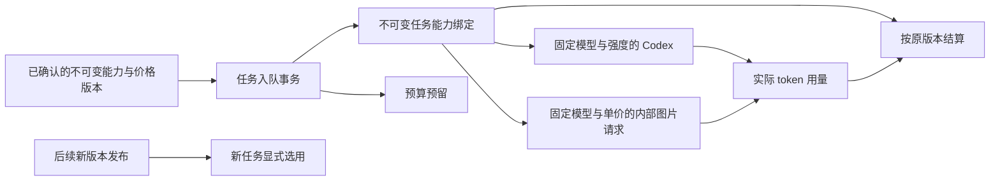

# 能力版本、模型选择与任务费率冻结

状态：阶段 52 正在实现。对应原始 REQ-045、REQ-099 及 TC-045、TC-099；原始验收范围不变，不因本阶段的局部验证而视为完成。

任务冻结基础已接入真实入队、管理员重试、Codex 配置、图片生成/编辑和结算。第五次专项候选 35/35，包括实际锁定 Codex 对受控 Responses 网关的原模型与强度请求、已有任务继续原版本，以及运行内核撤销后阻止工具与成果发布。第四次 28/28 保留其原范围和来源；第五次补入既有七组模板回归，没有减少测试。

原始失败原样保留：候选第一轮的应用账号行锁权限及升级夹具缺少付款账户；第二、三轮的夹具连续创建任务触发原有套餐并发上限；首次全量 434/435 的一项旧断言要求“默认配置变化即取消旧任务”，与冻结版本语义冲突。修正该断言，继续检查新委派不能静默采用能力版本及运行中撤销边界。修复没有放宽套餐或全局配置写权限。

两个原生数据库已完成 062→063，各自 124 张原公共表的全部行摘要、001–062 SQL 字节与历史迁移校验值保持不变。第二次全量平台回归 **435/435**，参与的 **714** 份源码前后一致，失败、取消、跳过、todo 均为 0，测试启动的原生 PostgreSQL 已关闭；未触碰其他本地服务。专项与数据库升级不代替全部原始需求验收。

## 已确认的差异

阶段 51 的 `internal_capability_versions` 已保存不可变能力身份，但普通任务没有独立的能力绑定。Codex 的模型、推理强度及 Worker 的 token／图片结算继续读取进程启动配置。环境配置更新并重启后，排队任务可能使用新模型或新价格；旧能力记录也未包含推理强度。后台还缺少规范的配置验证、发布及回滚流程。

## 实现顺序与不变量

1. 每个新任务与预算预留在同一事务内写入不可变的能力绑定，固定 Codex profile、内部能力版本及其费率。普通任务、会话委派、计划执行、工作流、定时任务和管理员重试均走此约束。重试继承原任务能力；无法继续使用时明确拒绝，不能自动采用当前模型。
2. 能力版本包含实际内部别名、Responses／Images 协议、推理强度、操作和费率。模型别名、推理强度、费率任一改变都产生新身份。密钥和实际网关 URL 不进入任务或客户端 DTO。
3. Worker 从冻结的数据库记录生成 Codex 配置、图片请求及实际结算。启动环境只提供网关位置和服务端凭证。旧价格在结算时继续可读；撤销能力阻止继续执行，但不改写已发生的消费。
4. 数据模式必须一致；模拟网关重启可更换随机端口和凭证，仍明确为模拟。真实网关改变则暂停使用旧绑定，要求显式处理。缺少绑定的历史任务不会补造“当时已确认”的模型与价格。
5. 后续接入后台不可变配置文档、草稿验证、发布和回滚，使用现有目录权限、近期 MFA、持久幂等及审计。发布必须有与具体文档、网关、Codex 和验证范围绑定的真实回执；模拟通过不能声明为真实模型验收。
6. 后续提供规范 `GET /v1/capabilities` 及 Admin release 接口、配置管理页面、用户可见的版本选择与变更提示；不得接受客户端供应商密钥、外部 AI 网关、非 Codex 内核或静默降级。

## 验证要求与边界

- 原生 PostgreSQL 检查迁移、不可变性、租户／私人任务隔离、版本撤销及幂等。
- 用实际入队和 Worker 验证：排队后改变启动配置，新旧任务各用所绑定的模型、强度和费率；管理员重试保持原绑定；未知消费保留预留进入对账。
- 用锁定版本的真实 Codex 对受控 Responses 服务验证实际请求中的模型和推理强度，不能只检查传给模拟 adapter 的对象。
- 图片生成／编辑使用原绑定的模型与价格，生成前及产物写入前重新校验授权；模拟数据与真实数据隔离。
- 保留所有原始失败、TAP 和既有证据，不把历史源码的回执标为当前源码通过。阶段 51 原生形态结果及其包字节保持独立。

当前尚未完成后台 release 管理、逐请求网关授权、用户版本变更交互及上述完整验证；不得以基础绑定实现代替 REQ-045／099 的整体验收。

专项原始回执 `evidence/capability-candidate-05.json`、数据库回执 `evidence/capability-migrations.json` 随 [交付仓库](../../dev/copypaste-delivery/README.md) 保存。执行 `python docs/tools/refresh_stage52_capabilities.py --write` 时核对原始 TAP、失败来源、迁移原字节、全部 424 项原测试的保留及唯一明确的语义改名，再更新完整 102 项跟踪；不会把历史页面回执标为本阶段重新运行。

机器核查摘要见 [阶段 52 能力检查点](../quality/capability-version-checkpoint.json)，完整需求状态见 [102 项逐项进度](../quality/requirements-alignment-progress.json)。本阶段仅将 REQ-045 补充为部分验证，完整通过及真实合格角色仍为 0；REQ-099 的既有部分证据保留并追加本次基础修复。

## 外部协议依据

[Codex 官方配置参考](https://learn.chatgpt.com/docs/config-file/config-reference)说明自定义 provider、Responses 协议和模型推理配置；[官方 reasoning 指南](https://developers.openai.com/api/docs/guides/reasoning)说明推理强度取决于模型支持。项目仍以锁定的本地 Codex 版本和公司内部别名实测为准，不据此替换用户指定的模型或开放未验证能力。
