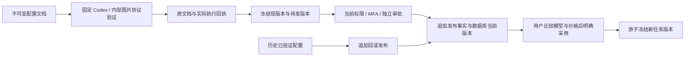

# 受控模型能力配置、验证与版本发布

状态：阶段 53 实现中。继续原始 REQ-045、REQ-093、REQ-099、TC-045/093/099，不缩减全部 102 项需求、NFR 或 G01–G10。阶段 52 的 435/435、原始失败和两库迁移证据保持原字节；本阶段源码变化后的结果另行执行。

当前 [候选核查回执](../quality/controlled-capability-in-progress-20261021.json) 绑定 720 份后台来源，最近一次八文件回归为 58/65、失败 7、取消及跳过 0。夹具清理现在可退出，文字能力验证的即时目录回收仍记录 `EBUSY` 并阻止验证通过；实际协议工具回合及已知费用保留。七次失败的原始 TAP、SQL 和验证器快照均保留，自建测试 PostgreSQL 已全部关闭。当前完整回归及现有两库 064 升级未执行，原始 102 项验收仍无新增整项通过。

## 已核对的差异

现有能力版本和任务绑定已固定模型、强度与费率，但“当前能力”仍来自各进程的启动缓存。后台无法验证新模型、发布或回滚为真实生效的默认版本；用户的“采用目前技能”按钮会同时改变能力却未展示模型和价格差异。原规范目录草稿的六个 kind 也未包含模型能力，不能把模型配置伪装为公告或功能开关。

## 本次实现边界

1. 增加专用能力配置文档及补充接口，保留原始 OpenAPI 及目录发布接口。配置文档只接受已实现的文字 Responses 与 Image 2 生成/编辑，不接受供应商密钥、网关地址、任意内核、任意程序或未实现媒体协议。文档、验证结果与发布事实不可原地改写。
2. 服务端用固定 Codex 和内部网关执行文字工具循环/用量检查；图片分别验证生成和编辑。验证归属于具体文档哈希、模式、网关指纹、运行版本和执行程序字节。请求被接受后结果不明时保留待对账记录，不静默重放。模拟验证不能成为真实模式发布资格。
3. 发布及回滚使用全域目录权限、近期 MFA、持久幂等、冻结比较、审计与独立审批；回滚新增发布事实指向历史已验证配置，不改历史记录，不恢复撤销版本。
4. 任务、专家模板和显式版本采用均从数据库读取当前已发布版本；多 Worker 不依赖进程缓存刷新。旧任务继续其冻结绑定及原价，旧专家/会话须明确采用新版本。用户确认展示模型、推理强度和费率前后差异，并检查预览后版本未变化。
5. 实现原规范 `GET /v1/capabilities`，另用补充 DTO 提供价格/发布/验证信息；原规范 Capability 不增加未声明字段。未实现、未验证、被撤销和模式不匹配的能力不可显示为已就绪。

验收需覆盖真实身份、租户/项目读取、全域与显式 deny、验证失败/中断/重复、原子发布和审计回滚、旧任务原价、当前头部并发变化、撤销不复活、实际后台与用户确认页面。实现或局部测试存在不代表上述完整验收已完成。

## 后台服务接口与权限

本阶段后端使用专用 `/v1/admin/capability-releases`，不改变原目录草稿的六种 `kind`。所有端点使用真实 Admin 会话；全域授权和任一重叠显式 deny 在服务端判定，项目范围的目录权限不能发布全局模型。

| 接口 | 作用 | 必需权限 |
| --- | --- | --- |
| `GET /v1/admin/capability-releases`、`GET /:id` | 分页读取不可变配置及最近验证状态 | `admin.catalog.read` |
| `POST /v1/admin/capability-releases/drafts` | 建立新文档版本，返回规范 `202 AdminOperation` | `admin.catalog.draft`、近期 MFA |
| `POST /:id/validations` | 使用固定 Codex 和内部网关执行验证，返回持久验证回执 | `admin.catalog.publish`、近期 MFA |
| `GET /v1/admin/capability-releases/validations/:validation` | 读取已保存的验证状态及实际费用 | `admin.catalog.read` |
| `POST /:id/publications-previews`、`POST /:id/publications` | 冻结当前版本后申请独立审批发布 | `admin.catalog.publish`、近期 MFA |
| `POST /:id/rollbacks-previews`、`POST /:id/rollbacks` | 对历史已发布、仍有效的版本追加回滚事实 | `admin.catalog.rollback`、近期 MFA |

表中 `/:id` 简写均相对于 `/v1/admin/capability-releases`。原共享审批目录和决定接口负责第二位管理员审批；审批时再次复查请求人及审批人的当前身份、权限、MFA、会话和前态。预览与审批窗口为五分钟，发布头部已变化时返回冲突，不自动按新版本重新解释旧确认。

配置只允许 `kernel: codex`、`gateway_policy: company_internal_only`、内部模型别名和明确费率；文字 profile 额外指定推理强度，图片 profile 的强度必须为 `null`。不允许在此输入 API key、URL、任意命令或可替换的内核。图片固定验证 1024×1024、高质量 PNG 的生成和编辑；文字验证实际工具往返、非空结果及已知用量。模拟与真实服务模式分别保存验证及发布头部，模拟回执不具备真实模式资格。

验证先原子保存 `running` 与执行随机标识，再在数据库事务外调用模型。幂等重放返回同一回执；四分钟执行租约到期后转为 `reconciling`，不重复扣费调用。成功资格有效二十四小时；后续失败或过期不能回退到较早的成功回执。已接受但结果未知的调用保留对账状态。实际完成事件即使遇到权限撤销也保留费用，不产生可发布能力。

原规范 `GET /v1/capabilities` 保持严格 `CapabilityList`。另设 `GET /v1/capabilities/details` 提供白名单模型、费率及发布信息；签名游标绑定当前用户、身份版本、企业、项目、分页范围和当前发布头部。未实现的视频/声音不会显示为可用。

## 数据与旧任务约束

候选前向迁移 064 新增配置文档、验证回执、验证完成事件、发布事实和当前头部五张控制表，全部开启并强制 RLS。普通应用账号不能直接读写控制表，只通过限定的只读视图读取已发布能力。旧 SQL 001–063 不变；升级不得把当前测试结果补写成历史验证或历史发布。

新委派从数据库读取当前发布头部，与入队和预算预留在同一事务内冻结版本。旧任务、其暂停恢复及明确重试沿用原绑定，即使新默认版本被撤销也不能因此丢弃仍有效的旧绑定；旧绑定本身被撤销、网关或 Codex profile 不匹配时继续阻止执行。发布和回滚均追加事实，不能复活已撤销能力或重算历史费用。

Windows 下验证目录的清理与协议检查分别记录。只清理本次创建且通过父目录及 UUID 检查的目录；每轮清理不启用深层递归重试，整轮按有限次数退让。最终清理失败仍阻止验证通过，并保留实际用量及清理错误代码；原有失败回执和被自动审批拒绝删除的历史测试目录继续保留，不通过其他工具绕过删除限制。

## 尚未交付的本阶段内容

Admin 配置编辑、验证结果、发布/回滚页面及实际页面截图仍待实现。用户采用新版本时的模型、推理强度、价格前后比较和基于预览的并发检查也尚未完成，现有采用按钮不能充当该完整验收。补充机器合同、变更后台后的三端业务复查、内部网关逐请求限制，以及原始 TC/NFR/G01–G10 继续保留。阶段 52 的 435 项回归仅对应其原源码；本阶段专项与完整回归完成前不得将其写为当前通过。
