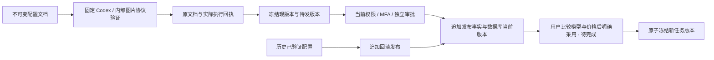

# 受控模型能力配置、验证与版本发布

**阶段 81 当前增量：** 后台视频模型不可变配置、16 案例异步验证、原作业恢复、费用核对、独立审批、发布及回滚已在明确假服务和真实 MP4 下验证。平台 929 项（原 912 项保留）、兼容 106、契约 7、真实后台页面 7 项分别通过；新增 SQL098，SQL001–097 与两份原 OpenAPI 保持。Desktop 本机 Codex、无边框、隐藏纵横滚动条并保留滚动／键盘／真实进度；原生侧栏仍是云端 Agent。102 REQ/102 TC 保持 83 部分／19 未证明／0 完整验收，G01–G10 保留。见[当前方案及证据](81-managed-video-capability-releases.md)。

状态：阶段 53 后台配置、验证、独立审批发布与回滚已完成有界实测；后续用户采用已在 [阶段 54](54-explicit-agent-version-adoption.md) 实现，并通过独立专项、网页与原生流程，完整综合验收继续跟踪。继续原始 REQ-045、REQ-093、REQ-099、TC-045/093/099，不缩减全部 102 项需求、NFR 或 G01–G10。阶段 52 的 435/435、原始失败和两库迁移证据保持原字节；本阶段源码变化后的结果另行执行。

历史 [候选核查回执](../quality/controlled-capability-in-progress-20261021.json) 保留候选 07 的 58/65 和七次失败的原始 TAP、SQL 及验证器快照。加入持久暂存清理任务后，候选 08、09 分别通过 67/67；完整回归 01 的 456/458 与两个夹具收尾失败保持原样，改进后的完整回归 02 通过 458/458 并实际回收四个延期夹具。PNG 完整性修复后的候选 10 通过 70/70，但完整回归 03 为 460/461：新增恶意图片测试有一次网关请求计数为零，不算通过。全部源码、原始 TAP、SQL 和收尾回执分别保留，自建 PostgreSQL 已关闭。

本机实际 TCP 动态端口范围为 1024–15000，与 [Fetch 禁止端口](https://fetch.spec.whatwg.org/#port-blocking) 重叠；已新增真实监听、拒绝发送和重新分配后的可用 HTTP 请求验证。旧失败未记录当时分配的端口，不能据此捏造具体端口。修复共用的本地 HTTP 端口分配后，当前候选 11 通过 71/71，726 份来源前后一致，未降低原始调用次数、幂等或费用断言。补充合同 02 通过 6 项；后台浏览器 06 通过 11 项、保留 14 张未编辑截图，绑定当前三个仓库源码及实际生产构建。浏览器 01/03/04 的环境或脚本失败与 02/05 的原先通过记录均保留。

当前完整回归 04 通过 **462/462**，726 份来源前后一致，失败、取消、跳过均为零；全部原 435 项测试保留，71 项专项与全量重叠，不累加。父级收尾在工作进程退出后实际回收两个延期夹具。本机两库 063→064 升级及迁移前后比较通过，各保留 125 张原公共表的完整行摘要及旧 SQL 校验值。全部本轮自建数据库、浏览器与服务已关闭。原始 102 项验收无新增整项通过。

原始 TAP、源码/SQL/验证器快照、浏览器回执和两库比较由[独立交付仓库 README](../../dev/copypaste-delivery/README.md)链接到具体证据文件；本目录继续保存主设计与质量摘要。

## 已核对的差异

本阶段修复前，能力版本和任务绑定已固定模型、强度与费率，但“当前能力”仍来自各进程的启动缓存，后台缺少验证、发布和回滚实际默认版本的完整流程。当前受控后台及数据库头部已补齐。该阶段当时用户的“采用目前技能”按钮仍会同时改变能力而未展示模型和价格差异；这一修复前缺陷的后续实现见阶段 54。原规范目录草稿的六个 kind 未包含模型能力，专用能力接口不把模型配置伪装为公告或功能开关。

## 本次实现边界

1. 增加专用能力配置文档及补充接口，保留原始 OpenAPI 及目录发布接口。配置文档只接受已实现的文字 Responses 与 Image 2 生成/编辑，不接受供应商密钥、网关地址、任意内核、任意程序或未实现媒体协议。文档、验证结果与发布事实不可原地改写。
2. 服务端用固定 Codex 和内部网关执行文字工具循环/用量检查；图片分别验证生成和编辑。验证归属于具体文档哈希、模式、网关指纹、运行版本和执行程序字节。请求被接受后结果不明时保留待对账记录，不静默重放。模拟验证不能成为真实模式发布资格。
3. 发布及回滚使用全域目录权限、近期 MFA、持久幂等、冻结比较、审计与独立审批；回滚新增发布事实指向历史已验证配置，不改历史记录，不恢复撤销版本。
4. 任务、专家模板和显式版本采用均从数据库读取当前已发布版本；多 Worker 不依赖进程缓存刷新。旧任务继续其冻结绑定及原价，旧专家/会话须明确采用新版本。用户确认展示模型、推理强度和费率前后差异，并检查预览后版本未变化。
5. 实现原规范 `GET /v1/capabilities`，另用补充 DTO 提供价格/发布/验证信息；原规范 Capability 不增加未声明字段。未实现、未验证、被撤销和模式不匹配的能力不可显示为已就绪。

验收需覆盖真实身份、租户/项目读取、全域与显式 deny、验证失败/中断/重复、原子发布和审计回滚、旧任务原价、当前头部并发变化、撤销不复活、实际后台与用户确认页面。实现或局部测试存在不代表上述完整验收已完成。

## 后台服务接口与权限

本阶段后端使用专用 `/v1/admin/capability-releases`，不改变原目录草稿的六种 `kind`。所有端点使用真实 Admin 会话；全域授权和任一重叠显式 deny 在服务端判定，项目范围的目录权限不能发布全局模型。

| 接口 | 作用 | 必需权限 |
| --- | --- | --- |
| `GET /v1/admin/capability-releases`、`GET /:id` | 分页读取不可变配置及最近验证状态 | `admin.catalog.read` |
| `POST /v1/admin/capability-releases/drafts` | 建立新文档版本，返回规范 `202 AdminOperation` | `admin.catalog.draft`、近期 MFA |
| `POST /:id/validations` | 使用固定 Codex 和内部网关执行验证，返回持久验证回执 | `admin.catalog.publish`、近期 MFA |
| `GET /v1/admin/capability-releases/validations/:validation` | 读取已保存的验证状态及实际费用 | `admin.catalog.read` |
| `POST /v1/admin/capability-releases/validations/:validation/workspace-purge-retries` | 对已耗尽自动重试的暂存清理任务重新排程；不再调用模型 | `admin.catalog.publish`、近期 MFA |
| `POST /:id/publications-previews`、`POST /:id/publications` | 冻结当前版本后申请独立审批发布 | `admin.catalog.publish`、近期 MFA |
| `POST /:id/rollbacks-previews`、`POST /:id/rollbacks` | 对历史已发布、仍有效的版本追加回滚事实 | `admin.catalog.rollback`、近期 MFA |

表中 `/:id` 简写均相对于 `/v1/admin/capability-releases`。原共享审批目录和决定接口负责第二位管理员审批；审批时再次复查请求人及审批人的当前身份、权限、MFA、会话和前态。预览与审批窗口为五分钟，发布头部已变化时返回冲突，不自动按新版本重新解释旧确认。

配置只允许 `kernel: codex`、`gateway_policy: company_internal_only`、内部模型别名和明确费率；文字 profile 额外指定推理强度，图片 profile 的强度必须为 `null`。不允许在此输入 API key、URL、任意命令或可替换的内核。图片固定验证 1024×1024、高质量 PNG 的生成和编辑；文字验证实际工具往返、非空结果及已知用量。模拟与真实服务模式分别保存验证及发布头部，模拟回执不具备真实模式资格。

图片验证要求恰好一张规范 Base64 内联图片，完整检查 PNG 块边界、CRC、静态单图、唯一头部、连续图像数据和终结块。解码前依据位深、颜色类型和 Adam7 扫描几何计算准确解压上限，再使用 Node 有界解压及固定版本 pngjs 完整像素解码；检查实际扫描线长度、压缩流耗尽和最终 RGBA 像素数量。支持合法灰阶、调色板、16 位及隔行图片，拒绝伪造文件头、截断、错误 CRC、非法过滤器、超量解压及尾随数据。实现依据 [W3C PNG 规范](https://www.w3.org/TR/png-3/)、[Node zlib](https://nodejs.org/api/zlib.html) 和 [pngjs 官方源码](https://github.com/pngjs/pngjs)。

已接受的图像响应即使损坏也不记作免费失败：资格为空并保留 `reconciling`，同一幂等请求不重发。若生成已验证成功而编辑损坏，保留已知的单次生成价格，编辑费用仍待核对；不把已知小计显示为最终费用。此处仅补齐能力发布的验证路径，不能将其视作所有上传及媒体交付路径的完整验收。

验证先原子保存 `running` 与执行随机标识，再在数据库事务外调用模型。幂等重放返回同一回执；四分钟执行租约到期后转为 `reconciling`，不重复扣费调用。成功资格有效二十四小时；后续失败或过期不能回退到较早的成功回执。已接受但结果未知的调用保留对账状态。实际完成事件即使遇到权限撤销也保留费用，不产生可发布能力。

原规范 `GET /v1/capabilities` 保持严格 `CapabilityList`。另设 `GET /v1/capabilities/details` 提供白名单模型、费率及发布信息；签名游标绑定当前用户、身份版本、企业、项目、分页范围和当前发布头部。未实现的视频/声音不会显示为可用。

## 数据与旧任务约束

前向迁移 064 新增配置文档、验证回执、验证完成事件、发布事实、当前头部和暂存清理任务六张控制表，全部开启并强制 RLS。普通应用账号不能直接读写控制表，只通过限定的只读视图读取已发布能力。旧 SQL 001–063 不变；升级不得把当前测试结果补写成历史验证或历史发布。

064 已应用到 `copypaste` 与 `copypaste_test`，自此与 001–063 一同保持原字节，不再编辑已应用 SQL；后续变化使用新迁移。升级后六张新控制表没有新增历史记录，RLS 与应用账号无直接权限逐项核对。该本机升级不代表生产部署。

新委派从数据库读取当前发布头部，与入队和预算预留在同一事务内冻结版本。旧任务、其暂停恢复及明确重试沿用原绑定，即使新默认版本被撤销也不能因此丢弃仍有效的旧绑定；旧绑定本身被撤销、网关或 Codex profile 不匹配时继续阻止执行。发布和回滚均追加事实，不能复活已撤销能力或重算历史费用。

Windows 下的临时文件占用通过独立的持久任务处理，与原有运行缓存清理队列保持同样的职责边界。验证结束后先实际尝试回收本次 UUID 目录；若尚有占用，在保存实际协议结果、用量、费用和完成事件的同一事务中排入清理任务。协议是否通过仍取决于固定 Codex、工具往返、输出及已知用量；清理失败不会改写或丢弃这些已发生的事实，也不能被显示为“已清理”。这是对先前候选把即时清理作为模型资格条件的修正，原有失败回执保持原字节。

维护进程只按配置的数据目录加固定子目录和验证 UUID 推导目标，不接受任意路径，不跟随目录链接。每次锁定任务只做一轮实际文件操作，失败按数据库时钟退让，最多八次。实际删除成功才标记 `completed`；耗尽次数后为 `failed`，管理员须提供当前任务版本、原因、持久幂等键及近期 MFA 才能重新排程。该操作记录审计，不调用模型、不新增费用、不修改验证回执。专项测试覆盖占用、退让、实际删除、次数耗尽、越权、陈旧版本、幂等重放和未通过验证不可发布。被自动审批拒绝删除的历史测试目录继续保留，不通过其他工具绕过限制。

测试夹具另外使用父级启动器收尾：测试仍先关闭应用并删除自己的隔离数据库；仅 Windows 的有限目录占用错误可写入本轮随机令牌绑定的回收记录。父级等所有测试进程退出后，逐项验证 UUID、目录、令牌及原进程已退出，实际删除并确认目录不存在。实际回收失败、记录被替换或工作进程仍活着均使启动器及整轮报告失败，不能把单纯 TAP 通过当作完整成功。新机制只处理本轮新夹具，不扫描或重试历史保留目录。两组真实子进程测试覆盖“进程未退出不可删除”及“路径不匹配必须保留”。

补充机器合同为 [capability-releases.openapi.json](../contracts/capability-releases.openapi.json)，生成器固定验证原始 OpenAPI 摘要并保持其原字节。其 11 个补充操作分别声明真实 Admin 会话、全域权限、近期 MFA、持久幂等、预览标识及精确 DTO；原规范三个 DTO 保留原定义。

## 已验证的后台页面

入口为“角色与内容发布 → 模型能力”。文字与图片使用明确的配置字段，港币最多六位小数直接转换为整数微元；不经浮点金额往返。保存后进入不可变版本详情，实际验证显示用量、已知费用、期限、协议检查和独立暂存清理任务。结果不明时保留待对账状态，不将已知小计标作最终费用。

发布和回滚分别先获取冻结比较；编辑原因会使已取得的比较失效。比较展示当前与目标的模型、推理强度和费率，确认后申请独立审批，待审批不标作已发布；共享审批页同样使用明确的前后比较，并拒绝申请人自批。只读身份没有写操作入口，服务端仍拒绝强制写请求；读取权限被撤销后，轮询失败清空此前加载的配置。

真实浏览器 06 使用独立的邮箱/TOTP 会话、原生 PostgreSQL 隔离库、实际固定 Codex 和获准模拟 AI/媒体，覆盖发布、更新、回滚、图片生成/编辑、单微元价格、修改原因后重新预览、只读、即时撤权、原规范及补充响应 DTO、繁中/英文、浅深主题和 390px 导航。响应与截图均绑定本次源码及生产构建摘要，记录真实 Chrome 版本与程序摘要；字体、内容加载与动画结束后截图，不编辑图片。全部自建浏览器上下文、页面和服务均已关闭。

当前实际截图随独立 Admin 仓库交付：`dev/copypaste-admin/assets/screenshots/capabilities-06-*.png`，中英 README 包含概览、深色、窄屏和发布比较入口。后台验收不代替用户端采用新版本的确认流程。

## 尚未交付的本阶段内容

用户采用新版本时的模型、推理强度、价格前后比较和基于预览的并发检查尚未完成，现有采用按钮不能充当该完整验收。变更后台后的三端业务复查、内部网关逐请求限制，以及原始 TC/NFR/G01–G10 继续保留。阶段 52 的 435 项回归仅对应其原源码；本阶段的 462 项结果绑定自己的完整来源，不将历史客户端业务记录写为变更后台后的重新执行。
