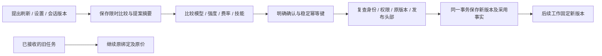
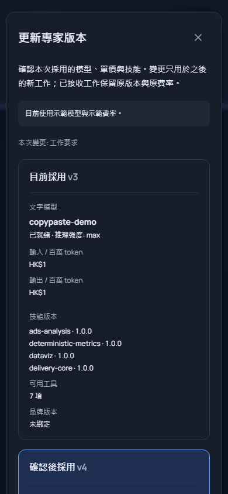

# 用户明确采用专家、模型与费率版本

状态：当前 729 份平台来源的完整回归 02 通过 484/484，专项 06 通过 93/93；实际构建版 Web 06 通过 12/12，新版打包无边框 Desktop 与原生 Side Panel 05 通过 11/11。两库 064→065 前向升级各保留 131 张原公共表的完整行摘要与 SQL001–064 字节和校验值，全部本轮自建浏览器、应用和服务已关闭。阶段 53 及本轮初始失败证据保持原字节；完整 102 项需求、TC/NFR/G01–G10 继续逐项跟踪，本阶段不宣称整项综合验收完成。

## 已核对的实际差异

| 现有入口 | 已确认的问题 | 必须达到的行为 |
| --- | --- | --- |
| 默认助手“采用目前技能版本” | 一次点击即刷新能力和费率，用户未比较模型、强度与价格 | 先比较，再明确确认；只有项目管理人可刷新共享默认助手 |
| 专家设置“保存” | 保存普通设置会重新读取当前模型、费率及安装，可能同时采用后台新发布配置 | 展示并冻结本次完整变更；旧写入口不得静默采用不同能力或安装 |
| 会话“后续工作使用专家新版” | 勾选即切换，没有模型、强度及费率比较 | 仅本人会话、明确目标版本和比较；会话名称与采用可原子保存 |

对应 REQ-045、062、064、079、099 的子流程。旧任务的固定模型、费率、已知费用和待对账事实不因采用而改写。原规范 Agent/Conversation CRUD 等其他未完整实现的接口继续单独验收，不能由此补充流程替代。

## 确认协议

服务端保存五分钟有效的预览，绑定用户、实际浏览器/原生会话、身份版本、企业、项目、资源及版本、原配置摘要、提案摘要、当前发布事实、运行内核和技能安装状态。预览不执行模型、不预留费用、不创建专家版本或安装技能。未保存历史能力的旧记录标为未知，不用今天的价格填充旧价。

补充接口与原始 OpenAPI 分开维护：

| 接口（项目路径下） | 输入及作用 |
| --- | --- |
| `POST /agents/:id/version-previews` | 预览默认助手刷新，或具体专家设置提案 |
| `POST /conversations/:id/adoption-previews` | 预览本人会话采用明确的当前专家版本 |
| `GET /version-adoption-previews/:id` | 复查当前权限、预览期限和配置状态；不得返回其他用户或会话的预览 |
| `POST /version-adoption-previews/:id/confirmations` | 对同一提案与比较摘要明确确认，使用持久幂等键 |

完整项目路径为 `/v1/tenants/:tenant/projects/:project`。提案的名称与工作要求只在客户端内存及实际保存的业务版本中存在；预览表保存提案摘要和必要的能力比较，不保存另一份私人正文。确认必须重新提交相同提案，服务端核对摘要，不按确认时的最新配置重新解释旧比较。

确认时锁定资源、当前发布读视图对应的共享发布锁、相关 Codex/能力/技能版本和当前用户会话；复查权限及安装状态。发布后回滚到相同能力也产生新的发布事实，旧比较仍须失效。审计、版本、技能绑定、预览消耗和幂等回执在同一事务提交，任一步失败整体回滚。同一确认重复请求不再创建版本；不同内容复用幂等键拒绝。

旧的默认刷新及会话直接采用入口拒绝绕过比较。旧专家 PATCH 只允许未改变运行、模型、费率和安装绑定的普通设置修改；需要采用新绑定时要求走预览确认。撤销的配置或技能不能借采用恢复。

## 页面与三端

沿用现有 CopyPaste 蓝色、墨色、留白、Manrope/Fraunces、繁中/英文及浅深主题。比较用有标题的前后列和明确计费单位；费用以整数微港币转换显示，最多六位小数，不用浮点金额往返。未知旧价、未就绪能力、每百万 token 与每张图片分别标明。

提交期间防止重复点击，网络重试复用同一幂等键。编辑提案后原比较失效；过期、权限撤销或配置变化清除可确认的旧比较，提供重新比较或返回编辑。确认成功更新实际版本并明确反馈。Web renderer 显式同步到无边框 Desktop 的独立快照；Extension 保留独立精简侧栏渲染器，新增双语模型/费率入口，只打开公司固定的 `/app/specialists` 工作区进行完整比较。原生侧栏仍由工具栏按钮打开，默认在右侧、再次点击收起，不使用 popup。三端分别构建并实际验证；保留旧预览包原字节，不用历史窗口/业务记录证明新流程。

## 必须验证

- 三条正常流程、精确微元和未知历史价格；预览没有模型、账本、安装或专家版本副作用。
- 两用户、跨企业/项目、只读、默认助手管理权限、会话所有权、不同登录会话、会话撤销及身份变更。
- 原资源、模型/强度/费率、发布后回滚、技能启停/卸载/重装、品牌和运行配置变化，及五分钟过期。
- 幂等重放、输入冲突、并发确认、同时编辑、审计失败原子回滚；旧任务、重试、费用和未知结果保持原事实。
- 严格补充 DTO 与原规范不变；实际 Web、打包 Desktop 和真实 SIDE_PANEL，双语、主题、窄屏、键盘及浏览器关闭。

前向迁移从 065 开始。已应用的 001–064 不修改；两库升级前必须取得对应当前源码的专项、完整回归和旧表比较证据。

## 当前原生交付及证据范围

新版客户端位于各仓库的 `release/adoption-54/`：Windows x64 Setup、Portable、解包程序及 Chrome Side Panel ZIP。使用 localhost 默认服务地址，未签名、未安装到系统或上架；实际运行了解包程序与原生侧栏。先前 `release/frameless/` 和 `release/sidepanel/` 不覆盖，仍对应原历史证据。详细字节见 [当前产物清单](../quality/agent-adoption-artifacts-02.json)。

实际网页 06 与原生 05 的十张截图逐字节复制到主文档，见 [截图来源](../quality/agent-adoption-screenshots-01.json)。原生测试使用本机 Chromium 156；正式 Chrome 155 的网页测试单独执行。初始原生脚本中的语言初始化、未加载扩展及侧栏文档尚未就绪的失败保留原报告，不修改产品行为来迎合脚本。

打包校验首轮使用 POSIX 路径查询 Windows ASAR 时失败；原归档中实际存在同一构建文件，改为 Windows 路径后 31 份嵌入文件逐字节匹配。此独立包装验证器未被网页/原生脚本导入，其前后版本分别绑定原失败与当前产物回执；产品运行字节未改变。完整模型、价格、权限与版本逻辑仍由实际业务回归核查。

## 回归首轮发现与复查

完整首轮保留 484 项、原失败 TAP 与实际执行的测试文件。技能卸载重装测试的旧流程仍直接 PATCH 采用安装，现明确断言该入口返回 `ADOPTION_PREVIEW_REQUIRED`，再通过预览、确认及原有旧任务断言验证重装。Codex 会话测试的原断言和时间限制保持，增加数值、状态及事件种类诊断；独立诊断执行 2/2 通过，随后当前源码完整回归 02 的 484/484 全部通过。首轮会话断言失败未复现，未放宽原断言或增加自动重试；原始失败原因仍不能由后续通过倒推。诊断启动器首次语法错误发生于测试执行前，单独记录；修正后使用新编号，原失败不覆盖。

上述两份测试文件未被 Web 或原生旅程导入。旅程保留执行当时完整源码清单，精确对应首轮保存的测试字节；当前测试字节另由完整回归 02 绑定。产品运行、页面、打包程序和浏览器旅程验证脚本必须保持原校验值。
