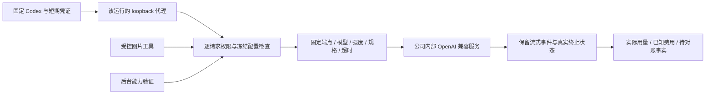

# 内部 AI 请求的短期凭证与逐次鉴权

状态：本分册限定的请求约束修复已验证，专项 03 为 **112/112**，最终全量 02 为 **531/531**，733 份平台来源在执行前后不变。上一轮阶段 54 的 484/484 平台回归、12/12 Web 和 11/11 原生客户端证据保留原始来源范围，不作为本轮修改后的界面运行证明。原始 102 项要求、TC/NFR/G01–G10 及未完成条件完整保留。

## 从当前源码确认的差异

1. Codex provider 虽固定公司地址，但子进程环境直接获得公司网关主密钥，未达到短期、限定用途凭证要求。
2. 任务启动、工具和三秒心跳有权限复查，同一 turn 内的下一次 Responses 请求没有独立复查。撤销后至下一次心跳之间仍可能产生请求。
3. 图片调用和后台能力验证各自直接 fetch，未共用请求范围、可信归属、超时与协议校验。图片编辑未显式发送冻结规格中的 high quality。
4. 整任务容量不能代替供应商逐调用并发和速率限制；任务预算预留与最终结算不能代替每次调用的预算分配。这两项必须继续独立实现和验收，不能由本分册的请求授权测试宣称完成。

## 本轮必须实现的行为

- 每次 Codex 运行创建只监听 IPv4 loopback 的代理及内存随机凭证，凭证限定该运行、模型、推理强度、已注册工具和 Responses 路径；终止及超时撤销，子进程不获得公司主密钥。
- 每次请求在转发之前复查原用户、企业、项目、任务状态、fencing、方案、Skill、输入依赖、冻结能力与预算预留是否仍有效。后台验证每次请求复查实际管理员会话、权限、MFA、验证对象和时限。
- 所有已实现 AI 出站路径使用同一固定端点构建及白名单检查；转发只使用服务端重建的租户、任务、操作和能力归属，不透传客户端的凭证、计费头或任意地址。
- 服务端拒绝模型、推理强度、未注册工具、异步后台模式和规格覆盖；保留合法的流式事件及上游终止/错误，不静默替换用户配置。
- 限制请求与响应字节、每个运行的请求次数和同时在途数；整体、单请求和流空闲超时分别执行。流中断或结果不明不自动重放。
- 图片生成和编辑均按冻结的单张、1024×1024、high、PNG 规格；输出仍须通过实际图片校验，鉴权失败与上游结果不明分开处理。
- 真实锁定 Codex、多轮撤销、跨运行凭证、错误端点、伪造归属、流中断、超时、图片及后台验证都需要运行证据；现有测试不得减少或放宽。

## 后续完整验收仍须保留

供应商跨 Worker 的原子速率及在途限额、每次付费调用的持久预算分配和用量事实、未知在途的容量占用、完整 Admin 策略管理、原始业务接口与角色资格、生产出口约束及完整 NFR 负载，都属于原目标，不能用每运行的内存计数替代。模型和媒体依赖按用户授权继续使用假数据；数据库、身份、权限及 Codex 使用实际实现。

## 本轮实现边界

`internal-ai-gateway.ts` 是已实现文本、图片工具及后台能力验证的共同出站入口。公司主密钥只用于服务端重建的请求；Codex 子进程仅获得本次运行的随机凭证和 loopback 地址。运行绑定模型、强度、已注册工具、有效期、任务归属和请求次数，默认只允许一个在途请求；这些内存范围限制不替代供应商的跨 Worker 持久限额。

Worker 每次转发前以原用户执行数据库事务，检查当前身份版本、企业与项目写权限、角色、冻结 Skill、输入与报告依赖、方案、能力、工作上下文、任务状态、租约、fencing 和原预算预留。仅鉴权通过才记录 `gateway.request_authorized`；该事件表示授权事实，不表示供应商已接收或已计费。后台验证逐次检查实际管理员会话、当前范围权限、MFA、验证 nonce、租约、原定义摘要及当前 Codex 运行配置。

锁定的 Codex 默认声明了本产品未开放的目标、看图和提问工具。运行配置关闭不需要的内核功能及环境访问；其仍固定声明的 `request_user_input` 从公司请求中移除。其他未注册声明一律拒绝。响应中的函数调用名称、调用参数事件及输出项目在完整 SSE 帧到达后、转交 Codex 之前校验，禁止模型响应重新启用这些工具。合法完整帧保持原始 UTF-8 字节与换行；不完整、畸形及超限帧拒绝，不能把仅检查请求声明当作完整工具控制。

首次帧验证前不发送响应头，以便返回明确的协议错误。已经发出部分响应后的中断关闭连接，并使该运行凭证失效；没有自动重放。失败后的已知用量只有在原生 Codex 计数有效、代理确认所有已转发响应都有完整终止用量、且两者总量相等时才保留。后续请求在本地鉴权被拒绝不会抹掉前一笔已知费用；缺失用量、流中断或原生计数回退继续待对账。

图片拒绝响应及错误协议会主动取消响应体；中止信号也直接清理整体与空闲计时器，不依赖消费者再次读取缓存中的流。测试使用实际子进程自然退出证明资源释放，禁止用 `process.exit()`、仅将计时器 `unref()` 或强制终止来伪造清理成功。

Codex 建立线程后、首次请求发出前取消时，先关闭运行代理并撤销凭证，再判断是否确实零次转发，避免仍在鉴权的请求随后发出。确认没有发出请求后才记录未接收、已知零用量，释放原预算预留。已发出但结果不明的请求继续待对账；该判断不会抹去图片操作单独保存的费用。

图片生成和编辑均使用冻结能力版本的模型和价格，固定单张、1024×1024、high、PNG。实际输出还要满足唯一图片、规范 Base64、PNG 块/CRC、解压与像素规格，不能以 PNG 文件头代替有效图片。已发布并绑定的能力不因环境中的旧验证开关为 false 而被错误禁用；安全撤销仍即时生效。

| 配置 | 默认值 | 用途 |
| --- | --- | --- |
| `AI_MAX_REQUEST_BYTES` | 16,000,000 | 单次序列化请求及单个 SSE 事件的字节上限 |
| `AI_MAX_RESPONSE_BYTES` | 70,000,000 | 单次响应总字节上限 |
| `AI_MAX_OUTPUT_TOKENS` | 16,384 | 推理及可见输出的合计上限，不静默提高上限 |
| `AI_MAX_REQUESTS_PER_TURN` | 64 | 单次 Codex 运行最多转发次数 |
| `AI_REQUEST_TIMEOUT_MS` | 180,000 | 一次供应商调用的整体超时 |
| `AI_STREAM_IDLE_TIMEOUT_MS` | 60,000 | 读取响应流的空闲超时 |
| `AI_SCOPE_TTL_MS` | 900,000 | 运行凭证的最长有效期，终止时提前撤销 |

配置解析设置有限范围；变更应先通过具体公司模型及工作负载验证。全部 SQL 001–065 保持原字节，本轮复用已有任务和验证事件，不回填历史逐次调用记录。

## 首轮集成失败的保留与修正

`inference-request-core-01` 正式首轮为 73/81，八处失败包含嵌套场景及其父测试。执行前后 732 份来源一致，实际夹具回收和自建数据库关闭均通过；原 TAP、验证脚本和修改前源码分别保留，不覆盖为成功报告。

新增夹具错误地关闭未发布图片能力的环境验证开关。既有安全守卫正确拒绝，因此改为另设真实验证、另一位管理员审批发布、再经实际 Worker 生成与编辑的场景。新增连续未知图片还用满隔离库默认的两个图片槽位；测试明确配置八个图片槽位并保留每笔待对账事实，生产策略没有改变。

新增中途租约场景尝试改写不可变验证租约，被数据库正确拒绝；其未捕获夹具异常又干扰后续共享配置。现已移除这个无效构造，保留原有过期验证拒绝测试，夹具回调失败也会明确终止响应，不遗留悬挂请求。没有关闭触发器、反向恢复撤销状态或修改 SQL 来制造通过。后台运行配置撤销使用独立测试版本，撤销事实保持不可逆。

专项 01 随后通过 107/107，但代码复查发现未读错误响应的计时器仍可能拖延退出，因此它保留为此前源码的通过记录，不用于证明后续清理修改。最终回归另用新编号，覆盖上述自然退出测试。

专项 02 的 111/111 与首轮全量的 530/530 属于取消修复前的源码。随后真实 Codex 取消诊断 01 复现零次供应商请求仍被标成已接收、用量未知；原失败 JSON 和当时诊断脚本均保留。诊断 01 未记录执行时源码摘要，因此不追补该项证据。修复后的诊断 02 绑定实际 `runtime.ts` 摘要，确认 `CODEX_CANCELLED`、零次请求、未接收、已知零用量及实际夹具回收。专项 03 已通过 112/112，新增实际用户取消接口、任务状态、零费用和原预留释放的集成验证；最终全量 02 通过 531/531，不覆盖原 530 项报告。

## 当前回执与边界

[来源绑定检查点](../quality/inference-request-checkpoint.json)核对原始 TAP、实际验证脚本、历史源码前像、全部旧 484 项命名测试，以及 SQL001–065 与原 OpenAPI 的原始摘要。专项包含于全量，两者不能相加。平台构建、交付仓库类型检查均通过；专项与全量的实际夹具回收、自建原生数据库关闭均通过。

原始失败 TAP 中的空白行带有工具输出的尾空格，数据库原始日志也有结尾空行，均按原字节保留，不能为了格式检查修改。Git 空白检查覆盖源码、文档、脚本和源码前像，明确排除这些原始 `.tap` 与 `*-database.log` 文件；它们继续通过摘要及配置密钥扫描检查。

本轮没有启动浏览器、Electron 或扩展，没有新增截图或安装验收。既有无边框 Desktop、原生侧栏和 Web 页面回执仍按其时的源码与包字节保留。模型和媒体为用户授权的假数据；本分册没有关闭任何一项原始完整需求，也没有增加实网合格角色。跨 Worker 供应商限额、逐调用预算和上列完整验收余项继续跟踪。

## 协议依据

[OpenAI 官方配置参考](https://learn.chatgpt.com/docs/config-file/config-reference)说明 provider 的 Responses 协议、HTTP 和流重试及传输配置。[官方 reasoning 指南](https://developers.openai.com/api/docs/guides/reasoning)说明 `max_output_tokens` 包括推理和可见输出，达到限制可能没有可见输出并产生费用。本产品据此实施显式输出上限和真实费用状态，不把截断、取消或未知结果当作免费成功；模型仍使用公司已确认的原别名与强度。
